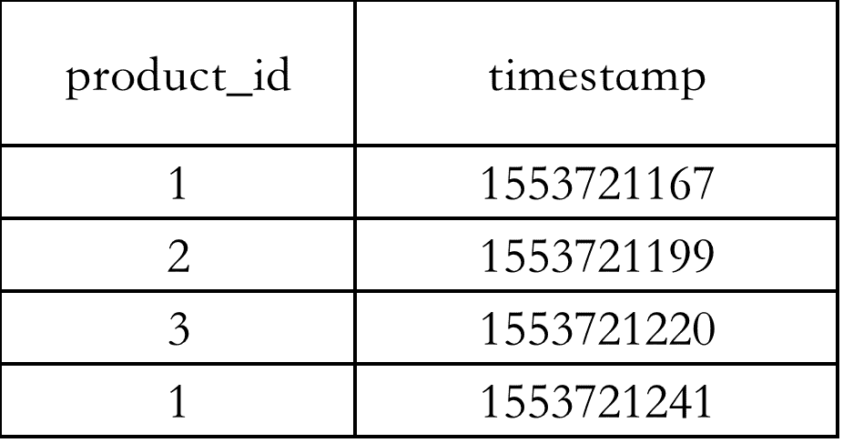
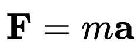
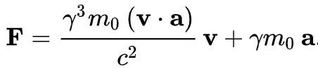
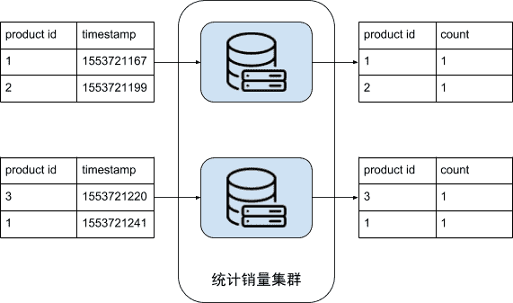
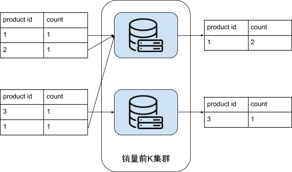
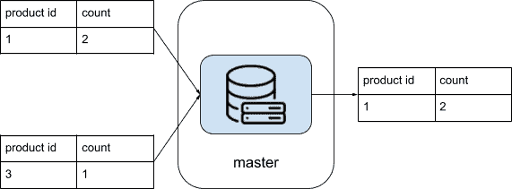

# 03 | 大规模数据处理初体验：怎样实现大型电商热销榜？

 

你好，我是蔡元楠。

今天我要与你分享的主题是“怎样实现大型电商热销榜”。

我在 Google 面试过很多优秀的候选人，应对普通的编程问题 coding 能力很强，算法数据结构也应用得不错。

可是当我追问数据规模变大时该怎么设计系统，他们却说不出所以然来。这说明他们缺乏必备的规模增长的技术思维（mindset of scaling）。这会限制这些候选人的职业成长。

因为产品从 1 万用户到 1 亿用户，技术团队从 10 个人到 1000 个人，你的技术规模和数据规模都会完全不一样。

今天我们就以大型电商热销榜为例，来谈一谈从 1 万用户到 1 亿用户，从 GB 数据到 PB 数据系统，技术思维需要怎样的转型升级？

同样的问题举一反三，可以应用在淘宝热卖，App 排行榜，抖音热门，甚至是胡润百富榜，因为实际上他们背后都应用了相似的大规模数据处理技术。


真正的排序系统非常复杂，仅仅是用来排序的特征（features）就需要多年的迭代设计。

为了便于这一讲的讨论，我们来构想一个简化的玩具问题，来帮助你理解。

假设你的电商网站销售 10 亿件商品，已经跟踪了网站的销售记录：商品 id 和购买时间 {product_id, timestamp}，整个交易记录是 1000 亿行数据，TB 级。作为技术负责人，你会怎样设计一个系统，根据销售记录统计去年销量前 10 的商品呢？

举个例子，假设我们的数据是：



我们可以把热销榜按 product_id 排名为：1, 2, 3。

## 小规模的经典算法

如果上过极客时间的《数据结构与算法之美》，你可能一眼就看出来，这个问题的解法分为两步：

第一步，统计每个商品的销量。你可以用哈希表（hashtable）数据结构来解决，是一个 O(n) 的算法，这里 n 是 1000 亿。

第二步，找出销量前十，可以用经典的 Top K 算法，也是 O(n) 的算法。

如果你考虑到了这些，先恭喜你答对了。

在小规模系统中，我们确实完全可以用经典的算法简洁漂亮地解决。以 Python 编程的话可能是类似这样的：

```
def CountSales(sale_records):  """Calculate number of sales for each product id.      Args:    sales_records: list of SaleRecord, SaleRecord is a named tuple,           e.g. {product_id: “1”, timestamp: 1553721167}.  Returns:    dict of {product_id: num_of_sales}. E.g. {“1”: 1, “2”: 1}  """  sales_count = {}  for record in sale_records:    sales_count[record[product_id]] += 1    return sales_count def TopSellingItems(sale_records, k=10):    """Calculate the best selling k products.      Args:    sales_records: list of SaleRecord, SaleRecord is a named tuple,         e.g. {product_id: “1”, timestamp: 1553721167}.    K: num of top products you want to output.  Returns:    List of k product_id, sorted by num of sales.  """  sales_count = CountSales(sale_records)  return heapq.nlargest(k, sales_count, key=sales_count.get)
```

但在一切系统中，随着尺度的变大，很多方法就不再适用。

比如，在小尺度经典物理学中适用的牛顿力学公式是这样的：



这在高速强力的物理系统中就不再适用，在狭义相对论中有另外的表达。



在社会系统中也是一样，管理 10 人团队，和治理 14 亿人口的国家，复杂度也不可同日而语。

具体在我们这个问题中，同样的 Top K 算法当数据规模变大会遇到哪些问题呢？

第一，内存占用。

对于 TB 级的交易记录数据，很难找到单台计算机容纳那么大的哈希表了。你可能想到，那我不要用哈希表去统计商品销售量了，我把销量计数放在磁盘里完成好了。

比如，就用一个 1000 亿行的文件或者表，然后再把销量统计结果一行一行读进后面的堆树 / 优先级队列。理论上听起来不错，实际上是否真的可行呢，那我们看下一点。

第二，磁盘 I/O 等延时问题。

当数据规模变大，我们难以避免地需要把一些中间结果存进磁盘，以应对单步任务出错等问题。一次磁盘读取大概需要 10ms 的时间。

如果按照上一点提到的文件替代方法，因为我们是一个 O(n * log k) 的算法，就需要 10ms * 10^9 = 10 ^ 7 s = 115 天的时间。你可能需要贾跃亭附体，才能忽悠老板接受这样的设计方案了。

这些问题怎么解决呢？你可能已经想到，当单台机器已经无法适应我们数据或者问题的规模，我们需要横向扩展。

## 大规模分布式解决方案

之前的思路依然没错。但是，我们需要把每一步从简单的函数算法，升级为计算集群的分布式算法。

### 统计每个商品的销量

我们需要的第一个计算集群，就是统计商品销量的集群。

例如，1000 台机器，每台机器一次可以处理 1 万条销售记录。对于每台机器而言，它的单次处理又回归到了我们熟悉的传统算法，数据规模大大缩小。

下图就是一个例子，图中每台机器输入是 2 条销售记录，输出是对于他们的本地输入而言的产品销量计数。



### 找出销量前 K

我们需要的第二个计算集群，则是找出销量前十的集群。

这里我们不妨把问题抽象一下，抽象出是销量前 K 的产品。因为你的老板随时可能把产品需求改成前 20 销量，而不是前 10 了。

在上一个统计销量集群得到的数据输出，将会是我们这个处理流程的输入。所以这里需要把分布在各个机器分散的产品销量汇总出来。例如，把所有 product_id = 1 的销量全部叠加。

下图示例是 K = 1 的情况，每台机器先把所有 product_id = 1 的销量叠加在了一起，再找出自己机器上销量前 K = 1 的商品。可以看到对于每台机器而言，他们的输出就是最终排名前 K = 1 的商品候选者。



### 汇总最终结果

到了最后一步，你需要把在“销量前 K 集群”中的结果汇总出来。也就是说，从所有排名前 K=1 的商品候选者中找出真正的销量前 K=1 的商品。

这时候完全可以用单一机器解决了。因为实际上你汇总的就是这 1000 台机器的结果，规模足够小。



看到这里，你已经体会到处理超大规模数据的系统是很复杂的。

当你辛辛苦苦设计了应对 1 亿用户的数据处理系统时，可能你就要面临另一个维度的规模化（scaling）。那就是应用场景数量从 1 个变成 1000 个。每一次都为不同的应用场景单独设计分布式集群，招募新的工程师维护变得不再“可持续发展”。

这时，你需要一个数据处理的**框架**。

## 大规模数据处理框架的功能要求

在第二讲“MapReduce 后谁主沉浮：怎样设计现代大规模数据处理技术”中，我们对于数据处理**框架**已经有了基本的方案。

今天这个实际的例子其实为我们的设计增加了新的挑战。

很多人面对问题，第一个想法是找有没有开源技术可以用一下。

但我经常说服别人不要先去看什么开源技术可以用，而是从自己面对的问题出发独立思考，忘掉 MapReduce，忘掉 Apache Spark，忘掉 Apache Beam。

如果这个世界一无所有，你会设计怎样的大规模数据处理框架？你要经常做一些思维实验，试试带领一下技术的发展，而不是永远跟随别人的技术方向。

在我看来，两个最基本的需求是：

 
1.  

高度抽象的数据处理流程描述语言。作为小白用户，我肯定再也不想一一配置分布式系统的每台机器了。作为框架使用者，我希望框架是非常简单的，能够用几行代码把业务逻辑描述清楚。
  
2.  

根据描述的数据处理流程，自动化的任务分配优化。这个框架背后的引擎需要足够智能，简单地说，要把那些本来手动配置的系统，进行自动任务分配。
  

那么理想状况是什么？对于上面的应用场景，我作为用户只想写两行代码。

第一行代码：

```
sales_count = sale_records.Count()
```

这样简单的描述，在我们框架设计层面，就要能自动构建成上文描述的“销量统计计算集群”。

第二行代码

```
top_k_sales = sales_count.TopK(k)
```

这行代码需要自动构建成上文描述的“找出销量前 K 集群”。

看到这里，你能发现这并不复杂。我们到这里就已经基本上把现代大规模数据处理架构的顶层构造掌握了。而背后的具体实现，我会在后面的专栏章节中为你一一揭晓。

## 小结

这一讲中，我们粗浅地分析了一个电商排行榜的数据处理例子。

从 GB 数据到 TB 数据，我们从小规模算法升级到了分布式处理的设计方案；从单一 TB 数据场景到 1000 个应用场景，我们探索了大规模数据处理框架的设计。

这些都是为了帮助你更好地理解后面所要讲的所有知识。比如，为什么传统算法不再奏效？为什么要去借助抽象的数据处理描述语言？希望在后面的学习过程中，你能一直带着这些问题出发。

## 思考题

在你的工作中，有没有随着数据规模变大，系统出问题的情况，你又是怎么解决的？

欢迎你把自己的想法写在留言区，与我和其他同学一起讨论。

如果你觉得有所收获，也欢迎把文章分享给你的朋友。


