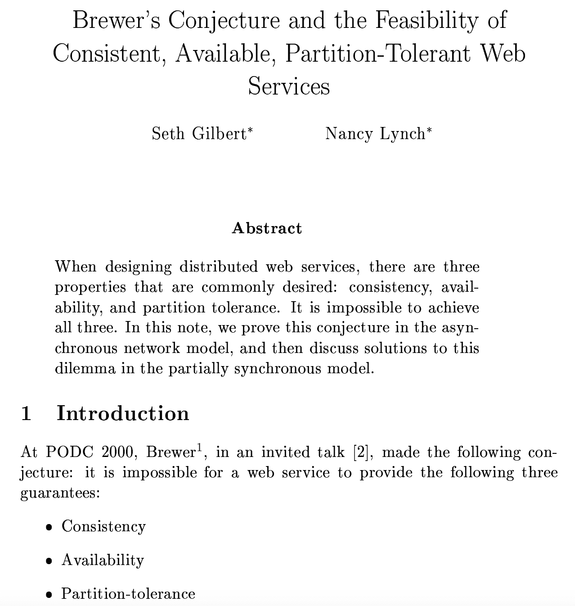
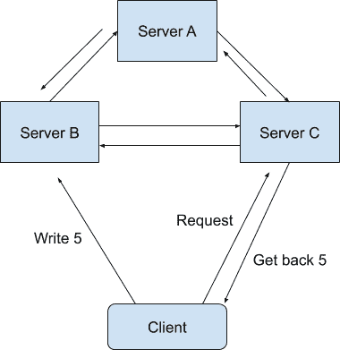
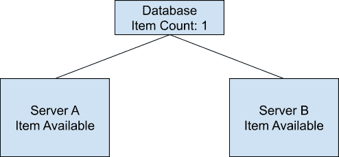
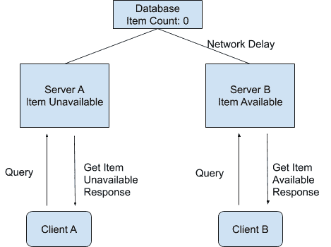
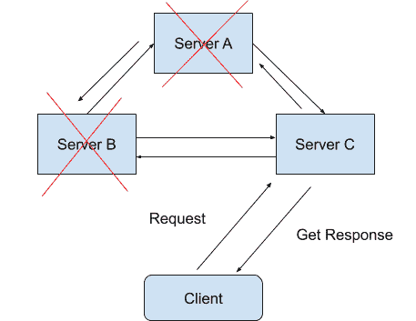
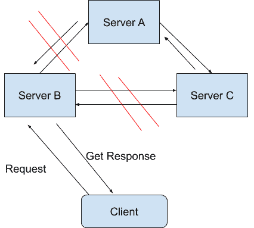
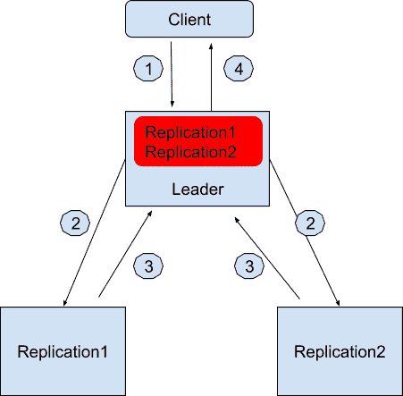
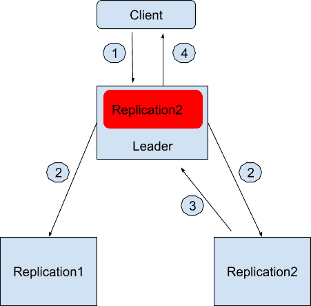
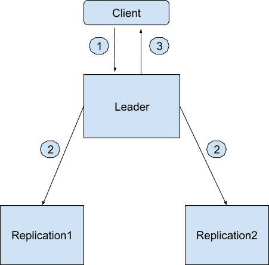

# 09 | CAP定理：三选二，架构师必须学会的取舍

 

你好，我是蔡元楠。

今天我要与你分享的主题是 CAP 定理。

在分布式系统的两讲中，我们一起学习到了两个重要的概念：可用性和一致性。

而今天，我想和你讲解一个与这两个概念相关，并且在设计分布式系统架构时都会讨论到的一个定理——**CAP 定理**（CAP Theorem）。

## CAP 定理

CAP 这个概念最初是由埃里克·布鲁尔博士（Dr. Eric Brewer）在 2000 年的 ACM 年度学术研讨会上提出的。

如果你对这次演讲感兴趣的话，可以翻阅他那次名为“[Towards Robust Distributed Systems](https://people.eecs.berkeley.edu/~brewer/cs262b-2004/PODC-keynote.pdf)”的演讲 deck。

在两年之后，塞思·吉尔伯特（Seth Gilbert）和麻省理工学院的南希·林奇教授（Nancy Ann Lynch）在他们的论文“Brewer’s conjecture and the Feasibility of Consistent, Available, Partition-Tolerant Web Services”中证明了这一概念。

他们在这篇论文中证明了：在任意的分布式系统中，一致性（Consistency），可用性（Availability）和分区容错性（Partition-tolerance）这三种属性最多只能同时存在两个属性。

下面，我来为你解读一下这三种属性在这篇论文里的具体意思。

## C 属性：一致性

一致性在这里指的是**线性一致性（Linearizability Consistency）**。在线性一致性的保证下，所有分布式环境下的操作都像是在单机上完成的一样，也就是说图中 Sever A、B、C 的状态一直是一致的。

打个比方，现在有两个操作（Operation），操作 A 和操作 B，都需要在同一个分布式系统上完成。

我们假设操作 A 作用在系统上的时候，所看见的所有系统状态（State）叫作状态 A。而操作 B 作用在系统上的时候，所看见的所有系统状态叫作状态 B。

如果操作 A 是在操作 B 之前发生的，并且操作 A 成功了。那么系统状态 B 必须要比系统状态 A 更加新。

可能光看理论的话你还是会觉得这个概念有点模糊，那下面我就以一个具体例子来说明吧。

假设我们设计了一个分布式的购物系统，在这个系统中，商品的存货状态分别保存在服务器 A 和服务器 B 中。我们把存货状态定义为“有货状态”或者“无货状态”。在最开始的时候，服务器 A 和服务器 B 都会显示商品为有货状态。

等一段时间过后，商品卖完了，后台就必须将这两台服务器上的商品状态更新为无货状态。

因为是在分布式的环境下，商品状态的更新在服务器 A 上完成了，显示为无货状态。而服务器 B 的状态因为网络延迟的原因更新还未完成，还是显示着有货状态。

这时，恰好有两个用户使用着这个购物系统，先后发送了一个查询操作（Query Operation）到后台服务器中查询商品状态。

我们假设是用户 A 先查询的，这个查询操作 A 被发送到了服务器 A 上面，并且成功返回了商品是无货状态的。用户 B 在随后也对同一商品进行查询，而这个查询操作 B 被发送到了服务器 B 上面，并且成功返回了商品是有货状态的。

我们知道，对于整个系统来说，商品的系统状态应该为无货状态。而操作 A 又是在操作 B 之前发送并且成功完成的，所以如果这个系统有线性一致性这个属性的话，操作 B 所看到的系统状态理论上应该是无货状态。

但在我们这个例子中，操作 B 却返回了有货状态。所以我们说，这个分布式的购物系统并不满足论文里所讲到的线性一致性。

聊完了一致性，我们一起来看看可用性的含义。

## A 属性：可用性

可用性的概念比较简单，在这里指的是**在分布式系统中，任意非故障的服务器都必须对客户的请求产生响应**。

当系统满足可用性的时候，不管出现什么状况（除非所有的服务器全部崩溃），都能返回消息。

也就是说，当客户端向系统发送请求，只要系统背后的服务器有一台还未崩溃，那么这个未崩溃的服务器必须最终响应客户端。

## P 属性：分区容错性

在了解了可用性之后，你还需要了解分区容错性。它分为两个部分，“分区”和“容错”。

在一个分布式系统里，如果出现一些故障，可能会使得部分节点之间无法连通。由于这些故障节点无法联通，造成整个网络就会被分成几块区域，从而使数据分散在这些无法连通的区域中的情况，你可以认为这就是发生了分区错误。

如图所示，如果你要的数据只在 Sever A 中保存，当系统出现分区错误，在不能直接连接 Sever A 时，你是无法获取数据的。我们要“分区容错”，意思是即使出现这样的“错误”，系统也需要能“容忍”。也就是说，就算错误出现，系统也必须能够返回消息。

分区容错性，在这里指的是我们的**系统允许网络丢失从一个节点发送到另一个节点的任意多条消息**。

我们知道，在现代网络通信中，节点出现故障或者网络出现丢包这样的情况是时常会发生的。

如果没有了分区容错性，也就是说系统不允许这些节点间的通讯出现任何错误的话，那我们日常所用到的很多系统就不能再继续工作了。

所以在**大部分情况下，系统设计都会保留 P 属性，而在 C 和 A 中二选一**。

论文中论证了在任意系统中，我们最多可以保留 CAP 属性中的两种，也就是 CP 或者 AP 或者 CA。关于具体的论证过程，如果你感兴趣的话，可以自行翻阅论文查看。

你可能会问，在我们平常所用到的开发架构中，有哪些系统是属于 CP 系统，有哪些是 AP 系统又有哪些是 CA 系统呢？我来给你介绍一下：

 
- CP 系统：Google BigTable, Hbase, MongoDB, Redis, MemCacheDB，这些存储架构都是放弃了高可用性（High Availablity）而选择 CP 属性的。 
- AP 系统：Amazon Dynamo 系统以及它的衍生存储系统 Apache Cassandra 和 Voldemort 都是属于 AP 系统 
- CA 系统：Apache Kafka 是一个比较典型的 CA 系统。 

我在上面说过，P 属性在现代网络时代中基本上是属于一个必选项，那为什么 Apache Kafka 会放弃 P 选择 CA 属性呢？我来给你解释一下它的架构思想。

## 放弃了 P 属性的 Kafka Replication

在 Kafka 发布了 0.8 版本之后，Kafka 系统引入了 Replication 的概念。Kafka Relocation 通过将数据复制到不同的节点上，从而增强了数据在系统中的持久性（Durability）和可用性（Availability）。在 Kafka Replication 的系统设计中，所有的数据日志存储是设计在同一个数据中心（Data Center）里面的，也就是说，在同一个数据中心里网络分区出现的可能性是十分之小的。

它的具体架构是这样的，在 Kafka 数据副本（Data Replication）的设计中，先通过 Zookeeper 选举出一个领导者节点（Leader）。这个领导者节点负责维护一组被称作同步数据副本（In-sync-replica）的节点，所有的数据写入都必须在这个领导者节点中记录。

我来举个例子，假设现在数据中心有三台服务器，一台被选为作为领导者节点，另外两台服务器用来保存数据副本，分别是 Replication1 和 Replication2，它们两个节点就是被领导者节点维护的同步数据副本了。领导者节点知道它维护着两个同步数据副本。

如果用户想写入一个数据，假设是“Geekbang”

 
1.  

用户会发请求到领导者节点中想写入“Geekbang”。
  
2.  

领导者节点收到请求后先在本地保存好，然后也同时发消息通知 Replication1 和 Replication2。
  
3.  

Replication1 和 Replication2 收到消息后也保存好这条消息并且回复领导者节点写入成功。
  
4.  

领导者节点记录副本 1 和副本 2 都是健康（Healthy）的，并且回复用户写入成功。
  

红色的部分是领导者节点本地日志，记录着有哪些同步数据副本是健康的。

往后用户如果想查询写入的数据，无论是领导者节点还是两个副本都可以返回正确同步的结果。

那假如分区出现了该怎么办呢？例如领导者节点和副本 1 无法通讯了，这个时候流程就变成这样了。

 
1.  

用户会发请求到领导者节点中想写入“Geekbang”。
  
2.  

领导者节点收到请求后先在本地保存好，然后也同时发消息通知 Replication1 和 Replication2。
  
3.  

只有 Replication2 收到消息后也保存好这条消息并且回复领导者节点写入成功。
  
4.  

领导者节点记录副本 2 是健康的，并且回复用户写入成功。
  

同样，红色的部分是领导者节点本地日志，记录着有哪些同步数据副本是健康的。

如果所有副本都无法通讯的时候，Apache Kafka 允许系统只有一个节点工作，也就是领导者节点。这个时候所有的写入都只保存在领导者节点了。过程如下，

 
1.  

用户会发请求到领导者节点中想写入“Geekbang”。
  
2.  

领导者节点收到请求后先在本地保存好，然后也同时发消息通知 Replication1 和 Replication2。
  
3.  

没有任何副本回复领导者节点写入成功，领导者节点记录无副本是健康的，并且回复用户写入成功。
  

当然，在最坏的情况下，连领导者节点也挂了，Zookeeper 会重新去寻找健康的服务器节点来当选新的领导者节点。

## 小结

通过今天的学习，我们知道在 CAP 定理中，一致性，可用性和分区容错性这三个属性最多只能选择两种属性保留。CAP 定理在经过了差不多 20 年的讨论与演化之后，大家对这三个属性可能会有着自己的一些定义。

例如在讨论一致性的时候，有的系统宣称自己是拥有 C 属性，也就拥有一致性的，但是这个一致性并不是论文里所讨论到的线性一致性。

在我看来，作为大规模数据处理的架构师，我们应该熟知自己的系统到底应该保留 CAP 中的哪两项属性，同时也需要熟知，自己所应用到的平台架构是保留着哪两项属性。

## 思考题

如果让你重新设计微博系统中的发微博功能，你会选择 CAP 的哪两个属性呢？为什么呢？

欢迎你把答案写在留言区，与我和其他同学一起讨论。

如果你觉得有所收获，也欢迎把文章分享给你的朋友。

