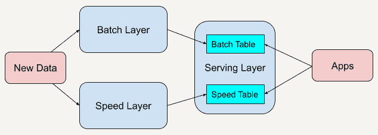
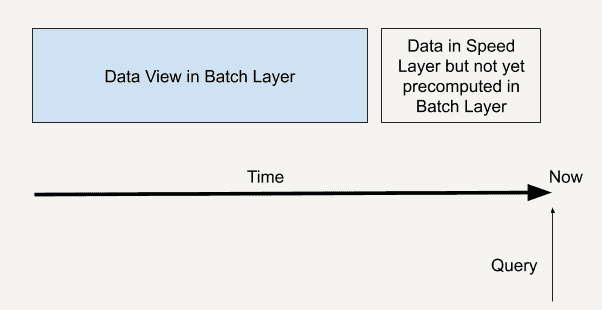
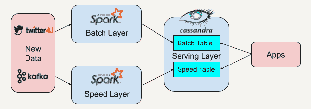
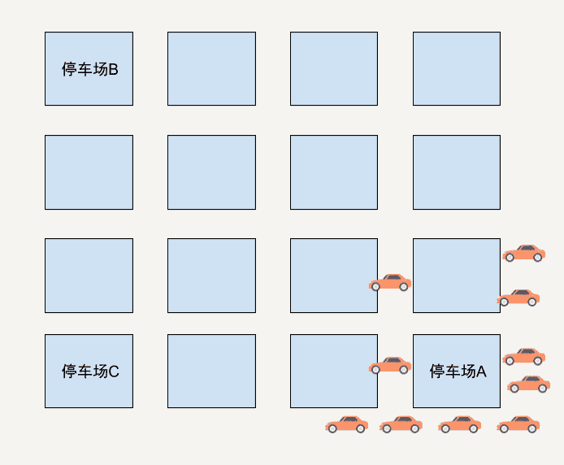
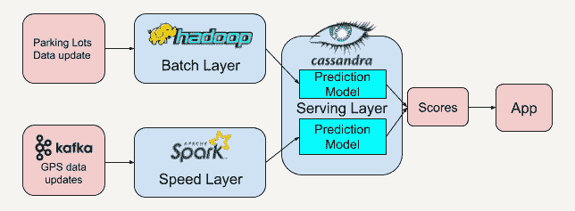
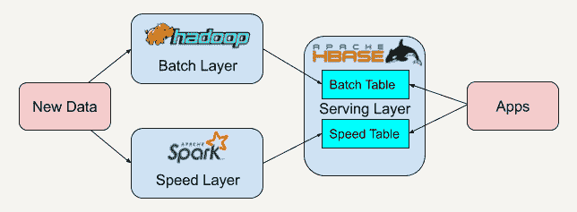

# 10 | Lambda架构：Twitter亿级实时数据分析架构背后的倚天剑

 

你好，我是蔡元楠。

今天我要与你分享的主题是 Lambda 架构。

通过这一讲，你可以了解什么是 Lambda 架构，以及它为什么能够成为 Twitter 亿级实时数据分析架构背后的“倚天剑”。

在学习了架构师的必备技能后，你是否已经摩拳擦掌，跃跃欲试地想要上手一个实际项目了呢？没问题，我们一起来看一个我的架构经历里的真实项目。

情况是这样的，我们正运行着广告精准投放业务，并且拥有海量的用户网站访问行为。我们需要进行用户行为分析来建立一个模型，然后根据这个模型来投放用户喜好的广告。

你可能想到了批处理架构。没错，这个时候数据批处理架构无疑是一种很好的选择。

可是我们不要忘了，之前讲过批处理架构有着高延时性的不足，而互联网用户行为的数据往往可以达到 Pb 或 Eb，甚至是 Zb 的级别。做这种分析挖掘用户行为的任务，往往能耗时好几个小时甚至是几天。这样的话，我们根据模型精准投放给特定用户的广告就会有一定延时了。

那我们只用流处理架构行不行呢？

在广告精准投放的业务需求下，只用流处理架构会造成忽略了用户的历史网站访问行为，一些异常行为可能会让我们的服务投放错误的广告。

例如，用户 A 的电脑暂时借给用户 B 使用了一下，而用户 B 浏览了一些新的网站类型（与用户 A 不同）。这种情况下，我们无法判断用户 A 实际上是否对这类型的广告感兴趣，所以不能根据这些新的浏览记录给用户 A 推送广告。

这个时候应该怎么优化我们的架构呢？我们先把问题放一放，在介绍完了 Lambda 架构之后或许会对你有所启发。

## Lambda 架构

Lambda 架构（Lambda Architecture）是由 Twitter 工程师南森·马茨（Nathan Marz）提出的大数据处理架构。这一架构的提出基于马茨在 BackType 和 Twitter 上的分布式数据处理系统的经验。

Lambda 架构使开发人员能够构建大规模分布式数据处理系统。它具有很好的灵活性和可扩展性，也对硬件故障和人为失误有很好的容错性。

Lambda 架构总共由三层系统组成：**批处理层**（Batch Layer），**速度处理层**（Speed Layer），以及用于响应查询的**服务层**（Serving Layer）。

在 Lambda 架构中，每层都有自己所肩负的任务。

批处理层存储管理主数据集（不可变的数据集）和预先批处理计算好的视图。

批处理层使用可处理大量数据的分布式处理系统预先计算结果。它通过处理所有的已有历史数据来实现数据的准确性。这意味着它是基于完整的数据集来重新计算的，能够修复任何错误，然后更新现有的数据视图。输出通常存储在只读数据库中，更新则完全取代现有的预先计算好的视图。

速度处理层会实时处理新来的大数据。

速度层通过提供最新数据的实时视图来最小化延迟。速度层所生成的数据视图可能不如批处理层最终生成的视图那样准确或完整，但它们几乎在收到数据后立即可用。而当同样的数据在批处理层处理完成后，在速度层的数据就可以被替代掉了。

本质上，速度层弥补了批处理层所导致的数据视图滞后。比如说，批处理层的每个任务都需要 1 个小时才能完成，而在这 1 个小时里，我们是无法获取批处理层中最新任务给出的数据视图的。而速度层因为能够实时处理数据给出结果，就弥补了这 1 个小时的滞后。

所有在批处理层和速度层处理完的结果都输出存储在服务层中，服务层通过返回预先计算的数据视图或从速度层处理构建好数据视图来响应查询。

好了，我们回到刚刚的问题中。我们如何做到既能实时分析用户新的网站浏览行为又能兼顾到用户的网站浏览行为历史呢？没错，就是利用 Lambda 架构。

所有的新用户行为数据都可以同时流入批处理层和速度层。批处理层会永久保存数据并且对数据进行预处理，得到我们想要的用户行为模型并写入服务层。而速度层也同时对新用户行为数据进行处理，得到实时的用户行为模型。

而当“应该对用户投放什么样的广告”作为一个查询（Query）来到时，我们从服务层既查询服务层中保存好的批处理输出模型，也对速度层中处理的实时行为进行查询，这样我们就可以得到一个完整的用户行为历史了。

一个查询就如下图所示，既通过批处理层兼顾了数据的完整性，也可以通过速度层弥补批处理层的高延时性，让整个查询具有实时性。

Lambda 架构在硅谷一线大公司的应用已经十分广泛，我来带你一起看看一些实际的应用场景。

## Twitter 的数据分析案例

Twitter 在欧美十分受欢迎，而 Twitter 中人们所发 Tweet 里面的 Hashtag 也常常能引爆一些热搜词汇，也就是 Most Popular Hashtags。下面我来给你讲述一下如何利用 Lambda 架构来实时分析这些 Hashtags。

在这个实际案例里，我们先用 twitter4J 的流处理 API 抓取实时的 Twitter 推文，同时利用 Apache Kafka 将抓取到的数据保存并实时推送给批处理层和速度层。

因为 Apache Spark 平台中既有批处理架构也兼容了流处理架构，所以我们选择在批处理层和速度层都采用 Apache Spark 来读取来自 Apache Kafka 的数据。

批处理层和速度层在分析处理好数据后会将数据视图输出存储在服务层中，我们将使用 Apache Cassandra 平台来存储他们的数据视图。Apache Cassandra 将批处理层的视图数据和速度层的实时视图数据结合起来，就可以得到一系列有趣的数据。

例如，我们根据每一条 Tweet 中元数据（Metadata）里的 location field，可以得知发推文的人的所在地。而服务层中的逻辑可以根据这个地址信息进行分组，然后统计在不同地区的人所关心的 Hashtag 是什么。

时间长达几周或者的几个月的数据，我们可以结合批处理层和速度层的数据视图来得出，而快至几个小时的数据我们又可以根据速度层的数据视图来获知，怎么样？这个架构是不是十分灵活？

看到这里，你可能会问，我在上面所讲的例子都是来自些科技巨头公司，如果我在开发中面对的数据场景没有这么巨大，又或者说我的公司还在创业起步阶段，我是否可以用到 Lambda 架构呢？

答案是肯定的！我下面将和你一起分享一个在硅谷旧金山创业公司的 App 后台架构。

## Smart Parking 案例分析

在硅谷旧金山地区上班生活的小伙伴肯定都知道，找停车位是一大难题。这里地少车多，每次出行，特别是周末，找停车位都要绕个好几十分钟才能找得到。

智能停车 App 就是在这样的背景下诞生的。这个 App 可以根据大规模数据所构建的视图推荐最近的车位给用户。

看到这里，我想先请你结合之前所讲到的广告精准投放案例，思考一下 Lambda 架构是如何应用在这个 App 里的，然后再听我娓娓道来。

好，我们来梳理一下各种可以利用到的大数据。

首先是可以拿到各类停车场的数据。这类数据的实时性虽然不一定高，但是数据的准确性高。那我们能不能只通过这类大数据来推荐停车位呢？

我来给你举个极端的例子。假设在一个区域有三个停车场，停车场 A 现在只剩下 1 个停车位了。

停车场 B 和 C 还有非常多的空位。而在这时候距离停车场比 A 较近的位置有 10 位车主在使用这个 App 寻求推荐停车位。如果只通过车主和停车场的距离和停车场剩余停车位来判断的话，App 很有可能会将这个只剩下一个停车位的停车场 A 同时推荐给这 10 位用户。

结果可想而知，只有一位幸运儿能找到停车位，剩下的 9 位车主需要重新寻找停车位。

如果附近又出现了只有一个停车位的停车场呢？同理，这个 App 又会推荐这个停车场给剩下的 9 位用户。这时又只能有一位幸运儿找到停车位。

如此反复循环，用户体验会非常差，甚至会导致用户放弃这个 App。

那我们有没有办法可以改进推荐的准确度呢？

你可能会想到我们可以利用这些停车场的历史数据，建立一个人工智能的预测模型，在推荐停车位的时候，不单单考虑到附近停车场的剩余停车位和用户与停车场的相邻距离，还能将预测模型应用在推荐里，看看未来的一段时间内这个停车场是否有可能会被停满了。

这时候我们的停车位推荐系统就变成了一个基于分数（Score）来推荐停车位的系统了。

好了，这个时候的系统架构是否已经达到最优了呢？你有想到应用 Lambda 架构吗？

没错，这些停车场的历史数据或者每隔半小时拿到的停车位数据，我们可以把它作为批处理层的数据。

那速度层的数据呢？我们可以将所有用户的 GPS 数据聚集起来，这些需要每秒收集的 GPS 数据刚好又是速度层所擅长的实时流处理数据。从这些用户的实时 GPS 数据中，我们可以再建立一套预测模型来预测附近停车场位置的拥挤程度。

服务层将从批处理层和速度层得到的分数结合后将得到最高分数的停车场推荐给用户。这样利用了历史数据（停车场数据）和实时数据（用户 GPS 数据）能大大提升推荐的准确率。

## 小结

在了解 Lambda 架构后，我们知道 Lambda 架构具有很好的灵活性和可扩展性。我们可以很方便地将现有的开源平台套用入这个架构中，如下图所示。

当开发者需要迁移平台时，整体的架构不需要改变，只需要将逻辑迁移到新平台中。

例如，可以将 Apache Spark 替换成 Apache Storm。而因为我们有批处理层这一概念，又有了很好的容错性。

假如某天开发者发现逻辑出现了错误，只需要调整算法对永久保存好的数据重新进行处理写入服务层，经过多次迭代后整体的逻辑便可以被纠正过来。

从我的开发经验来看，现在有很多的开发项目可能已经有了比较成熟的架构或者算法了。

但是如果我们平时能多思考一下现有架构的瓶颈，又或者想一想现在的架构能不能改善得更好，有了这样的思考，在学习到这些经典优秀架构之后，说不定真的能让现有的架构变得更好。

也就是说，作为一名优秀的架构师，“现有的架构能不能做得更好？”应该是一个需要经常思考的问题。

## 思考题

你所做的项目开发能否利用 Lambda 架构呢？在生活中有没有哪些大数据处理场景可以利用 Lambda 架构呢？

欢迎在评论中留言，与我和其他同学一起讨论。

如果你觉得今天有些不一样的收获，也欢迎你把这篇文章分享给你的好友。

