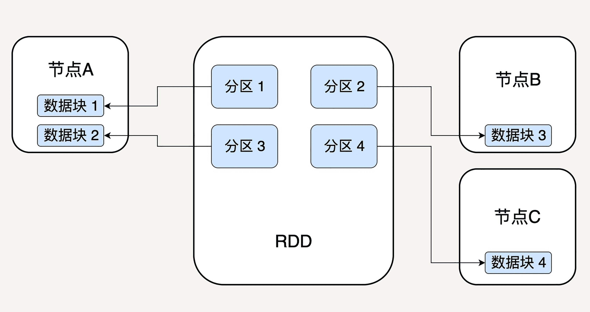
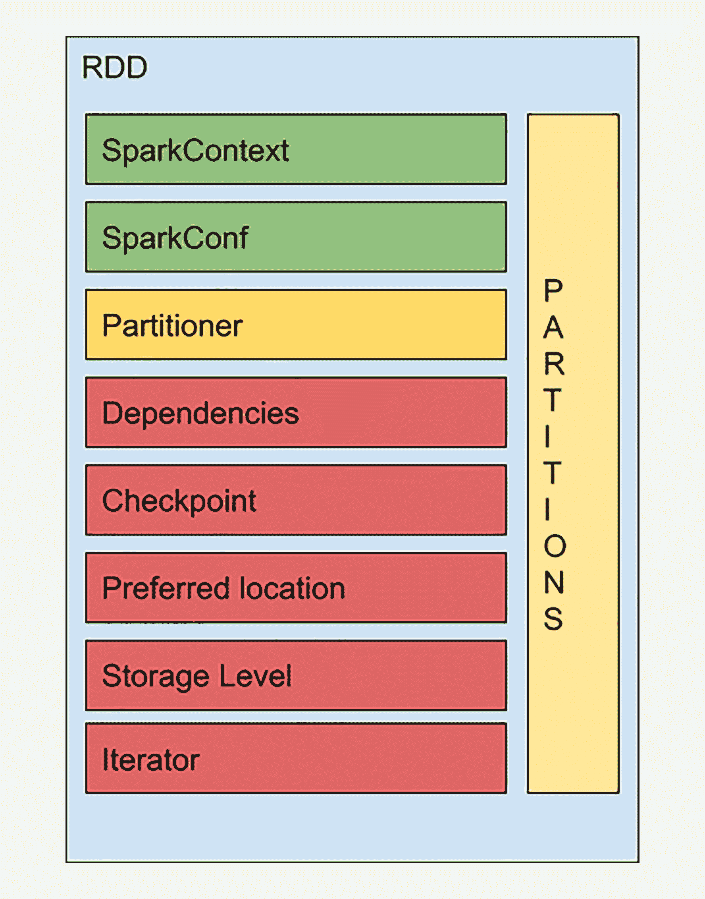
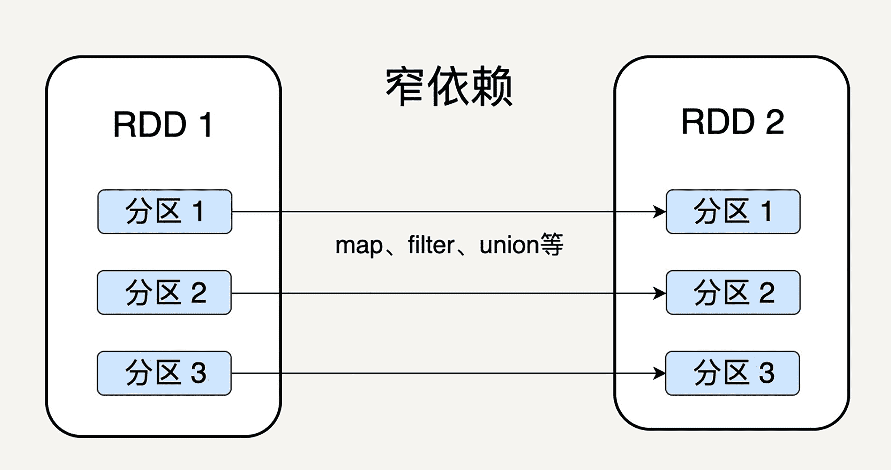
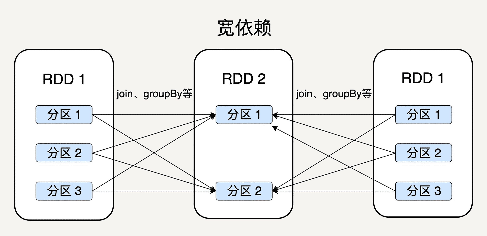

# 13 | 弹性分布式数据集：Spark大厦的地基（上）

 

你好，我是蔡元楠。

今天我要与你分享的主题是“弹性分布式数据集”。

上一讲中提到，Spark 最基本的数据抽象是弹性分布式数据集（Resilient Distributed Dataset, 下文用 RDD 代指）。

Spark 基于 RDD 定义了很多数据操作，从而使得数据处理的代码十分简洁、高效。所以，要想深入学习 Spark，我们必须首先理解 RDD 的设计思想和特性。

## 为什么需要新的数据抽象模型？

传统的 MapReduce 框架之所以运行速度缓慢，很重要的原因就是有向无环图的中间计算结果需要写入硬盘这样的稳定存储介质中来防止运行结果丢失。

而每次调用中间计算结果都需要要进行一次硬盘的读取，反复对硬盘进行读写操作以及潜在的数据复制和序列化操作大大提高了计算的延迟。

因此，很多研究人员试图提出一个新的分布式存储方案，不仅保持之前系统的稳定性、错误恢复和可扩展性，还要尽可能地减少硬盘 I/O 操作。

一个可行的设想就是在分布式内存中，存储中间计算的结果，因为对内存的读写操作速度远快于硬盘。而 RDD 就是一个基于分布式内存的数据抽象，它不仅支持基于工作集的应用，同时具有数据流模型的特点。

## RDD 的定义

弹性分布式数据集是英文直译的名字，乍一看这个名字相信你会不知所云。如果你去 Google 或者百度搜索它的定义，你会得到如下结果：

**RDD 表示已被分区、不可变的，并能够被并行操作的数据集合。**

这个定义很不直观，我认识的很多 Spark 初学者在查阅了很多资料后还是对 RDD 一头雾水，很难理解这个抽象的概念。接下来，让我们一起来对这个晦涩的概念抽丝剥茧，见其真义。

在上述定义以及 RDD 的中文译名中，我们不难发现，RDD 有以下基本特性：分区、不可变和并行操作。接下来让我分别讲解这些特点。

### 分区

顾名思义，分区代表同一个 RDD 包含的数据被存储在系统的不同节点中，这也是它可以被并行处理的前提。

逻辑上，我们可以认为 RDD 是一个大的数组。数组中的每个元素代表一个分区（Partition）。

在物理存储中，每个分区指向一个存放在内存或者硬盘中的数据块（Block），而这些数据块是独立的，它们可以被存放在系统中的不同节点。

所以，RDD 只是抽象意义的数据集合，分区内部并不会存储具体的数据。下图很好地展示了 RDD 的分区逻辑结构：



RDD 中的每个分区存有它在该 RDD 中的 index。通过 RDD 的 ID 和分区的 index 可以唯一确定对应数据块的编号，从而通过底层存储层的接口中提取到数据进行处理。

在集群中，各个节点上的数据块会尽可能地存放在内存中，只有当内存没有空间时才会存入硬盘。这样可以最大化地减少硬盘读写的开销。

虽然 RDD 内部存储的数据是只读的，但是，我们可以去修改（例如通过 repartition 转换操作）并行计算单元的划分结构，也就是分区的数量。

### 不可变性

不可变性代表每一个 RDD 都是只读的，它所包含的分区信息不可以被改变。既然已有的 RDD 不可以被改变，我们只可以对现有的 RDD 进行**转换**（Transformation）操作，得到新的 RDD 作为中间计算的结果。从某种程度上讲，RDD 与函数式编程的 Collection 很相似。

```
lines = sc.textFile("data.txt")lineLengths = lines.map(lambda s: len(s))totalLength = lineLengths.reduce(lambda a, b: a + b)
```

在上述的简单例子中，我们首先读入文本文件 data.txt，创建了第一个 RDD lines，它的每一个元素是一行文本。然后调用 map 函数去映射产生第二个 RDD lineLengths，每个元素代表每一行简单文本的字数。最后调用 reduce 函数去得到第三个 RDD totalLength，它只有一个元素，代表整个文本的总字数。

那么这样会带来什么好处呢？显然，对于代表中间结果的 RDD，我们需要记录它是通过哪个 RDD 进行哪些转换操作得来，即**依赖关系**，而不用立刻去具体存储计算出的数据本身。

这样做有助于提升 Spark 的计算效率，并且使错误恢复更加容易。

试想，在一个有 N 步的计算模型中，如果记载第 N 步输出 RDD 的节点发生故障，数据丢失，我们可以从第 N-1 步的 RDD 出发，再次计算，而无需重复整个 N 步计算过程。这样的容错特性也是 RDD 为什么是一个“弹性”的数据集的原因之一。后边我们会提到 RDD 如何存储这样的依赖关系。

### 并行操作

由于单个 RDD 的分区特性，使得它天然支持并行操作，即不同节点上的数据可以被分别处理，然后产生一个新的 RDD。

## RDD 的结构

通过上述讲解，我们了解了 RDD 的基本特性——分区、不可变和并行计算。而且，我们还提到每一个 RDD 里都会包括分区信息、所依赖的父 RDD 以及通过怎样的转换操作才能由父 RDD 得来等信息。

实际上 RDD 的结构远比你想象的要复杂，让我们来看一个 RDD 的简易结构示意图：



SparkContext 是所有 Spark 功能的入口，它代表了与 Spark 节点的连接，可以用来创建 RDD 对象以及在节点中的广播变量等。一个线程只有一个 SparkContext。SparkConf 则是一些参数配置信息。感兴趣的同学可以去阅读官方的技术文档，一些相对不重要的概念我就不再赘述了。

Partitions 前文中我已经提到过，它代表 RDD 中数据的逻辑结构，每个 Partition 会映射到某个节点内存或硬盘的一个数据块。

Partitioner 决定了 RDD 的分区方式，目前有两种主流的分区方式：Hash partitioner 和 Range partitioner。Hash，顾名思义就是对数据的 Key 进行散列分区，Range 则是按照 Key 的排序进行均匀分区。此外我们还可以创建自定义的 Partitioner。

### 依赖关系

Dependencies 是 RDD 中最重要的组件之一。如前文所说，Spark 不需要将每个中间计算结果进行数据复制以防数据丢失，因为每一步产生的 RDD 里都会存储它的依赖关系，即它是通过哪个 RDD 经过哪个转换操作得到的。

细心的读者会问这样一个问题，父 RDD 的分区和子 RDD 的分区之间是否是一对一的对应关系呢？Spark 支持两种依赖关系：窄依赖（Narrow Dependency）和宽依赖（Wide Dependency）。



窄依赖就是父 RDD 的分区可以一一对应到子 RDD 的分区，宽依赖就是父 RDD 的每个分区可以被多个子 RDD 的分区使用。



显然，窄依赖允许子 RDD 的每个分区可以被并行处理产生，而宽依赖则必须等父 RDD 的所有分区都被计算好之后才能开始处理。

如上图所示，一些转换操作如 map、filter 会产生窄依赖关系，而 Join、groupBy 则会生成宽依赖关系。

这很容易理解，因为 map 是将分区里的每一个元素通过计算转化为另一个元素，一个分区里的数据不会跑到两个不同的分区。而 groupBy 则要将拥有所有分区里有相同 Key 的元素放到同一个目标分区，而每一个父分区都可能包含各种 Key 的元素，所以它可能被任意一个子分区所依赖。

Spark 之所以要区分宽依赖和窄依赖是出于以下两点考虑：

 
-  

窄依赖可以支持在同一个节点上链式执行多条命令，例如在执行了 map 后，紧接着执行 filter。相反，宽依赖需要所有的父分区都是可用的，可能还需要调用类似 MapReduce 之类的操作进行跨节点传递。
  
-  

从失败恢复的角度考虑，窄依赖的失败恢复更有效，因为它只需要重新计算丢失的父分区即可，而宽依赖牵涉到 RDD 各级的多个父分区。
  

## 小结

弹性分布式数据集作为 Spark 的基本数据抽象，相较于 Hadoop/MapReduce 的数据模型而言，各方面都有很大的提升。

首先，它的数据可以尽可能地存在内存中，从而大大提高的数据处理的效率；其次它是分区存储，所以天然支持并行处理；而且它还存储了每一步骤计算结果之间的依赖关系，从而大大提升了数据容错性和错误恢复的正确率，使 Spark 更加可靠。

下一讲，我们会继续深入研究 RDD 的容错机制、任务执行机制，以及 Spark 定义在 RDD 上的各种转换与动作操作。

## 思考题

窄依赖是指父 RDD 的每一个分区都可以唯一对应子 RDD 中的分区，那么是否意味着子 RDD 中的一个分区只可以对应父 RDD 中的一个分区呢？如果子 RDD 的一个分区需要由父 RDD 中若干个分区计算得来，是否还算窄依赖？

最后，欢迎你把对弹性分布式数据集的疑问写在留言区，与我和其他同学一起讨论。

如果你觉得有所收获，也欢迎把文章分享给你的朋友。


