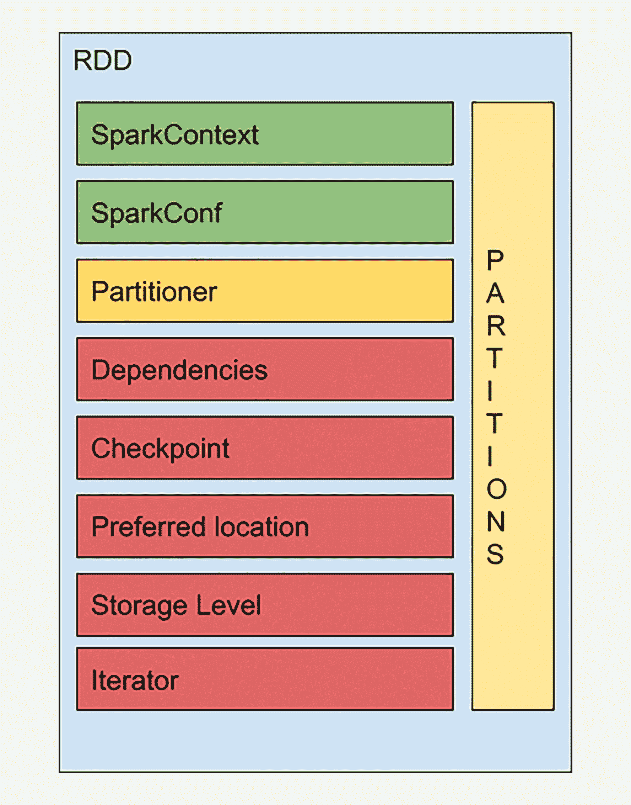

# 14 | 弹性分布式数据集：Spark大厦的地基（下）

 

你好，我是蔡元楠。

上一讲我们介绍了弹性分布式数据集（RDD）的定义、特性以及结构，并且深入讨论了依赖关系（Dependencies）。

今天让我们一起来继续学习 RDD 的其他特性。

## RDD 的结构

首先，我来介绍一下 RDD 结构中其他的几个知识点：检查点（Checkpoint）、存储级别（ Storage Level）和迭代函数（Iterator）。



通过上一讲，你应该已经知道了，基于 RDD 的依赖关系，如果任意一个 RDD 在相应的节点丢失，你只需要从上一步的 RDD 出发再次计算，便可恢复该 RDD。

但是，如果一个 RDD 的依赖链比较长，而且中间又有多个 RDD 出现故障的话，进行恢复可能会非常耗费时间和计算资源。

而检查点（Checkpoint）的引入，就是为了优化这些情况下的数据恢复。

很多数据库系统都有检查点机制，在连续的 transaction 列表中记录某几个 transaction 后数据的内容，从而加快错误恢复。

RDD 中的检查点的思想与之类似。

在计算过程中，对于一些计算过程比较耗时的 RDD，我们可以将它缓存至硬盘或 HDFS 中，标记这个 RDD 有被检查点处理过，并且清空它的所有依赖关系。同时，给它新建一个依赖于 CheckpointRDD 的依赖关系，CheckpointRDD 可以用来从硬盘中读取 RDD 和生成新的分区信息。

这样，当某个子 RDD 需要错误恢复时，回溯至该 RDD，发现它被检查点记录过，就可以直接去硬盘中读取这个 RDD，而无需再向前回溯计算。

存储级别（Storage Level）是一个枚举类型，用来记录 RDD 持久化时的存储级别，常用的有以下几个：

 
-  

MEMORY_ONLY：只缓存在内存中，如果内存空间不够则不缓存多出来的部分。这是 RDD 存储级别的默认值。
  
-  

MEMORY_AND_DISK：缓存在内存中，如果空间不够则缓存在硬盘中。
  
-  

DISK_ONLY：只缓存在硬盘中。
  
-  

MEMORY_ONLY_2 和 MEMORY_AND_DISK_2 等：与上面的级别功能相同，只不过每个分区在集群中两个节点上建立副本。
  

这就是我们在前文提到过的，Spark 相比于 Hadoop 在性能上的提升。我们可以随时把计算好的 RDD 缓存在内存中，以便下次计算时使用，这大幅度减小了硬盘读写的开销。

迭代函数（Iterator）和计算函数（Compute）是用来表示 RDD 怎样通过父 RDD 计算得到的。

迭代函数会首先判断缓存中是否有想要计算的 RDD，如果有就直接读取，如果没有，就查找想要计算的 RDD 是否被检查点处理过。如果有，就直接读取，如果没有，就调用计算函数向上递归，查找父 RDD 进行计算。

到现在，相信你已经对弹性分布式数据集的基本结构有了初步了解。但是光理解 RDD 的结构是远远不够的，我们的终极目标是使用 RDD 进行数据处理。

要使用 RDD 进行数据处理，你需要先了解一些 RDD 的数据操作。

在[第 12 讲](http://time.geekbang.org/column/article/94410)中，我曾经提过，相比起 MapReduce 只支持两种数据操作，Spark 支持大量的基本操作，从而减轻了程序员的负担。

接下来，让我们进一步了解基于 RDD 的各种数据操作。

## RDD 的转换操作

RDD 的数据操作分为两种：转换（Transformation）和动作（Action）。

顾名思义，转换是用来把一个 RDD 转换成另一个 RDD，而动作则是通过计算返回一个结果。

不难想到，之前举例的 map、filter、groupByKey 等都属于转换操作。

### Map

map 是最基本的转换操作。

与 MapReduce 中的 map 一样，它把一个 RDD 中的所有数据通过一个函数，映射成一个新的 RDD，任何原 RDD 中的元素在新 RDD 中都有且只有一个元素与之对应。

在这一讲中提到的所有的操作，我都会使用代码举例，帮助你更好地理解。

```
rdd = sc.parallelize(["b", "a", "c"])rdd2 = rdd.map(lambda x: (x, 1)) // [('b', 1), ('a', 1), ('c', 1)]
```

### Filter

filter 这个操作，是选择原 RDD 里所有数据中满足某个特定条件的数据，去返回一个新的 RDD。如下例所示，通过 filter，只选出了所有的偶数。

```
rdd = sc.parallelize([1, 2, 3, 4, 5])rdd2 = rdd.filter(lambda x: x % 2 == 0) // [2, 4]
```

### mapPartitions

mapPartitions 是 map 的变种。不同于 map 的输入函数是应用于 RDD 中每个元素，mapPartitions 的输入函数是应用于 RDD 的每个分区，也就是把每个分区中的内容作为整体来处理的，所以输入函数的类型是 Iterator[T] => Iterator[U]。

```
rdd = sc.parallelize([1, 2, 3, 4], 2)def f(iterator): yield sum(iterator)rdd2 = rdd.mapPartitions(f) // [3, 7]
```

在 mapPartitions 的例子中，我们首先创建了一个有两个分区的 RDD。mapPartitions 的输入函数是对每个分区内的元素求和，所以返回的 RDD 包含两个元素：1+2=3 和 3+4=7。

### groupByKey

groupByKey 和 SQL 中的 groupBy 类似，是把对象的集合按某个 Key 来归类，返回的 RDD 中每个 Key 对应一个序列。

```
rdd = sc.parallelize([("a", 1), ("b", 1), ("a", 2)])rdd.groupByKey().collect()//"a" [1, 2]//"b" [1]
```

在此，我们只列举这几个常用的、有代表性的操作，对其他转换操作感兴趣的同学可以去自行查阅官方的 API 文档。

## RDD 的动作操作

让我们再来看几个常用的动作操作。

### Collect

RDD 中的动作操作 collect 与函数式编程中的 collect 类似，它会以数组的形式，返回 RDD 的所有元素。需要注意的是，collect 操作只有在输出数组所含的数据数量较小时使用，因为所有的数据都会载入到程序的内存中，如果数据量较大，会占用大量 JVM 内存，导致内存溢出。

```
rdd = sc.parallelize(["b", "a", "c"])rdd.map(lambda x: (x, 1)).collect() // [('b', 1), ('a', 1), ('c', 1)]
```

实际上，上述转换操作中所有的例子，最后都需要将 RDD 的元素 collect 成数组才能得到标记好的输出。

### Reduce

与 MapReduce 中的 reduce 类似，它会把 RDD 中的元素根据一个输入函数聚合起来。

```
from operator import addsc.parallelize([1, 2, 3, 4, 5]).reduce(add)  // 15
```

### Count

Count 会返回 RDD 中元素的个数。

sc.parallelize([2, 3, 4]).count() // 3

### CountByKey

仅适用于 Key-Value pair 类型的 RDD，返回具有每个 key 的计数的 <Key, Count> 的 map。

```
rdd = sc.parallelize([("a", 1), ("b", 1), ("a", 1)])sorted(rdd.countByKey().items()) // [('a', 2), ('b', 1)]
```

讲到这，你可能会问了，为什么要区分转换和动作呢？虽然转换是生成新的 RDD，动作是把 RDD 进行计算生成一个结果，它们本质上不都是计算吗？

这是因为，所有转换操作都很懒，它只是生成新的 RDD，并且记录依赖关系。

但是 Spark 并不会立刻计算出新 RDD 中各个分区的数值。直到遇到一个动作时，数据才会被计算，并且输出结果给 Driver。

比如，在之前的例子中，你先对 RDD 进行 map 转换，再进行 collect 动作，这时 map 后生成的 RDD 不会立即被计算。只有当执行到 collect 操作时，map 才会被计算。而且，map 之后得到的较大的数据量并不会传给 Driver，只有 collect 动作的结果才会传递给 Driver。

这种惰性求值的设计优势是什么呢？让我们来看这样一个例子。

假设，你要从一个很大的文本文件中筛选出包含某个词语的行，然后返回第一个这样的文本行。你需要先读取文件 textFile() 生成 rdd1，然后使用 filter() 方法生成 rdd2，最后是行动操作 first()，返回第一个元素。

读取文件的时候会把所有的行都存储起来，但我们马上就要筛选出只具有特定词组的行了，等筛选出来之后又要求只输出第一个。这样是不是太浪费存储空间了呢？确实。

所以实际上，Spark 是在行动操作 first() 的时候开始真正的运算：只扫描第一个匹配的行，不需要读取整个文件。所以，惰性求值的设计可以让 Spark 的运算更加高效和快速。

让我们总结一下 Spark 执行操作的流程吧。

Spark 在每次转换操作的时候，使用了新产生的 RDD 来记录计算逻辑，这样就把作用在 RDD 上的所有计算逻辑串起来，形成了一个链条。当对 RDD 进行动作时，Spark 会从计算链的最后一个 RDD 开始，依次从上一个 RDD 获取数据并执行计算逻辑，最后输出结果。

## RDD 的持久化（缓存）

每当我们对 RDD 调用一个新的 action 操作时，整个 RDD 都会从头开始运算。因此，如果某个 RDD 会被反复重用的话，每次都从头计算非常低效，我们应该对多次使用的 RDD 进行一个持久化操作。

Spark 的 persist() 和 cache() 方法支持将 RDD 的数据缓存至内存或硬盘中，这样当下次对同一 RDD 进行 Action 操作时，可以直接读取 RDD 的结果，大幅提高了 Spark 的计算效率。

```
rdd = sc.parallelize([1, 2, 3, 4, 5])rdd1 = rdd.map(lambda x: x+5)rdd2 = rdd1.filter(lambda x: x % 2 == 0)rdd2.persist()count = rdd2.count() // 3first = rdd2.first() // 6rdd2.unpersist()
```

在文中的代码例子中你可以看到，我们对 RDD2 进行了多个不同的 action 操作。由于在第四行我把 RDD2 的结果缓存在内存中，所以无论是 count 还是 first，Spark 都无需从一开始的 rdd 开始算起了。

在缓存 RDD 的时候，它所有的依赖关系也会被一并存下来。所以持久化的 RDD 有自动的容错机制。如果 RDD 的任一分区丢失了，通过使用原先创建它的转换操作，它将会被自动重算。

持久化可以选择不同的存储级别。正如我们讲 RDD 的结构时提到的一样，有 MEMORY_ONLY，

MEMORY_AND_DISK，DISK_ONLY 等。cache() 方法会默认取 MEMORY_ONLY 这一级别。

## 小结

Spark 在每次转换操作的时候使用了新产生的 RDD 来记录计算逻辑，这样就把作用在 RDD 上的所有计算逻辑串起来形成了一个链条，但是并不会真的去计算结果。当对 RDD 进行动作 Action 时，Spark 会从计算链的最后一个 RDD 开始，利用迭代函数（Iterator）和计算函数（Compute），依次从上一个 RDD 获取数据并执行计算逻辑，最后输出结果。

此外，我们可以通过将一些需要复杂计算和经常调用的 RDD 进行持久化处理，从而提升计算效率。

## 思考题

对 RDD 进行持久化操作和记录 Checkpoint，有什么区别呢？

欢迎你把对弹性分布式数据集的疑问写在留言区，与我和其他同学一起讨论。如果你觉得有所收获，也欢迎把文章分享给你的朋友。


