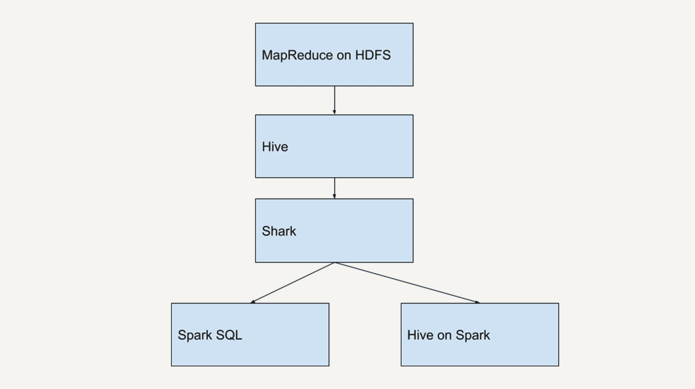
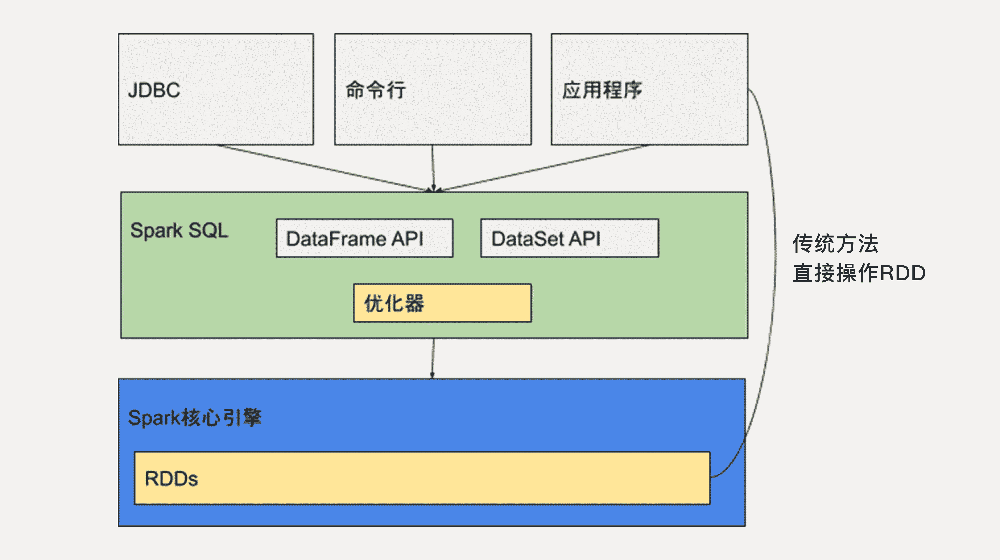
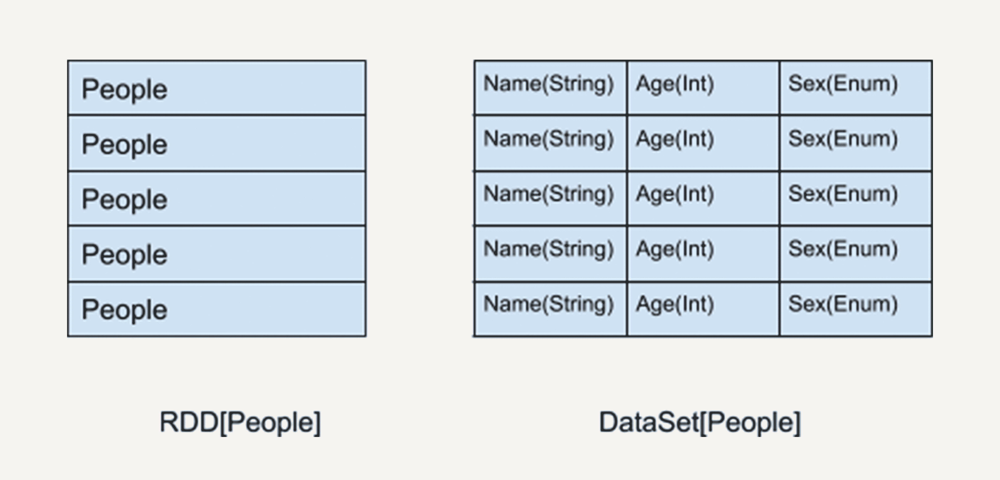
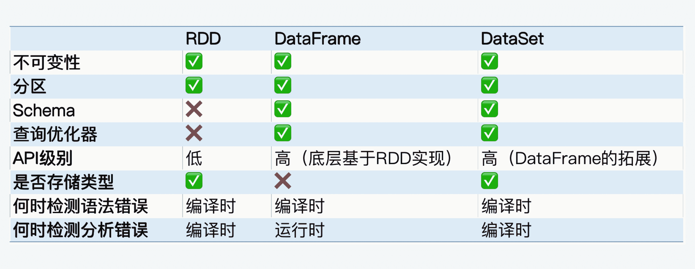
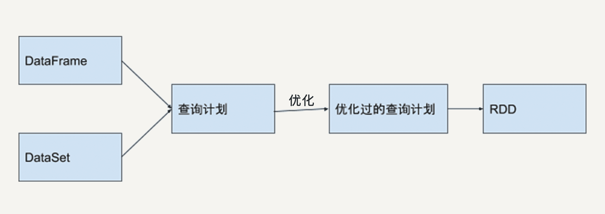

# 15 | Spark SQL：Spark数据查询的利器

 

你好，我是蔡元楠。

上一讲中，我介绍了弹性分布式数据集的特性和它支持的各种数据操作。

不过在实际的开发过程中，我们并不是总需要在 RDD 的层次进行编程。

就好比编程刚发明的年代，工程师只能用汇编语言，到后来才慢慢发展出高级语言，如 Basic、C、Java 等。使用高级语言大大提升了开发者的效率。

同样的，Spark 生态系统也提供很多库，让我们在不同的场景中使用。

今天，让我们来一起探讨 Spark 最常用的数据查询模块——Spark SQL。

## Spark SQL 发展历史

几年前，Hadoop/MapReduce 在企业生产中的大量使用，HDFS 上积累了大量数据。

由于 MapReduce 对于开发者而言使用难度较大，大部分开发人员最熟悉的还是传统的关系型数据库。

为了方便大多数开发人员使用 Hadoop，Hive 应运而生。

Hive 提供类似 SQL 的编程接口，HQL 语句经过语法解析、逻辑计划、物理计划转化成 MapReduce 程序执行，使得开发人员很容易对 HDFS 上存储的数据进行查询和分析。

在 Spark 刚问世的时候，Spark 团队也开发了一个 Shark 来支持用 SQL 语言来查询 Spark 的数据。

Shark 的本质就是 Hive，它修改了 Hive 的内存管理模块，大幅优化了运行速度，是 Hive 的 10 倍到 100 倍之多。

但是，Shark 对于 Hive 的依赖严重影响了 Spark 的发展。Spark 想要定义的是一个统一的技术栈和完整的生态，不可能允许有这样的外在依赖。

试想，如果 Spark 想发布新的功能还需要等 Hive 的更新，那么势必会很难执行。此外，依赖于 Hive 还制约了 Spark 各个组件的相互集成，Shark 也无法利用 Spark 的特性进行深度优化。

所以，2014 年 7 月 1 日，Spark 团队就将 Shark 交给 Hive 进行管理，转而开发了 SparkSQL。

SparkSQL 摒弃了 Shark 的（将 SQL 语句转化为 Spark RDD 的）执行引擎，换成自己团队重新开发的执行引擎。

Spark SQL 不仅将关系型数据库的处理模式和 Spark 的函数式编程相结合，还兼容多种数据格式，包括 Hive、RDD、JSON 文件、CSV 文件等。

可以说，Spark SQL 的问世大大加快了 Spark 生态的发展。

## Spark SQL 的架构

Spark SQL 本质上是一个库。它运行在 Spark 的核心执行引擎之上。

如上图所示，它提供类似于 SQL 的操作接口，允许数据仓库应用程序直接获取数据，允许使用者通过命令行操作来交互地查询数据，还提供两个 API：DataFrame API 和 DataSet API。

Java、Python 和 Scala 的应用程序可以通过这两个 API 来读取和写入 RDD。

此外，正如我们在上一讲介绍的，应用程序还可以直接操作 RDD。

使用 Spark SQL 会让开发者觉得好像是在操作一个关系型数据库一样，而不是在操作 RDD。这是它优于原生的 RDD API 的地方。

与基本的 Spark RDD API 不同，Spark SQL 提供的接口为 Spark 提供了关于数据结构和正在执行的计算的更多信息。

在内部，Spark SQL 使用这些额外的信息来执行额外的优化。虽然 Spark SQL 支持多种交互方式，但是在计算结果时均使用相同的执行引擎。

这种统一意味着开发人员可以轻松地在不同的 API 之间来回切换，基于这些 API 提供了表达给定转换的最自然的方式。

接下来让我们进一步了解 DataSet 和 DataFrame。

## DataSet

DataSet，顾名思义，就是数据集的意思，它是 Spark 1.6 新引入的接口。

同弹性分布式数据集类似，DataSet 也是不可变分布式的数据单元，它既有与 RDD 类似的各种转换和动作函数定义，而且还享受 Spark SQL 优化过的执行引擎，使得数据搜索效率更高。

DataSet 支持的转换和动作也和 RDD 类似，比如 map、filter、select、count、show 及把数据写入文件系统中。

同样地，DataSet 上的转换操作也不会被立刻执行，只是先生成新的 DataSet，只有当遇到动作操作，才会把之前的转换操作一并执行，生成结果。

所以，DataSet 的内部结构包含了逻辑计划，即生成该数据集所需要的运算。

当动作操作执行时，Spark SQL 的查询优化器会优化这个逻辑计划，并生成一个可以分布式执行的、包含分区信息的物理计划。

那么，DataSet 和 RDD 的区别是什么呢？

通过之前的叙述，我们知道 DataSet API 是 Spark SQL 的一个组件。那么，你应该能很容易地联想到，DataSet 也具有关系型数据库中表的特性。

是的，DataSet 所描述的数据都被组织到有名字的列中，就像关系型数据库中的表一样。

如上图所示，左侧的 RDD 虽然以 People 为类型参数，但 Spark 框架本身不了解 People 类的内部结构。所有的操作都以 People 为单位执行。

而右侧的 DataSet 却提供了详细的结构信息与每列的数据类型。

这让 Spark SQL 可以清楚地知道该数据集中包含哪些列，每列的名称和类型各是什么。也就是说，DataSet 提供数据表的 schema 信息。这样的结构使得 DataSet API 的执行效率更高。

试想，如果我们要查询 People 的年龄信息，Spark SQL 执行的时候可以依靠查询优化器仅仅把需要的那一列取出来，其他列的信息根本就不需要去读取了。所以，有了这些信息以后在编译的时候能够做更多的优化。

其次，由于 DataSet 存储了每列的数据类型。所以，在程序编译时可以执行类型检测。

## DataFrame

DataFrame 可以被看作是一种特殊的 DataSet。它也是关系型数据库中表一样的结构化存储机制，也是分布式不可变的数据结构。

但是，它的每一列并不存储类型信息，所以在编译时并不能发现类型错误。DataFrame 每一行的类型固定为 Row，他可以被当作 DataSet[Row] 来处理，我们必须要通过解析才能获取各列的值。

所以，对于 DataSet 我们可以用类似 people.name 来访问一个人的名字，而对于 DataFrame 我们一定要用类似 people.get As [String] (“name”) 来访问。

## RDD、DataFrame、DataSet 对比

学习 Spark 到现在，我们已经接触了三种基本的数据结构：RDD、DataFrame 和 DataSet。接下来你的表格中，你可以看到它们的异同点，思考一下怎样在实际工程中选择。

### 发展历史

从发展历史上来看，RDD API 在第一代 Spark 中就存在，是整个 Spark 框架的基石。

接下来，为了方便熟悉关系型数据库和 SQL 的开发人员使用，在 RDD 的基础上，Spark 创建了 DataFrame API。依靠它，我们可以方便地对数据的列进行操作。

DataSet 最早被加入 Spark SQL 是在 Spark 1.6，它在 DataFrame 的基础上添加了对数据的每一列的类型的限制。

在 Spark 2.0 中，DataFrame 和 DataSet 被统一。DataFrame 作为 DataSet[Row] 存在。在弱类型的语言，如 Python 中，DataFrame API 依然存在，但是在 Java 中，DataFrame API 已经不复存在了。

### 不变性与分区

由于 DataSet 和 DataFrame 都是基于 RDD 的，所以它们都拥有 RDD 的基本特性，在此不做赘述。而且我们可以通过简单的 API 在 DataFrame 或 Dataset 与 RDD 之间进行无缝切换。

### 性能

DataFrame 和 DataSet 的性能要比 RDD 更好。

Spark 程序运行时，Spark SQL 中的查询优化器会对语句进行分析，并生成优化过的 RDD 在底层执行。

举个例子，如果我们想先对一堆数据进行 GroupBy 再进行 Filter 操作，这无疑是低效的，因为我们并不需要对所有数据都 GroupBy。

如果用 RDD API 实现这一语句，在执行时它只会机械地按顺序执行。而如果用 DataFrame/DataSet API，Spark SQL 的 Catalyst 优化器会将 Filter 操作和 GroupBy 操作调换顺序，从而提高执行效率。

下图反映了这一优化过程。

### 错误检测

RDD 和 DataSet 都是类型安全的，而 DataFrame 并不是类型安全的。这是因为它不存储每一列的信息如名字和类型。

使用 DataFrame API 时，我们可以选择一个并不存在的列，这个错误只有在代码被执行时才会抛出。如果使用 DataSet API，在编译时就会检测到这个错误。

## 小结

DataFrame 和 DataSet 是 Spark SQL 提供的基于 RDD 的结构化数据抽象。

它既有 RDD 不可变、分区、存储依赖关系等特性，又拥有类似于关系型数据库的结构化信息。

所以，基于 DataFrame 和 DataSet API 开发出的程序会被自动优化，使得开发人员不需要操作底层的 RDD API 来进行手动优化，大大提升开发效率。

但是 RDD API 对于非结构化的数据处理有独特的优势，比如文本流数据，而且更方便我们做底层的操作。所以在开发中，我们还是需要根据实际情况来选择使用哪种 API。

## 思考题

什么场景适合使用 DataFrame API，什么场景适合使用 DataSet API？

欢迎你把答案写在留言区，与我和其他同学一起讨论。

如果你觉得有所收获，也欢迎把文章分享给你的朋友。

