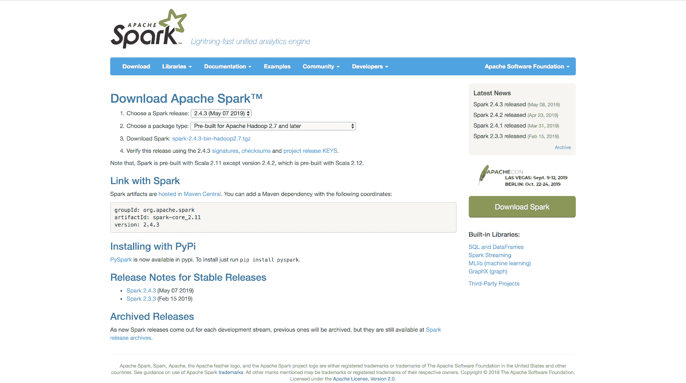
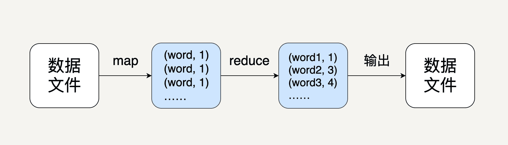

# 18 | Word Count：从零开始运行你的第一个Spark应用

 

你好，我是蔡元楠。

今天我们来从零开始运行你的第一个 Spark 应用。

我们先来回顾一下模块三的学习路径。

首先，我们由浅入深地学习了 Spark 的基本数据结构 RDD，了解了它这样设计的原因，以及它所支持的 API。

之后，我们又学习了 Spark SQL 的 DataSet/DataFrame API，了解到它不仅提供类似于 SQL query 的接口，大大提高了开发者的工作效率，还集成了 Catalyst 优化器，可以提升程序的性能。

这些 API 应对的都是批处理的场景。

再之后，我们学习了 Spark 的流处理模块：Spark Streaming 和 Structured Streaming。两者都是基于微批处理（Micro batch processing）的思想，将流数据按时间间隔分割成小的数据块进行批处理，实时更新计算结果。

其中 Structured Streaming 也是使用 DataSet/DataFrame API，这套 API 在某种程度上统一了批处理和流处理，是当前 Spark 最流行的工具，我们必需要好好掌握。

虽然学习了这么多 API 以及它们的应用，但是大部分同学还没有从零开始写一个完整的 Spark 程序，可能更没有运行 Spark 程序的经历。纸上谈兵并不能帮助我们在工作生活中用 Spark 解决实际问题。所以，今天我就和你一起做个小练习，从在本地安装 Spark、配置环境开始，为你示范怎样一步步解决之前提到数次的统计词频（Word Count）的问题。

通过今天的学习，你可以收获：

 
- 怎样安装 Spark 以及其他相关的模块； 
- 知道什么是 SparkContext、SparkSession； 
- 一个完整的 Spark 程序应该包含哪些东西； 
- 用 RDD、DataFrame、Spark Streaming 如何实现统计词频。 

这一讲中，我们使用的编程语言是 Python，操作系统是 Mac OS X。

在这一讲以及之前文章的例子中，我们都是用 Python 作为开发语言。虽然原生的 Spark 是用 Scala 实现，但是在大数据处理领域中，我个人最喜欢的语言是 Python。因为它非常简单易用，应用非常广泛，有很多的库可以方便我们开发。

当然 Scala 也很棒，作为一个函数式编程语言，它很容易用链式表达对数据集进行各种处理，而且它的运行速度是最快的，感兴趣的同学可以去学习一下。

虽然 Spark 还支持 Java 和 R，但是我个人不推荐你使用。用 Java 写程序实在有些冗长，而且速度上没有优势。

操作系统选 Mac OS X 是因为我个人喜欢使用 Macbook，当然 Linux/Ubuntu 也很棒。

## 安装 Spark

首先，我们来简单介绍一下如何在本地安装 Spark，以及用 Python 实现的 Spark 库——PySpark。

在前面的文章中，我们了解过，Spark 的 job 都是 JVM（Java Virtual Machine）的进程，所以在安装运行 Spark 之前，我们需要确保已经安装 Java Developer Kit（JDK）。在命令行终端中输入：

```
java -version
```

如果命令行输出了某个 Java 的版本，那么说明你已经有 JDK 或者 JRE 在本地。如果显示无法识别这个命令，那么说明你还没有安装 JDK。这时，你可以去[Oracle 的官网](https://www.oracle.com/technetwork/java/javase/downloads/index.html)去下载安装 JDK，然后配置好环境变量。

同样，我们需要确保 Python 也已经被安装在本地了。在命令行输入“Python”或者“Python3”，如果可以成功进入交互式的 Python Shell，就说明已经安装了 Python。否则，需要去[Python 官网](https://www.python.org/downloads/)下载安装 Python。这里，我推荐你使用 Python3 而不是 Python2。

我们同样可以在本地预装好 Hadoop。Spark 可以脱离 Hadoop 运行，不过有时我们也需要依赖于 HDFS 和 YARN。所以，这一步并不是必须的，你可以自行选择。

接下来我们就可以安装 Spark。首先去[Spark 官网](https://spark.apache.org/downloads.html)的下载界面。在第一个下拉菜单里选择最新的发布，第二个菜单最好选择与 Hadoop 2.7 兼容的版本。因为有时我们的 Spark 程序会依赖于 HDFS 和 YARN，所以选择最新的 Hadoop 版本比较好。



下载好之后，解压缩 Spark 安装包，并且把它移动到 /usr/local 目录下，在终端中输入下面的代码。

```
$ tar -xzf ~/Dowmloads/spark-2.4.3-bin-hadoop2.7.tg$ mv spark-2.4.3-bin-hadoop2.7.tgz /usr/local/spark
```

经过上述步骤，从官网下载并安装 Spark 的文件，这样我们便完成了 Spark 的安装。但是，Spark 也是要进行相应的环境变量配置的。你需要打开环境变量配置文件。

```
vim ~/.bash_profile
```

并在最后添加一段代码。

```
export SPARK_HOME=/usr/local/sparkexport PATH=$PATH:$SPARK_HOME/bin
```

这样，所需的步骤都做完之后，我们在命令行控制台输入 PySpark，查看安装情况。如果出现下面的欢迎标志，就说明安装完毕了。

```
Welcome to      ____              __     / __/__  ___ _____/ /__    _\ \/ _ \/ _ `/ __/  '_/   /__ / .__/\_,_/_/ /_/\_\   version 2.4.3      /_/ Using Python version 2.7.10 (default, Oct  6 2017 22:29:07)SparkSession available as 'spark'.>>>
```

## 基于 RDD API 的 Word Count 程序

配置好所需的开发环境之后，下一步就是写一个 Python 程序去统计词语频率。我们都知道这个程序的逻辑应该是如下图所示的。



对于中间的先 map 再 reduce 的处理，我相信通过前面的学习，所有同学都可以用 RDD 或者 DataFrame 实现。

但是，我们对于 Spark 程序的入口是什么、如何用它读取和写入文件，可能并没有了解太多。所以，接下来让我们先接触一下 Spark 程序的入口。

在 Spark 2.0 之前，**SparkContext**是所有 Spark 任务的入口，它包含了 Spark 程序的基本设置，比如程序的名字、内存大小、并行处理的粒度等，Spark 的驱动程序需要利用它来连接到集群。

无论 Spark 集群有多少个节点做并行处理，每个程序只可以有唯一的 SparkContext，它可以被 SparkConf 对象初始化。

```
conf = SparkConf().setAppName(appName).setMaster(master)sc = SparkContext(conf=conf)
```

这个 appName 参数是一个在集群 UI 上展示应用程序的名称，master 参数是一个 Spark、Mesos 或 YARN 的集群 URL，对于本地运行，它可以被指定为“local”。

在统计词频的例子中，我们需要通过 SparkContext 对象来读取输入文件，创建一个 RDD，如下面的代码所示。

```
text_file = sc.textFile("file://…...") // 替换成实际的本地文件路径。
```

这里的 text_file 是一个 RDD，它里面的每一个数据代表原文本文件中的一行。

在这些版本中，如果要使用 Spark 提供的其他库，比如 SQL 或 Streaming，我们就需要为它们分别创建相应的 context 对象，才能调用相应的 API，比如的 DataFrame 和 DStream。

```
hc = HiveContext(sc)ssc = StreamingContext(sc)
```

在 Spark 2.0 之后，随着新的 DataFrame/DataSet API 的普及化，Spark 引入了新的**SparkSession**对象作为所有 Spark 任务的入口。

SparkSession 不仅有 SparkContext 的所有功能，它还集成了所有 Spark 提供的 API，比如 DataFrame、Spark Streaming 和 Structured Streaming，我们再也不用为不同的功能分别定义 Context。

在统计词频的例子中，我们可以这样初始化 SparkSession 以及创建初始 RDD。

```
spark = SparkSession       .builder       .appName(appName)       .getOrCreate()text_file = spark.read.text("file://….").rdd.map(lambda r: r[0])
```

由于 SparkSession 的普适性，我推荐你尽量使用它作为你们 Spark 程序的入口。随后的学习中，我们会逐渐了解怎样通过它调用 DataFrame 和 Streaming API。

让我们回到统计词频的例子。在创建好代表每一行文本的 RDD 之后，接下来我们便需要两个步骤。

 
1. 把每行的文本拆分成一个个词语； 
2. 统计每个词语的频率。 

对于第一步，我们可以用 flatMap 去把行转换成词语。对于第二步，我们可以先把每个词语转换成（word, 1）的形式，然后用 reduceByKey 去把相同词语的次数相加起来。这样，就很容易写出下面的代码了。

```
counts = lines.flatMap(lambda x: x.split(' '))                  .map(lambda x: (x, 1))                  .reduceByKey(add)
```

这里 counts 就是一个包含每个词语的（word，count）pair 的 RDD。

相信你还记得，只有当碰到 action 操作后，这些转换动作才会被执行。所以，接下来我们可以用 collect 操作把结果按数组的形式返回并输出。

```
output = counts.collect()for (word, count) in output:    print("%s: %i" % (word, count))spark.stop() // 停止 SparkSession
```

## 基于 DataSet API 的 Word Count 程序

讲完基于 RDD API 的 Word Count 程序，接下来让我们学习下怎样用 DataSet API 来实现相同的效果。

在 DataSet 的世界中，我们可以把所有的词语放入一张表，表中的每一行代表一个词语，当然这个表只有一列。我们可以对这个表用一个 groupBy() 操作把所有相同的词语聚合起来，然后用 count() 来统计出每个 group 的数量。

```
spark = SparkSession        .builder        .appName(appName)        .getOrCreate()ds_lines = spark.read.textFile("file://….")ds = ds_lines.flatMap(lambda x: x.split(' '))                    .groupBy("Value")                    .count()ds.show() spark.stop()
```

从这个例子，你可以很容易看出使用 DataSet/DataFrame API 的便利性——我们不需要创建（word, count）的 pair 来作为中间值，可以直接对数据做类似 SQL 的查询。

## 小结

通过今天的学习，我们掌握了如何从零开始创建一个简单的 Spark 的应用程序，包括如何安装 Spark、如何配置环境、Spark 程序的基本结构等等。

## 实践题

希望你可以自己动手操作一下，这整个过程只需要跑通一次，以后就可以脱离纸上谈兵，真正去解决实际问题。

欢迎你在留言中反馈自己动手操作的效果。

如果你跑通了，可以在留言中打个卡。如果遇到了问题，也请你在文章中留言，与我和其他同学一起讨论。


