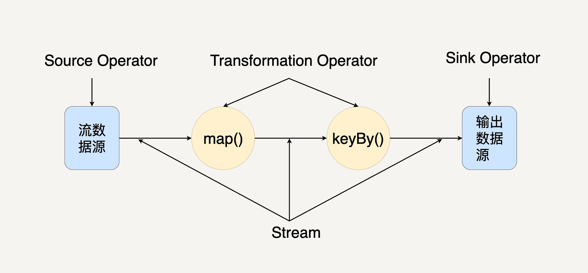
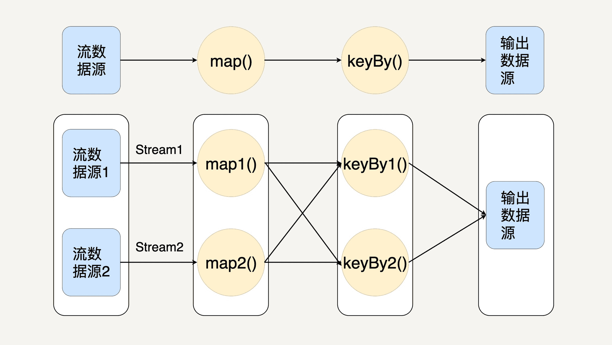
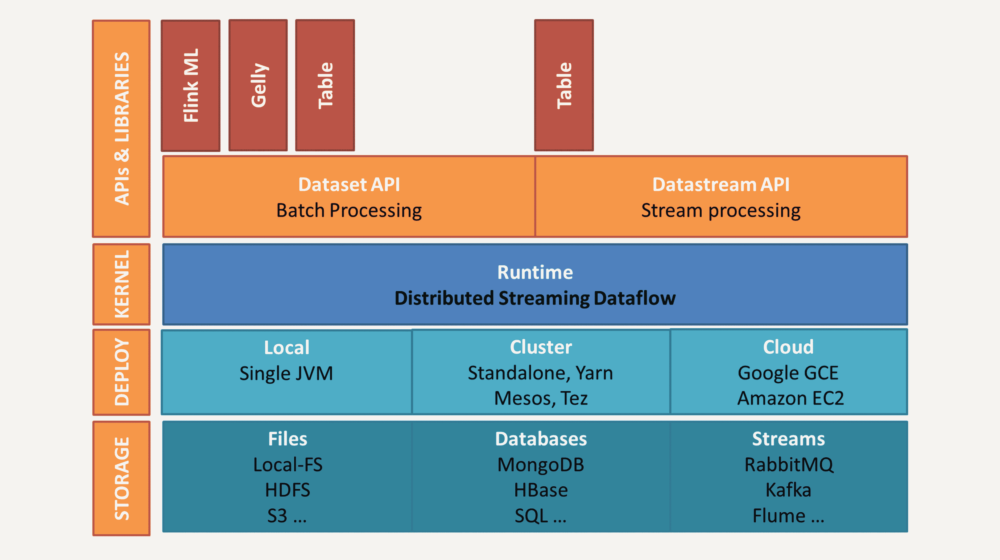

# 21 | 深入对比Spark与Flink：帮你系统设计两开花

 

你好，我是蔡元楠。

今天我要与你分享的主题是“深入对比 Spark 与 Flink”。

相信通过这一模块前 9 讲的学习，你对 Spark 已经有了基本的认识。现在，我们先来回顾整个模块，理清一下思路。

首先，从 MapReduce 框架存在的问题入手，我们知道了 Spark 的主要优点，比如用内存运算来提高性能；提供很多 High-level API；开发者无需用 map 和 reduce 两个操作实现复杂逻辑；支持流处理等等。

接下来，我们学习了 Spark 的数据抽象——RDD。RDD 是整个 Spark 的核心概念，所有的新 API 在底层都是基于 RDD 实现的。但是 RDD 是否就是完美无缺的呢？显然不是，它还是很底层，不方便开发者使用，而且用 RDD API 写的应用程序需要大量的人工调优来提高性能。

Spark SQL 提供的 DataFrame/DataSet API 就解决了这个问题，它提供类似 SQL 的查询接口，把数据看成关系型数据库的表，提升了熟悉关系型数据库的开发者的工作效率。这部分内容都是专注于数据的批处理，那么我们很自然地就过渡到下一个问题：Spark 是怎样支持流处理的呢？

那就讲到了 Spark Streaming 和新的 Structured Streaming，这是 Spark 的流处理组件，其中 Structured Streaming 也可以使用 DataSet/DataFrame API，这就实现了 Spark 批流处理的统一。

通过这个简单的回顾我们发现，Spark 的发布，和之后各个版本新功能的发布，并不是开发人员拍脑袋的决定，每个新版本发布的功能都是在解决旧功能的问题。在如此多的开源工作者的努力下，Spark 生态系统才有今天的规模，成为了当前最流行的大数据处理框架之一。

在开篇词中我就提到过，我希望你能通过这个专栏建立自己的批判性思维，遇到一个新的技术，多问为什么，而不是盲目的接受和学习。只有这样我们才能不随波逐流，成为这个百花齐放的技术时代的弄潮儿。

所以，这里我想问你一个问题，Spark 有什么缺点？

这个缺点我们之前已经提到过一个——无论是 Spark Streaming 还是 Structured Streaming，Spark 流处理的实时性还不够，所以无法用在一些对实时性要求很高的流处理场景中。

这是因为 Spark 的流处理是基于所谓微批处理（Micro-batch processing）的思想，即它把流处理看作是批处理的一种特殊形式，每次接收到一个时间间隔的数据才会去处理，所以天生很难在实时性上有所提升。

虽然在 Spark 2.3 中提出了连续处理模型（Continuous Processing Model），但是现在只支持很有限的功能，并不能在大的项目中使用。Spark 还需要做出很大的努力才能改进现有的流处理模型。

想要在流处理的实时性上提升，就不能继续用微批处理的模式，而要想办法实现真正的流处理，即每当有一条数据输入就立刻处理，不做等待。那么当今时代有没有这样的流处理框架呢？

Apache Flink 就是其中的翘楚。它采用了基于操作符（Operator）的连续流模型，可以做到微秒级别的延迟。今天我就带你一起了解一下这个流行的数据处理平台，并将 Flink 与 Spark 做深入对比，方便你在今后的实际项目中做出选择。

## Flink 核心模型简介

Flink 中最核心的数据结构是 Stream，它代表一个运行在多个分区上的并行流。

在 Stream 上同样可以进行各种转换操作（Transformation）。与 Spark 的 RDD 不同的是，Stream 代表一个数据流而不是静态数据的集合。所以，它包含的数据是随着时间增长而变化的。而且 Stream 上的转换操作都是逐条进行的，即每当有新的数据进来，整个流程都会被执行并更新结果。这样的基本处理模式决定了 Flink 会比 Spark Streaming 有更低的流处理延迟性。

当一个 Flink 程序被执行的时候，它会被映射为 Streaming Dataflow，下图就是一个 Streaming Dataflow 的示意图。



在图中，你可以看出 Streaming Dataflow 包括 Stream 和 Operator（操作符）。转换操作符把一个或多个 Stream 转换成多个 Stream。每个 Dataflow 都有一个输入数据源（Source）和输出数据源（Sink）。与 Spark 的 RDD 转换图类似，Streaming Dataflow 也会被组合成一个有向无环图去执行。

在 Flink 中，程序天生是并行和分布式的。一个 Stream 可以包含多个分区（Stream Partitions），一个操作符可以被分成多个操作符子任务，每一个子任务是在不同的线程或者不同的机器节点中独立执行的。如下图所示：



从上图你可以看出，Stream 在操作符之间传输数据的形式有两种：一对一和重新分布。

 
- 一对一（One-to-one）：Stream 维护着分区以及元素的顺序，比如上图从输入数据源到 map 间。这意味着 map 操作符的子任务处理的数据和输入数据源的子任务生产的元素的数据相同。你有没有发现，它与 RDD 的窄依赖类似。 
- 重新分布（Redistributing）：Stream 中数据的分区会发生改变，比如上图中 map 与 keyBy 之间。操作符的每一个子任务把数据发送到不同的目标子任务。 

## Flink 的架构

当前版本 Flink 的架构如下图所示。



我们可以看到，这个架构和[第 12 讲](https://time.geekbang.org/column/article/94410)中介绍的 Spark 架构比较类似，都分为四层：存储层、部署层、核心处理引擎、high-level 的 API 和库。

从存储层来看，Flink 同样兼容多种主流文件系统如 HDFS、Amazon S3，多种数据库如 HBase 和多种数据流如 Kafka 和 Flume。

从部署层来看，Flink 不仅支持本地运行，还能在独立集群或者在被 YARN 或 Mesos 管理的集群上运行，也能部署在云端。

核心处理引擎就是我们刚才提到的分布式 Streaming Dataflow，所有的高级 API 及应用库都会被翻译成包含 Stream 和 Operator 的 Dataflow 来执行。

Flink 提供的两个核心 API 就是 DataSet API 和 DataStream API。你没看错，名字和 Spark 的 DataSet、DataFrame 非常相似。顾名思义，DataSet 代表有界的数据集，而 DataStream 代表流数据。所以，DataSet API 是用来做批处理的，而 DataStream API 是做流处理的。

也许你会问，Flink 这样基于流的模型是怎样支持批处理的？在内部，DataSet 其实也用 Stream 表示，静态的有界数据也可以被看作是特殊的流数据，而且 DataSet 与 DataStream 可以无缝切换。所以，Flink 的核心是 DataStream。

DataSet 和 DataStream 都支持各种基本的转换操作如 map、filter、count、groupBy 等，让我们来看一个用 DataStream 实现的统计词频例子。

```
public class WindowWordCount { public static void main(String[] args) throws Exception {   StreamExecutionEnvironment env = StreamExecutionEnvironment.getExecutionEnvironment();     DataStream<Tuple2<String, Integer>> dataStream = env　　.socketTextStream("localhost", 9999)　　.flatMap(new Splitter())　　.keyBy(0)　　.timeWindow(Time.seconds(5))　　.sum(1);     dataStream.print();   env.execute("Window WordCount");}   public static class Splitter implements FlatMapFunction<String, Tuple2<String, Integer>> {   @Override   public void flatMap(String sentence, Collector<Tuple2<String, Integer>> out) {     for (String word: sentence.split(" ")) {       out.collect(new Tuple2<String, Integer>(word, 1));     }   } }
```

这里我是用 Java 来示范的，因为 Flink 就是用 Java 开发的，所以它对 Java 有原生的支持。此外，也可以用 Scala 来开发 Flink 程序，在 1.0 版本后更是支持了 Python。

在这个例子中，我们首先创建了一个 Splitter 类，来把输入的句子拆分成（词语，1）的对。在主程序中用 StreamExecutionEnvironment 创建 DataStream，来接收本地 Web Socket 的文本流，并进行了 4 步操作。

 
1. 用 flatMap 把输入文本拆分成（词语，1）的对； 
2. 用 keyBy 把相同的词语分配到相同的分区； 
3. 设好 5 秒的时间窗口； 
4. 对词语的出现频率用 sum 求和。 

可以看出，DataStream 的使用方法和 RDD 比较相似，都是把程序拆分成一系列的转换操作并分布式地执行。

在 DataSet 和 DataStream 之上，有更高层次的 Table API。Table API 和 Spark SQL 的思想类似，是关系型的 API，用户可以像操作 SQL 数据库表一样的操作数据，而不需要通过写 Java 代码、操作 DataStream/DataSet 的方式进行数据处理，更不需要手动优化代码的执行逻辑。

此外，Table API 同样统一了 Flink 的批处理和流处理。

## Flink 和 Spark 对比

通过前面的学习，我们了解到，Spark 和 Flink 都支持批处理和流处理，接下来让我们对这两种流行的数据处理框架在各方面进行对比。

首先，这两个数据处理框架有很多相同点。

 
- 都基于内存计算； 
- 都有统一的批处理和流处理 API，都支持类似 SQL 的编程接口； 
- 都支持很多相同的转换操作，编程都是用类似于 Scala Collection API 的函数式编程模式； 
- 都有完善的错误恢复机制； 
- 都支持 Exactly once 的语义一致性。 

当然，它们的不同点也是相当明显，我们可以从 4 个不同的角度来看。

**从流处理的角度来讲**，Spark 基于微批量处理，把流数据看成是一个个小的批处理数据块分别处理，所以延迟性只能做到秒级。而 Flink 基于每个事件处理，每当有新的数据输入都会立刻处理，是真正的流式计算，支持毫秒级计算。由于相同的原因，Spark 只支持基于时间的窗口操作（处理时间或者事件时间），而 Flink 支持的窗口操作则非常灵活，不仅支持时间窗口，还支持基于数据本身的窗口，开发者可以自由定义想要的窗口操作。

**从 SQL 功能的角度来讲**，Spark 和 Flink 分别提供 SparkSQL 和 Table API 提供 SQL 交互支持。两者相比较，Spark 对 SQL 支持更好，相应的优化、扩展和性能更好，而 Flink 在 SQL 支持方面还有很大提升空间。

**从迭代计算的角度来讲**，Spark 对机器学习的支持很好，因为可以在内存中缓存中间计算结果来加速机器学习算法的运行。但是大部分机器学习算法其实是一个有环的数据流，在 Spark 中，却是用无环图来表示。而 Flink 支持在运行时间中的有环数据流，从而可以更有效的对机器学习算法进行运算。

**从相应的生态系统角度来讲**，Spark 的社区无疑更加活跃。Spark 可以说有着 Apache 旗下最多的开源贡献者，而且有很多不同的库来用在不同场景。而 Flink 由于较新，现阶段的开源社区不如 Spark 活跃，各种库的功能也不如 Spark 全面。但是 Flink 还在不断发展，各种功能也在逐渐完善。

## 小结

今天我们从 Spark 存在的一个缺点——无法高效应对低延迟的流处理场景入手，一起学习了另一个主流流数据处理框架 Flink，还对比了这两个框架的异同，相信现在你对两个框架肯定有了更多的认识。

我经常被问到的一个问题是：Spark 和 Flink 到底该选哪一个？对于这个问题，我们还是要分一下场景。

对于以下场景，你可以选择 Spark。

 
1. 数据量非常大而且逻辑复杂的批数据处理，并且对计算效率有较高要求（比如用大数据分析来构建推荐系统进行个性化推荐、广告定点投放等）； 
2. 基于历史数据的交互式查询，要求响应较快； 
3. 基于实时数据流的数据处理，延迟性要求在在数百毫秒到数秒之间。 

Spark 完美满足这些场景的需求， 而且它可以一站式解决这些问题，无需用别的数据处理平台。

由于 Flink 是为了提升流处理而创建的平台，所以它适用于各种需要非常低延迟（微秒到毫秒级）的实时数据处理场景，比如实时日志报表分析。

而且 Flink 用流处理去模拟批处理的思想，比 Spark 用批处理去模拟流处理的思想扩展性更好，所以我相信将来 Flink 会发展的越来越好，生态和社区各方面追上 Spark。比如，阿里巴巴就基于 Flink 构建了公司范围内全平台使用的数据处理平台 Blink，美团、饿了么等公司也都接受 Flink 作为数据处理解决方案。

可以说，Spark 和 Flink 都在某种程度上统一了批处理和流处理，但也都有一些不足。下一模块中，让我们来一起学习一个全新的、完全统一批流处理的数据处理平台——Apache Beam，到时候我们会对 Spark 的优缺点有更加深入的认识。

## 思考题

除了高延迟的流处理这一缺点外，你认为 Spark 还有什么不足？可以怎样改进？

欢迎你把答案写在留言区，与我和其他同学一起讨论。如果你觉得有所收获，也欢迎把文章分享给你的朋友。


