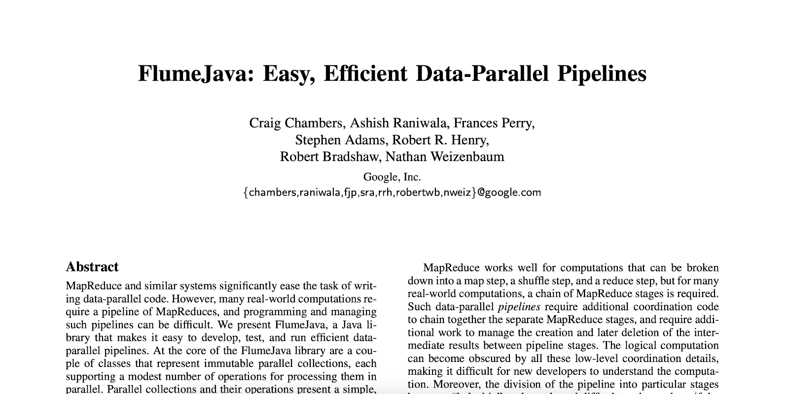
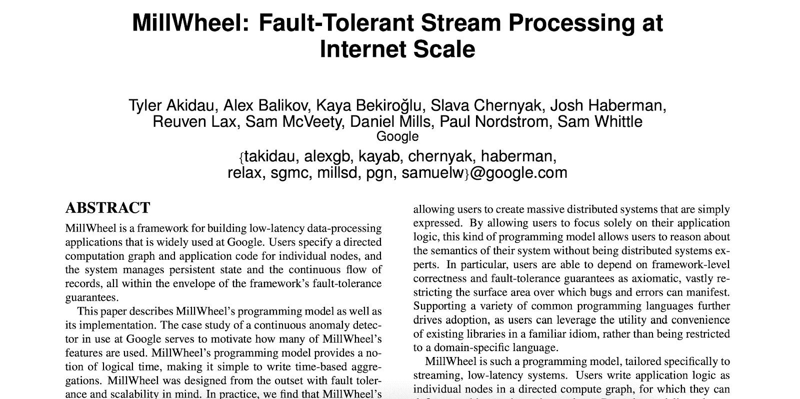
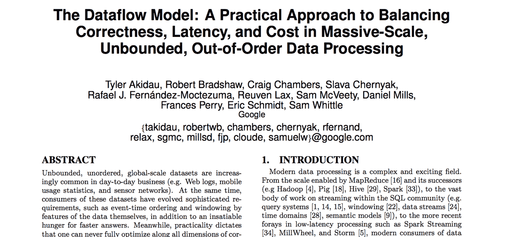
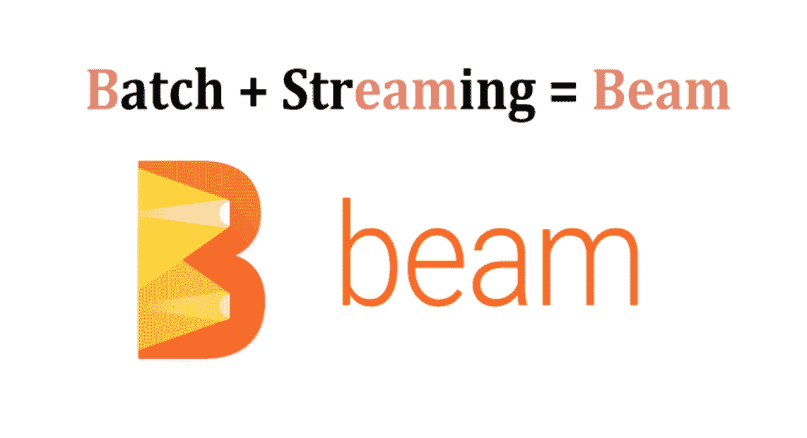
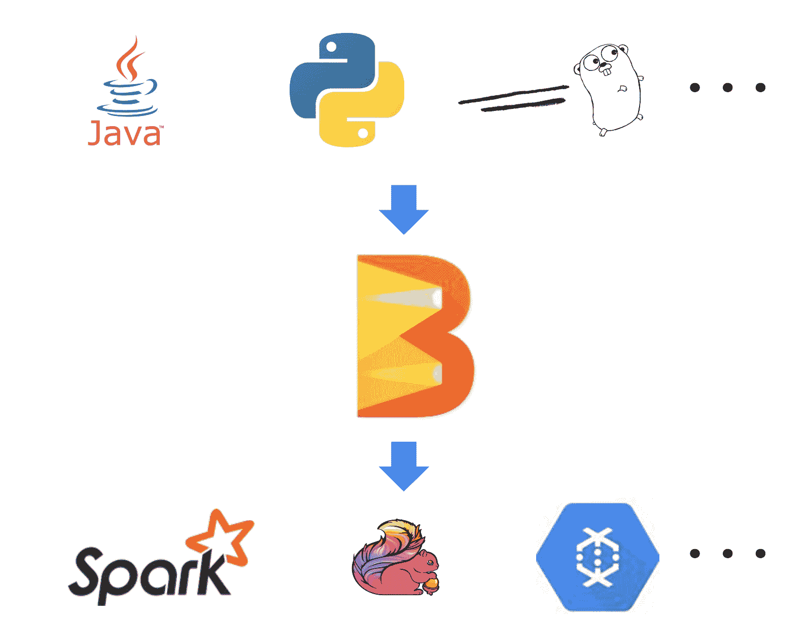

# 22 | Apache Beam的前世今生

 

你好，我是蔡元楠。

今天我要与你分享的主题是“ Apache Beam 的前世今生”。

从这一讲开始，我们将进入一个全新的篇章。在这一讲中，我将会带领你了解 Apache Beam 的完整诞生历程。

让我们一起来感受一下，Google 是如何从处理框架上的一无所有，一直发展到推动、制定批流统一的标准的。除此之外，我还会告诉你，在 2004 年发布了 MapReduce 论文之后，Google 在大规模数据处理实战中到底经历了哪些技术难题和技术变迁。我相信通过这一讲，你将会完整地认识到为什么 Google 会强力推崇 Apache Beam。

在 2003 年以前，Google 内部其实还没有一个成熟的处理框架来处理大规模数据。而当时 Google 的搜索业务又让工程师们不得不面临着处理大规模数据的应用场景，像计算网站 URL 访问量、计算网页的倒排索引（Inverted Index）等等。

那该怎么办呢？这个答案既简单又复杂：自己写一个。

没错，当时的工程师们需要自己写一个自定义的逻辑处理架构来处理这些数据。因为需要处理的数据量非常庞大，业务逻辑不太可能只放在一台机器上面运行。很多情况下，我们都必须把业务逻辑部署在分布式环境中。所以，这个自定义的逻辑处理架构还必须包括容错系统（Fault Tolerant System）的设计。

久而久之，Google 内部不同组之间都会开发出一套自己组内的逻辑处理架构。因为工程师们遇到的问题很多都是相似的，开发出来的这些逻辑处理架构很多时候也都是大同小异，只是有一些数据处理上的逻辑差别而已。这无疑就变成了大家一起重复造轮子的情况。

这时候，就有工程师想到，能不能改善这一种状况。MapReduce 的架构思想也就由此应运而生。

## MapReduce

其实 MapReduce 的架构思想可以从两个方面来看。

一方面，它希望能提供一套简洁的 API 来表达工程师数据处理的逻辑。另一方面，要在这一套 API 底层嵌套一套扩展性很强的容错系统，使得工程师能够将心思放在逻辑处理上，而不用过于分心去设计分布式的容错系统。

这个架构思想的结果你早就已经知道了。MapReduce 这一套系统在 Google 获得了巨大成功。在 2004 年的时候，Google 发布的一篇名为“MapReduce: Simplified Data Processing on Large Clusters”的论文就是这份成果的总结。

在 MapReduce 的计算模型里，它将数据的处理抽象成了以下这样的计算步骤

 
- Map：计算模型从输入源（Input Source）中读取数据集合，这些数据在经过了用户所写的逻辑后生成出一个临时的键值对数据集（Key/Value Set）。MapReduce 计算模型会将拥有相同键（Key）的数据集集中起来然后发送到下一阶段。这一步也被称为 Shuffle 阶段。 
- Reduce：接收从 Shuffle 阶段发送过来的数据集，在经过了用户所写的逻辑后生成出零个或多个结果。 

很多人都说，这篇 MapReduce 论文是具有划时代意义的。可你知道为什么都这么说吗？

这是因为 Map 和 Reduce 这两种抽象其实可以适用于非常多的应用场景，而 MapReduce 论文里面所阐述的容错系统，可以让我们所写出来的数据处理逻辑在分布式环境下有着很好的可扩展性（Scalability）。

MapReduce 在内部的成功使得越来越多的工程师希望使用 MapReduce 来解决自己项目的难题。

但是，就如我在模块一中所说的那样，使用 MapReduce 来解决一个工程难题往往会涉及到非常多的步骤，而每次使用 MapReduce 的时候我们都需要在分布式环境中启动机器来完成 Map 和 Reduce 步骤，以及启动 Master 机器来协调这两个步骤的中间结果（Intermediate Result），消耗不少硬件上的资源。

这样就给工程师们带来了以下一些疑问：

 
- 我们的项目数据规模是否真的需要运用 MapReduce 来解决呢？是否可以在一台机器上的内存中解决呢？ 
- 我们所写的 MapReduce 项目是否已经是最优的呢？因为每一个 Map 和 Reduce 步骤这些中间结果都需要写在磁盘上，会十分耗时。是否有些步骤可以省略或者合并呢？我们是否需要让工程师投入时间去手动调试这些 MapReduce 项目的性能呢？ 

问题既然已经提出来了，Google 的工程师们便开始考虑是否能够解决上述这些问题。最好能够让工程师（无论是新手工程师亦或是经验老到的工程师）都能专注于数据逻辑上的处理，而不用花更多时间在测试调优上。

FlumeJava 就是在这样的背景下诞生的。

## FlumeJava

这里，我先将 FlumeJava 的成果告诉你。因为 FlumeJava 的思想又在 Google 内容获得了巨大成功，Google 也希望将这个思想分享给业界。所以在 2010 年的时候，Google 公开了 FlumeJava 架构思想的论文。

FlumeJava 的思想是将所有的数据都抽象成名为 PCollection 的数据结构，无论是从内存中读取的数据，还是在分布式环境下所读取的文件。

这样的抽象对于测试代码中的逻辑是十分有好处的。要知道，想测试 MapReduce 的话，你可能需要读取测试数据集，然后在分布式环境下运行，来测试代码逻辑。但如果你有了 PCollection 这一层抽象的话，你的测试代码可以在内存中读取数据然后跑测试文件，也就是同样的逻辑既可以在分布式环境下运行也可以在单机内存中运行。

而 FlumeJava 在 MapReduce 框架中 Map 和 Reduce 思想上，抽象出 4 个了原始操作（Primitive Operation），分别是 parallelDo、groupByKey、 combineValues 和 flatten，让工程师可以利用这 4 种原始操作来表达任意 Map 或者 Reduce 的逻辑。

同时，FlumeJava 的架构运用了一种 Deferred Evaluation 的技术，来优化我们所写的代码。

对于 Deferred Evaluation，你可以理解为 FlumeJava 框架会首先会将我们所写的逻辑代码静态遍历一次，然后构造出一个执行计划的有向无环图。这在 FlumeJava 框架里被称为 Execution Plan Dataflow Graph。

有了这个图之后，FlumeJava 框架就会自动帮我们优化代码。例如，合并一些本来可以通过一个 Map 和 Reduce 来表达，却被新手工程师分成多个 Map 和 Reduce 的代码。

FlumeJava 框架还可以通过我们的输入数据集规模，来预测输出结果的规模，从而自行决定代码是放在内存中跑还是在分布式环境中跑。

总的来说，FlumeJava 是非常成功的。但是，FlumeJava 也有一个弊端，那就是 FlumeJava 基本上只支持批处理（Batch Execution）的任务，对于无边界数据（Unbounded Data）是不支持的。所以，Google 内部有着另外一个被称为 Millwheel 的项目来支持处理无边界数据，也就是流处理框架。

在 2013 年的时候，Google 也公开了 Millwheel 思想的论文。

这时 Google 的工程师们回过头看，感叹了一下成果，并觉得自己可以再优秀一些：既然我们已经创造出好几个优秀的大规模数据处理框架了，那我们能不能集合这几个框架的优点，推出一个统一的框架呢？

这也成为了 Dataflow Model 诞生的契机。

## Dataflow Model

在 2015 年时候，Google 公布了 Dataflow Model 的论文，同时也推出了基于 Dataflow Model 思想的平台 Cloud Dataflow，让 Google 以外的工程师们也能够利用这些 SDK 来编写大规模数据处理的逻辑。

讲到这么多，你可能会有个疑问了，怎么 Apache Beam 还没有出场呢？别着急，Apache Beam 的登场契机马上就到了。

## Apache Beam

前面我说了，Google 基于 Dataflow Model 的思想推出了 Cloud Dataflow 云平台，但那毕竟也需要工程师在 Google 的云平台上面运行程序才可以。如果有的工程师希望在别的平台上面跑该如何解决呢？

所以，为了解决这个问题，Google 在 2016 年的时候联合了 Talend、Data Artisans、Cloudera 这些大数据公司，基于 Dataflow Model 的思想开发出了一套 SDK，并贡献给了 Apache Software Foundation。而它 Apache Beam 的名字是怎么来的呢？就如下图所示，Beam 的含义就是统一了批处理和流处理的一个框架。

这就是 Apache Beam 的发展历史，从中你可以看到它拥有很多优点，而这也是我们需要 Beam 的原因。

在现实世界中，很多时候我们不可避免地需要对数据同时进行批处理和流处理。Beam 提供了一套统一的 API 来处理这两种数据处理模式，让我们只需要将注意力专注于在数据处理的算法上，而不用再花时间去对两种数据处理模式上的差异进行维护。

它能够将工程师写好的算法逻辑很好地与底层的运行环境分隔开。也就是说，当我们通过 Beam 提供的 API 写好数据处理逻辑后，这个逻辑可以不作任何修改，直接放到任何支持 Beam API 的底层系统上运行。

关于怎么理解这个优点，其实我们可以借鉴一下 SQL（Structure Query Language）的运行模式。

我们在学习 SQL 语言的时候，基本上都是独立于底层数据库系统来学习的。而在我们写完一个分析数据的 Query 之后，只要底层数据库的 Schema 不变，这个 Query 是可以放在任何数据库系统上运行的，例如放在 MySql 上或者 Oracle DB 上。

同样的，我们用 Beam API 写好的数据处理逻辑无需改变，可以根据自身的需求，将逻辑放在 Google Cloud Dataflow 上跑，也可以放在 Apache Flink 上跑。在 Beam 上，这些底层运行的系统被称为 Runner。现阶段 Apache Beam 支持的 Runner 有近十种，包括了我们很熟悉的 Apache Spark 和 Apache Flink。

当然最后 Apache Beam 也是希望对自身的 SDK 能够支持任意多的语言来编写。现阶段 Beam 支持 Java、Python 和 Golang。

也就是说，通过 Apache Beam，最终我们可以用自己喜欢的编程语言，通过一套 Beam Model 统一地数据处理 API，编写好符合自己应用场景的数据处理逻辑，放在自己喜欢的 Runner 上运行。

## 小结

今天，我与你一起回顾了 Apache Beam 的完整诞生历程。

通过这一讲，我希望你知道每一项技术都不会毫无理由地诞生，而每一项技术诞生的背后都是为了解决某些特定问题的。了解前人一步步解决问题的过程，有助于我们更有层次地理解一项技术产生的根本原因。在学习一项技术之前，先了解了它的历史源流，可以让我们做到知其然，并知其所以然。

## 思考题

你也能分享一些你所经历过的技术变迁或是技术诞生的故事吗？

欢迎你把答案写在留言区，与我和其他同学一起讨论。如果你觉得有所收获，也欢迎把文章分享给你的朋友。

