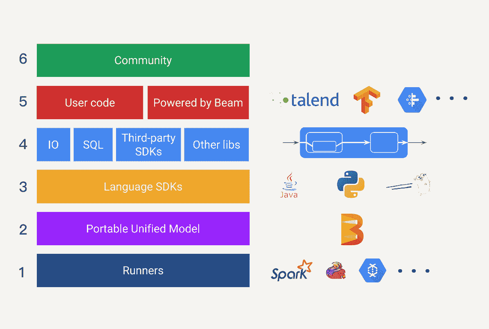
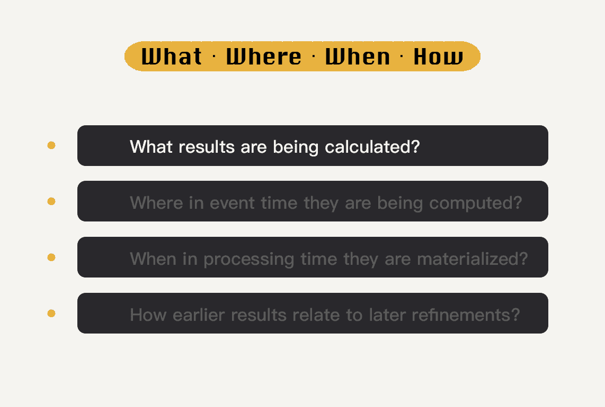
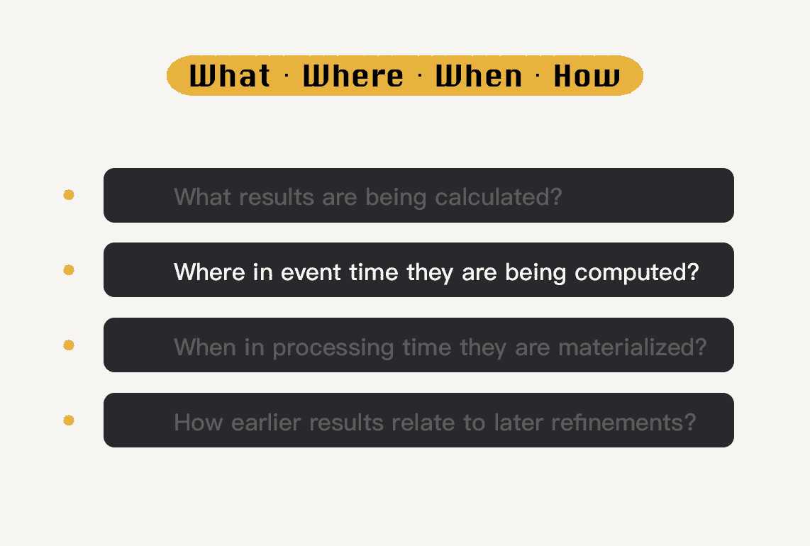
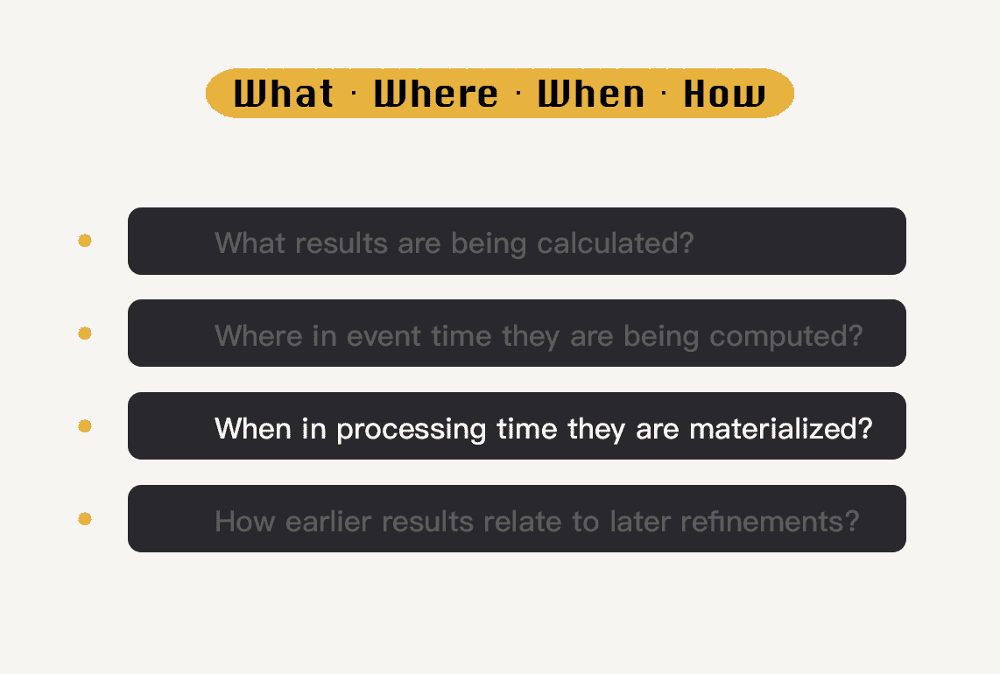
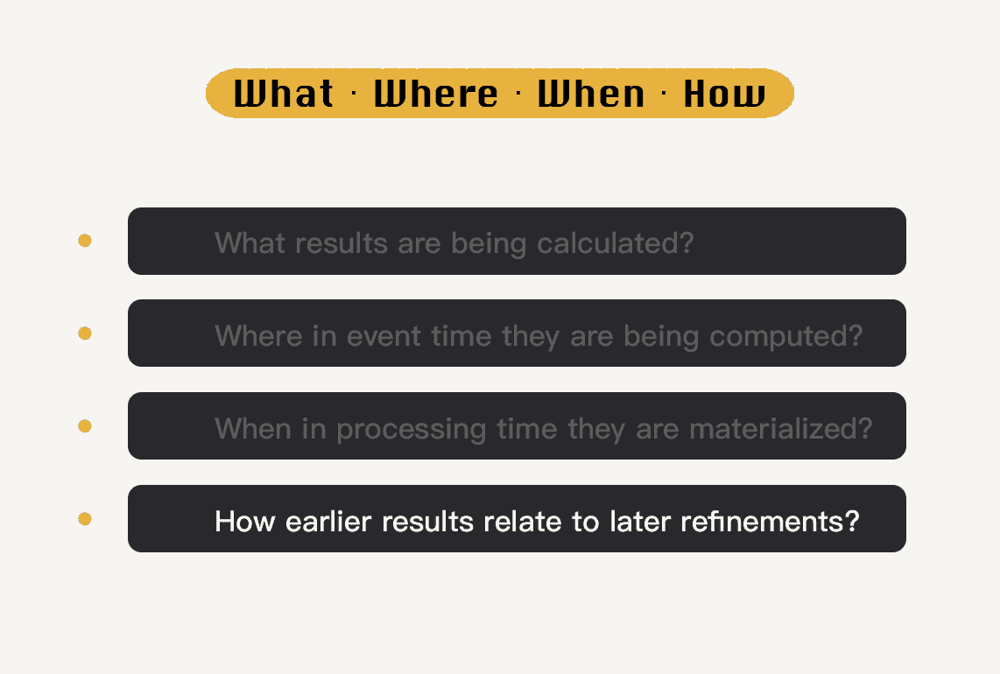

# 23 | 站在Google的肩膀上学习Beam编程模型

 

你好，我是蔡元楠。

今天我要与你分享的话题是“站在 Google 的肩膀上学习 Beam 编程模型”。

在上一讲中，我带你一起领略了 Apache Beam 的完整诞生历史。通过上一讲，你应该对于 Apache Beam 在大规模数据处理中能够带来的便利有了一定的了解。

而在这一讲中，让我们一起来学习 Apache Beam 的编程模型，帮助你打下良好的基础以便应对接下来的 Beam 实战篇。希望你在以后遇到不同的数据处理问题时，可以有着 Beam 所提倡的思考模式。

现在让我们一起进入 Beam 的世界吧。

## 为什么要先学习 Beam 的编程模型？

可能你会有疑问，很多人学习一项新技术的时候，都是从学习 SDK 的使用入手，为什么我们不同样的从 SDK 入手，而是要先学习 Beam 的编程模型呢？

我的答案有两点。

第一，Apache Beam 和其他开源项目不太一样，它并不是一个数据处理平台，本身也无法对数据进行处理。Beam 所提供的是一个统一的编程模型思想，而我们可以通过这个统一出来的接口来编写符合自己需求的处理逻辑，这个处理逻辑将会被转化成为底层运行引擎相应的 API 去运行。

第二，学习 Apache Beam 的时候，如果只学习 SDK 的使用，可能你不一定能明白这些统一出来的 SDK 设计背后的含义，而这些设计的思想又恰恰是涵盖了解决数据处理世界中我们所能遇见的问题。我认为将所有的 SDK 都介绍一遍是不现实的。SDK 会变，但它背后的原理却却不会改变，只有当我们深入了解了整个设计原理后，遇到各种应用场景时，才能处理得更加得心应手。

## Beam 的编程模型

那事不宜迟，我们来看看 Beam 的编程模型到底指的是什么？

简单来说，Beam 的编程模型需要让我们根据“WWWH”这四个问题来进行数据处理逻辑的编写。“WWWH”是哪四个问题呢？这里我先卖个关子，在进入四个具体问题之前，我需要先介绍一下根据 Beam 编程模型所建立起来的 Beam 生态圈，帮助你理解 Beam 的编程模型会涉及到的几个概念。整个 Apache Beam 的生态圈构成就如下图所示。

为了帮助你理解，我为这几层加了编号，数字编号顺序是自下而上的，你可以对照查找。

第一层，是现在已有的各种大数据处理平台（例如 Apache Spark 或者 Apache Flink），在 Beam 中它们也被称为 Runner。

第二层，是可移植的统一模型层，各个 Runners 将会依据中间抽象出来的这个模型思想，提供一套符合这个模型的 APIs 出来，以供上层转换。

第三层，是 SDK 层。SDK 层将会给工程师提供不同语言版本的 API 来编写数据处理逻辑，这些逻辑就会被转化成 Runner 中相应的 API 来运行。

第四层，是可扩展库层。工程师可以根据已有的 Beam SDK，贡献分享出更多的新开发者 SDK、IO 连接器、转换操作库等等。

第五层，我们可以看作是应用层，各种应用将会通过下层的 Beam SDK 或工程师贡献的开发者 SDK 来实现。

最上面的第六层，也就是社区一层。在这里，全世界的工程师可以提出问题，解决问题，实现解决问题的思路。

通过第 6 讲的内容，我们已经知道，这个世界中的数据可以分成有边界数据和无边界数据，而有边界数据又是无边界数据的一种特例。所以，我们都可以将所有的数据抽象看作是无边界数据。

同时，每一个数据都是有两种时域的，分别是事件时间和处理时间。我们在处理无边界数据的时候，因为在现实世界中，数据会有延时、丢失等等的状况发生，我们无法保证现在到底是否接收完了所有发生在某一时刻之前的数据。所以现实中，流处理必须在数据的完整性和数据处理的延时性上作出取舍。Beam 编程模型就是在这样的基础上提出的。

Beam 编程模型会涉及到的 4 个概念，窗口、水印、触发器和累加模式，我来为你介绍一下。

 
- **窗口（Window）** 

窗口将无边界数据根据事件时间分成了一个个有限的数据集。我们可以看看批处理这个特例。在批处理中，我们其实是把一个无穷小到无穷大的时间窗口赋予了数据集。我会在第 32 讲中，对窗口这个概念进行详细地介绍。

 
- **水印（Watermark）** 

水印是用来表示与数据事件时间相关联的输入完整性的概念。对于事件时间为 X 的水印是指：数据处理逻辑已经得到了所有事件时间小于 X 的无边界数据。在数据处理中，水印是用来测量数据进度的。

 
- **触发器（Triggers）** 

触发器指的是表示在具体什么时候，数据处理逻辑会真正地触发窗口中的数据被计算。触发器能让我们可以在有需要时对数据进行多次运算，例如某时间窗口内的数据有更新，这一窗口内的数据结果需要重算。

 
- **累加模式（Accumulation）** 

累加模式指的是如果我们在同一窗口中得到多个运算结果，我们应该如何处理这些运算结果。这些结果之间可能完全不相关，例如与时间先后无关的结果，直接覆盖以前的运算结果即可。这些结果也可能会重叠在一起。

懂得了这几个概念之后，我来告诉你究竟 Beam 编程模型中的“WWWH”是什么。它们分别是：What、Where、When、How。

**What results are being calculated?**

我们要做什么计算？得到什么样的结果？Beam SDK 中各种 transform 操作就是用来回答这个问题的。这包括我们经常使用到批处理逻辑，训练机器学习模型的逻辑等等。

举个例子，我们每次学习大规模数据处理时所用到的经典例子 WordCount 里，我们想要得到在一篇文章里每个单词出现的次数，那我们所要做的计算就是通过 Transform 操作将一个单词集合转换成以单词为 Key，单词出现次数为 Value 的集合。

**Where in event time they are being computed?**

计算什么时间范围的数据？这里的“时间”指的是数据的事件时间。我们可以通过窗口这个概念来回答这个问题。

例如，我们有三个不同的数据，它们的事件时间分别是 12:01、12:59 和 14:00。如果我们的时间窗口设定为 [12:00 , 13:00)，那我们所需要处理的数据就是前两个数据了。

**When in processing time they are materialized?**

何时将计算结果输出？我们可以通过使用水印和触发器配合触发计算。

在之前的概念中，我们知道触发器指的就是何时触发一个窗口中的数据被计算出最终结果。在 Beam 中，我们可以有多种多样的触发器信号，例如根据处理时间的信号来触发，也就是说每隔了一段时间 Beam 就会重新计算一遍窗口中的数据；也可以根据元素的计数来触发，意思就是在一个窗口中的数据只要达到一定的数据，这个窗口的数据就会被拿来计算结果。

现在我来举一个以元素计数来触发的例子。我们现在定义好的固定窗口（Fixed Window）时间范围为 1 个小时，从每天的凌晨 00:00 开始计算，元素计数定为 2。我们需要处理的无边界数据是商品交易数据，我们需要计算在一个时间窗口中的交易总量。

为了方便说明，我们假设只接收到了 4 个数据点，它们按照以下顺序进入我们的处理逻辑。

 
1. 于 6 月 11 号 23:59 产生的 10 元交易； 
2. 于 6 月 12 号 00:01 产生的 15 元交易； 
3. 于 6 月 11 号 23:57 产生的 20 元交易； 
4. 于 6 月 11 号 23:57 产生的 30 元交易。 

接收到第三个数据的时候，6 月 11 号这个 24 小时窗口的数据已经达到了两个，所以触发了这个窗口内的数据计算，也就是 6 月 11 号的窗口内交易总量现在为 10+20=30 元。

当第四个数据（6 月 11 号 23:57 产生的 30 元交易）进入处理逻辑时，6 月 11 号这个 24 小时窗口的数据又超过了两个元素，这个窗口的计算再次被触发，交易总量被更新为 30+30=60 元。你可以看到，由于 6 月 12 号这个窗口的数据一直没有达到我们预先设定好的 2，所以就一直没有被触发计算。

**How earlier results relate to later refinements?**

后续数据的处理结果如何影响之前的处理结果呢？这个问题可以通过累加模式来解决，常见的累加模式有：丢弃（结果之间是独立且不同的）、累积（后来的结果建立在先前的结果上）等等。

还是以刚刚上面所讲述的 4 个交易数据点为例子，你可能会认为这里我们采取的累加模式是累积，其实我们采取的是丢弃。因为我们从始至终只保存着一个计算结果。这里要再引入一个概念，每一次通过计算一个窗口中的数据而得到的结果，我们可以称之为窗格（Pane）。

我们可以看到，当数据处理逻辑第一次产生 6 月 11 号这个窗口结果的时候，两次交易相加产生的 30 元成为了一个窗格。而第二次产生窗口结果是 60 元，这个结果又是一个窗格。因为我们只需要计算在一个窗口时间中的交易总量，所以第一个窗格随之被丢弃，只保留了最新的窗格。如果我们采用的是累积的累加模式呢，那这两个交易总量 30 元和 60 元都会被保存下来，成为历史记录。

Beam 的编程模型将所有的数据处理逻辑都分割成了这四个纬度，统一成了 Beam SDK。我们在基于 Beam SDK 构建数据处理业务逻辑时，只需要根据业务需求，按照这四个维度调用具体的 API，即可生成符合自己要求的数据处理逻辑。Beam 会自动转化数据处理逻辑，并提交到具体的 Runner 上去执行。我们可以看到，无论是 Runner 自身的 API 还是 Beam 的 SDK 设计，都需要有能力解决上述四个问题。Beam 的编程模型是贯穿了 Beam 生态圈中的每一层的。

在模块四的后续的内容中，我们会围绕着这四个问题展开具体的分析，看看在 Beam 的实战中，这每一步是如何被解答的。

## 小结

Google 如此地推崇 Apache Beam 开源项目，除了借此能够推广自己的云计算平台之外，更是借鉴了 Apache Hadoop 在开源社区中所取得的巨大成功。Google 希望为外界贡献一个容易使用而又功能强大的大数据处理模型，可以同时适用于流处理和批处理，并且还可以移植于各种不同数据处理平台上。

在 Beam 的生态圈中，我们可以看到，每一层的设计都是根据 Beam 的编程模型来搭建的。懂得了 Beam 编程模型之后，我们可以为生态圈中的任意一层做出贡献。

## 思考题

在现实应用中，你能否根据 Beam 的编程模型来分享你会怎么设计自己的数据处理逻辑呢？

欢迎你把答案写在留言区，与我和其他同学一起讨论。如果你觉得有所收获，也欢迎把文章分享给你的朋友。

