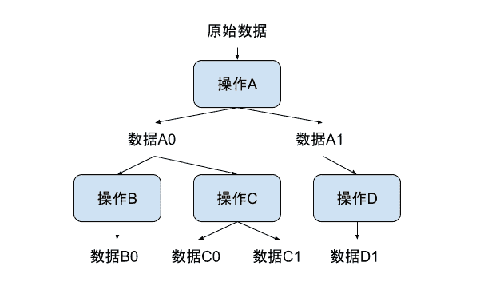
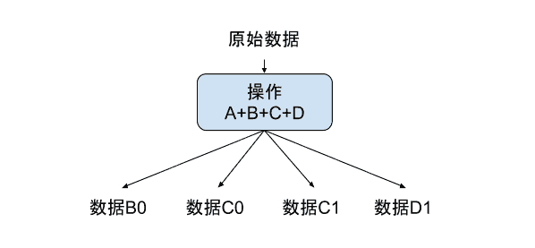

# 24 | PCollection：为什么Beam要如此抽象封装数据？

 

你好，我是蔡元楠。

今天我要与你分享的主题是“为什么 Beam 要如此抽象封装数据”。

很多人在刚开始接触 Apache Beam 的时候，都会觉得这里面的概念太抽象了。什么 PCollection、PValue、Transform……这都是些什么？尤其是 PCollection，完全和先前的技术知识找不到对应。

确实如此。同样作为数据的容器，PCollection 却并不像 Python/Java 的 List 或者 C++ 的 vector。PCollection 是无序的，Beam 对于 PCollection 中元素的处理顺序不作任何保证。所以，你不可能说“我想处理 PCollection 中的第二个元素”，因为它就没有“第几个”这种概念。

PCollection 也不像 Python/Java 的 Set，或者 C++ 的 unordered_set，PCollection 不一定有固定的边界。所以，你也不能指望去查找一个 PCollection 的大小。在 PCollection 的世界里，也没有“固定大小”这样的概念。

作为程序员，我很讨厌重复造轮子，尤其是新瓶装旧酒。的确，有很多开发者为了体现自己项目的复杂度，故意强行引进了很多概念，让大家都似懂非懂的。这就像是为了体现自己知道茴香豆的“茴”有几种写法一样，故意用另一种写法来体现自己“有文化”。

那么 Apache Beam 引进这么多概念，是不是也是故意强行造轮子呢？答案是否定的。这一讲，我们就要分析 PCollection 为什么会如此设计。

在之前的章节中，我们已经讲到了 Apache Beam 的“爷爷”——FlumeJava 产生的背景。

当时 Google 的工程师们发现 MapReduce 使用起来并没有很方便。如果计算过程都能够分解成 map、shuffle、reduce 步骤的话，MapReduce 是非常能胜任的。

但是，很多现实世界中的问题，往往需要一系列的 map 或 reduce 步骤。这样的数据流水线就需要额外的代码用来协调这些 map 或 reduce 步骤。也需要一些额外的代码去管理分步的 map/reduce 步骤产生的一些中间结果。以至于新的开发者很难理解复杂的流水线。

清楚这样的背景对于理解 Apache Beam 的 PCollection 起源很有帮助。因为，这个项目起源只是为了提供比 MapReduce 更好的开发体验，最终的运算引擎仍然是 MapReduce。

## 为什么需要 PCollection？

那么，为什么 Beam 需要 PCollection 这样一个全新的抽象数据结构呢？

我们知道，不同的技术系统有不同的数据结构。比如，C++ 里有 vector、unordered_map，安卓有 ListView。相比它们而言，其实 Beam 的数据结构体系是很单调的，几乎所有数据都能表达为 PCollection。

PCollection，就是 Parallel Collection，意思是可并行计算的数据集。如果你之前学习了 Spark 的章节，就会发现 PCollection 和 RDD 十分相似。

在一个分布式计算系统中，我们作为架构设计者需要为用户隐藏的实现细节有很多，其中就包括了**数据是怎样表达和存储的**。

这个数据可能是来自于内存的数据（内部可能只是由一个 C++ array 存储）；也有可能是来自外部文件（由几个文件存储）；或者是来自于 MySQL 数据库（由数据库的行来表达）。

如果没有一个统一的数据抽象的话，开发者就需要不停地更改代码。比如，在小规模测试的时候用 C++ vector，等到了真实的生产环境，我再换 MySQL row。沉溺于这样的实现细节会让开发者无法集中注意力在真正重要的事情上，那就是“你想怎样处理数据”。

清楚了这些，你就能明白我们需要一层抽象来表达数据，而这层抽象就是 PCollection。

PCollection 的创建完全取决于你的需求。比如，在测试中 PCollection 往往来自于代码生成的伪造数据，或者从文件中读取。

Python

```
lines = (p           | beam.Create(['To be, or not to be: that is the question. ']))    lines = p | 'ReadMyFile' >> beam.io.ReadFromText('gs://some/inputData.txt'
```

Java

```
PCollection<String> lines = p.apply(      "ReadMyFile", TextIO.read().from("protocol://path/to/some/inputData.txt"));
```

## 为什么 PCollection 需要 Coders？

与普通编程相比，PCollection 的另一个不同之处是，你需要为 PCollection 的元素编写 Coder。例如，你有一个自己的类 MyClass，那么 PCollection一定需要实现 Coder。

刚开始使用 Beam 时，你可能会感觉这很不方便。例如，你只是要去读取 MySQL 的一个表，也得为此实现 Coder。

Coder 的作用和 Beam 的本质紧密相关。因为你的计算流程最终会运行在一个分布式系统。所以，所有的数据都有可能在网络上的计算机之间相互传递。而 Coder 就是在告诉 Beam，怎样把你的数据类型序列化和逆序列化，以方便在网络上传输。

Coder 需要注册进全局的 CoderRegistry 中，简单来说，是为你自己的数据类型建立与 Coder 的对应关系。不然每次你都需要手动指定 Coder。

Python

```
apache_beam.coders.registry.register_coder(int, BigEndianIntegerCoder)
```

Java

```
PipelineOptions options = PipelineOptionsFactory.create();Pipeline p = Pipeline.create(options);  CoderRegistry cr = p.getCoderRegistry();cr.registerCoder(Integer.class, BigEndianIntegerCoder.class);
```

## 为什么 PCollection 是无序的？

讲完为什么 PCollection 需要 Coder 之后，我们再来看下，为什么 PCollection 是无序的。

PCollection 的无序特性其实也和它的分布式本质有关。一旦一个 PCollection 被分配到不同的机器上执行，那么为了保证最大的处理输出，不同机器都是独立运行的。所以，它的执行顺序就无从得知了。可能是第一个元素先被运行，也可能是第二个元素先被运行。所以，肯定不会有 PCollection[2] 这样的运算符。

## 为什么 PCollection 没有固定大小？

无序也就算了，为什么 PCollection 还没有固定大小呢？

前面的章节中讲到过，Beam 想要统一批处理和流处理，所以它要统一表达有界数据和无界数据。正因为如此，PCollection 并没有限制它的容量。如前面所说，它可能表达内存上的一个数组，也可能表达整个数据库的所有数据。

一个 PCollection 可以是有界的，也可以是无界的。一个有界的 PCollection 表达了一个已知大小的固定的数据集。一个无界的 PCollection 表达了一个无限大小的数据集。事实上一个 PCollection 是否有界，往往取决于它是如何产生的。

从批处理的数据源中读取，比如一个文件或者是一个数据库，就会产生有界的 PColleciton。如果从流式的或者是持续更新的数据库中读取，比如 pub/sub 或者 kafka，会产生一个无界的 PCollection。

但是，PCollection 的有界和无界特性会影响到 Beam 的数据处理方式。一个批处理作业往往处理有界数据。而无界的 PCollection 需要流式的作业来连续处理。

在实现中，Beam 也是用 window 来分割持续更新的无界数据。所以，一个流数据可以被持续地拆分成不同的小块。这样的处理方式我们会在实战部分展开。

## 如何理解 PCollection 的不可变性？

在普通编程语言中，大部分数据结构都是可变的。

Python

```
Alist = []alist.append(1)
```

C++

```
Std::vector<int> list;list.push_back(1);
```

但是 PCollection 不提供任何修改它所承载数据的方式。修改一个 PCollection 的唯一方式就是去转化 (Transform) 它，下一讲会展开讲 Transformation。

但是在这一讲，我们需要理解的是，Beam 的 PCollection 都是延迟执行（deferred execution）的模式。也就是说，当你下面这样的语句的时候，什么也不会发生。

Java

```
PCollection<T1> p1 = ...;PCollection<T2> p2 = doSomeWork(p1);
```

这样的语句执行完，p2 这个 PCollection 仅仅会记录下自己是由 doSomeWork 这个操作计算而来的，和计算自己所需要的数据 p1。当你执行写完 100 行的 beam 的运算操作，最终的结果仅仅是生成了一个有向无环图（DAG），也就是执行计划（execution plan）。

为什么这么设计呢？如果你记得我们在专栏第一部分讲到的大规模数据框架设计，可能会有印象。这样的有向无环图是框架能够自动优化执行计划的核心。



类似图中这样的数据处理流程，在 Beam 获知了整个数据处理流程后，就会被优化成下图所示。



这样的优化，在 Beam 中被称为 sibling fusion。类似的操作优化我们后面会继续介绍。在这个小标题下，我想用这个优化的例子说明，PCollection 下的数据不可变是因为改变本身毫无意义。

例如，在刚才这个例子中，你会发现，优化后的执行计划里已经没有了数据 A0。因为，Beam 发现数据 A0 作为中间结果并不影响最终输出。另外，由于 Beam 的分布式本质，即使你想要去修改一个 PCollection 的底层表达数据，也需要在多个机器上查找，毫无实现的价值。

## 小结

这一讲我们介绍了整个 Beam 核心数据结构 PCollection 的设计思想。尤其是分析了 PCollection 的几大特性为什么是这么设计的。它的特性包括 Coders、无序性、没有固定大小、不可变性等。在每个特性下面我们也介绍了几个例子或者代码示例，希望能帮助你加深印象。

## 思考题

PCollection 的设计是否能表达你的大规模数据处理场景呢？

欢迎你把答案写在留言区，与我和其他同学一起讨论。如果你觉得有所收获，也欢迎把文章分享给你的朋友。


