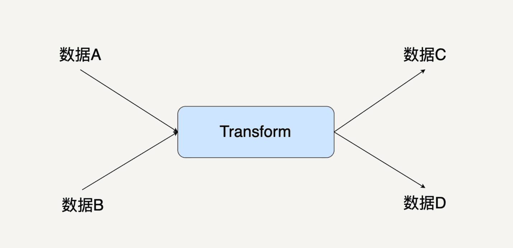
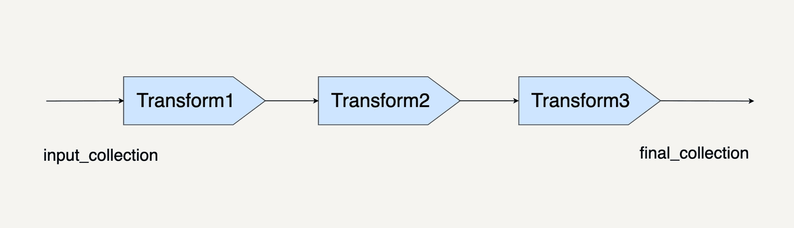
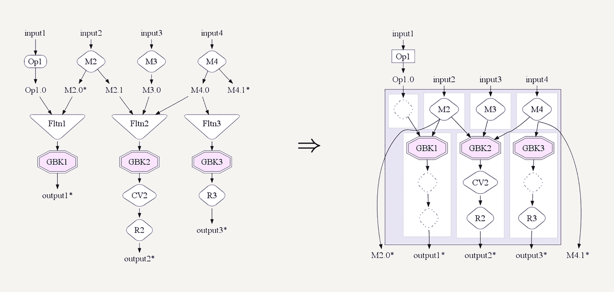

# 25 | Transform：Beam数据转换操作的抽象方法

 

你好，我是蔡元楠。

今天我要与你分享的主题是“Beam 数据转换操作的抽象方法”。

在上一讲中，我们一起学习了 Beam 中数据的抽象表达——PCollection。但是仅仅有数据的表达肯定是无法构建一个数据处理框架的。那么今天，我们就来看看 Beam 中数据处理的最基本单元——Transform。

下图就是单个 Transform 的图示。



之前我们已经讲过，Beam 把数据转换抽象成了有向图。PCollection 是有向图中的边，而 Transform 是有向图里的节点。

不少人在理解 PCollection 的时候都觉得这不那么符合他们的直觉。许多人都会自然地觉得 PCollection 才应该是节点，而 Transform 是边。因为数据给人的感觉是一个实体，应该用一个方框表达；而边是有方向的，更像是一种转换操作。事实上，这种想法很容易让人走入误区。

其实，区分节点和边的关键是看一个 Transform 是不是会有一个多余的输入和输出。

每个 Transform 都可能有大于一个的输入 PCollection，它也可能输出大于一个的输出 PCollection。所以，我们只能把 Transform 放在节点的位置。因为一个节点可以连接多条边，而同一条边却只能有头和尾两端。

## Transform 的基本使用方法

在了解了 Transform 和 PCollection 的关系之后，我们来看一下 Transform 的基本使用方法。

Beam 中的 PCollection 有一个抽象的成员函数 Apply。使用任何一个 Transform 时候，你都需要调用这个 apply 方法。

Java

```
pcollection1 = pcollection2.apply(Transform)
```

Python

```
Pcollection1 = pcollection2 | Transform
```

当然，你也可以把 Transform 级连起来。

```
final_collection = input_collection.apply(Transform1).apply(Transform2).apply(Transform3)
```



所以说，Transform 的调用方法是要通过 apply() 的，但是 Transform 有很多种。

## 常见的 Transform

Beam 也提供了常见的 Transform 接口，比如 ParDo、GroupByKey。最常使用的 Transform 就是 ParDo 了。

ParDo 就是 Parallel Do 的意思，顾名思义，表达的是很通用的并行处理数据操作。GroupByKey 的意思是把一个 Key/Value 的数据集按 Key 归并，就如下面这个例子。

```
cat, 1dog, 5and, 1jump, 3tree, 2cat, 5dog, 2and, 2cat, 9and, 6 => cat, [1,5,9]dog, [5,2]and, [1,2,6]jump, [3]tree, [2]
```

当然，你也可以用 ParDo 来实现 GroupByKey，一种简单的实现方法就是放一个全局的哈希表，然后在 ParDo 里把一个一个元素插进这个哈希表里。但这样的实现方法并不能用，因为你的数据量可能完全无法放进一个内存哈希表。而且，你还要考虑到 PCollection 会把计算分发到不同机器上的情况。

当你在编写 ParDo 时，你的输入是一个 PCollection 中的单个元素，输出可以是 0 个、1 个，或者是多个元素。你只要考虑好怎样处理一个元素。剩下的事情，Beam 会在框架层面帮你做优化和并行。

使用 ParDo 时，你需要继承它提供的 DoFn 类，你可以把 DoFn 看作是 ParDo 的一部分。因为 ParDo 和 DoFn 单独拿出来都没有意义。

java

```
static class UpperCaseFn extends DoFn<String, String> {  @ProcessElement  public void processElement(@Element String word, OutputReceiver<String> out) {    out.output(word.toUpperCase());  }} PCollection<String> upperCaseWords = words.apply(    ParDo    .of(new UpperCaseFn())); 
```

在上面的代码中你可以看出，每个 DoFn 的 @ProcessElement 标注的函数 processElement，就是这个 DoFn 真正的功能模块。在上面这个 DoFn 中，我们把输入的一个词转化成了它的大写形式。之后在调用 apply(ParDo.of(new UpperCaseFn())) 的时候，Beam 就会把输入的 PCollection 中的每个元素都使用刚才的 processElement 处理一遍。

看到这里，你可能会比较迷惑，transform、apply、DoFn、ParDo 之间到底是什么关系啊？怎么突然冒出来一堆名词？其实，Transform 是一种概念层面的说法。具体在编程上面，Transform 用代码来表达的话就是这样的：

```
pcollection.apply(ParDo.of(new DoFn()))
```

这里的 apply(ParDo) 就是一个 Transform。

我们在[第 7 讲](https://time.geekbang.org/column/article/92928)中讲过数据处理流程的常见设计模式。事实上很多应用场景都可以用 ParDo 来实现。比如过滤一个数据集、格式转化一个数据集、提取一个数据集的特定值等等。

**1. 过滤一个数据集**

当我们只想要挑出符合我们需求的元素的时候，我们需要做的，就是在 processElement 中实现。一般来说会有一个过滤函数，如果满足我们的过滤条件，我们就把这个输入元素输出。

Java

```
@ProcessElementpublic void processElement(@Element T input, OutputReceiver<T> out) {    if (IsNeeded(input)) {      out.output(input);    }  }
```

**2. 格式转化一个数据集**

给数据集转化格式的场景非常常见。比如，我们想把一个来自 csv 文件的数据，转化成 TensorFlow 的输入数据 tf.Example 的时候，就可以用到 ParDo。

Java

```
@ProcessElement  public void processElement(@Element String csvLine, OutputReceiver<tf.Example> out) {    out.output(ConvertToTfExample(csvLine));  }
```

**3. 提取一个数据集的特定值**

ParDo 还可以提取一个数据集中的特定值。比如，当我们想要从一个商品的数据集中提取它们的价格的时候，也可以使用 ParDo。

Java

```
@ProcessElement  public void processElement(@Element Item item, OutputReceiver<Integer> out) {    out.output(item.price());  }
```

通过前面的几个例子你可以看到，ParDo 和 DoFn 这样的抽象已经能处理非常多的应用场景问题。事实正是如此，在实际应用中，80% 的数据处理流水线都是使用基本的 ParDo 和 DoFn。

## Stateful Transform 和 side input/side output

当然，还有一些 Transform 其实也是很有用的，比如 GroupByKey，不过它远没有 ParDo 那么常见。所以，这一模块中暂时不会介绍别的数据转换操作，需要的话我们可以在后面用到的时候再介绍。我想先在这里介绍和 ParDo 同样是必用的，却在大部分教程中被人忽略的技术点——Statefullness 和 side input/side output。

上面我们所介绍的一些简单场景都是无状态的，也就是说，在每一个 DoFn 的 processElement 函数中，输出只依赖于输入。它们的 DoFn 类不需要维持一个成员变量。无状态的 DoFn 能保证最大的并行运算能力。因为 DoFn 的 processElement 可以分发到不同的机器，或者不同的进程也能有多个 DoFn 的实例。但假如我们的 processElement 的运行需要另外的信息，我们就不得不转而编写有状态的 DoFn 了。

试想这样一个场景，你的数据处理流水线需要从一个数据库中根据用户的 id 找到用户的名字。你可能会想到用“在 DoFn 中增加一个数据库的成员变量”的方法来解决。的确，实际的应用情况中我们就会写成下面这个代码的样子。

java

```
static class FindUserNameFn extends DoFn<String, String> {  @ProcessElement  public void processElement(@Element String userId, OutputReceiver<String> out) {    out.output(database.FindUserName(userId));  }   Database database;}
```

但是因为有了共享的状态，这里是一个共享的数据库连接。在使用有状态的 DoFn 时，我们需要格外注意 Beam 的并行特性。

如上面讲到的，Beam 不仅会把我们的处理函数分发到不同线程、进程，也会分发到不同的机器上执行。当你共享这样一个数据库的读取操作时，很可能引发服务器的 QPS 过高。

例如，你在处理一个 1 万个用户 id，如果 beam 很有效地将你的 DoFn 并行化了，你就可能观察到数据库的 QPS 增加了几千。如果你不仅是读取，还做了修改的话，就需要注意是不是有竞争风险了。这里你可以联想在操作系统中有关线程安全的相关知识。

除了这种简单的增加一个成员变量的方法。如果我们需要共享的状态来自于另外一些 Beam 的数据处理的中间结果呢？这时候为了实现有状态 DoFn 我们需要应用 Beam 的 Side input/side output 计数。

java

```
PCollectionView<Integer> mediumSpending = ...; PCollection<String> usersBelowMediumSpending =  userIds.apply(ParDo      .of(new DoFn<String, String>() {          @ProcessElement          public void processElement(@Element String userId, OutputReceiver<String> out, ProcessContext c) {            int medium = c.sideInput(mediumSpending);            if (findSpending(userId) <= medium) {              out.output(userId);            }          }      }).withSideInputs(mediumSpending)  );
```

比如，在这个处理流程中，我们需要根据之前处理得到的结果，也就是用户的中位数消费数据，找到消费低于这个中位数的用户。那么，我们可以通过 side input 把这个中位数传递进 DoFn 中。然后你可以在 ProcessElement 的参数 ProcessContext 中拿出来这个 side input。

## Transform 的优化

之前我们也提到过，Beam 中的数据操作都是 lazy execution 的。这使得 Transform 和普通的函数运算很不一样。当你写下面这样一个代码的时候，真正的计算完全没有被执行。

```
Pcollection1 = pcollection2.apply(Transform)
```

这样的代码仅仅是让 Beam 知道了“你想对数据进行哪些操作”，需要让它来构建你的数据处理有向图。之后 Beam 的处理优化器会对你的处理操作进行优化。所以，千万不要觉得你写了 10 个 Transform 就会有 10 个 Transform 马上被执行了。

理解 Transform 的 lazy execution 非常重要。很多人会过度地优化自己的 DoFn 代码，想要在一个 DoFn 中把所有运算全都做了。其实完全没这个必要。



你可以用分步的 DoFn 把自己想要的操作表达出来，然后交给 Beam 的优化器去合并你的操作。比如，在 FlumeJava 论文中提到的 MSCR Fusion，它会把几个相关的 GroupByKey 的 Transform 合并。

## 小结

在这一讲中，我们学习了 Transform 的概念和基本的使用方法。通过文章中的几个简单的例子，你要做到的是了解怎样编写 Transform 的编程模型 DoFn 类。有状态 DoFn 在实际应用中尤其常见，你可以多加关注。

## 思考题

你可能会发现 Beam 的 ParDo 类似于 Spark 的 map() 或者是 MapReduce 的 map。它们确实有很多相似之处。那你认为它们有什么不一样之处呢？

欢迎你把答案写在留言区，与我和其他同学一起讨论。如果你觉得有所收获，也欢迎把文章分享给你的朋友。


