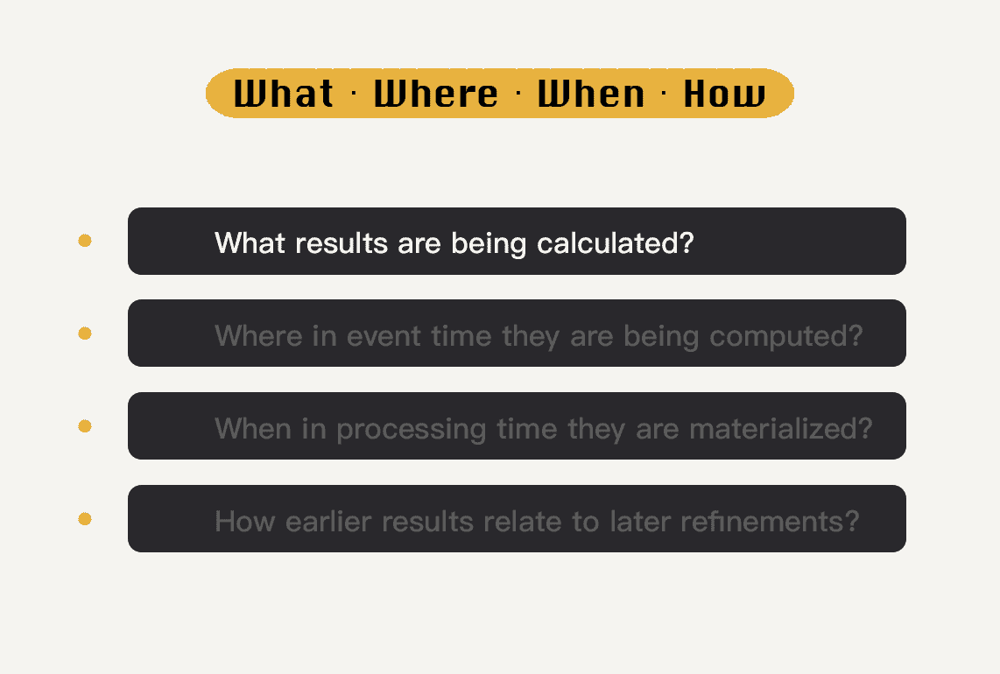
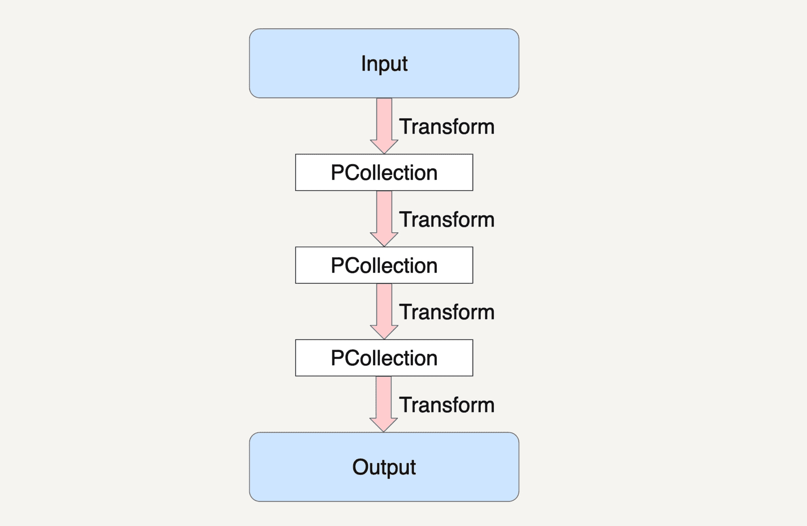
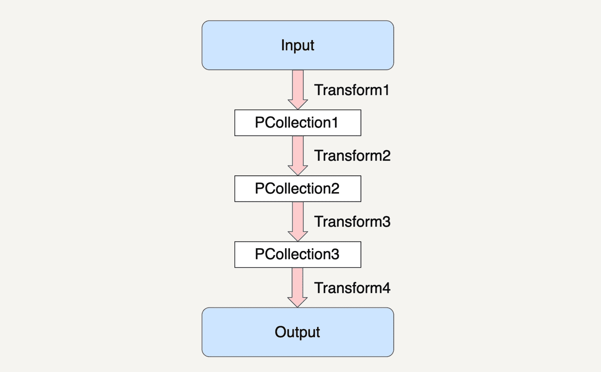
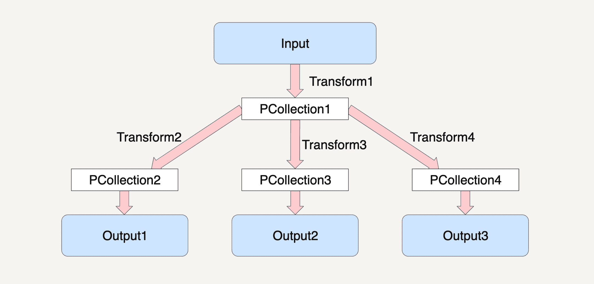
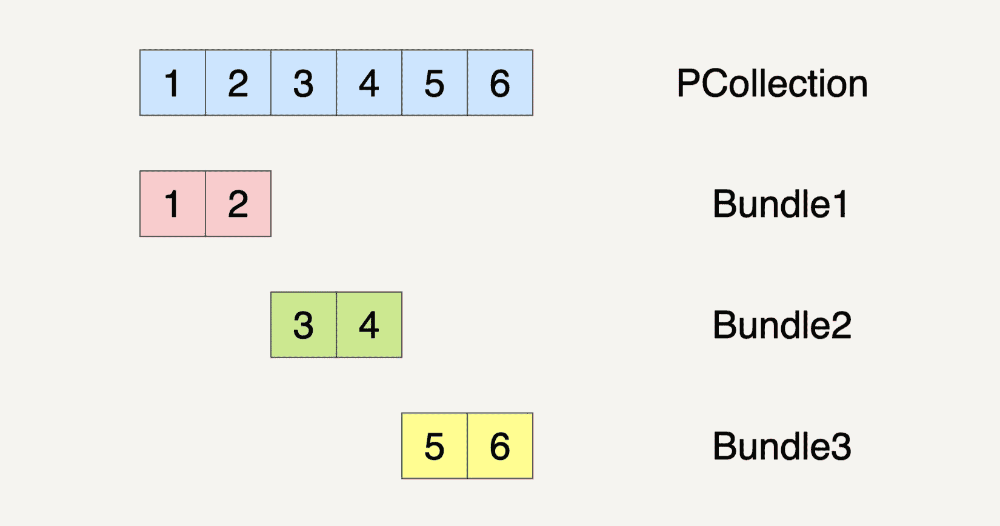
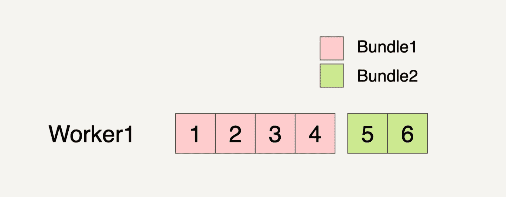
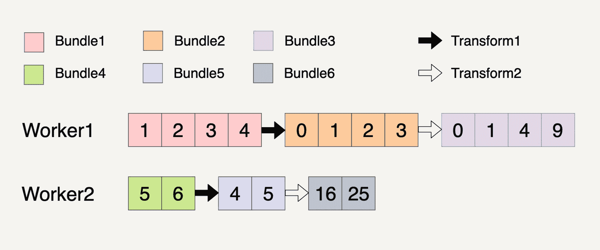
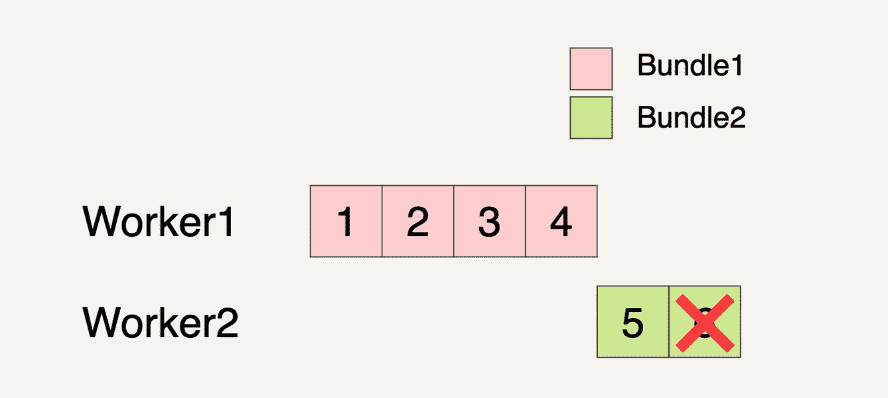
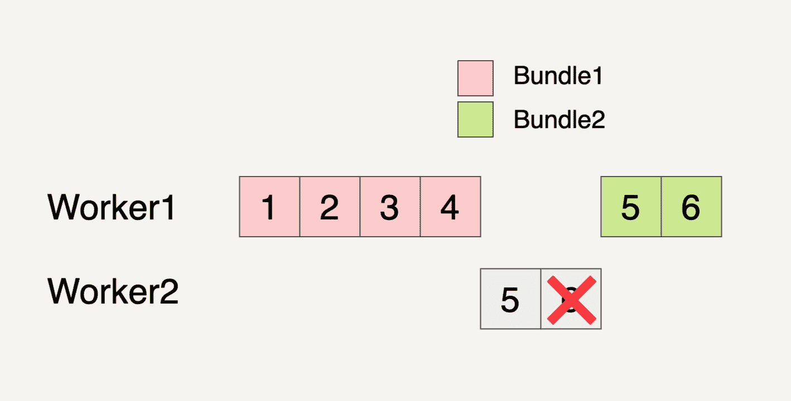
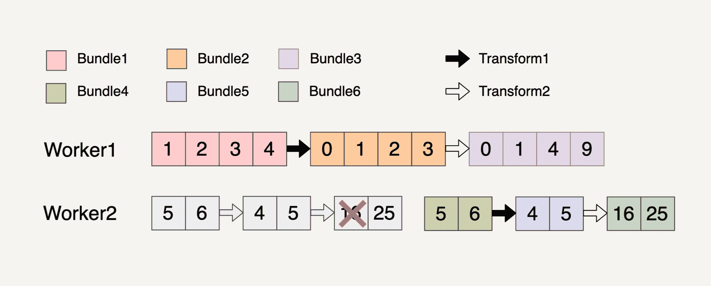

# 26 | Pipeline：Beam如何抽象多步骤的数据流水线？

 

你好，我是蔡元楠。

今天我要与你分享的主题是“Pipeline：Beam 如何抽象多步骤的数据流水线”。

在上两讲中，我们一起学习了 Beam 是如何抽象封装数据，以及如何抽象对于数据集的转换操作的。在掌握了这两个基本概念后，我们就可以很好地回答 Beam 编程模型里的 4 个维度 What、Where、When、How 中的第一个问题——What 了。也就是，我们要做什么计算？想得到什么样的结果？



这个时候你可能已经跃跃欲试，开始想用 PCollection 和 Transform 解决我们平常经常会使用到的批处理任务了。没有问题，那我们就先抛开 Where、When 和 How 这三个问题，由简至繁地讲起。

现在假设我们的数据处理逻辑只需要处理有边界数据集，在这个情况下，让我们一起来看看 Beam 是如何运行一套批处理任务的。

## 数据流水线

在 Beam 的世界里，所有的数据处理逻辑都会被抽象成**数据流水线（Pipeline）**来运行。那么什么是数据流水线呢？

Beam 的数据流水线是对于数据处理逻辑的一个封装，它包括了从**读取数据集**，**将数据集转换成想要的结果**和**输出结果数据集**这样的一整套流程。

所以，如果我们想要跑自己的数据处理逻辑，就必须在程序中创建一个 Beam 数据流水线出来，比较常见的做法是在 main() 函数中直接创建。

Java

```
PipelineOptions options = PipelineOptionsFactory.create();Pipeline p = Pipeline.create(options);
```

在创建 Beam 数据流水线的同时，我们必须给这个流水线定义一个**选项**（Options）。这个选项会告诉 Beam，用户的 Pipeline 应该如何运行。例如，是在本地的内存上运行，还是在 Apache Flink 上运行？关于具体 Beam 选项的解释，我会在第 30 讲中展开讲解。

## Beam 数据流水线的应用

有了数据流水线这个抽象概念之后，我们就可以将 PCollection 和 Transform 应用在这个流水线里面了。



上图就是一个 Beam 的数据流水线，整个数据流水线包括了从读取数据，到经过了 N 个 Transform 之后输出数据的整个过程。

在[第 24 讲](https://time.geekbang.org/column/article/100666)中我们学习过 PCollection 的不可变性。也就是说，一个 PCollection 一经生成，我们就不能够再增加或者删除它里面的元素了。所以，在 Beam 的数据流水线中，每次 PCollection 经过一个 Transform 之后，流水线都会新创建一个 PCollection 出来。而这个新的 PCollection 又将成为下一个 Transform 的新输入。



在上图的示例中，Beam 数据流水线在经过 Transform1 读取了输入数据集之后，会创建出一个新的 PCollection1，而经过了 Transform2 之后，数据流水线又会创建出新的 PCollection2 出来，同时 PCollection1 不会有任何改变。也就是说，在上面的例子中，除去最终的输出结果，数据流水线一共创建了 3 个不同的 PCollection 出来。

这种特性可以让我们在编写数据处理逻辑的时候，对同一个 PCollection 应用多种不同的 Transfrom。

例如下图所示，对于 PCollection1，我们可以使三个不同的 Transform 应用在它之上，从而再产生出三个不同的 PCollection2、PCollection3 和 PCollection4 出来。



## Beam 数据流水线的处理模型

在了解完 Beam 数据流水线高度抽象的概念后，紧接着，我想和你介绍一下 Beam 数据流水线的处理模型，也就是数据流水线在运行起来之后，会发生些什么，它是如何处理我们定义好的 PCollection 和 Transform 的。

Beam 数据流水线的底层思想其实还是动用了 MapReduce 的原理，在分布式环境下，整个数据流水线会启动 N 个 Workers 来同时处理 PCollection。而在具体处理某一个特定 Transform 的时候，数据流水线会将这个 Transform 的输入数据集 PCollection 里面的元素分割成不同的 Bundle，将这些 Bundle 分发给不同的 Worker 来处理。

Beam 数据流水线具体会分配多少个 Worker，以及将一个 PCollection 分割成多少个 Bundle 都是随机的。但 Beam 数据流水线会尽可能地让整个处理流程达到**完美并行**（Embarrassingly Parallel）。

我想举个几个例子让你更好地来理解这个概念。

假设在数据流水线的一个 Transform 里面，它的输入数据集 PCollection 是 1、2、3、4、5、6 这个 6 个元素。数据流水线可能会将这个 PCollection 按下图的方式将它分割成两个 Bundles。

当然，PCollection 也有可能会被分割成三个 Bundles。



那数据流水线会启用多少个 Worker 来处理这些 Bundle 呢？这也是任意的。还是以刚刚的 PCollection 输入数据集作为例子，如果 PCollection 被分割成了两个 Bundles，数据流水线有可能会分配两个 Worker 来处理这两个 Bundles。

甚至有可能只分配一个 Worker 来处理这两个 Bundles。



在多步骤的 Transforms 中，一个 Bundle 通过一个 Transform 产生出来的结果会作为下一个 Transform 的输入。

之前刚刚讲过，在 Beam 数据流水线中，抽象出来的 PCollection 经过一个 Transform 之后，流水线都会新创建一个 PCollection 出来。同样的，Beam 在真正运行的时候，每一个 Bundle 在一个 Worker 机器里经过 Transform 逻辑后，也会产生出来一个新的 Bundle，它们也是具有不可变性的。像这种具有关联性的 Bundle，必须在同一个 Worker 上面处理。

我现在来举例说明一下上面的概念。现在假设输入数据集如下图所示，它被分成了两个 Bundles。

我们现在需要做两个 Transforms。第一个 Transform 会将元素的数值减一；第二个 Transform 会对元素的数值求平方。整个过程被分配到了两个 Workers 上完成。



过程就如上图所示，总共产生了 6 个不可变的 Bundle 出来，从 Bundle1 到 Bundle3 的整个过程都必须放在 Worker1 上完成，因为它们都具有关联性。同样的，从 Bundle4 到 Bundle6 的整个过程也都必须放在 Worker2 上完成。

## Beam 数据流水线的错误处理

在学习完 Beam 数据流水线底层的处理模型之后，你可能会有个疑问：既然 Bundle 都是放在分布式环境下处理的，要是其中一个步骤出错了，那数据流水线会做什么样的处理？接下来我会给你讲解一下 Beam 数据流水线的错误处理机制。

### 单个 Transform 上的错误处理

我们还是以单个 Transform 开始讲解。在一个 Transform 里面，如果某一个 Bundle 里面的元素因为任意原因导致处理失败了，则这整个 Bundle 里的元素都必须重新处理。

还是假设输入数据集如下图所示，被分成了两个 Bundles。

Beam 数据流水线分配了两个 Worker 来处理这两个 Bundles。我们看到下图中，在 Worker2 处理 Bundle2 的时候，最后一个元素 6 处理失败了。



这个时候，即便 Bundle2 的元素 5 已经完成了处理，但是因为同一个 Bundle 里面的元素处理失败，所以整个 Bundle2 都必须拿来重新处理。



重新处理的 Bundle 也不一定要在原来的 Worker 里面被处理，有可能会被转移到另外的 Worker 里面处理。如上图所示，需要重新被处理的 Bundle2 就被转移到 Worker1 上面处理了。

### 多步骤 Transform 上的错误处理

学习完单个 Transform 上的错误处理机制，我们再来看看在多步骤的 Transform 上发生错误时是如何处理的。

在多步骤的 Transform 上，如果处理的一个 Bundle 元素发生错误了，则这个元素所在的整个 Bundle 以及与这个 Bundle 有关联的所有 Bundle 都必须重新处理。

我们还是用上面的多步骤 Transform 来讲解这个例子。



你可以看到，在 Worker2 中，处理 Transform2 逻辑的时候生成 Bundle6 里面的第一个元素失败了。因为 Bundle4、Bundle5 和 Bundle6 都是相关联的，所以这三个 Bundle 都会被重新处理。

## 小结

今天我们一起学习了 Beam 里对于数据处理逻辑的高度抽象数据流水线，以及它的底层处理模型。数据流水线是构建数据处理的基础，掌握了它，我们就可以根据自身的应用需求，构建出一套数据流水线来处理数据。

## 思考题

你能根据自己的理解重述一下在 Beam 的数据流水线中，当处理的元素发生错误时流水线的错误处理机制吗？

欢迎你把答案写在留言区，与我和其他同学一起讨论。如果你觉得有所收获，也欢迎把文章分享给你的朋友。


