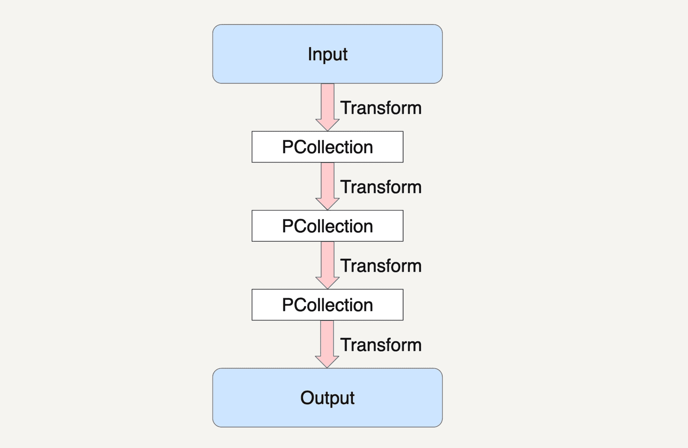

# 27 | Pipeline I/O: Beam数据中转的设计模式

 

你好，我是蔡元楠。

今天我要与你分享的主题是“Pipeline I/O: Beam 数据中转的设计模式”。

在前面的章节中，我们一起学习了如何使用 PCollection 来抽象封装数据，如何使用 Transform 来封装我们的数据处理逻辑，以及 Beam 是如何将数据处理高度抽象成为 Pipeline 来表达的，就如下图所示。



讲到现在，你有没有发现我们还缺少了两样东西没有讲？没错，那就是最初的输入数据集和结果数据集。那么我们最初的输入数据集是如何得到的？在经过了多步骤的 Transforms 之后得到的结果数据集又是如何输出到目的地址的呢？

事实上在 Beam 里，我们可以用 Beam 的 Pipeline I/O 来实现这两个操作。今天我就来具体讲讲 Beam 的 Pipeline I/O。

### 读取数据集

一个输入数据集的读取通常是通过 Read Transform 来完成的。Read Transform 从外部源 (External Source) 中读取数据，这个外部源可以是本地机器上的文件，可以是数据库中的数据，也可以是云存储上面的文件对象，甚至可以是数据流上的消息数据。

Read Transform 的返回值是一个 PCollection，这个 PCollection 就可以作为输入数据集，应用在各种 Transform 上。Beam 数据流水线对于用户什么时候去调用 Read Transform 是没有限制的，我们可以在数据流水线的最开始调用它，当然也可以在经过了 N 个步骤的 Transforms 后再调用它来读取另外的输入数据集。

以下的代码实例就是从 filepath 中读取文本。

Java

```
PCollection<String> inputs = p.apply(TextIO.read().from(filepath));
```

当然了，Beam 还支持从多个文件路径中读取数据集的功能，它的文件名匹配规则和 Linux 系统底下的 glob 文件路径匹配模式是一样的，使用的是“*”和“?”这样的匹配符。

我来为你举个例子解释一下，假设我们正运行着一个商品交易平台，这个平台会将每天的交易数据保存在一个一个特定的文件路径下，文件的命名格式为 YYYY-MM-DD.csv。每一个 CSV 文件都存储着这一天的交易数据。

现在我们想要读取某一个月份的数据来做数据处理，那我们就可以按照下面的代码实例来读取文件数据了。

Java

```
PCollection<String> inputs = p.apply(TextIO.read().from("filepath/.../YYYY-MM-*.csv");
```

这样做后，所有满足 YYYY-MM- 前缀和.csv 后缀的文件都会被匹配上。

当然了，glob 操作符的匹配规则最终还是要和你所要使用的底层文件系统挂钩的。所以，在使用的时候，最好要先查询好你所使用的文件系统的通配符规则。

我来举个 Google Cloud Storage 的例子吧。我们保存的数据还是上面讲到的商品交易平台数据，我们的数据是保存在 Google Cloud Storage 上面，并且文件路径是按照“filepath/…/YYYY/MM/DD/HH.csv”这样的格式来存放的。如果是这种情况，下面这样的代码写法就无法读取到一整个月的数据了。

Java

```
PCollection<String> inputs = p.apply(TextIO.read().from("filepath/.../YYYY/MM/*.csv");
```

因为在 Google Cloud Storage 的通配符规则里面，“*”只能匹配到“*”自己所在的那一层子目录而已。所以"filepath/…/YYYY/MM/*.csv"这个文件路径并不能找到“filepath/…/YYYY/MM/DD/…”这一层目录了。如果要达到我们的目标，我们就需要用到“**”的通配符，也就是如以下的写法。

Java

```
PCollection<String> inputs = p.apply(TextIO.read().from("filepath/.../YYYY/MM/**.csv");
```

如果你想要从不同的外部源中读取同一类型的数据来统一作为输入数据集，那我们可以多次调用 Read Transform 来读取不同源的数据，然后利用 flatten 操作将数据集合并，示例如下。

Java

```
PCollection<String> input1 = p.apply(TextIO.read().from(filepath1);PCollection<String> input2 = p.apply(TextIO.read().from(filepath2);PCollection<String> input3 = p.apply(TextIO.read().from(filepath3);PCollectionList<String> inputs = PCollectionList.of(input1).and(input2).and(input3);PCollection<String> inputs = collections.apply(Flatten.<String>pCollections());
```

### 输出数据集

将结果数据集输出到目的地址的操作是通过 Write Transform 来完成的。Write Transform 会将结果数据集输出到外部源中。

与 Read Transform 相对应，只要 Read Transform 能够支持的外部源，Write Transform 都是支持的。在 Beam 数据流水线中，Write Transform 可以在任意的一个步骤上将结果数据集输出。所以，用户能够将多步骤的 Transforms 中产生的任何中间结果输出。示例代码如下。

Java

```
output.apply(TextIO.write().to(filepath));
```

需要注意的是，如果你的输出是写入到文件中的话，Beam 默认是会写入到多个文件路径中的，而用户所指定的文件名会作为实际输出文件名的前缀。

Java

```
output.apply(TextIO.write().to(filepath/output));
```

当输出结果超过一定大小的时候，Beam 会将输出的结果分块，并写入到以“output00”“output01”等等为文件名的文件当中。如果你想将结果数据集保存成为特定的一种文件格式的话，可以使用“withSuffix”这个 API 来指定这个文件格式。

例如，如果你想将结果数据集保存成 csv 格式的话，代码就可以这样写：

Java

```
output.apply(TextIO.write().to(filepath/output).withSuffix(".csv"));
```

在 Beam 里面，Read 和 Write 的 Transform 都是在名为 I/O 连接器（I/O connector）的类里面实现的。而 Beam 原生所支持的 I/O 连接器也是涵盖了大部分应用场景，例如有基于文件读取输出的 FileIO、TFRecordIO，基于流处理的 KafkaIO、PubsubIO，基于数据库的 JdbcIO、RedisIO 等等。

当然了，Beam 原生的 I/O 连接器并不可能支持所有的外部源。比如，如果我们想从 Memcached 中读取数据，那原生的 I/O 连接器就不支持了。说到这里你可能会有一个疑问，当我们想要从一些 Beam 不能原生支持的外部源中读取数据时，那该怎么办呢？答案很简单，可以自己实现一个自定义的 I/O 连接器出来。

### 自定义 I/O 连接器

自定义的 I/O 连接器并不是说一定要设计得非常通用，而是只要能够满足自身的应用需求就可以了。实现自定义的 I/O 连接器，通常指的就是实现 Read Transform 和 Write Transform 这两种操作，这两种操作都有各自的实现方法，下面我以 Java 为编程语言来一一为你解释。

### 自定义读取操作

我们知道 Beam 可以读取无界数据集也可以读取有界数据集，而读取这两种不同的数据集是有不同的实现方法的。

如果读取的是有界数据集，那我们可以有以下两种选项：

 
1. 使用在第 25 讲中介绍的两个 Transform 接口，ParDo 和 GroupByKey 来模拟读取数据的逻辑。 
2. 继承 BoundedSource 抽象类来实现一个子类去实现读取逻辑。 

如果读取的是无界数据集的话，那我们就必须继承 UnboundedSource 抽象类来实现一个子类去实现读取逻辑。

无论是 BoundedSource 抽象类还是 UnboundedSource 抽象类，其实它们都是继承了 Source 抽象类。为了能够在分布式环境下处理数据，这个 Source 抽象类也必须是可序列化的，也就是说 Source 抽象类必须实现 Serializable 这个接口。

如果我们是要读取有界数据集的话，Beam 官方推荐的是使用第一种方式来实现自定义读取操作，也就是将读取操作看作是 ParDo 和 GroupByKey 这种多步骤 Transforms。

好了，下面我来带你分别看看在不同的外部源中读取数据集是如何模拟成 ParDo 和 GroupByKey 操作的。

### 从多文件路径中读取数据集

从多文件路径中读取数据集相当于用户转入一个 glob 文件路径，我们从相应的存储系统中读取数据出来。比如说读取“filepath/**”中的所有文件数据，我们可以将这个读取转换成以下的 Transforms：

 
1. 获取文件路径的 ParDo：从用户传入的 glob 文件路径中生成一个 PCollection的中间结果，里面每个字符串都保存着具体的一个文件路径。 
2. 读取数据集 ParDo：有了具体 PCollection的文件路径数据集，从每个路径中读取文件内容，生成一个总的 PCollection 保存所有数据。 

### 从 NoSQL 数据库中读取数据集

NoSQL 这种外部源通常允许按照键值范围（Key Range）来并行读取数据集。我们可以将这个读取转换成以下的 Transforms：

 
1. 确定键值范围 ParDo：从用户传入的要读取数据的键值生成一个 PCollection 保存可以有效并行读取的键值范围。 
2. 读取数据集 ParDo：从给定 PCollection 的键值范围，读取相应的数据，并生成一个总的 PCollection 保存所有数据。 

### 从关系型数据库读取数据集

从传统的关系型数据库查询结果通常都是通过一个 SQL Query 来读取数据的。所以，这个时候只需要一个 ParDo，在 ParDo 里面建立与数据库的连接并执行 Query，将返回的结果保存在一个 PCollection 里。

### 自定义输出操作

相比于读取操作，输出操作会简单很多，只需要在一个 ParDo 里面调用相应文件系统的写操作 API 来完成数据集的输出。

如果我们的输出数据集是需要写入到文件去的话，Beam 也同时提供了基于文件操作的 FileBasedSink 抽象类给我们，来实现基于文件类型的输出操作。像很常见的 TextSink 类就是实现了 FileBasedSink 抽象类，并且运用在了 TextIO 中的。

如果我们要自己写一个自定义的类来实现 FileBasedSink 的话，也必须实现 Serializable 这个接口，从而保证输出操作可以在分布式环境下运行。

同时，自定义的类必须具有不可变性（Immutability）。怎么理解这个不可变性呢？其实它指的是在这个自定义类里面，如果有定义私有字段（Private Field）的话，那它必须被声明为 final。如果类里面有变量需要被修改的话，那每次做的修改操作都必须先复制一份完全一样的数据出来，然后再在这个新的变量上做修改。这和我们在第 27 讲中学习到的 Bundle 机制一样，每次的操作都需要产生一份新的数据，而原来的数据是不可变的。

## 小结

今天我们一起学习了在 Beam 中的一个重要概念 Pipeline I/O，它使得我们可以在 Beam 数据流水线上读取和输出数据集。同时，我们还学习到了如何自定义一个 I/O 连接器，当 Beam 自身提供的原生 I/O 连接器不能满足我们需要的特定存储系统时，我们就可以自定义 I/O 逻辑来完成数据集的读取和输出。

## 思考题

你觉得 Beam 的 Pipeline I/O 设计能够满足我们所有的应用需求了吗？

欢迎你把答案写在留言区，与我和其他同学一起讨论。如果你觉得有所收获，也欢迎把文章分享给你的朋友。


