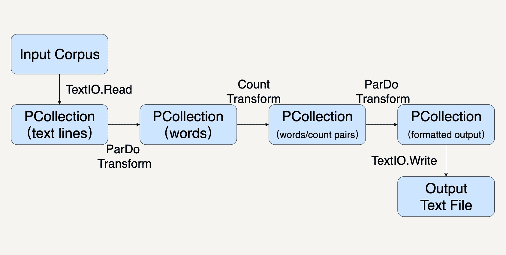

# 31 | WordCount Beam Pipeline实战

 

你好，我是蔡元楠。

今天我要与你分享的主题是“WordCount Beam Pipeline 实战”。

前面我们已经学习了 Beam 的基础数据结构 PCollection，基本数据转换操作 Transform，还有 Pipeline 等技术。你一定跃跃欲试，想要在实际项目中使用了。这一讲我们就一起学习一下怎样用 Beam 解决数据处理领域的教科书级案例——WordCount。

WordCount 你一定不陌生，在[第 18 讲](https://time.geekbang.org/column/article/97658)中，我们就已经接触过了。WordCount 问题是起源于 MapReduce 时代就广泛使用的案例。顾名思义，WordCount 想要解决的问题是统计一个文本库中的词频。

比如，你可以用 WordCount 找出莎士比亚最喜欢使用的单词，那么你的输入是莎士比亚全集，输出就是每个单词出现的次数。举个例子，比如这一段：

```
HAMLET ACT I SCENE I	Elsinore. A platform before the castle. 	[FRANCISCO at his post. Enter to him BERNARDO] BERNARDO	Who's there? FRANCISCO	Nay, answer me: stand, and unfold yourself. BERNARDO	Long live the king! FRANCISCO	Bernardo? BERNARDO	He. FRANCISCO	You come most carefully upon your hour. BERNARDO	'Tis now struck twelve; get thee to bed, Francisco. FRANCISCO	For this relief much thanks: 'tis bitter cold,	And I am sick at heart. BERNARDO	Have you had quiet guard? FRANCISCO	Not a mouse stirring. BERNARDO	Well, good night.	If you do meet Horatio and Marcellus,	The rivals of my watch, bid them make haste. FRANCISCO	I think I hear them. Stand, ho! Who's there?
```

在这个文本库中，我们用“the: 数字”表示 the 出现了几次，数字就是单词出现的次数。

```
The: 3And: 3Him: 1...
```

那么我们怎样在 Beam 中处理这个问题呢？结合前面所学的知识，我们可以把 Pipeline 分为这样几步：

 
1. 用 Pipeline IO 读取文本库（参考[第 27 讲](https://time.geekbang.org/column/article/102578)）； 
2. 用 Transform 对文本进行分词和词频统计操作（参考[第 25 讲](https://time.geekbang.org/column/article/101735)）； 
3. 用 Pipeline IO 输出结果（参考[第 27 讲](https://time.geekbang.org/column/article/102578)）； 
4. 所有的步骤会被打包进一个 Beam Pipeline（参考[第 26 讲](https://time.geekbang.org/column/article/102182)）。 

整个过程就如同下图所示。



## 创建 Pipeline

首先，我们先用代码创建一个 PipelineOptions 的实例。PipelineOptions 能够让我们对 Pipeline 进行必要的配置，比如配置执行程序的 Runner，和 Runner 所需要的参数。我们在这里先采用默认配置。

记得第 30 讲中我们讲过，Beam Pipeline 可以配置在不同的 Runner 上跑，比如 SparkRunner，FlinkRunner。如果 PipelineOptions 不配置的情况下，默认的就是 DirectRunner，也就是说会在本机执行。

Java

```
PipelineOptions options = PipelineOptionsFactory.create();
```

接下来，我们就可以用这个 PipelineOptions 去创建一个 Pipeline 了。一个 Pipeline 实例会去构建一个数据处理流水线所需要的数据处理 DAG，以及这个 DAG 所需要进行的 Transform。

Java

```
Pipeline p = Pipeline.create(options);
```

## 应用 Transform

在上面的设计框图中，我们可以看到，我们需要进行好几种 Transform。比如 TextIO.Read、ParDo、Count 去读取数据，操纵数据，以及存储数据。

每一种 Transform 都需要一些参数，并且会输出特定的数据。输入和输出往往会用 PCollection 的数据结构表示。简单回顾一下，PCollection 是 Beam 对于数据集的抽象，表示任意大小、无序的数据，甚至可以是无边界的 Streaming 数据。

在我们这个 WordCount 例子中，我们的 Transform 依次是这样几个。

第一个 Transform，是先要用 TextIO.Read 来读取一个外部的莎士比亚文集，生成一个 PCollection，包含这个文集里的所有文本行。这个 PCollection 中的每个元素都是文本中的一行。

Java

```
PCollection<String> lines = p.apply(TextIO.read().from("gs://apache-beam-samples/shakespeare/*"));
```

第二个 Transform，我们要把文本行中的单词提取出来，也就是做分词（tokenization）。

这一步的输入 PCollection 中的每个元素都表示了一行。那么输出呢？输出还是一个 PCollection，但是每个元素变成了单词。

你可以留意一下，我们这里做分词时，用的正则表达式 [^\p{L}]+，意思是非 Unicode Letters 所以它会按空格或者标点符号等把词分开。

Java

```
PCollection<String> words = lines.apply("ExtractWords", FlatMapElements        .into(TypeDescriptors.strings())        .via((String word) -> Arrays.asList(word.split("[^\\p{L}]+"))));
```

第三个 Transform，我们就会使用 Beam SDK 提供的 Count Transform。Count Transform 会把任意一个 PCollection 转换成有 key/value 的组合，每一个 key 是原来 PCollection 中的非重复的元素，value 则是元素出现的次数。

Java

```
PCollection<KV<String, Long>> counts = words.apply(Count.<String>perElement());
```

第四个 Transform 会把刚才的 key/value 组成的 PCollection 转换成我们想要的输出格式，方便我们输出词频。因为大部分的时候，我们都是想要把输出存储到另一个文件里的。

Java

```
PCollection<String> formatted = counts.apply("FormatResults", MapElements    .into(TypeDescriptors.strings())    .via((KV<String, Long> wordCount) -> wordCount.getKey() + ": " + wordCount.getValue()));
```

最后一个 Transform 就是 TextIO.Write 用来把最终的 PCollection 写进文本文档。PCollection 中的每一个元素都会被写为文本文件中的独立一行。

## 运行 Pipeline

调用 Pipeline 的 run() 方法会把这个 Pipeline 所包含的 Transform 优化并放到你指定的 Runner 上执行。这里你需要注意，run() 方法是异步的，如果你想要同步等待 Pipeline 的执行结果，需要调用 waitUntilFinish() 方法。

Java

```
p.run().waitUntilFinish();
```

## 改进代码的建议

代码看起来都完成了，不过，我们还可以对代码再做些改进。

### 编写独立的 DoFn

在上面的示例代码中，我们把 Transform 都 inline 地写在了 apply() 方法里。

Java

```
lines.apply("ExtractWords", FlatMapElements        .into(TypeDescriptors.strings())        .via((String word) -> Arrays.asList(word.split("[^\\p{L}]+"))));
```

但是这样的写法在实际工作中很难维护。

一是因为真实的业务逻辑往往比较复杂，很难用一两行的代码写清楚，强行写成 inline 的话可读性非常糟糕。

二是因为这样 inline 的 Transform 几乎不可复用和测试。

所以，实际工作中，我们更多地会去继承 DoFn 来实现我们的数据操作。这样每个 DoFn 我们都可以单独复用和测试。

接下来，我们看看怎样用用 DoFn 来实现刚才的分词 Transform？

其实很简单，我们继承 DoFn 作为我们的子类 ExtracrtWordsFn，然后把单词的拆分放在 DoFn 的 processElement 成员函数里。

Java

```
static class ExtractWordsFn extends DoFn<String, String> {    private final Counter emptyLines = Metrics.counter(ExtractWordsFn.class, "emptyLines");    private final Distribution lineLenDist =        Metrics.distribution(ExtractWordsFn.class, "lineLenDistro");     @ProcessElement    public void processElement(@Element String element, OutputReceiver<String> receiver) {      lineLenDist.update(element.length());      if (element.trim().isEmpty()) {        emptyLines.inc();             // Split the line into words.      String[] words = element.split(“[^\\p{L}]+”, -1);       // Output each word encountered into the output PCollection.      for (String word : words) {        if (!word.isEmpty()) {          receiver.output(word);        }      }   }}
```

### 创建 PTransform 合并相关联的 Transform

PTransform 类可以用来整合一些相关联的 Transform。

比如你有一些数据处理的操作包含几个 Transform 或者 ParDo，你可以把他们封装在一个 PTransform 里。

我们这里试着把上面的 ExtractWordsFn 和 Count 两个 Transform 封装起来。这样可以对这样一整套数据处理操作复用和测试。当定义 PTransform 的子类时，它的输入输出类型就是一连串 Transform 的最初输入和最终输出。那么在这里，输入类型是 String，输出类型是 KV<String, Long>。就如同下面的代码一样。

Java

```
  /**   * A PTransform that converts a PCollection containing lines of text into a PCollection of   * formatted word counts.   *   * <p>This is a custom composite transform that bundles two transforms (ParDo and   * Count) as a reusable PTransform subclass. Using composite transforms allows for easy reuse,   * modular testing, and an improved monitoring experience.   */   public static class CountWords      extends PTransform<PCollection<String>, PCollection<KV<String, Long>>> {    @Override    public PCollection<KV<String, Long>> expand(PCollection<String> lines) {       // Convert lines of text into individual words.      PCollection<String> words = lines.apply(ParDo.of(new ExtractWordsFn()));       // Count the number of times each word occurs.      PCollection<KV<String, Long>> wordCounts = words.apply(Count.perElement());       return wordCounts;    }  }
```

### 参数化 PipelineOptions

刚才我们把输入文件的路径和输出文件的路径都写在了代码中。但实际工作中我们很少会这样做。

因为这些文件的路径往往是运行时才会决定，比如测试环境和生产环境会去操作不同的文件。在真正的实际工作中，我们往往把它们作为命令行参数放在 PipelineOptions 里面。这就需要去继承 PipelineOptions。

比如，我们创建一个 WordCountOptions，把输出文件作为参数 output。

Java

```
public static interface WordCountOptions extends PipelineOptions {    @Description("Path of the file to write to")    @Required    String getOutput();     void setOutput(String value);}
```

完成上面两个方面的改进后，我们最终的数据处理代码会是这个样子：

Java

```
public static void main(String[] args) {  WordCountOptions options =        PipelineOptionsFactory.fromArgs(args).withValidation().as(WordCountOptions.class);   Pipeline p = Pipeline.create(options);   p.apply("ReadLines", TextIO.read().from(options.getInputFile()))        .apply(new CountWords())        .apply(ParDo.of(new FormatAsTextFn()))        .apply("WriteCounts", TextIO.write().to(options.getOutput()));     p.run().waitUntilFinish();}
```

### DoFn 和 PTransform 的单元测试

如同[第 29 讲](https://time.geekbang.org/column/article/103750)“如何测试 Pipeline”中所讲的那样，我们用 PAssert 测试 Beam Pipeline。具体在我们这个例子中，我一再强调要把数据处理操作封装成 DoFn 和 PTransform，因为它们可以独立地进行测试。

什么意思呢？比如，ExtractWordsFn 我们想要测试它能把一个句子分拆出单词，比如“" some input words "，我们期待的输出是 [“some”, “input”, “words”]。在测试中，我们可以这样表达：

```
/** Example test that tests a specific {@link DoFn}. */  @Test  public void testExtractWordsFn() throws Exception {    DoFnTester<String, String> extractWordsFn = DoFnTester.of(new ExtractWordsFn());     Assert.assertThat(        extractWordsFn.processBundle(" some  input  words "),        CoreMatchers.hasItems("some", "input", "words"));    Assert.assertThat(extractWordsFn.processBundle(" "), CoreMatchers.hasItems());    Assert.assertThat(        extractWordsFn.processBundle(" some ", " input", " words"),        CoreMatchers.hasItems("some", "input", "words"));  }
```

## 小结

这一讲我们应用前面学习的 PCollection，Pipeline，Pipeline IO，Transform 知识去解决了一个数据处理领域经典的 WordCount 问题。并且学会了一些在实际工作中改进数据处理代码质量的贴士，比如写成单独可测试的 DoFn，和把程序参数封装进 PipelineOptions。

## 思考题

文中提供了分词的 DoFn——ExtractWordsFn，你能利用相似的思路把输出文本的格式化写成一个 DoFn 吗？也就是文中的 FormatAsTextFn，把 PCollection<KV<String, Long>> 转化成 PCollection，每一个元素都是 : 的格式。

欢迎你把答案写在留言区，与我和其他同学一起讨论。如果你觉得有所收获，也欢迎把文章分享给你的朋友。


