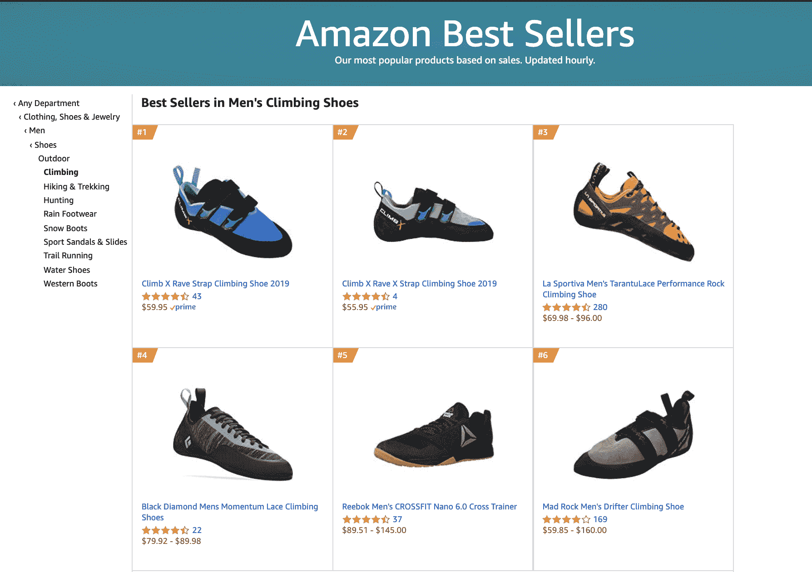
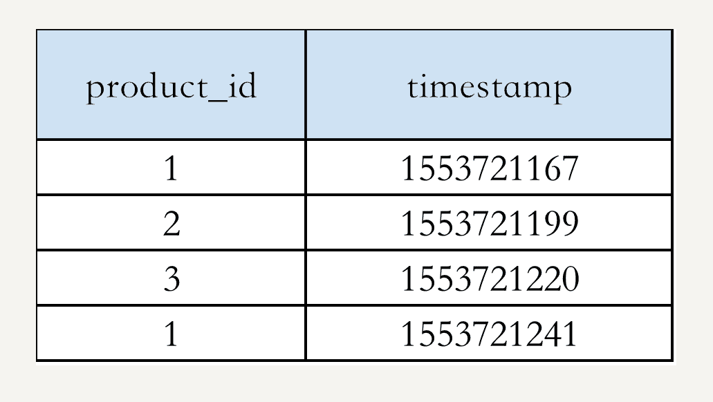
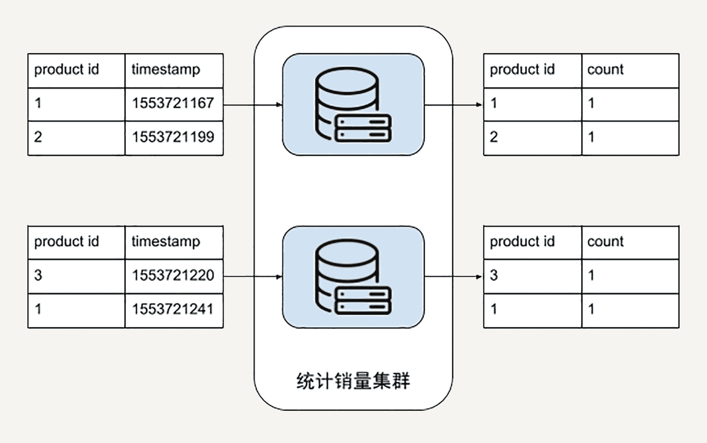
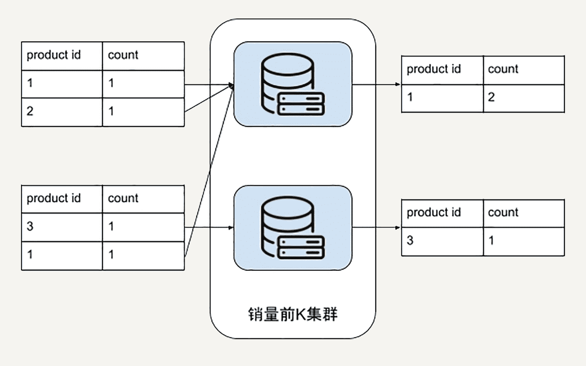
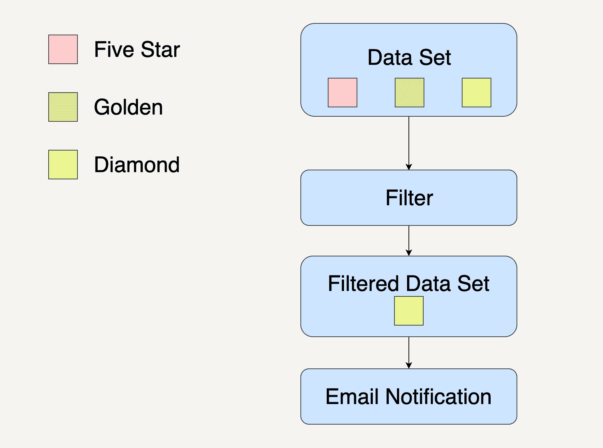
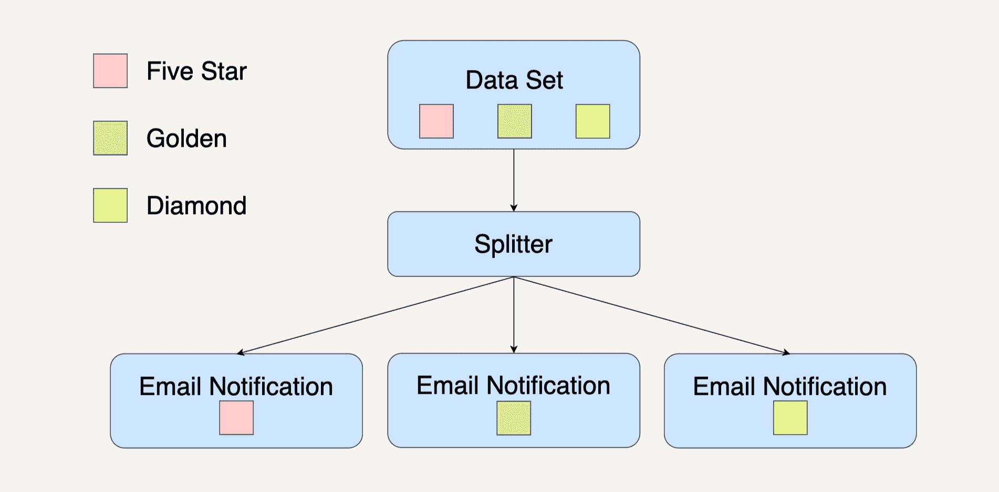

# 34 | Amazon热销榜Beam Pipeline实战

 

你好，我是蔡元楠。

今天我要与你分享的主题是“Amazon 热销榜 Beam Pipeline 实战”。

两个月前，亚马逊（Amazon）宣布将关闭中国国内电商业务的消息你一定还记忆犹新。虽然亚马逊遗憾离场，但它依然是目前全球市值最高的电商公司。

作为美国最大的一家网络电子商务公司，亚马逊的总部位于华盛顿州的西雅图。类似于 BAT 在国内的地位，亚马逊也是北美互联网 FAANG 五大巨头之一，其他四个分别是 Facebook、Apple、Netflix 和 Google。

亚马逊的热销商品系统就如下图所示。


当我搜索“攀岩鞋”时，搜索结果的第三个被打上了“热销商品”的标签，这样能帮助消费者快速做出购买决策。

当我点击这个“Best Seller”的标签时，我可以浏览“攀岩鞋”这个商品分类中浏览销量最高的前 100 个商品。



这些贴心的功能都是由热销商品系统实现的。

这一讲我们就来看看在这样的热销商品系统中，怎样应用之前所学的 Beam 数据处理技术吧。今天，我们主要会解决一个热销商品系统数据处理架构中的这几个问题：

 
1. 怎样用批处理计算基础的热销商品列表、热销商品的存储和 serving 设计？ 
2. 怎样设计每小时更新的热销榜单？ 
3. 怎样设计商品去重处理流水线和怎样根据商品在售状态过滤热销商品？ 
4. 怎样按不同的商品门类生成榜单？ 

### 1. 怎样用批处理计算基础的热销商品列表、热销商品的存储和 serving 设计？

我们先来看最简单的问题设置，怎样用批处理计算基础的热销商品列表。

假设你的电商网站销售着 10 亿件商品，并且已经跟踪了网站的销售记录：商品 id 和购买时间 {product_id, timestamp}，整个交易记录是 1000 亿行数据，TB 级。举个例子，假设我们的数据是这样的：



我们可以把热销榜按 product_id 排名为：1，2，3。

你现在有没有觉得这个问题似曾相识呢？的确，我们在[第 3 讲“大规模数据初体验”](https://time.geekbang.org/column/article/91125)中用这个例子引出了数据处理框架设计的基本需求。

这一讲中，我们会从这个基本问题设置开始，逐步深入探索。

在第 3 讲中，我们把我们的数据处理流程分成了两个步骤，分别是：

 
1. 统计每个商品的销量 
2. 找出销量前 K 

我们先来看第一个步骤的统计商品销量应该如何在 Beam 中实现。我们在第 3 讲中是画了这样的计算集群的示意图：



如果你暂时没有思路的话，我们不妨试试换一个角度来思考这个问题。

统计商品的销量，换句话说，其实就是计算同样的商品 id 在我们的销售记录数据库中出现了多少次。这有没有让你联想到什么呢？没错，就是我们在[第 31 讲](https://time.geekbang.org/column/article/105324)中讲到的 WordCount 例子。WordCount 是统计同样的单词出现的次数，而商品销量就是统计同样的商品 id 出现的次数。

所以，我们完全可以用 WordCount 中的部分代码解决商品销量统计的这部分数据处理逻辑。

在 WordCount 中，我们用 words.apply(Count.perElement()) 把一个分词后的 PCollection 转换成了“单词为 key，count 为 value”的一个 key/value 组合。

在这里呢，我们同样使用 salesRecords.apply(Count.perElement()) 把一个商品 id 的 PCollection 转换成“key 为商品 id，value 为 count”的 key/value 组合。

Java

```
// WordCount 的统计词频步骤wordCount = words.apply(Count.perElement()) // 我们这里的统计销量步骤salesCount = salesRecords.apply(Count.perElement())
```

解决了统计每个商品的销量步骤，我们再来看看怎样统计销量前 K 的商品。在第 3 讲中，我们是画了一个计算集群来解决这个问题。



但是 Beam 提供了很好的 API 供我们使用。我们可以使用 Top() 这个 Transform。

Top 接受的第一个参数就是我们这里的 K，也就是我们最终要输出的前几个元素。我们需要实现的是一个 Java Comparator interface。

Java

```
PCollection<KV<String, Long>> topK =      salesCount.apply(Top.of(K, new Comparator<KV<String, Long>>() {          @Override          public int compare(KV<String, Long> a, KV<String, Long> b) {            return b.getValue.compareTo(a.getValue());          }      }));
```

到这里，销量前 K 的产品就已经被计算出来了。

和所有数据处理流水线一样，我们需要的是一个完整的系统。那么你就不能仅仅满足于计算出结果，必须要考虑你的数据处理结果将怎样被使用。在本文开头的截图中，你能看到，热销商品都被打上了“Best Seller”的标签，点击“Best Seller”标签我们还能看到完整的热销榜单。

那么你可以考虑两种 serving 的方案。

一种是把热销商品的结果存储在一个单独的数据库中。但是在 serving 时候，你需要把商品搜索结果和热销商品结果进行交叉查询。如果搜索结果存在于热销商品数据库中，你就在返回的搜索结果元素中把它标注成“Best Seller”。

另一个可能不太灵活，就是把热销商品的结果写回原来的商品数据库中。如果是热销商品，你就在“是热销商品”这一列做标记。这种方案的缺点是每次更新热销结果后，都要去原来的数据库进行大量更新，不仅要把新成为热销的商品进行标记，还要将落选商品的标记去除。

两种 serving 方案的选择影响了你对于数据处理输出的业务需求。相应的，你可以把输出的前 K 销量产品使用 Pipeline output 输出到一个单独数据库，也可以统一更新所有数据库中的商品。

### 2. 怎样设计每小时更新的热销榜单？

在设计完基础的热销商品处理系统后，我们注意到在 Amazon 的热销榜上有一行小字 “Updated hourly”，也就是“每小时更新”。的确，热销商品往往是有时效性的。去年热销的 iPhone X 今年就变成了 iPhone XS。Amazon 选择了以小时为单位更新热销榜单确实是合理的产品设计。

那么怎样用 Beam 实现这种定时更新的数据处理系统呢？

可能你在看到“时间”这个关键词的时候，就马上联想到了第 32 讲介绍的 Beam Window。确实，用基于 Window 的流处理模式是一个值得考虑的方案。我在这里故意把问题设置得比较模糊。其实是因为这需要取决于具体的业务需求，实际上你也可以选择批处理或者流处理的方式。

我们先从简单的批处理模式开始。

在处理工程问题时，我们都是先看最简单的方案能否支撑起来业务需求，避免为了体现工程难度而故意将系统复杂化。采用批处理的方式的话，我们可以每隔一个小时运行一遍上一个小标题中的基础版热销商品系统，也就是部署成 cron job 的模式。

但你要注意，如果我们不修改代码的话，每一次运行都会计算目前为止所有销售的商品。如果这不是你的业务需求，你可以在批处理的数据输入步骤中，根据你的销售记录表的时间戳来筛选想要计算的时间段。比如，你可以设置成每一次运行都只计算从运行时间前 6 个月到该运行时间为止。

其实，批处理的模式已经能解决我们目前为止的大部分业务需求。但有时候我们不得不去使用流处理。比如，如果存储销售记录的团队和你属于不同的部门，你没有权限去直接读取他们的数据库，他们部门只对外分享一个 Pub/Sub 的消息队列。这时候就是流处理应用的绝佳场景。

不知道你还记不记得第 33 讲中我提到过，在 Streaming 版本的 WordCount 中监听一个 Kafka 消息队列的例子。同样的，这时候你可以订阅来自这个部门的销售消息。

Java

```
pipeline    .apply(KafkaIO.<String, Long>read()       .withBootstrapServers("broker_1:9092,broker_2:9092")       .withTopic("sales_record")  // use withTopics(List<String>) to read from multiple topics.       .withKeyDeserializer(StringDeserializer.class)       .withValueDeserializer(StringDeserializer.class)       .withLogAppendTime()    )
```

之后你可以为你的输入 PCollection 添加窗口，和 WordCount 一样。不过这时候你很有可能需要滑动窗口，因为你的窗口是每小时移动一次。

Java

```
PCollection<String> windowedProductIds = input  .apply(Window.<String>into(    SlidingWindows.of(Duration.standardMonths(options.getWindowSize()))));
```

### 3. 怎样设计商品去重处理流水线和怎样根据商品在售状态过滤热销商品？

通过前面的内容，我们已经设计出了能够每小时更新的热销榜单。但不知道你有没有注意到，其实我们之前的问题设置是过于简化了，忽略了很多现实而重要的问题，比如：

 
- 怎样处理退货的商品？ 
- 怎样处理店家因为收到差评故意把商品下架换个马甲重新上架？ 
- 怎样处理那些虽然曾经热销但是现在已经不再出售的商品？ 

这些问题都需要使用第 28 讲中介绍的 Pipeline 的基本设计模式：过滤模式。



我们这个案例中所需要的过滤条件是：

 
- 把退货的商品销量减去 
- 把重复的商品销量进行叠加 
- 将在售商品过滤出来 

一起来想想这些过滤条件应该怎么实现吧。

对于退货商品，我们可以把所有退货的记录挑出来进行统计。同样对于每一个商品 id，如果我们把出售的计数减去退货的计数就可以得到成功销售的计数。

而事实上，实际交易系统对于商品状态的跟踪会详细得多，每一个订单最终落在退货状态还是成功销售状态都可以在交易数据库中查询得到。我们可以把这个封装在 isSuccessfulSale() 方法中。

重复的商品在一个成熟的交易系统中一般会有另外一个去重的数据处理流水线。它能根据商品描述、商品图片等推测重复的商品。我们假设在我们系统中已经有了 product_unique_id 这样一个记录，那么我们只要把之前进行统计的 product_id 替换成统计 product_unique_id 就行了。

过滤在售的商品可能有多种实现方式，取决于你的小组有没有权限读取所需的数据库。

假如你可以读取一个商品状态的数据库列，那你可以直接根据 [商品状态 = 在售] 这样的判断条件进行过滤。假如你不能读取商品状态，那你可能需要查询在售的商品中是否有你的这个商品 id 来进行判断。但在这一讲中，我们先忽略实现细节，把这个过滤逻辑封装在 isInStock() 方法中。

最终我们的过滤处理步骤会是类似下面这样的。只有同时满足 isSuccessfulSale() 和 isInStock() 的 product_unique_id，才会被我们后续的销量统计步骤所计算。

Java

```
PCollection<Product> productCollection = ...; PCollection<Product> qualifiedProductCollection = productCollection  .apply(“uniqueProductTransform”, Distinct.withRepresentativeValueFn(      new SerializableFunction<Product, Long>() {        @Override        public Long apply(Product input) {          return input.productUniqueId();        }      }).withRepresentativeType(TypeDescriptor.of(Long.class))  )    .apply("filterProductTransform", ParDo.of(new DoFn<Product, Product>(){    @ProcessElement    public void processElement(ProcessContext c) {      if (isSuccessfulSale(c.element()) && isInStockc.element())) {        c.output(c.element());      }    }  }));
```

### 4. 怎样按不同的商品门类生成榜单？

我们还注意到亚马逊的热销榜是按照不同的商品种类的。也就说每一个商品分类都有自己的榜单。这是很合理的业务设计，因为你不可能会去把飞机的销量和手机的销量相比，手机可能人手一个，飞机无法人手一个。

这时候我们在第 28 讲所学的分离模式设计就能大显身手了。分离模式把一个 PCollection 按照类别分离成了几个小的子 PCollection。



在这个案例里，我们也需要对商品进行分离。

与经典的分离模式不同，我们这里每一个商品可能都属于多个类别。比如一双鞋子，它可能既归类为“户外”，也归类为“潮鞋”。还记得分离模式在 Beam 中怎么实现吗？没错就是使用 output tag。我们先要为每一种分类定义 tag，比如刚才说的 outdoorTag 和 fashionTag。再把相应的商品输出进对应的 tag 中。示例如下：

Java

```
// 首先定义每一个 output 的 tagfinal TupleTag<Product> outdoorTag = new TupleTag<Product>(){};final TupleTag<Product> fashionTag = new TupleTag<Product>(){}; PCollection<Product> salesCollection = ...; PCollectionTuple mixedCollection =    userCollection.apply(ParDo        .of(new DoFn<Product, Product>() {          @ProcessElement          public void processElement(ProcessContext c) {            if (isOutdoorProduct(c.element())) {              c.output(c.element());            } else if (isFashionProduct(c.element())) {              c.output(fashionTag, c.element());	        }          }        })        .withOutputTags(outdoorTag, TupleTagList.of(fashionTag))); // 分离出不同的商品分类mixedCollection.get(outdoorTag).apply(...); mixedCollection.get(fashionTag).apply(...);
```

## 小结

这一讲我们从基础商品排行榜系统出发，利用到了之前学的数据处理设计模式和 Beam 编程方法。

同时，探索了以批处理计算为基础的热销商品列表。我们设计了每小时更新的热销榜单、商品去重处理流水线，根据商品在售状态过滤出热销商品，并按不同的商品门类生成榜单。

## 思考题

一个商品排名系统中还有太多需要解决的工程问题，你觉得哪些也可以利用大规模数据处理技术设计解决？

欢迎你把答案写在留言区，与我和其他同学一起讨论。如果你觉得有所收获，也欢迎把文章分享给你的朋友。


