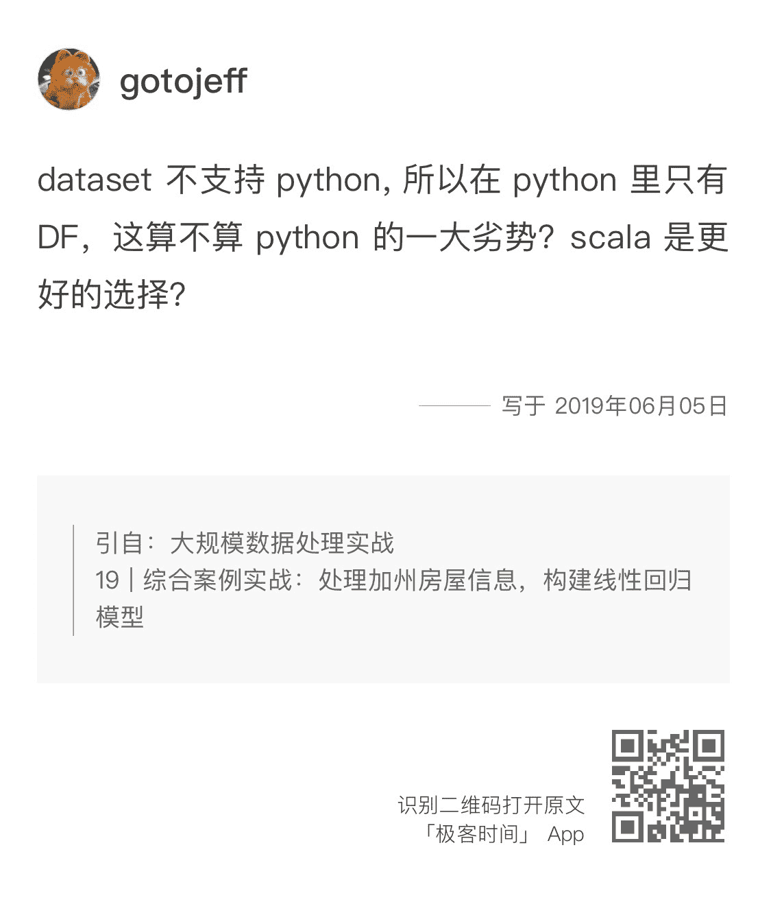
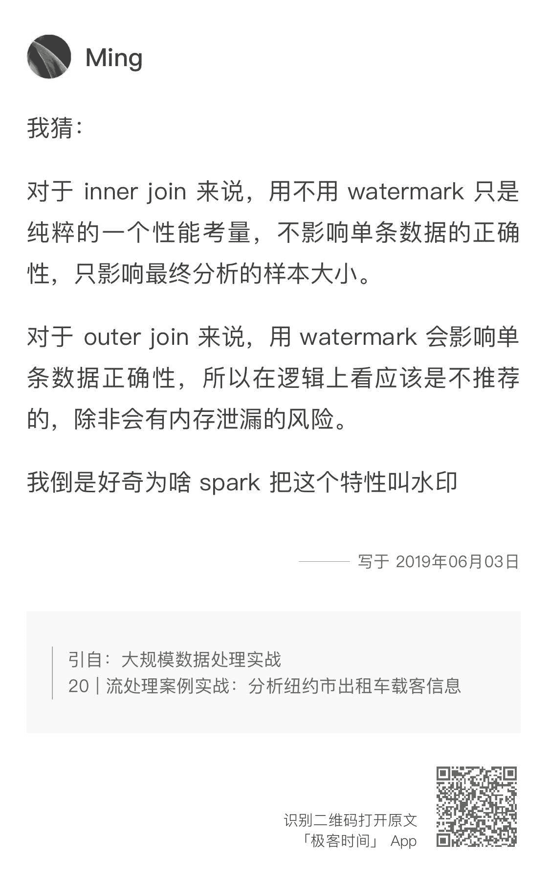

# FAQ第二期 | Spark案例实战答疑

 

你好，我是蔡元楠。

这里是第二期答疑，上周我们结束了 Spark 部分的内容，时隔一周，我们的 Spark 案例实战答疑终于上线了。

通过 10 讲的 Spark 学习，相信你已经对 Spark 的基本特性有了深入的了解，也基本掌握了如何使用各类常用 API，如 RDD、DataSet/DataFrame、Spark Streaming 和 Structured Streaming。今天我将针对模块三中提出的一些共性留言做一个集中答疑。

我首先要为积极留言的同学们点个赞，感谢同学们亲自动手实践，有的同学还通过查阅官方 API 文档的形式找出了正确的实现方式，这非常值得鼓励。

## 第 18 讲

在第 18 讲中，kylin 同学留言问到，为什么用我们通篇用的是 DataFrame API 而不是 DataSet。这是因为 PySpark 的 SQL 库只有 DataFrame，并没有 DataSet。不过在 Scala 和 Java 中，DataSet 已经成为了统一的 SQL 入口。

斯盖丸同学问道，第 18 讲代码中 groupBy(‘value’) 中 value 是什么意思？

这里我说一下，SparkSession.read.text() 读取文件后生成的 DataFrame 只有一列，它的默认名字就是“value”。

在[第 18 讲](https://time.geekbang.org/column/article/97658)的代码中，我们用 lines.value 去读取这一列，是同样的道理。之后我们给新的列重命名为”word”，所以 groupBy 的参数变成了”word”。如果你印象不深了，可以返回去查看一下。

讲到这里，我要为 Jerry 同学点个赞。在开篇词中我就提到过，我希望你可以建立自己的批判性思维，不要盲目听从任何人的意见。除了认真实践，像 Jerry 一样通过查阅官方文档找到了正确的实现方式，做的真的很棒，希望可以在工作中也把这份批判性思维和独立学习的能力保持下去。

你可以发现，在第 18 讲中，我介绍的 explode 和 split 方法在官方文档中都有详细的讲解，这些内容并没有很大的难点，通过自己阅读官方文档都可以学会。官方文档中还有很多我没有提到的用法，在仅仅 10 讲的篇幅中我不能把 Spark 的每一个用法都教给你。我能做的，只是从源头出发，分析新的技术、新的 API 产生的原因，教会你思考的方式，并结合例子，让你体会一下如何在真实场景中利用这些技术，而不是照本宣科地把官方文档复述一遍。

学习新的技术跟上学时背单词不一样，我们要做的是在最短时间内掌握核心内容和设计的理念，至于具体的用法，完全可以在用到的时候查阅官方文档。

## 第 19 讲

[第 19 讲](https://time.geekbang.org/column/article/98374)中，gotojeff 提出的这个语言选择问题，其实我之前就提到过，PySpark 现在不支持 DataSet，只有 Scala 和 Java 支持。这是由语言特性决定的，Python 是动态类型的语言，而 DataSet 是强类型的，要求在编译时检测类型安全。所以，在所有用 Python 的代码例子中，我用的都是 DataFrame。

大部分人都同意在 Spark 中，Scala 和 Python 是优于 Java 和 R 的。至于在 Spark 生态中，Scala 和 Python 孰优孰劣，这是个很主观的问题，我们不能只因为不支持 DataSet 这一点就说 Python 比 Scala 差。

Scala 确实很优秀，Spark 原生的实现就是用 Scala 写的，所以任何新发布的功能肯定支持 Scala，官方文档也都是用 Scala 来举例子。而且 Scala 的性能要优于 Python。但是 Python 也有很多优点，比如容易学习、应用场景广。这两种语言在 Spark 的世界中都可以满足我们绝大多数的需求，选择任何一个都不是错误的。

## 第 20 讲

[第 20 讲](https://time.geekbang.org/column/article/98537)的思考题是，为什么流的 Inner-Join 不支持完全输出模式？对于 Inner-Join 而言，加水印是否是必须的？ Outer-Join 呢？

这里，我节选了 never leave、jon、Ming 的留言，里面是他们对这个思考题的回答，不知道你是不是也进行了深入的思考？那么现在，让我也来分享一下我的看法吧。

首先，现阶段不仅 Inner-join 不支持完全输出模式，任何类型的 Join 都不支持完全输出模式。

这是因为完全输出模式要求每当有新数据输入时，输出完整的结果表。而对于无边界数据，我们很难把所有历史数据存在内存中。所以，一般 Join 的都是在某个时间窗口内的流数据，这就是引入 watermarking 的原因。希望将来 Spark 可以引入新的机制来支持这一点。

其次，我们都知道 Outer join 是要在 Inner Join 的基础上，把没有匹配的行的对应列设为 NULL。但是由于流数据的无边界性，Spark 永远无法知道在未来会不会找到匹配的数据。所以，为了保证 Outer Join 的正确性，加水印是必须的。这样 Spark 的执行引擎只要在水印的有效期内没找到与之匹配的数据，就可以把对应的列设为 NULL 并输出。

那么 Inner Join 呢？由于 Inner Join 不需要连接两个表中所有的行，所以在 Spark 官网的叙述中，水印和事件时间的限制不是必须的。但是如果不加任何限制，流数据会不断被读入内存，这样无疑是不安全的。所以，我推荐你即便是 Inner Join 也要加水印和事件时间的限制。

Feng.X 同学不是很理解实例中两个 Streaming DataFrame Join 时，为什么要加上事件时间的限制“endTime > startTime AND endTime <= startTime + interval 2 hours”。

事实上，这个限制会抛弃任何长于 2 个小时的出租车出行数据。确实，对于这个例子来说，这样一个对事件时间的限制并不是必须的。加入它其实是为了告诉你，在基于事件时间来 join 两个流时，我们一般不考虑时间跨度过大的情况，因为它们没有普遍意义，还会影响数据分析的结果。

举个例子吧，对于一个网页广告来说，我们需要知道用户看到一个广告后要多长时间才会去点击它，从而评估广告的效果。

这里显然有两个流：一个代表用户看到广告的事件，另一个代表用户点击广告的事件。尽管我们可以通过用户的 ID 来 Join 这两个流，但是我们需要加一个限制，就是点击广告的时间不能比看到广告的时间晚太久，否则 Join 的结果很可能是不准确的。比如，用户可能在 1:00 和 2:00 都看到了广告，但是只在 2:01 点击了它，我们应该把 2:00 和 2:01Join 起来，而不应该 Join1:00 和 2:01，因为 1:00 看到的广告并没有促使他点击。

## 第 21 讲

[第 21 讲](https://time.geekbang.org/column/article/99152)的思考题是，除了高延迟的流处理这一缺点外，你认为 Spark 还有什么不足？可以怎样改进？

我们都知道，Spark 并不是一个完美的数据处理框架，它的优点明显，也同样有不少不足之处。

 
- 在数据规模很大的场景中，靠内存处理的开销很大。如果内存不够把中间结果写入硬盘的话，又会影响处理速度； 
- Spark 没有自己的文件管理系统，它对 HDFS 或者其他的文件系统依赖很强； 
- 在流处理中，只支持基于时间的窗口，而不支持其他种类的窗口，比如基于数据个数的窗口。 

正是由于 Spark 还有诸多不足，所以众多开源的贡献者才会持续对 Spark 做改进，Spark 也在不断发布新版本。此外，很多新的数据处理框架的发明也是为了从根本上解决 Spark 存在的问题，比如 Flink，还有我们正在学习的 Apache Beam。

这位飞哥 grapefruit 不太明白 Flink 支持基于数据本身窗口是什么意思，我来回答一下。

窗口是流数据处理中最重要的概念之一，窗口定义了如何把无边界数据划分为一个个有限的数据集。基于事件时间的窗口只是窗口的一种，它是按照事件时间的先后顺序来划分数据，比如说 1:00-1:10 是一个集合，1:10-1:20 又是一个集合。

但是窗口并不都是基于时间的。比如说我们可以按数据的个数来划分，每接受到 10 个数据就是一个集合，这就是 Count-based Window（基于数量的窗口）。Flink 对于窗口的支持远比 Spark 要好，这是它相比 Spark 最大的优点之一。它不仅支持基于时间的窗口（处理时间、事件时间和摄入时间），还支持基于数据数量的窗口。

此外，在窗口的形式上，Flink 支持滚动窗口（Tumbling Window）、滑动窗口（Sliding Window）、全局窗口（Global Window）和会话窗口（Session Windows）。

到这里，我们 Spark 案例实战篇的答疑就结束了。欢迎继续留言，与我分享你的问题与答案。如果你觉得有所收获，也欢迎把文章分享给你的朋友。

