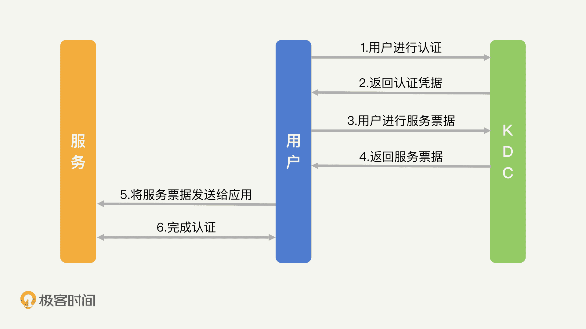
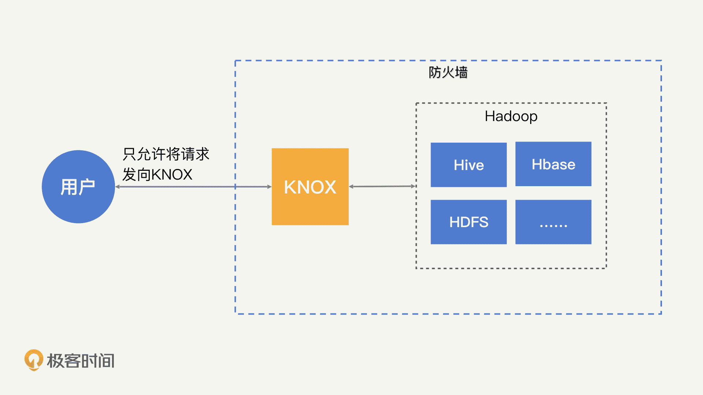
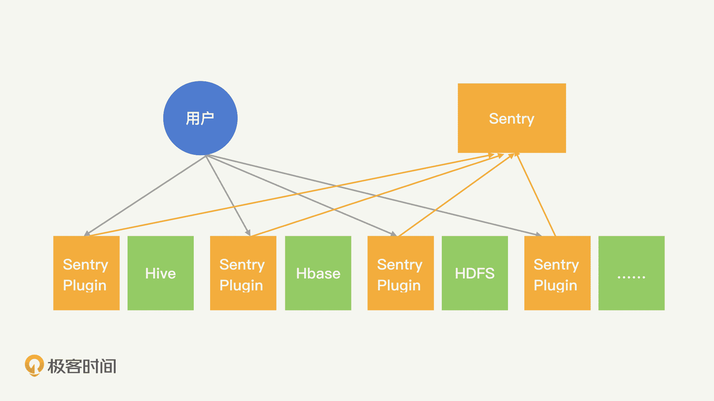
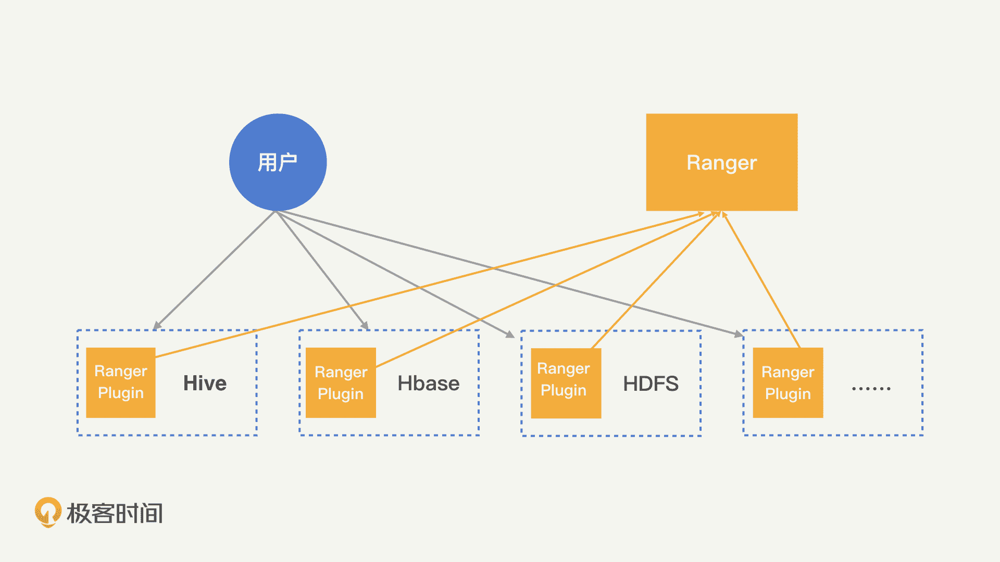
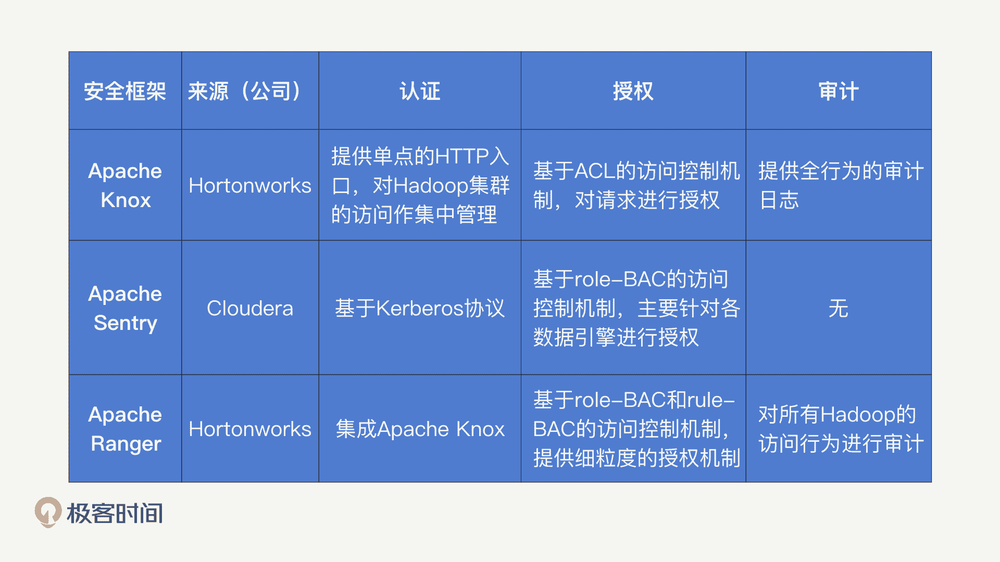

# 17 | 分布式安全：上百个分布式节点，不会出现“内奸”吗？

 

你好，我是何为舟。

如今，大数据处理已经成为了每一个应用和公司都必备的业务。因此，除了数据库之外，分布式的平台和框架也是开发人员最熟悉的工具之一。

说到分布式，就不得不提到 Hadoop。Hadoop 可以说是一个划时代的分布式框架，底层的 HDFS 提供了大数据存储的文件系统支持，YARN 提供了大数据运算的资源调度能力，而 MapReduce 的计算框架，更是彻底革新了数据运算的方式。基于此，Hadoop 又衍生了一系列的分布式工具和数据处理生态圈。

可以说，Hadoop 是分布式框架的根基。所以，我们今天就以 Hadoop 为例，探讨一下分布式框架的安全性。

对于开发人员来说，优化分布式环境下的数据处理性能，完成各种高复杂度的运算任务，都不在话下。但是，说到分布式环境中的安全，你又知道多少呢？

现在的分布式环境中，动辄就是上百台的分布式节点，海量的数据在这些节点中不停地流动，你能够确定所有的节点都是可信的吗？如果某一个节点被黑客控制了，又会发生什么呢？

## 针对 Hadoop 的攻击方式有哪些？

Hadoop 最开始是设计工作在可信的网络中的，所以，Hadoop 的默认安全防护机制并不强。这也就使得 Hadoop 中的数据安全得不到保障。而 Hadoop 作为大数据的处理框架，可以说公司大部分的数据都会落到其中进行处理。因此，Hadoop 中数据 CIA 的重要性，甚至比普通的数据库更高。

那么，黑客可以通过哪些方式来攻击 Hadoop 呢？

首先，最直接也是最常见的，也就是在默认情况下，Hadoop 没有集成认证和授权功能，任何人都可以通过客户端的形式连入到 Hadoop 集群中。所以，黑客可以任意地增删改查 HDFS 中的数据，也可以任意地提交 Hadoop 任务，来进行自己想要的数据操作。

除了直接的越权访问，黑客也可以通过一些间接的方式，来窃取 Hadoop 中的数据。比如，Hadoop 节点间的数据传输默认都是明文的。因此，即使黑客无法连入到 Hadoop 集群中，它们也可以通过控制交换机等网络设备，同样能够获得很多的数据信息。

最后，因为 Hadoop 能够很好地支持节点的增加和删除操作。所以，黑客可以以一个节点的身份加入到 Hadoop 集群中。这样一来，数据就会自动流转到黑客的节点中。如果伪装的是具备调度功能的 NameNode，黑客还能够对整个 Hadoop 集群的资源调度进行干预和影响。

## Hadoop 自带的安全功能有哪些？

现在，你应该知道了，黑客针对 Hadoop 的攻击一旦发生，就会造成非常大的危害。那我们该如何提高 Hadoop 的安全性呢？和数据库一样，我们还是分别从认证、授权、审计和加密这四个方面来看。

### 黄金法则在 Hadoop 上如何应用？

首先，我们来看，如何给 Hadoop 加上认证的功能。

目前，Hadoop 支持了基于 Kerberos 协议的认证功能，我们可以在配置文件中使用。

那 Kerberos 协议是什么呢？Kerberos 协议和我们之前讲过的单点登录机制（CAS 流程）很类似，都是向认证中心获取一个认证 Token，然后根据 Token 去完成服务的认证。区别在于，Kerberos 都是主动向认证中心发起认证，不需要服务去进行重定向操作。



接下来，我带你梳理一下 Kerberos 的流程，你可以结合上面的流程图来看。

用户在向 KDC（Kerberos 的认证中心）发起登录之后，会获取一个 Token（Kerberos 的 ST），然后通过这个 Token 去访问对应的服务。Token 中包含了签名，因此服务方可以自行验证 Token 的合法性。在认证完成之后，服务方就可以向用户提供服务了。

Kerberos 比较适用于服务与服务之间的认证，对应到 Hadoop 的场景中，就是 Hadoop 集群中内部各个节点之间的认证。

那么，在使用了 Kerberos 认证机制后，我们要怎么去配置每一个 Hadoop 节点，来完成 Hadoop 集群的认证呢？这就需要我们在初始化 Hadoop 的各个节点时，为每个节点申请一个 Kerberos 的密钥文件 Keytab。

Keytab 文件会使用一个 Principal 作为唯一的身份标识。Principal 的格式如下：username/host@realm。可以看到，Principal 由三个部分组成：username、host 和 realm。

其中，“username”是服务所对应的用户身份。比如，Hadoop 的服务会分别以 hdfs 用户运行 HDFS 服务、以 yarn 用户运行 YARN 服务、以 mapred 用户运行 MapReduce 服务。因此，对应各个服务节点的“username”就是 hdfs、yarn 和 mapred。

“host”即为服务节点在 DNS 中的主机名，“realm”为域标示，可以使用根域名来替代，比如 BAIDU.COM。

现在，我们知道，通过 Principal，Keytab 文件会和节点的服务类型以及 Host 进行绑定。这样一来，每个服务节点都具备了能证实身份的唯一 ID 和密钥，也就可以保证在整个 Hadoop 集群中，各个节点都是可信任的。

Kerberos 协议同样可以完成对用户的授权。当认证开启后，只要用户登录一台配置好了 Kerberos 密钥的服务器，就能以节点的身份向 Hadoop 发起认证了。

总体来说，因为不同的 Hadoop 工具（Hive、HDFS 等）对授权和审计有不同的需求，所以，这些授权和审计功能通常会放到具体工具中去实现，无法由底层的 Hadoop 统一完成。而这种不统一会增加 Hadoop 管理的工作量，因此，在实际工作中，我们往往会选择通过集成额外的安全框架，来对授权和审计进行统一管理。我会在 Hadoop 安全框架的内容中，详细来讲解授权和审计机制。

### Hadoop 中有哪些加密形式？

在黄金法则之外，我们需要考虑的另外一点就是数据加密。和 MySQL 数据库一样，Hadoop 也支持对硬盘数据进行加密存储，这个过程主要集中在 HDFS 中：当数据写入 HDFS 时，数据会自动加密；当需要从 HDFS 读取数据时，数据会自动解密。在 MySQL 中，我们是以表为单位分配不同的密钥；在 HDFS 中，则需要我们主动创建 Zone 来进行加密。

比如，通过下面的命令，我们能够在 HDFS 中创建一个 /zone 目录，对 /zone 目录中的所有数据进行加密。

```
hadoop fs -mkdir /zone  
hdfs crypto -createZone -keyName mykey -path /zone
```

但是，和 MySQL 数据库不同的是，HDFS 是一个分布式的存储系统，一份大数据会被分成若干个小数据，存储在不同的服务节点上。那么，HDFS 是怎么对加密密钥进行管理的呢？Hadoop 提供了一个密钥管理中心 KMS，当 HDFS 需要进行加解密操作时，会根据用户信息，向 KMS 请求对应的密钥，从而完成数据的加解密工作。

## 通过 Hadoop 安全框架来加强安全功能

Hadoop 作为一个成熟的开源框架，当出现安全需求时，各个公司都会对其进行安全加固。当这些加固的技术成熟时，部分公司就会对这些技术进行整理，包装成为 Hadoop 提供安全加固的框架供我们使用。

接下来，我就从我最熟悉的 3 个知名安全框架入手，为你详细讲解这些安全框架分别为 Hadoop 提供了哪些安全机制。

首先我们来看 Apache Knox。

Apache Knox 是一个针对 Hadoop 集群的网关。所有对 Hadoop 集群的请求，需要先发送给 Apache Knox，然后由 Apache Knox 代理到 Hadoop 集群中去。对于用户来说，只能够看到 Apache Knox 的网关，而不能够直接和 Hadoop 集群进行通信。通过网关的形式，Apache Knox 将所有和 Hadoop 交互的行为进行了统一收口。在此基础之上，Apache Knox 就可以为 Hadoop 提供统一的安全管理能力，也就是进行用户的认证、授权和审计等工作。



接着，我们再来说一说 Apache Sentry。

Apache Sentry 相当于一个为 Hadoop 提供集中式授权的中心。它在 Hive、Impala 等数据引擎中添加一个插件，拦截所有对数据引擎的请求，并转发到 Apache Sentry 的授权中心。然后 Apache Sentry 会基于 role-BAC 的访问控制方式，对请求进行具体的授权。对于 Hadoop 的各类组件来说，Apache Sentry 是一个比较独立的授权引擎，可以随时地引入或者撤除。也就是说，Apache Sentry 为 Hadoop 提供了可“插拔式”的授权能力。



最后是 Apache Ranger。

Apache Ranger 提供了一个集中制的访问控制机制。通过 Apache Ranger 的管理后台，我们可以很方便地管理各类资源的授权机制。而且，这些授权机制是通过一个轻量级的 Java 插件，运行在各类工具的服务进程（比如 HDFS 的 namenode 进程，Hive 的 Hive2Server 进程等）中，所以，在 Hadoop 的服务节点上，不需要运行额外的进程。尽管耦合性更强，但 Apache Ranger 更便于管理，它相当于在每一个 Hadoop 工具中都加入了授权的能力。



为了帮助你加深理解，我把这三个安全框架的功能简单地总结了一张表格。



现在，你应该已经了解这 3 个安全框架能够提供的安全机制了。接下来，我们说一说，在实际工作中，你该如何选择这些安全框架。

我比较推荐你使用 Apache Ranger 和 Apache Knox 的组合。因为 Apache Ranger 和 Apache Knox 是同一个公司（Hortonworks）推出的安全框架，它们在功能上是相辅相成。

我为什么会这么说呢？我们前面讲过，Apache Ranger 是一个授权系统，它通过访问授权机制决定，谁可以访问哪些数据。但是，Apache Ranger 没有自带的认证功能，当请求到达 Apache Ranger 的时候，它就默认这个用户已经完成认证了。Apache Knox 提供了统一的出入口，只有通过认证的用户，能够将请求发送到 Hadoop 集群中。简单来说就是，Apache Knox 为 Ranger 提供了认证能力，Apache Ranger 为 Apache Knox 提供了授权能力。

那 Apache Sentry 是不是也能和其他的安全框架组合使用呢？其实，我认为 Apache Sentry 和 Apache Ranger，只是两家公司为了竞争开发的同一类产品。因此，它们在功能上比较相似，只是支持的 Hadoop 工具稍有区别，比如，Apache Sentry 支持 Impala，而 Apache Ranger 不支持。

现在，Apache Sentry 和 Apache Ranger 的两家公司已经完成合并，并且已经决定将 Apache Sentry 合并到 Apache Ranger 中。所以，如果你需要为 Hadoop 加入安全框架的话，使用 Apache Knox+Apache Ranger 的组合即可，不需要再去考虑其他安全框架了。官方网站也对这种组合形式进行了具体的描述，你可以直接查阅使用。

## 总结

好了，今天的内容讲完了。我们来一起总结回顾一下，你需要掌握的重点内容。

我们以 Hadoop 为例，详细讲解了分布式系统中的安全风险和安全措施。如果 Hadoop 缺乏安全保护措施，那么其中的数据就会受到威胁。黑客可以通过伪装成用户、伪装成节点或者窃听网络的方式破坏数据的 CIA。

在防护上，我们可以通过认证、授权、审计和加密的方式，对 Hadoop 进行保护。除此之外，Hadoop 作为成熟的开源框架，有很多公司为其打造了增强安全能力的辅助工具。我比较推荐你使用 Hortonworks 的 Apache Knox 和 Apache Ranger 的组合。

## 思考题

最后，我们还是来看一道思考题。

在 Hadoop 安全中，我们介绍了“外挂式”的安全工具和框架。所谓“外挂式”，即应用本身不提供足够的安全能力，而由外接的工具来提供安全能力。你可以回忆一下，你还在哪些场景中见过类似的安全模式？这个安全模式又有哪些优缺点？

欢迎留言和我分享你的思考和疑惑，也欢迎你把文章分享给你的朋友。我们下一讲再见！
