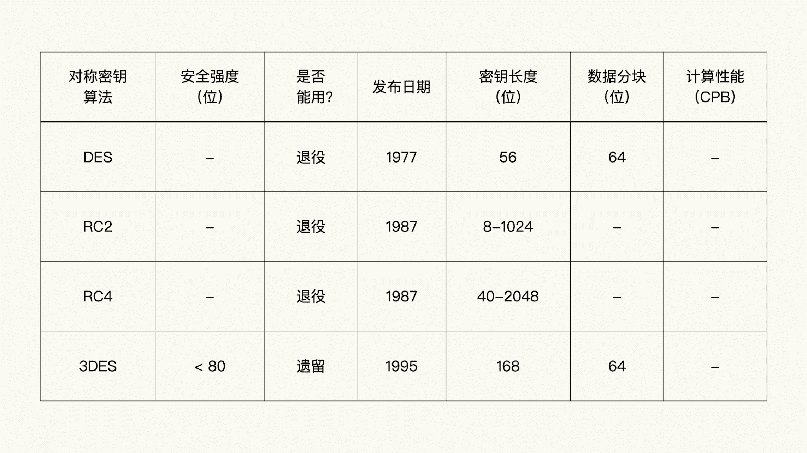
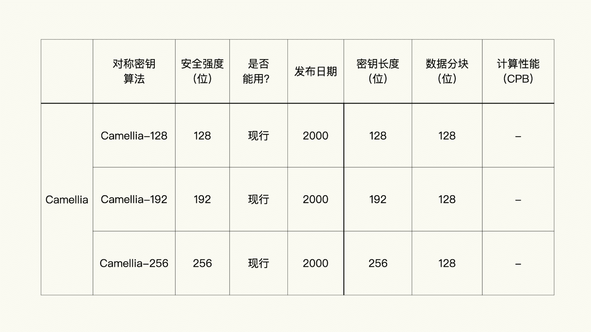
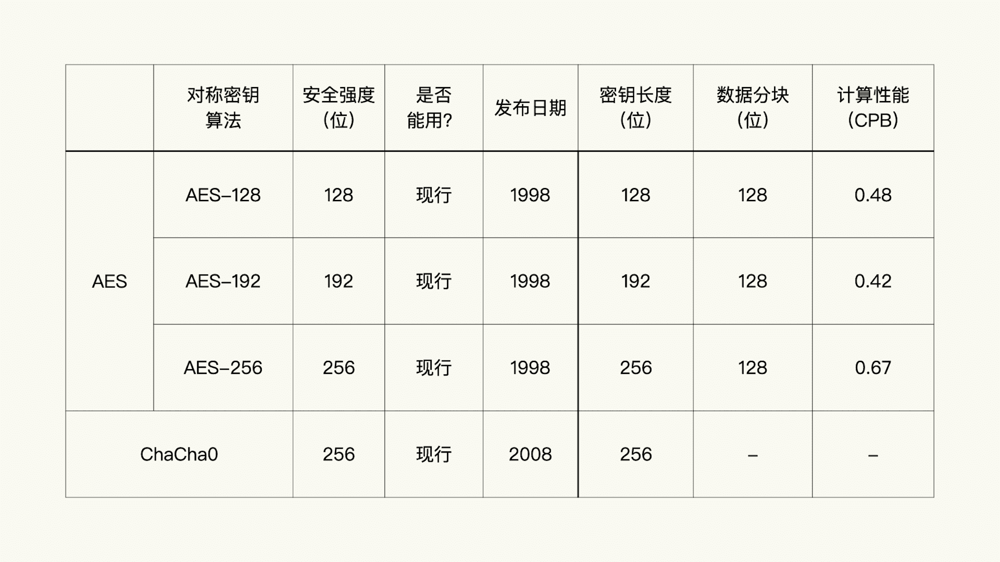
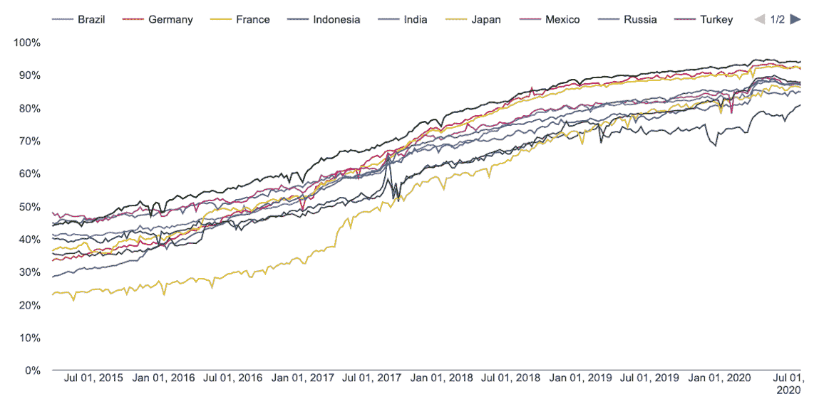
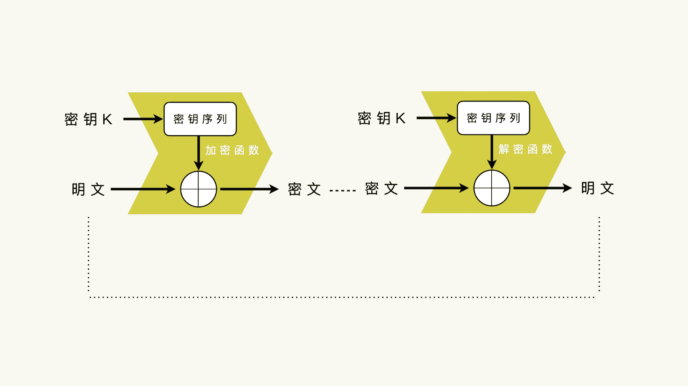

# 07 | 怎么选择对称密钥算法？

 

你好，我是范学雷。

上一讲，我们讨论了什么是对称密钥，你还记得决定对称密钥系统安全性的两个关键因素吗？**密钥的保密性和算法的安全性**。和单向散列函数一样，我们也要分析如何选择对称密钥算法。

所以，有哪些算法是值得我们信任的呢？这就是我们这一次要解决的问题。首先，我们还是先来一起看看曾经流行的和现在流行的对称密钥算法。

## 数据加密影响性能吗？

像单向散列函数一样，我们可以把对称密钥算法也按照退役的、遗留的以及现行的算法来分类。

在下面的表格里，我给你总结了常见的一些算法，以及一些相关的信息。其中，计算性能参考的是 ECRYPT 性能基准测试在 2020 年 7 月对较长数据的运行结果。

对于不同的系统，这个计算性能数据差距可能很大，不过，它足以让我们有一个大致的感受。

（文末附各个算法的参考文献链接）

如果我们关注一下上表里的计算性能，每个字节的加密、解密运算需要大约 0.5 个时钟周期。你看这个数字，对比我们在前面提到的单向散列函数的计算性能，我们可以感受到，加密、解密运算是一种很快的运算。之后，我们还会交代非对称密钥的计算性能，你也会有同样的感受。

很快的运算，也是需要额外的运算的。对比数据不加密和数据加密，计算性能的影响到底有多大呢？这个答案当然依赖于具体的环境。不过，我们可以看一个最常见的场景，感受一下数据加密给计算性能带来的影响。这个场景就是我们常用的互联网 Web 服务。

现在的 Web 服务，大部分都是运行在 HTTPS 协议上的。和 HTTP 协议相比，在 HTTPS 协议通道上传输的应用数据，都是加密的数据。有测试数据表明，和 HTTP 相比，一个合理配置的 HTTPS 服务，客户端的响应时间没有明显的变化；服务器的吞吐量大约减少了 5% 到 8%，CPU 的使用大约增加了 2% 到 5%。

我们可以看到，数据加密会影响性能，但是这个影响并不显著。这也是近年来，绝大多数 Web 服务迁移到 HTTPS 协议的背后技术支撑。十多年前，大部分 Web 服务还是运行在 HTTP 协议上，传输数据没有加密，用户的数据经常就莫名其妙地丢失了，Web 服务网页动不动就被黑了。

现在，如果一个 Web 服务还没有转换到 HTTPS 协议上，这个服务的安全性是不能让人放心的。

接下来，我们看下面的这张图，显示的是在不同的地域，使用 HTTPS 的网页的百分比。这张图是由 Google 根据 Chrom 浏览器加载 Web 页面的数据统计绘制的。

我们能看到，在 2015 年，不足 50% 的 Web 页面使用 HTTPS 协议。到 2020 年，领先的几个地域，已经有大约 95% 的 Web 页面使用了 HTTPS 协议。总的来说，在短短的五年时间里，Web 服务整体的安全性有了巨大的提高。

也许，再过五年，就很难找到不使用加密通道的 Web 服务了。这是互联网消费者的幸事！

## 序列算法和分组算法

不知道你注意到没有，在上面的表格里，RC4 和 ChaCha20 没有数据分块数据，而 3DES 和 AES 有数据分块数据。这是因为 RC4 和 ChaCha20 是序列算法，3DES 和 AES 是分组算法。那么，问题来了，序列算法和分组算法有什么不一样的呢？

我们前面讲过，为了能够处理任意大小的数据，并且输出结果长度固定，单向散列函数需要对数据进行分组，然后按数据组进行运算。在对称密钥算法里，因为输出结果的长度没有限制，对数据的处理方式，也就有了更多的想象空间。

如果我们从数据是否分组这个角度考虑，就有两种处理方式。

1. 进行数据分组，然后按数据组运算，这就是分组算法；
2. 不进行数据分组，按照原始数据的大小进行运算，这就是序列算法。

那么，怎么计算序列算法呢？

序列算法的基本思路，就是从对称密钥里推导出一段和明文数据相同长度的密钥序列，然后密钥序列和明文进行亦或运算得到密文，和密文进行异或运算得到明文。

序列算法的关键，是怎么从固定长度的对称密钥推导出参与运算的任意长度的密钥序列。一般来说，密钥序列的推导和异或运算都是快速的运算。所以，序列算法通常被认为是更高效的算法。

比如说，在类似的条件下，相同安全强度的对称密钥，ChaCha20 算法要比 AES 算法快四到六倍，比 Camellia 算法快近十倍。如果你关注过浏览器底层技术细节，你可能会注意到，ChaCha20 是现代主流浏览器优先选择的加密算法。

由于不需要数据分组，序列算法的安全性主要取决于密钥序列的推导算法，而不用考虑数据分组带来的种种陷阱。对于应用程序而言，这是一个便于使用，不易出错的选择。

分组算法的安全性，除了算法本身之外，还取决于数据分组的策略。应用程序需要同时指定分组算法和分组策略。对于不太了解密码技术的细节的程序员来说，这实在是一个不小的挑战。

**良好的性能，以及皮实的用法，这是我倾向于优先使用序列算法的两个基本原因**。同样，按照这两个标准，同时考虑安全强度，我建议你使用下面的对称密钥算法，按照优先级从高到低排列：

1. ChaCha20
2. AES-256
3. AES-128

不过，这个建议的实用性还欠考虑，因为我们还没有考虑数据分组的影响，以及其他的一些因素。对于分组算法，数据分组到底有什么样的麻烦？对于序列算法，还有什么因素需要考虑？上面的推荐该如何修正？是我们之后要讨论的话题。

## Take Away（今日收获）

今天，我们罗列了常见的对称密钥算法，讨论了数据加密对应用性能的影响，还知道了分组算法和序列算法这两个概念。

这一讲，我们要：

1. 知道什么是序列算法，什么是分组算法；
2. 知道现在优先选择的三个算法：ChaCha20，AES-256，AES-128

## 思考题

今天留给大家的也是一个需要动手的思考题。我们罗列了常见的对称密钥算法，其中有退役的、遗留的和现行的算法。

在你正在开发的项目中，或者你关注的开放源代码项目中，试着搜索一下这些算法，看看哪些退役的算法还在使用，哪些遗留的算法还在使用。如果我们发现了退役算法和遗留算法的使用，你有没有什么建议？

这是一个能够帮助你解决现有项目历史遗留问题的好办法。欢迎在留言区留言，记录、讨论你的发现和建议。

好的，今天就这样，我们下次再聊。

**附：本讲表格中的各个算法参考文献链接**

1. DES：RFC 18229
2. RC2：RFC 2268
3. 3DES：RFC 1851
4. Camellia-128、192、256：RFC 3713
5. AES-128、192、256：FIPS 197
6. ChaCha20：ChaCha
