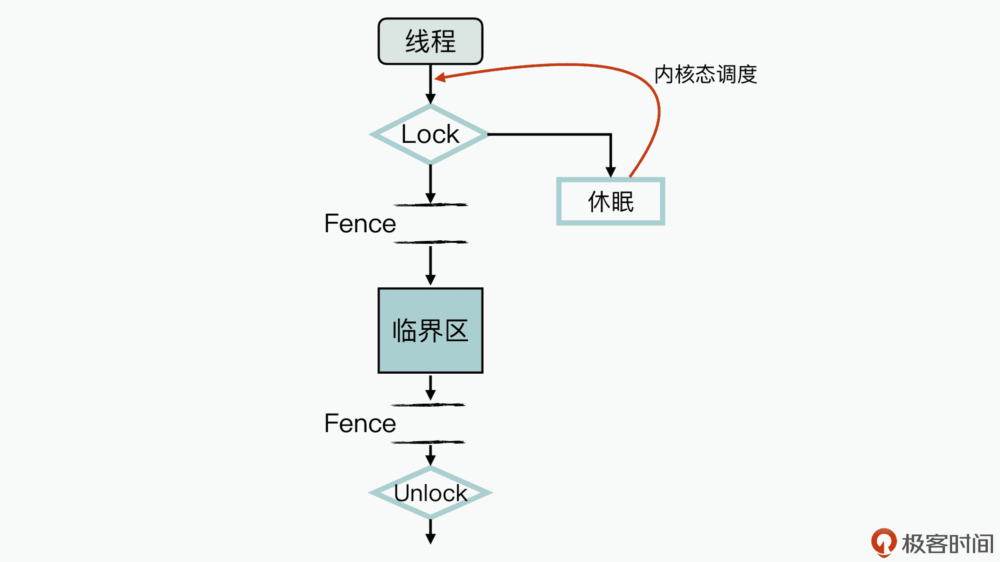
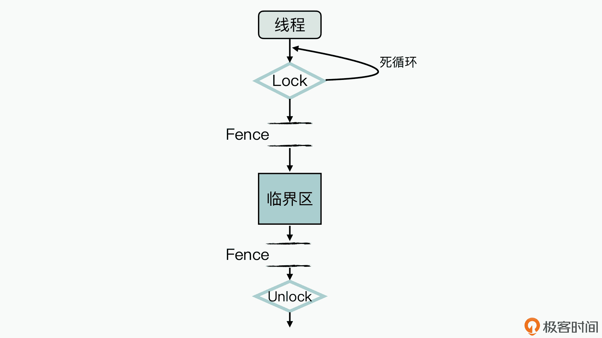
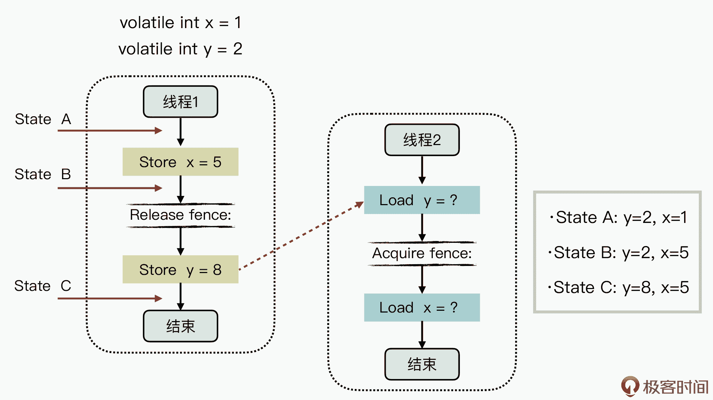

# 03 | 并行设计（下）：如何高效解决同步互斥问题？

 

你好，我是尉刚强。

我曾经主导过一个性能优化的项目，该项目的主要业务逻辑是在线抢货并购买。在原来的设计方案中，我们为了保证库存数据的一致性，后端服务在请求处理中使用了 Redis 互斥锁，而这就导致系统的吞吐量受限于 30TPS，不能通过弹性扩展来提高性能。

那我们是怎么解决这个问题的呢？后来我们使用无锁化来实现性能的拓展，系统吞吐量一下就提升至 1000TPS，相比原来提升了 30 倍之多。

所以你看，**同步互斥是影响并发系统性能的关键因素之一，一旦处理不当，甚至可能会引起死锁或者系统崩溃的危险。**

这节课，我就会带你去发现并发系统中存在的同步互斥问题，一起思考、分析引起这些问题的根源是什么，然后我 会介绍各种同步互斥手段的内部实现细节，帮助你理解利用同步互斥的具体原理及解决思路。这样，你在深入理解同步互斥问题的本质模型后，就能够更加精准地设计并发系统中的同步互斥策略，从而帮助提升系统的关键性能。

好，接下来，我们就从并发系统中存在的同步互斥问题开始，一起来看看引起同步互斥问题的内在根源是什么吧。

## 并行执行的核心问题

从计算机早期的图灵机模型，到面向过程、面向对象的软件编程模型，软件工程师其实早已习惯于运用串行思维去思考和解决问题。而随着多核时代的来临，受制于硬件层面的并发技术的发展，为了更大地发挥 CPU 价值，就需要通过软件层的并行设计来进一步提升系统性能。

但是，现在大多数的软件工程师还习惯于用串行思维去解决问题，这就会导致设计实现的软件系统不仅性能非常差，还容易出故障。

比如说，我们可以来看下这个并发程序，找找它在执行期间都可能会存在什么问题：

```
int number_1 = 0;  
int number_2 = 0;  
void atom_increase_call()  
{  
     for (int i = 0; i < 10000; i++)  
     {  
         number_1++;  
         number_2++;  
     }   
}  
void atom_read_call()  
{  
     int inorder_count = 0;  
     for (int i = 0; i < 10000; i++)   
     {    
      if (number_2 > number_1)  
         {  
             inorder_count++;  
         }   
     }  
     std::cout << "thread:3 read inorder_number is " << inorder_count  
             << std::endl;  
}  
int main()  
{  
     std::thread threadA(atom_increase_call);  
     std::thread threadB(atom_increase_call);  
     std::thread threadC(atom_read_call);  
     threadA.join();  
     threadB.join();  
     threadC.join();  
     std::cout << "thread:main read number is " << number_1 << std::endl;  
     return 0;  
}
```

运行之后你会发现，由于代码在三个线程上并行执行，导致这个程序每次的运行结果可能都不相同，这种现象就被叫做**程序运行结果不确定性**，而这通常是业务所不能接受的。

这里我列举了其中两次执⾏结果，如下：

```
| 第⼀次：  
thread:3 read inorder_number is 1  
thread:main read number_1 is 15379  
thread:main read number_2 is 15378  
  
| 第⼆次：  
thread:3 read inorder_number is 13  
thread:main read number_1 is 15822  
thread:main read number_2 is 15821
```

通过分析这段代码的两次执行结果，我们可以看到该并发程序出现了两种现象：

1. 线程 A 和线程 B 中，number_1++、number_2++ 累计执行了 20000 次，那么结果应该为 20000 才对，但实际运行的结果却与 20000 的差距比较大。
2. 线程 A 和线程 B 中，都是先执行 number_1++，再执行 number_2++，因此 inorder_number 的统计应该是 0 才合理，但最后的结果却不是 0。这就说明了，number_1++ 与 number_2++ 执行结果的生效，在跨线程下的顺序是不一致的。

那么现在，我们可以先来思考一下：为什么现象 1 中，number_1 的值不是 20000 呢？我认为可能有两个原因：

1. number_1 在不同线程间的**缓存失效**了，导致大量写入操作与预期不一致，这就导致与实际值的偏差较大；
2. number_1++ 的操作执行包括了读取、修改两个阶段，中间有可能被中断，所以**不满足原子特性**，这样两个线程中 number_1++ 操作互相干扰，从而就无法保证结果的正确性。

而导致 inorder_number 值不为 0 的原因比较多，比如说：

1. 变量 number_1 和 number_2 在线程间的**缓存不一致**；
2. 由于编译器指令重排序优化，导致 number_1++ 和 number_2++**生成指令的顺序被打乱**；
3. 由于 CPU 级指令级并发技术，造成 number_1++ 和 number_2++ 并发执行，因而**无法保证执行顺序**。

如此一来，我们将以上所有问题进行汇总整理之后，其实可以发现引起并发系统执行结果不确定性的根源问题主要有三个，分别是**原⼦性破坏问题、缓存一致性问题、顺序一致性问题**。

**那么我们该怎么去解决并发系统中存在的这三个根源问题呢？**你肯定会想到，使用互斥锁呀！的确，互斥锁能够很好地解决上述三个问题。

下面，我们就一起来了解下互斥锁是如何解决上面描述的三个问题的，同时在此过程中，我们也来看看由于使用了互斥锁，都会引入什么样的性能开销。

## 互斥锁的原理与性能

首先，我们来理解下互斥锁的实现原理，下图就展示了一个互斥锁的处理过程：



如图中所示，在 Lock 加锁后进入临界区前、退出临界区后并执行 Unlock 之前，这两处都增加了内存屏障指令（不同 CPU 架构与 OS 上的实现存在一些差异，但其基本原理是类似的）。这样，编译期间通过这两个内存屏障，就实现了以下功能：

1. 限制了临界区与非临界区之间的指令重排序；
2. 保证在释放锁之前，临界区中的共享数据已经写入到了内存中，以此确保多线程间的缓存一致性。

由于临界区是互斥访问的，因此你可以认为临界区的业务逻辑在整体上是原子性且缓存一致的，而且跨线程间数据顺序的一致性约束，也被统一放到了临界区内来实现。虽然临界区间内的代码是乱序优化执行的，还存在非原子性操作等实现，不过这都不会影响到程序执行最终结果的不确定性。

另外，从图上你还可以看到，当互斥锁加锁失败后，执行线程会进入休眠态，直到互斥锁资源释放之后，才会被动地等待内核态重新调度去激活。

显而易见，线程长时间休眠会导致业务阻塞，从而就会影响到软件系统的性能。所以，在并发程序中使用互斥锁时，**一个重要的性能优化手段就是减少临界区的大小，以此减少线程可能的阻塞时间。**比如说，通过删除一些非冲突的业务逻辑，来减少临界区的执行代码时间。

不过这里请你再来思考一个问题：在通过减少临界区代码来优化性能的过程中，如果你发现临界区的执行时间，已经小于线程休眠切换的时间开销（通常线程休眠切换的开销大约在 2us 左右，不同机器在性能上会有一定差异，需要以实际机器的测试为准），那你还会选择互斥锁这种方式吗？

其实，这时候你应该考虑更换一种锁，来减少线程休眠切换消耗的时间。接下来我要带你了解的自旋锁（SpinLock），就可以帮助实现这个目的。自旋锁在 Linux 源码中使用很多，我来给你介绍一下它的基本原理与性能表现吧。

## 自旋锁的原理与性能

首先，我们还是来了解下自旋锁的实现原理，看看它的处理逻辑是怎么样的，如下图所示：



对比前面互斥锁的工作过程示意图，你可以发现，**自旋锁与互斥锁的逻辑差异主要体现在**：当加锁失败时，当前线程并不会进入休眠态。所以如果你使用自旋锁这种实现方式，如果临界区执行开销比较小，就可以赚取等待时间开销小于线程休眠切换开销的额外收益了。

**在自旋锁中，临界区的实现机制与互斥锁基本是一致的，因此它也能解决前面提到的并发系统中的三个根源问题。**

另外，与互斥锁一样，为了进一步提升软件性能，你也需要进一步减少线程间的数据依赖。这样，你通过设计优化之后，将线程之间的依赖数据减少到仅剩几个变量时，执行开销可能只需要几个指令周期就可以完成了。

不过这时使用锁机制，你还需要在每次数据操作的过程中进行加锁与解锁，这样额外开销的占比就会过大，其实就不太划算了。

那么既然如此，还有其他更加高效的解决方案吗？

当然有！请记住，**锁只是我们解决问题的手段，而不是我们需要解决的问题。**现在让我们再次回到问题本身，再来强化记忆一下并发系统内的三个本质问题：原⼦性破坏问题、缓存一致性问题、顺序一致性问题。

这里你需要意识到，在具体的并发业务场景中，可能并不需要你同时去解决这三个问题。比如多线程场景下的统计变量，两个线程会同时更新一个变量，那这里压根就不存在顺序一致性的问题。

因此，**你首先需要学会的是识别并发系统中待解决的问题，然后再去精准地寻找解决方案，这才是进一步提升系统性能的关键。**

那么，在实际的业务场景中，**最常见的引发并发系统执行结果不确定性的问题，其实是缓存一致性问题**，比如典型的生产者消费者问题。不过在嵌入式系统的业务场景中，C 语言已经通过引入 volatile 变量解决了这个问题。

接下来，我们就通过使用 volatile 来解决问题的工作流程，来分析、了解下 volatile 是如何解决同步互斥中存在的问题的。

## volatile 的原理与性能

volatile 是一种特殊变量类型，它主要是为了解决并发系统中的**缓存一致性问题**。定义为 volatile 类型的变量，会被默认为是缓存失效状态，针对这个变量的读取、设置操作，都可以通过直接操作内存来实现，从而就规避了缓存一致性问题。

在 C/C++ 语言中，volatile 一直在沿用这种方式，但这种实现机制并没有完全解决并发系统中的原子性破坏和顺序一致性的问题。

而在 Java 语言中，JVM 会在 volatile 变量的过程中添加内存屏障机制，从而可以部分解决顺序一致性的问题。其具体机制如下图所示：



图中，变量 x、y 是 volatile 类型变量，初始值分别为 1 和 2，Load 代表的是对内存直接进行读取操作，而 Store 代表了对内存直接进行写入操作。在线程 1 内，volatile 变量 y 执行写入操作时，会在生成的操作指令前添加写屏障指令；而线程 2 是在执行 volatile 变量 y 读取操作时，在生成的代码指令后添加了读屏障指令。

如此一来，通过写屏障就限制了线程 1 在执行过程中，Store x 与 Store y 的写操作不能乱序；而读屏障就限制了线程 2 在执行过程中，Load y 和 Load x 不能乱序。

因此，对于线程 2 来说，就只可能看到线程 1 执行过程中 3 个时间点的状态，分别为：

1. State A ：初始化状态，y=2，x =1。
2. State B ：x 刚设置完的中间状态，y=2，x =5。
3. State C ：x, y 都设置完的状态，y=8，x=5。

而如果线程 1 和线程 2 的其中任何一方没有使用内存屏障指令，就有可能导致线程 2 读到的数据顺序不一致，比如说获取到乱取的状态，y=8，x=2。实际上，这也是**无锁编程**（即不使用操作系统中锁资源的程序，而互斥锁需要使用操作系统的锁资源）中的一个典型问题解决方式。

但这里，你还需要注意的是：**volatile 并没有完全实现原子性**。比如说，如果出现以下两种情况，就不满足原子性：

1. 类似 i++ 这种对数据的更新操作，CPU 层面无法通过一条指令就更新完成，因此使用 volatile 也不能保证原子性；
2. 对 32 位的 CPU 架构而言，64 位的长整型变量的读取和写入操作就无法在一条指令内完成，因此也无法保证原子性。

对于 32 位与 64 位 CPU 架构之间的差异而导致的原子性问题，我们就只能在使用过程中尽量去规避；而针对 i++ 这种更新操作，大部分 CPU 架构都实现了一条特殊的 CPU 指令，来单独解决这个问题。

这个特殊指令就是 **CAS 指令**，它的实现语义如下：

```
 bool CAS(T* addr, T expected, T newValue)  
 {  
      if( *addr == expected )  
     {  
          *addr =  newValue;  
           return true;  
     }  
     else  
           return false;  
 }
```

该函数实现的功能是：如果当前值等于 expect, 则更新值为 newValue，否则不更新；如果更新成功就返回 true，否则返回 false。**这条指令就是满足原子性的。**

好了，现在我给你总结下前面的分析过程：在并发系统的同步互斥中，使用 volatile 可以实现读取和写入操作的原子性，使用 CAS 指令能够实现更新操作的原子性，然后再借助内存屏障实现跨线程的顺序一致性。

在 Java 语言中，正是基于 volatile + CAS + 内存屏障的组合，实现了 **Atomic 类型**（如果想更深入理解 Java 的 Atomic 类型的原理与机制，可以参考阅读这个文档），从而支撑解决了并发中的三个本质问题。

C++ 在 Atmoic 实现的原理与 Java Atomic 是类似的，但在 C++ 语言中，它定义了更加丰富的一致性内存模型，可以供我们灵活选择。

## 小结

这节课，我带你学习了并发系统中，解决同步互斥问题的多种手段与原理，以此帮助你更好地优化同步互斥性能。不过，我并不希望你在实际的业务场景中，也直接去对比选择这节课所讲的解决方案，因为脱离了上下文场景下的优劣分析是没有实际意义的。

相反，我希望你通过今天的学习，能够更加深入地理解并发系统同步互斥问题本身，这样当面临具体问题时，你可以准确地抓住问题本质，找到最佳性能的解决方案。

## 思考题

思考一下，Redis 上的变量 set 和 get 操作也是原子操作，也提供 CAS 指令，那么在跨机器的分布式系统设计中，是否也可以使用 Redis 进行无锁编程呢？
