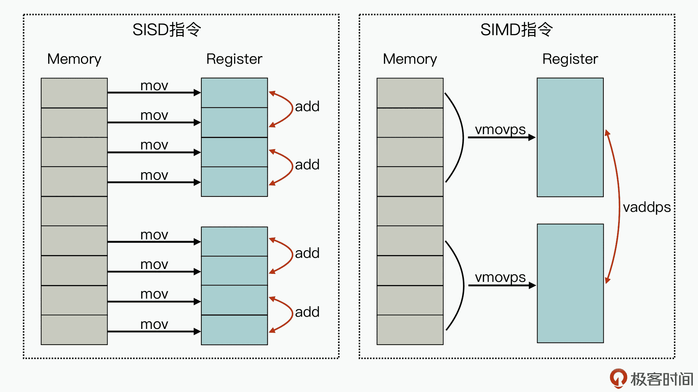
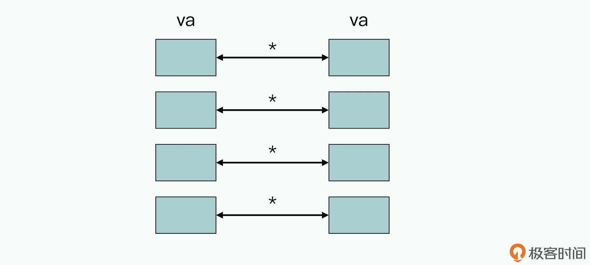

# 16 | 技术探索：你真的把CPU的潜能都挖掘出来了吗？

 

你好，我是尉刚强。

通过上节课的学习，我们现在已经了解并发设计和实现的相关技术和方法，而所有这些技术方法的目的，都是为了能最大程度地发挥 CPU 多核的性能。但我们还要知道的是，CPU 体系架构在解决单核性能瓶颈问题、提升处理软件性能的过程中，其实并不是只可以采用增加核数这一种方式。

现在主流的 CPU 体系架构，为了提升计算速度，实际上都借鉴了 GPU 中的向量计算特点，在硬件上引入了**向量寄存器**，并支持利用向量级指令来提升软件的性能。

这种利用单条指令执行多条数据的机制，我们通常称之为 **SIMD**（Single Instruction Multiple Data）技术，比如 MMX、SSE、AVX、FMA 等支持 SIMD 技术的指令集。另外像英特尔、AMD 等生产的不同款型的 CPU，也都会选择支持部分指令集技术，来帮助提升计算速度。就以 ClickHouse 为例，它之所以在分析数据上有卓越的性能表现，其中一部分原因就在于其底层大量地使用了 SIMD 技术。

那么，基于向量的 SIMD 技术的原理是什么，为什么它可以提升计算速度呢？我们在软件开发的过程中，要如何使用这种技术来提升性能呢？

今天这节课，我就根据目前比较主流的 AVX 技术的工作原理和具体实现，来帮你解答以上提出的这些问题。这样一来，你在 C/C++ 和 Java 语言的开发项目中，就知道如何使用这种技术来开发高性能的软件了。

## 基于向量的 SIMD 技术是如何提升计算速度的？

首先，我们需要搞清楚一个问题，就是基于 AVX 的 SIMD 技术为什么计算速度会比较快？

这里我们可以先来看看下面这张图，其中对比了 SIMD 指令与传统的 SISD（Single Instruction Single Data）指令，执行 4 个数字的求和计算操作过程：



图的左边，代表的是单条指令执行单条数据的实现方式，我们可以看到，针对两组包含 4 个元素的数据，在进行两两相加的操作时，最少需要 12 条指令（8 条 mov 指令，4 条 add 指令）才能完成业务。

而图的右边，因为在 CPU 芯片中集成了比较大的寄存器，从而就**实现了多条数据导入和多条数据相加操作都可以在一条指令周期内完成**，减少了执行 CPU 的指令数，进一步也就提升了计算速度。

目前支持 AVX 的 CPU 芯片，最高已经可以支持 512 位的寄存器，从而可以实现一个寄存器中保存 16 个浮点数的能力。因此，相比传统的单个浮点数的计算来说，其计算速度最高可以提升 16 倍，所以对计算密集型的软件性能提升帮助很大。而对于 GPU 来说，也正是因为它可以实现通过单条指令来运行矩阵或向量计算，才可以在数据处理和人工智能领域有比较大的性能优势。

## 如何使用 SIMD 技术来提升软件性能？

在了解了 AVX 向量指令集技术后，接下来我们要解决的问题就是：如何在软件开发的过程中，使用这种技术来提升软件性能呢？

实际上，目前很多的编程语言都可以支持基于 SIMD 的编码开发。所以接下来，我会针对 C/C++ 和 Java 这两种使用广泛的编程语言，来带你掌握 SIMD 技术的具体实现。

### 基于 C/C++ 的 SIMD 实现

事实上，针对 AVX 指令集，目前的 CPU 硬件厂商已经把它的基本功能封装成了 C 函数库，所以对于 C/C++ 的编程用户来说，就可以比较方便地使用 AVX 指令集开发程序。那接下来，我们就先来看一下在 C/C++ 语言中，是如何使用 AVX 优化执行性能的吧。

首先，我们来看一个具体的例子。在如下所示的函数中，是使用传统的指令实现的两个 double 类型的数组求和操作：

```
void vectorAdd(double* a, double* b, double* c){  
    for(int i=0; i<4; i++) {  
        c[i] = a[i] + b[i];  //一条代码仅能实现两个数字的计算。  
    }                        
}
```

因此，为了执行 4 个数字的相加操作，程序需要遍历循环四次。而如果采用 AVX 指令集，来实现相同功能的逻辑，其执行过程是这样的：

```
void vectorAdd(double *a, double *b, double *re)  
{  
    __m256d m1, m2; //avx指令集中支持的数据类型  
    m1 = _mm256_set_pd(a[i], a[i + 1], a[i + 2], a[i + 3]); //转化为向量变量  
    m2 = _mm256_set_pd(b[i], b[i + 1], b[i + 2], b[i + 3]);  
    __m256d l1 = _mm256_add_pd(m1, m2); //向量相加操作；  
    re[i + 3] = l1.m256d_f64[0];  
    re[i + 2] = l1.m256d_f64[1];  
    re[i + 1] = l1.m256d_f64[2];  
    re[i]     = l1.m256d_f64[3];  
}
```

我来给你具体分析一下：

1. 首先，__m256d 是 AVX 中支持的数据类型，它代表的是 256 位的 double 向量。其实目前的 AVX 内部，已经支持了很多数据类型，而 _m256 则表示可以保存 8 个 float 数字的向量（float 长度 32 位，256 位可以保存 256/32=8 个）。
2. 接下来的两条 _mm256_set_pd 指令，就实现了把 4 个 double 数字，转换为 double 类型的向量。
3. 然后，_mm256_add_pd 实现了向量相加操作，也就是把两个 double 类型的向量中的元素，进行逐个相加，再生出一个新的向量。
4. 最后，再使用 l1.m256d_f64 接口，将向量中的值转换到数组中。

如此一来，通过以上的向量化计算改造，我们就可以减少 CPU 执行的指令数目，从而提升计算速度。

不过这里你要注意，不同的 SIMD 指令集的用法差异是比较大的，我推荐你可以参考一下 Intel 的官网文档，其中涵盖了 Intel CPU 架构封装实现的各种向量指令集的接口定义。

同时，在不同的 CPU 芯片之间，它们对向量级计算的支持能力，以及支持的 SIMD 指令集也都不太一样，所以在进行软件开发之前，我更推荐你先去了解下软件运行的 CPU 芯片是否支持对应的 SIMD 指令集。

另外，从前面的数组求和操作示例中，你可能会发现，使用 AVX 指令集来编写程序会比较繁琐。所以如果你的产品对性能并没有极致的要求，我比较推荐你采用**编译器手段**来实现 AVX 的指令优化。比如，在做 GCC 编译时，你可以增加下面的选项来编译软件，这样程序在生成指令时，就可以尽量生成向量级操作指令，进而来提升软件性能。

```
gcc -mavx, -mavx2, -march=native
```

而如果，你使用的是英特尔的芯片，而且也使用了英特尔提供的 C/C++ 编译器 icc，来进行编译构建，那么你还可以使用下面的编译器宏，来显式地告知编译器进行 SIMD 的相关优化：

```
#pragma vector aligned  
#pragma simd 
```

当然，你还可以使用英特尔开发的 Cilk Plus 并行编程库，来更高效地开发支持并行与向量化的程序，以此帮助提升软件性能。

### 基于 Java 的 SIMD 实现

OK，我们再来看看 Java 语言中是如何支持实现 SIMD 技术的。

其实在以前，Java 语言并没有提供直接使用向量级指令的能力。早期 Java 的设计者们，是在 HotSpot 虚拟机中，引入了一种叫做 **SuperWord 的自动向量优化算法**，这个算法会缺省地将循环体内的标量计算，自动优化为向量计算，以此来提升数据运算时的执行效率。

不过，如果在 JIT 中采用这种自动向量优化机制，其实存在一定的局限性。比如说，它只能针对循环内的部分实现进行向量级的优化，同时针对一些复杂计算过程，像是中间包含分支判断、数据依赖等，也会很难将其优化为向量计算指令。

但是，在 JDK 16 之后，JIT 引入了向量化编程的直接支持，这部分的模块代码在 jdk.incubator.vector 模块中。当你安装了新版本的 JDK，并在代码中导入这个模块包之后，你就可以基于向量级指令开发程序了。

那么下面，我们就来看下，在 Java 中具体要怎么用 jdk.incubator.vector，来开发基于向量化的程序。

首先，我们来看一段基于 Java，它实现功能是两个数组内元素先进行平方后，再进行数组对应元素间相加操作的代码示例：

```
void scalarCalc(float[] a, float[] b, float[] c) {  
   for (int i = 0; i < a.length; i++) {  
        c[i] = (a[i] * a[i] + b[i] * b[i]);  
   }  
}
```

由此你会发现，这段代码的实现其实跟前面 C/C++ 的实现过程是一样的，它同样需要遍历数组中所有的元素，依次根据公式计算出 C 中每个元素的值。

而如果是基于 jdk.incubator.vector 技术，则调整优化后的代码实现如下：

```
static final VectorSpecies<Float> SPECIES = FloatVector.SPECIES_512;  
void vectorCalc(float[] a, float[] b, float[] c) {  
    for (int i = 0; i < a.length; i += SPECIES.length()) {  
        var m = SPECIES.indexInRange(i, a.length);  
        var va = FloatVector.fromArray(SPECIES, a, i, m);  
        var vb = FloatVector.fromArray(SPECIES, b, i, m);  
        var vc = va.mul(va).add(vb.mul(vb));  
        vc.intoArray(c, i, m);  
    }  
}
```

其中，你需要重点关注的是 **vectorCalc 函数**，它实现了和上一段代码相同的功能逻辑，也是先计算平方再求和。此外，代码 FloatVector.SPECIES_512，它代表的是将 16 个 float 数字放在一个向量中的类型，这与 AVX 封装的 C 语言指令集也是类似的。

然后，在使用 jdk.incubator.vector 进行运算的过程中，也需要进行同样的转换过程，所以这里首先也要将数组转换为向量类型。

接下来，你需要注意的是在 **va.mul(va) 中，基于向量的 mul 操作**，它实现的功能是元素逐个相乘，如下图所示：



所以，中间的代码片段就变成了：

```
va.mul(va).add(vb.mul(vb))
```

这样一来，就可以实现原来的相同计算逻辑，如下：

```
 c[i] = (a[i] * a[i] + b[i] * b[i]);
```

同理，由于基于向量级的操作，可以将原来 16 个 float 上的乘法和加法操作，都转换为一条指令，减少了执行的指令数，所以计算速度会变快。

目前，jdk.incubator.vector 中已经囊括了常用的运算操作功能，包含的接口比较多，详细的你可以参考官方 API。

不过到这里，你可能会觉得，好像所有基于 AVX 的编码实现，都只是把之前代码的实现，修改为基于 AVX 指令的实现。

但实际上并不只是这样，在真实的高性能编码过程中，它的核心挑战并不是修改之前的代码，而是**针对同样的一段业务计算逻辑，如何调整编码实现，从而最大化地利用和发挥底层的 CPU 的向量级指令的能力。**

我举个例子。下面这段代码展示的是一个 float 数组求和操作，如果是在数组长度为 N 的情况下，那么你可能就需要执行 N 次的求和操作：

```
float sum(float[] a) {  
   float sum =0.0;  
   for (int i = 0; i < a.length; i++) {  
        sum = sum + a[i] ;  
   }  
   return sum;  
}
```

所以针对这种情况，你就可以在原始数据构造阶段，把数据记录到两个数组中，然后利用向量级指令的求和计算，就可以实现仅通过 N/16 次的向量加法操作之后，将需要求和的数组规模下降一半的效果。

当然，这里我给出的只是一个很小的示例代码，在真实的业务计算中，你可以通过调整设计与实现，来改变业务功能的计算过程，从而更加充分地发挥向量化计算的性能优势。

## 小结

今天这节课，我带你了解了针对 CPU 提供的 SIMD 技术的原理，以及它是如何提升软件性能的。同时，我还针对 C/C++ 和 Java 这两种语言，帮你明确了如何在具体编码过程中，去使用这种技术来提升软件性能。如果你在参与一些 CPU 计算密集型的软件系统开发，并且性能要求非常高，那么就可以尝试使用今天课程中学习的 SIMD 技术来提升性能。

不过，SIMD 技术是一种比较贴近底层的优化技术，只会在特定场景下才有效果。因此，你在性能优化的过程中，首先需要考虑其他可用的高性能编码实现技术，只有当其他的高性能实现技术都已经发挥到极致，而且通过打点分析，确认通过计算数据向量化可以进一步提升性能时，再考虑使用这种向量化优化性能的技术。

## 思考题

今天课程上讲解的向量级指令与人工智能 CPU 中的向量计算原理是一样的吗？它们在使用中有什么差异？

欢迎在留言区分享你的观点和看法。如果觉得有收获，也欢迎你把今天的内容分享给更多的朋友。
