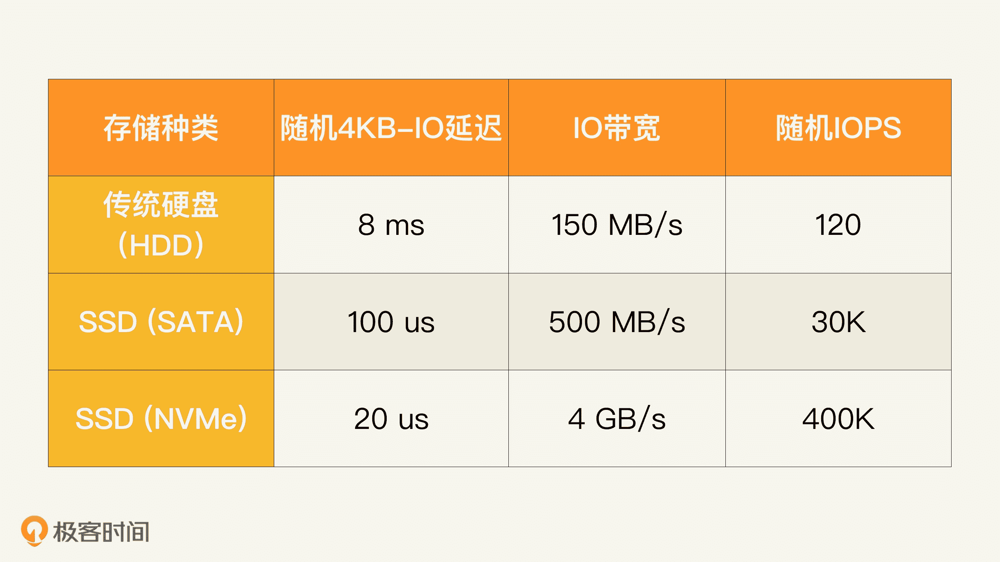
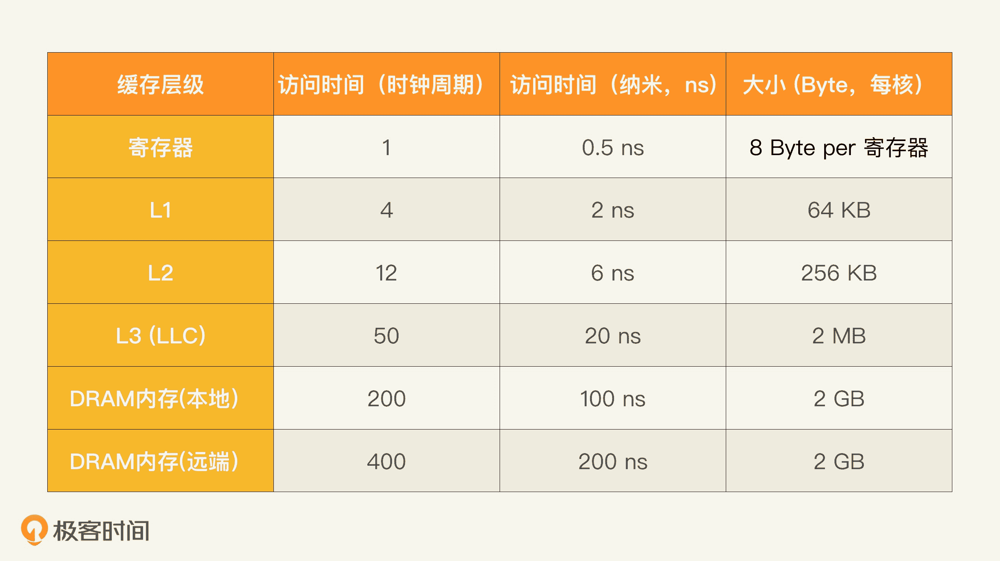
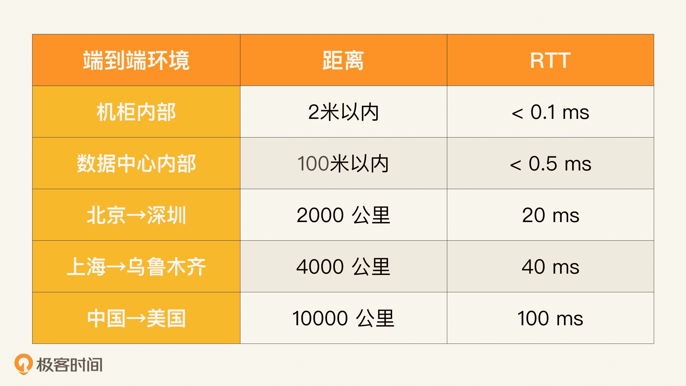
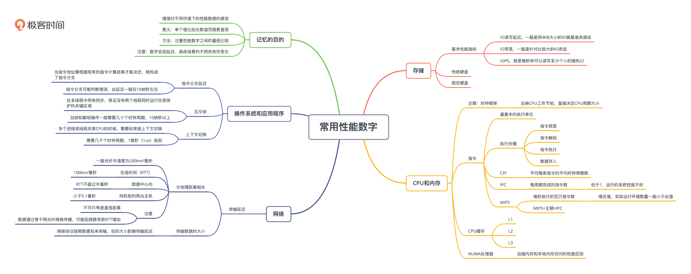

# 08 | 经验总结：必须熟记的一组常用性能数字

 

你好，我是庄振运。

今天这一讲是”数理基础“这一部分的最后一讲，我在这一讲会给你总结一组性能相关的常用的数字。这些数字在做性能和设计方面的工作时经常用到。它们就像九九乘法表一样，我希望你能熟记在心。

记住这些数字的好处是，每次看到一个性能相关的数据的时候，我们立刻就能知道这个性能数据有没有问题。

举个简单例子，如果我们看到一个硬盘的 IO 读写延迟经常在 500 毫秒左右，我们立刻就知道这里面有性能问题。反之，如果硬盘 IO 读写延迟小于 1 毫秒，我们可以马上推断——这些 IO 读写并没有到达硬盘那里，是被操作系统缓存挡住了。这就是大家常说的“对数字有感觉”。

人们常说“腹有诗书气自华”。同理，如果我们能对系统和程序运行中常见的性能指标了如指掌，就有可能达到那种“一眼就看出问题”的大师级别。

为了方便理解和记忆，我把这些数字分成几大类，分别是存储、CPU、操作系统、内存和网络等，并且会给出具体的单个数值。

## 有言在先

但是我必须强调说明的是，我之所以给出具体的单个数值，是为了方便你记忆，并让你对性能指标“有感觉”。因为**单个值**比给出**数值范围**更直观。

比如传统硬盘的 IO 延迟，如果我冠冕堂皇地说：“IO 延迟的大小取决于很多因素，比如硬盘型号、IO 大小、随机还是连续、磁头离数据的远近等，从小于 1 毫米到几秒钟不等。“这样的说法当然对，但是并不能帮助你找到数字的感觉，所以直观指导意义不是很大。

所以我想强调，我给出的数字仅供参考，帮助你记忆和理解，更重要的目的是**让你对不同环境下的性能数据有所感觉**。你要更加注重它们之间的量级比较，比如 SSD 的随机 IOPS 的性能，可以轻松地达到普通硬盘 HDD 的 1000 倍以上。

至于具体的性能数字的值大小，却也可能对一个非常具体的场景不那么匹配。这有几个原因：

1. 因为市场上有很多种类和很多厂家的产品，具体的值都不一样，比如 SSD 的一些性能指标就是如此。
2. 因为每个具体场景都不同，比如 IO 的读写大小。还有就是我们的技术不断进步，就如同 CPU 的频率，具体的值是一直在变的。

这些性能数据多半和**延迟**有关，所以要弄清楚这些延迟的单位。你应该都知道，一秒钟是 1000 毫秒（ms），一毫秒是 1000 微秒（us），一微秒是 1000 纳秒（ns）。

## 存储相关

我们先看存储相关的性能数据。存储有很多种，常用的是传统硬盘（HDD, Hard Drive Disk）和固态硬盘（SSD, Solid State Drive）。硬盘的厂家和产品多种多样，而且具体的配置也有很多种，比如大家熟悉的磁盘阵列（RAID)。我们这里仅仅选取最普遍的硬盘和最简单的配置。

值得一说的是 SSD。最近几年，SSD 的技术发展和市场演化非常迅速。随着市场规模的增大和技术的进步，SSD 的价格已经极大地降低了。在很多大规模的在线后台系统中，SSD 几乎已经成了标准配置。

SSD 的种类很多，按照技术来说有单层（SLC）和多层（MLC，TLC 等）。按照质量和性能来分，有企业级和普通级。根据安装的接口和协议来分，有 SAS、SATA、PCIe 和 NVMe 等。

对所有的存储来说，有三个基本的性能指标。

1. IO 读写延迟。一般是用 4KB 大小的 IO 做基准来测试；
2. IO 带宽，一般是针对比较大的 IO 而言；
3. IOPS，就是每秒钟可以读写多少个小的随机 IO。

下面这个表格列出了几种存储介质和它们的性能数值。

我们这里考虑三种情况： 传统硬盘，SATA SSD 和 NVMe SSD。你可以看到，一般传统硬盘的随机 IO 读写延迟是 8 毫秒的样子，IO 带宽大约 100MB 每秒，而随机 IO 读写一般就是每秒 100 出头。

SSD 的随机 IO 延迟比传统硬盘快百倍以上，IO 带宽也高很多倍，随机 IOPS 更是快了上千倍。

## CPU 和内存相关

再来看看 CPU。说起 CPU 相关的性能数字，就必须先说 CPU 的时钟频率，也就是主频。主频反映了 CPU 工作节拍，也就直接决定了 CPU 周期大小。

**主频和周期大小。****比如基于英特尔 Skylake 微处理器架构的 i7 的一款，其主频为 4GHz，那么每一个时钟周期（Cycle）大约****0.25 纳秒**（ns）。

CPU 运行程序时，最基本的执行单位是指令。而每一条指令的执行都需要经过四步：指令获取、指令解码、指令执行、数据存入。这些操作都是按照 CPU 周期来进行的，一般需要好几个周期。

**CPI 和 IPC**

每个指令周期数 CPI 和每个周期指令数 IPC 其实是孪生兄弟，衡量的是同一个东西。

CPI（cycles per instruction）衡量平均每条指令的平均时钟周期个数。它的反面是 IPC（instructions per cycle）。虽然一个指令的执行过程需要多个周期，但 IPC 是可以大于 1 的，因为现代 CPU 都采用流水线结构。一般来讲，测量应用程序运行时的 IPC，如果**低于 1**，这个运行的系统性能就不是太好，需要做些优化来提高 IPC。

**MIPS**

MIPS 就是每秒执行的百万指令数。

我们经常会需要比较不同 CPU 硬件的性能，MIPS 就是一个很好的指标，一般来讲，MIPS 越高，CPU 性能越高。MIPS 可以通过主频和 IPC 相乘得到，也就是说 MIPS= 主频×IPC。这个很容易理解，比如一个 CPU 频率再高，IPC 是 0 的话，性能就是 0。假设一个 CPU 的主频是 4GHz，IPC 是 1，那么这个 CPU 的 **MIPS 就是 4000**。注意的是，MIPS 是理论值，实际运行环境数量一般小于这个值。

**CPU 缓存**

一般 CPU 都有几级缓存，分别称为 L1、L2、L3，按这个顺序越来越慢，也越来越大，当然成本也越来越低。L3 有时候也称为 LLC（Last Level Cache），因为 L3 经常是最后一级缓存。多核 CPU 的情况下，一般 L1 和 L2 在核上，而 L3 是各个核共享的。

我用下面的表格来表示一款 2GHz 主频的 CPU，进行寄存器和缓存访问的一般延迟，分别用时钟周期数和绝对时间来表示，同时也给出在每个 CPU 核上面的字节大小。重复一下，数字仅供参考，因为每款 CPU 都不同。

比如一般 L3 的访问需要 40 个时钟周期，2GHz 主频的话就是 20 纳秒，大小一般是每个核平均下来 2MB 的样子。

为了方便对比，我们把内存的性能也放在同一个表格里。

值得一提的是现在的 NUMA（非统一内存访问，Non-Uniform Memory Access）处理器会有**本地**和**远端内存**的区别，当访问本地节点的内存是会快一些。

## 操作系统和应用程序相关

我们刚刚谈了硬件方面，下面看看软件，也就是操作系统和应用程序。

首先，你需要弄清楚如下的几个重要概念和指标。

**1. 指令分支延迟**

CPU 需要先获取指令，然后才能执行。获取下一条指令时需要知道指令地址，如果这个地址需要根据现有的指令计算结果才能决定，那么就构成了指令分支。CPU 通常会采取提前提取指令这项优化来提高性能，但是如果是指令分支，那么就可能预测错误，预先提取的指令分支并没有被执行。

指令分支判断错误（Branch Mispredict）的时间代价是很昂贵的。如果判断预测正确，可能只需要一个时钟周期；如果判断错误，就需要十几个时钟周期来重新提取指令，这个延迟一般在 **10 纳秒**左右。

**2. 互斥加锁和解锁**

互斥锁 Mutex（也叫 Lock）是在多线程中用来同步的，可以保证没有两个线程同时运行在受保护的关键区域。使用互斥锁的时候需要加锁和解锁，都是时间很昂贵的操作，每个操作一般需要几十个时钟周期，**10 纳秒**以上。

**3. 上下文切换**

多个进程或线程共享 CPU 的时候，就需要经常做上下文切换（Context switch）。这种切换在 CPU 时间和缓存上都很大代价；尤其是进程切换。在时间上，上下文切换可能需要几千个时钟周期，**1 微秒（1us）级别**。在缓存代价上，多级 CPU 缓存和 TLB 缓存都需要恢复，所以可能极大地降低程序线程和进程性能。

## 网络相关

互联网服务最终是要面向终端客户的，客户和服务器的延迟对用户的服务体验至关重要。

网络的传输延迟是和地理距离相关的。网络信号传递速度不可能超过光速，一般光纤中速度是每毫秒 200 公里左右。如果考虑往返时间（RTT，Round Trip Time），那么可以大致说每 100 公里就需要一毫秒。北京到深圳约 2,000 公里，RTT 就是 20 毫秒；上海到乌鲁木齐或者美国的东西海岸之间距离差不多 4,000 公里，所以 RTT 是 40 毫秒左右；中国到美国（比如北京到美国西海岸旧金山）差不多 10,000 公里，RTT 就是 100 毫秒。

在数据中心里面，一般的传输 RTT 不超过半毫秒。如果是同一个机柜里面的两台主机之间，那么延迟就更小了，小于 0.1 毫秒。

仔细想想的话，你就会发现直线距离本身还不够，因为数据是通过骨干网光纤网络传播的。如果光纤网络绕路的话，那么实际的 RTT 会超过以上估算数值。

另外要注意的是，传输延迟也取决于传输数据的大小，因为各种网络协议都是按照数据包来传输的，包的大小会有影响。比如一个 20KB 大小的数据，用 1Gbps 的网络传输，仅仅网卡发送延迟就是 0.2 毫秒。

下面这个表格就总结了几种环境下的端到端的距离和 RTT。

## 总结

今天讲了几十个平时经常用到的性能数字，希望起到抛砖引玉的效果。你可以在此基础上，在广度和深度上继续扩展记忆。

宋代诗人苏轼曾经作诗夸奖朋友：“前身子美只君是，信手拈来俱天成”，这里的“子美”是唐朝大诗人杜甫的字。这两句是夸朋友写文章写得好，能自由纯熟的选用词语或应用典故，用不着怎么思考，不必费心寻找，如同杜甫转世。

我们如果对各种性能数据足够熟悉，如掌上观纹，自然也就能达到那种对性能问题的分析信手拈来的境界。

## 思考题

假设你们公司有个互联网服务要上线，服务的要求是，用户端到端响应时间不能超过 40 毫秒。假设服务器在武汉，那么对上海的用户可以达到响应时间的要求吗？

欢迎你在留言区分享自己的思考，与我和其他同学一起讨论，也欢迎你把文章分享给自己的朋友。
