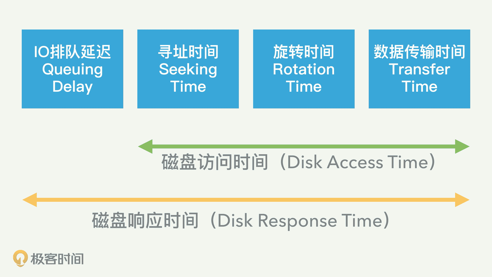
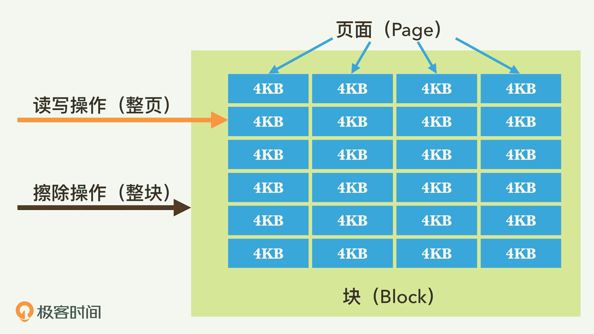
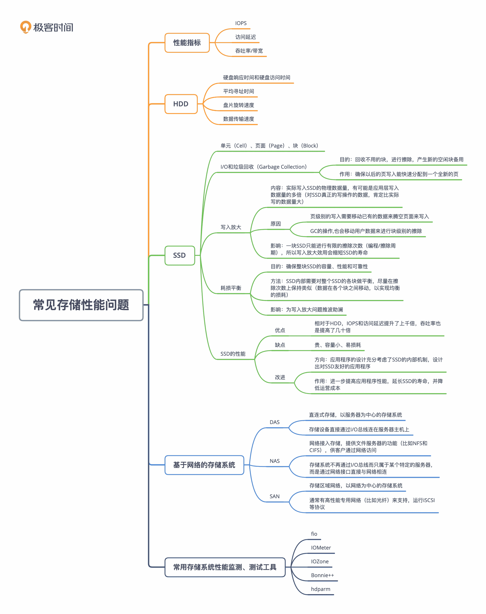

# 17 | 存储篇：如何根据性能优缺点选择最合适的存储系统？

 

你好，我是庄振运。

前面两讲我们讨论了 CPU 和内存，今天我们讨论第三个重要的主题：存储系统。现在是大数据时代，这些数据终归要保存到各种存储系统里面，以供读写和分析，因此讨论存储系统的性能问题就很有必要了。

狭义上的存储往往是硬件，比如磁盘、磁带还有固态硬盘。而广义上的存储系统除了指硬件的硬盘，还包括基于网络的存储系统，比如 SAN（Storage Area Network, 存储区域网络）和 NAS 存储（Network Attached Storage，网络接入存储）。

各种存储系统各有优缺点，尤其是性能和成本，所以对不同的需求，我们要选择最合适的存储系统。

我们首先讲存储系统最重要的三大性能指标：IOPS、访问延迟和带宽，然后讲传统硬盘 HDD（Hard Disk Drive）的性能。因为传统硬盘的特性相对简单直白（毕竟业界已经用了几十年了）。这之后再讲固态硬盘的性能（固态硬盘就是 SSD，也叫 Flash）。相对于传统硬盘，SSD 的内部工作原理很不一样，这也就导致它们的性能特性大相径庭。 最后，我们再延伸到基于网络的存储系统，并且介绍几个常用的和存储相关的工具。

## 存储系统的三大性能指标

一个存储系统的性能最主要的是三个：**IOPS**、**访问延迟**、**吞吐率 / 带宽**。这三个指标其实是互相关联和影响的，但是我们一般还是分开来衡量。

**IOPS**（Input/Output Per Second），即每秒钟能处理的读写请求数量，这是衡量存储性能的主要指标之一。每个 IO 的请求都有自己的特性，比如读还是写，是顺序读写还是随机读写，IO 的大小是多少等。

什么是顺序读写呢？就是访问存储设备中相邻位置的数据；随机读写呢，则是访问存储设备中非相邻位置的数据。对随机读写进行性能衡量时，一般假定 IO 大小是 4KB。

既然 IO 有这些特点，所以我们讨论存储系统 IOPS 性能的时候，经常需要更加具体的描述。比如顺序读 IOPS、随机写 IOPS 等。

IOPS 的数值会随这样的参数不同而有很大的不同，这些参数的变化，包括读取和写入的比例、其中顺序读写及随机读写的比例、读写大小、线程数量及读写队列深度等。此外，系统配置等因素也会影响 IOPS 的结果，例如操作系统的设置、存储设备的驱动程序特点、操作系统后台运行的作业等。

**访问延迟**（Access Time）和**响应时间**（Response Time），指的是从发起 IO 请求，到存储系统把 IO 处理完成的时间间隔，常以毫秒（ms）或者微妙（us）为单位。对这一性能指标，我们通常会考虑它的平均值和高位百分数，比如 P99、P95。

**吞吐率**（Throughput）或者带宽（Bandwidth），衡量的是存储系统的实际数据传输速率，通常以 MB/s 或 GB/s 为单位。一般来讲，IOPS 与吞吐率是紧密相关的；它们之间的关系是，吞吐率等于 IOPS 和 IO 大小的乘积。

这个也很容易理解，比如对一个硬盘的读写 IO 是 1MB，硬盘的 IOPS 是 100，那么硬盘总的吞吐率就是 100MB/s。需要强调的是，这里 IO 的具体特性很重要，比如是顺序还是随机，IO 大小等。

还有一点要注意，有些存储系统会因为其 **IO 队列深度增加**，而获得更好的 IO 性能；比如吞吐率会升高，平均访问延迟会降低。

这是为什么呢？这是因为存储系统的 IO 队列处理机制，可以对 IO 进行重新排序，从而获得好的性能。比如，它可以合并几个相邻的 IO，把随机 IO 重新排序为顺序 IO 等。

## HDD（传统硬盘）的性能

我们先从你熟知的传统硬盘开始讨论。对于传统硬盘，我们应该比较熟悉它的内部是如何操作的。

简单来说，当应用程序发出硬盘 IO 请求后，这个请求就会进入硬盘的 IO 队列。如果前面有其他 IO，那么这个请求可能需要排队等待。当轮到这个 IO 来存取数据时，磁头需要机械运动到数据存放的位置，这就需要磁头寻址到相应的磁道，并旋转到相应的扇区，然后才是数据的传输。所以，讨论硬盘 IO 的性能时，需要充分考虑这一点。

我们有时候需要把**硬盘响应时间**和**硬盘访问时间**分开对待。它们之间的关系是，硬盘响应时间除了包括访问时间外，还包括 IO 排队的延迟，如下图所示。

我们如果拿起一块硬盘仔细看看，硬盘上面往往会标注后面三个参数，分别是平均寻址时间、盘片旋转速度，以及数据传输速度，这三个参数就可以提供给我们计算上述三个步骤的时间。

平均寻址时间一般是几个毫秒。平均旋转时间可以从硬盘转动速度 RPM 来算出。因为每个 IO 请求平均下来需要转半圈，那么如果硬盘磁头每分钟转一万圈（10K RPM），转半圈就需要 3 毫秒。

要注意的是，硬盘上面标注的数据传输速度参数往往是最大值，实际的数据传输时间要取决于 IO 的大小。

对于一块普通硬盘而言，我们前面讲常用的性能数字时也提过，随机 IO 读写延迟就是 8 毫秒左右，IO 带宽大约每秒 100MB，而随机 IOPS 一般是 100 左右。

硬盘的技术也在发展，现代的硬盘也有很多变种。比如采用了多磁头技术，或者几块硬盘组成磁盘阵列，这样的整体 IO 性能也会相应地提升。

## SSD（固态硬盘）的技术背景

讲完了传统硬盘，我们接着看看固态硬盘——SSD。SSD 的内部工作方式和 HDD 大相径庭，我们来了解一下。

### 单元（Cell）、页面（Page）、块（Block）

当今的主流 SSD 是基于 NAND 的，它是将数字位存储在单元中。每个 SSD 单元可以存储一位（SLC，Single Level Cell，单级单元）、两位（MLC，多级单元）、三位（TLC，三级单元），甚至四位（QLC）。

SSD 的特点是，对 SSD 单元的每次擦除，都会降低单元的寿命，因此每一个单元只能承受一定数量的擦除。所以，不同的 SSD 就有这几方面的考虑和平衡。单元存储的位数越多，制造成本就越少，SSD 的容量也就越大。但是耐久性（擦除次数）也会降低。所以高端的 SSD，比如企业级的，基本都是基于 SLC 的。

一个页面包括很多单元，典型的页面大小是 4KB。页面也是读写的最小存储单位。我们知道，HDD 可以直接对任何字节重写和覆盖；但是对 SSD 而言，不能直接进行上述的“覆盖”操作。SSD 的一个页面里面的所有单元，一旦写入内容后就不能进行重写，必须和其它相邻页面一起，被整体擦除、重置。

在 SSD 内部，多个页面会组合成**块**。一个块的典型大小为 512KB 或 1MB，也就是大约 128 或 256 页。块是擦除的基本单位，每次擦除，都是整个块内的所有页面都被重置。

### I/O 和垃圾回收（Garbage Collection）

我们总结一下，对 SSD 的 IO 操作，一共有三种类型：**读取**、**写入**和**擦除**。读取和写入是以页为单位的，也就是说最少也要读取写入一个页面。

IO 写入的延迟，具体取决于磁盘的历史状态，因为如果 SSD 已经存储了许多数据，那么对页的写入，有时需要移动已有的数据，这种情况下写入延迟就比较大。但多数情况下，读写延迟都很低，一般在微秒级别，远远低于 HDD。

擦除是以块为单位。擦除速度相对很慢，通常为几毫秒。所以，对同步的 IO 请求，发出 IO 的应用程序，可能会因为块的擦除而经历很大的写入延迟。为了尽量地减少这样的场景发生，一块 SSD 最好保持一定数量的空闲块，这样可以保证 SSD 的写入速度足够快。

SSD 内部有垃圾回收（GC）机制，它的目的就在于此，就是不断回收不用的块，进行擦除，从而产生新的空闲块来备用。这样可以确保以后的页写入能快速分配到一个全新的页。

### 写入放大（Write Amplification, or WA）

这是 SSD 相对于 HDD 的一个缺点，即实际写入 SSD 的物理数据量，有可能是应用层写入数据量的多倍。

这是因为，一方面页级别的写入需要移动已有的数据来腾空页面来写入。另一方面，GC 的操作, 也会移动用户数据来进行块级别的擦除。

所以，对 SSD 真正的写操作的数据，肯定比实际写的数据量大，这就是写入放大。因为一块 SSD 只能进行有限的擦除次数，也称为编程 / 擦除（P/E）周期，所以写入放大效用会缩短 SSD 的寿命。

### 耗损平衡（Wear Leveling）

对每一个块而言，一旦擦除造成的损耗达到最大数量，该块就会“死亡”，再也不能存储数据了。对于 SLC 类型的块，P/E 周期的典型数目是十万次；对于 MLC 块，P/E 周期的数目是一万；而对于 TLC 块，则可能是几千。为了确保整块 SSD 的容量、性能和可靠性，SSD 内部需要对整个 SSD 的各块做平衡，尽量在擦除次数上保持类似。

SSD 控制器具有这样一种机制，也叫“耗损平衡”，来实现这一目标。在损耗平衡操作时，数据在各个块之间移动，以实现均衡的损耗。但是这种机制也有害处，就是会对前面讲的写入放大推波助澜。

## SSD 的性能和应用程序的设计

性能方面，SSD 的 IO 性能相对于 HDD 来说，IOPS 和访问延迟提升了上千倍，吞吐率也是提高了几十倍。但是 SSD 的缺点也很明显。主要有三个缺点：

1. 贵；
2. 容量小；
3. 易损耗。

好消息是，随着技术的发展，这三个缺点近几年在弱化。

如今，越来越多的应用程序采用 SSD 来减轻 I/O 性能瓶颈。许多测试和实践的结果都表明，与 HDD 相比，采用 SSD 带来了极大的应用程序性能提升。

但是，我想强调的一点是，在大多数采用 SSD 的部署方案中，SSD 仅被视为一种“更快的 HDD”，并没有真正发挥 SSD 的潜力。

我为什么这么说呢？因为尽管使用 SSD 作为存储时，应用程序可以获得更好的性能，但是这些收益，主要归因于 **SSD 提供的更高的 IOPS 和带宽**。

但是，SSD 除了提供这些之外，它还有其它特点，比如易损耗，以及其独特的内部机制。如果应用程序的设计能充分考虑 SSD 的内部机制，设计出对 SSD 友好的应用程序，就可以更大程度地优化 SSD，从而进一步提高应用程序性能，也可以延长 SSD 的寿命，并降低运营成本。关于这方面，我后面会有一讲专门讨论。

## 基于网络的存储系统

我们前面讨论了存储硬件，这些存储硬件可以直接安装在服务器上，构成单机系统。和单机系统和场景相对应，也有很多非单机使用的场景。

在非单机使用的场景里，这些存储硬件也被包装在各种基于网络的存储系统里。这样的存储系统也有很多种，比如 DAS、NAS 和 SAN。

DAS（Directed Attached Storage）是直连式存储。这是以服务器为中心的存储系统，存储设备直接通过 I/O 总线连在服务器主机上。这种存储一般运行 SATA 或者 SAS 等协议，可以让网络的客户端直接使用。

NAS（Network Attached Storage）是网络接入存储。在 NAS 存储结构中，存储系统不再通过 I/O 总线只属于某个特定的服务器，而是通过网络接口直接与网络相连。NAS 提供的是文件服务器的功能（比如 NFS 和 CIFS），供客户通过网络访问。

SAN（Storage Area Network）是存储区域网络。SAN 是一种以网络为中心的存储系统，通常有高性能专用网络（比如光纤）来支持，运行 iSCSI 等协议。

## 工具

最后，我们看看常用的存储系统性能监测和测试工具。存储系统的测试和监控命令工具非常多，下面简单介绍几个。

Linux 系统上可以采用 fio 工具进行各种组合的 IO 测试。这些组合包括读写比例、随机还是顺序读写、IO 大小等等。

IOMeter 也是不错的测试磁盘性能的工具，比如可以测试 I/O 的传输速度和平均的 I/O 响应时间。

IOZone 是一个文件系统基准测试工具，可以测试不同的操作系统中文件系统的读写性能。

Bonnie++ 是基于 Linux 平台的开源磁盘 IO 测试的工具，可以用它来测试磁盘和文件系统的 I/O 性能。

hdparm 可以用来作跳过文件系统的纯硬件操作测试。

iostat 这个工具可以查看进程发出 IO 请求的数量、系统处理 IO 请求的耗时、磁盘的利用率等，也可以分析进程与操作系统的交互过程中 IO 方面是否存在瓶颈。

## 总结

存储系统，顾名思义，是用来存放我们各种程序和服务的数据。随着现代互联网服务的大数据化，几乎所有的业务都离不开存储系统的支持。

各种存储系统的基础是传统硬盘或者固态硬盘，这两种硬盘在成本、性能、大小方面各有千秋。我想起了宋代有首诗叫《雪梅》，里面比较了白雪和梅花的优缺点：

“梅须逊雪三分白，雪却输梅一段香。”

这句诗用来形容传统硬盘和固态硬盘的关系还挺合适的。

在实际使用中，我们要注意它们的性能优缺点，从而适当来作取舍。比如，如果系统对 IOPS 或者延迟要求很高，恐怕只有 SSD 才能满足要求。反之，如果数据量极大需要降低成本，那么只能选择磁盘或者磁带系统了。

## 思考题

你对 SSD 这种新型存储了解多少？你公司里面有没有系统使用 SSD？它们碰到的性能问题有哪几个方面？运维和开发人员是怎么一起解决这些问题的？

欢迎你在留言区分享自己的思考，与我和其他同学一起讨论，也欢迎你把文章分享给自己的朋友。
