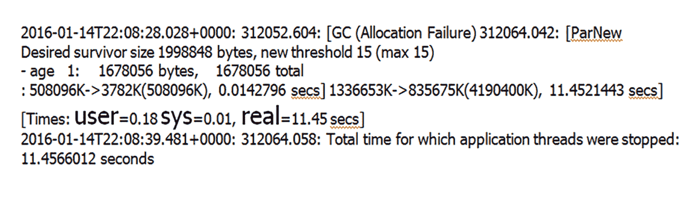
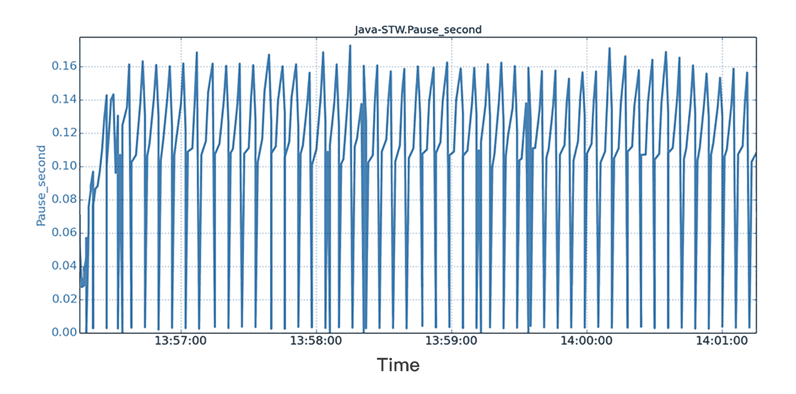
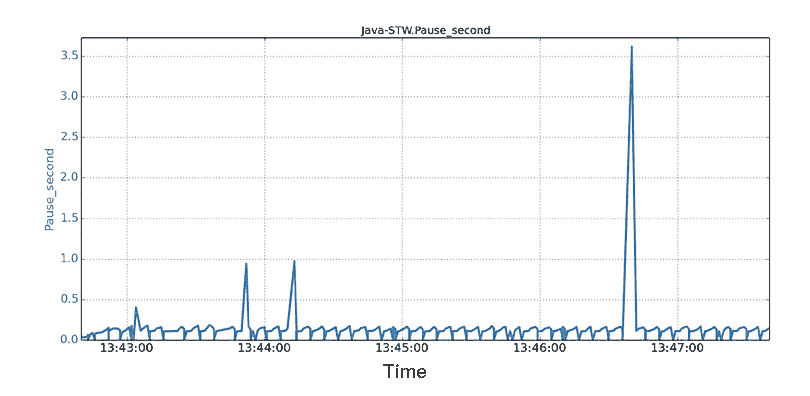
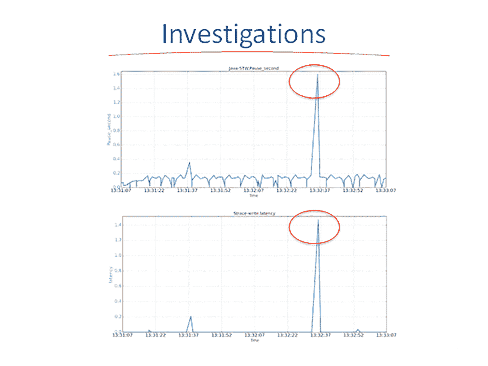
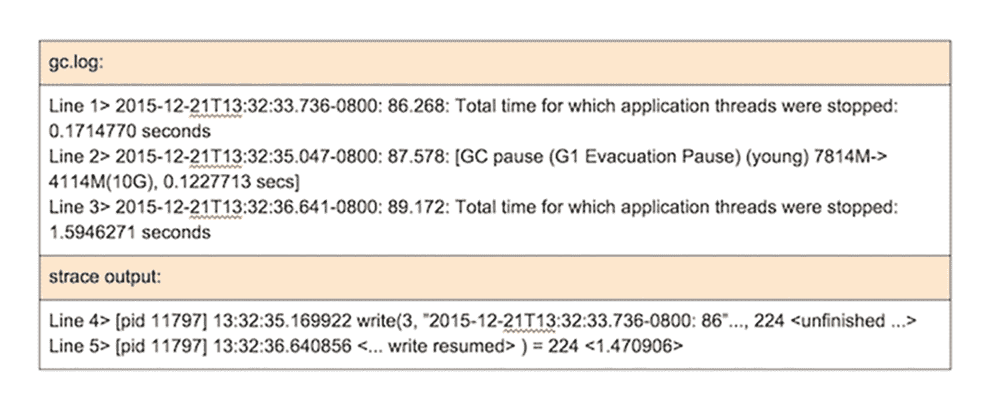
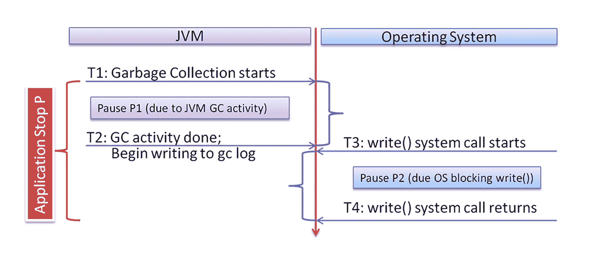
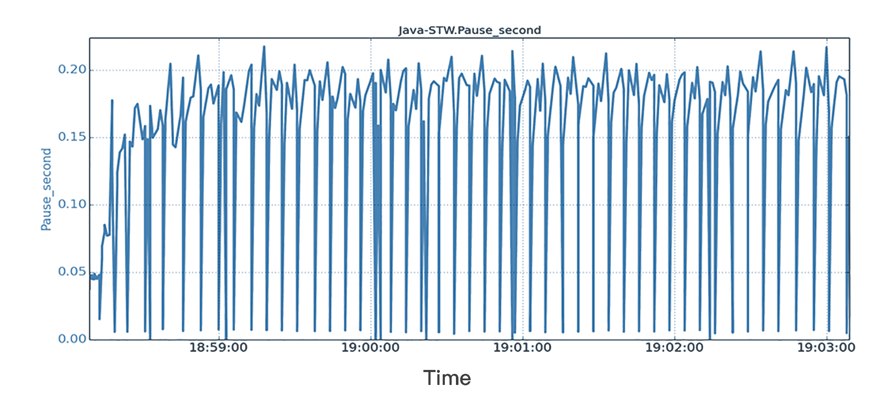
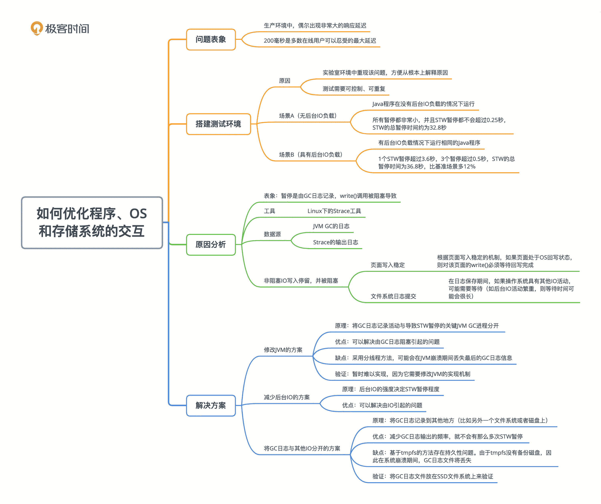

# 24 | 跨层案例：如何优化程序、OS和存储系统的交互？

 

你好，我是庄振运。

我们前面几讲介绍了性能优化的原则和策略，并且集中探讨了 CPU、内存和存储三个最关键的领域。

今天我们来讲一个**比较复杂的 JVM 场景和超大延迟的性能问题**；这是本模块，也就是性能优化模块的最后一讲。

我们会一步步地探讨这个性能问题的表象、问题的重现、性能分析的过程和解决方案。这个性能问题的复杂性，表现在它牵扯了计算机技术的很多层次——从最上层的应用程序，到中间层 JVM 的机制，再到操作系统和文件系统的特性，最后还涉及到硬件存储的特点。

更重要的是，这几个层次互相影响，最后导致了平时我们不容易看到的严重性能问题——非常大的 JVM 卡顿。

今天我会把问题的核心和分析过程阐述清楚，而对于其他的一些背景和更多的性能数据，你可以参考我发表在IEEE Cloud上的论文。

## 生产环境下偶尔很大的响应延迟是怎么回事？

我们先来看看这个性能问题的表象：就是在生产环境中，偶尔会出现非常大的响应延迟。

由于大多数互联网业务都是面向在线客户的（例如在线游戏和在线聊天），所以，确保客户相应的低延迟非常重要。各种研究也都表明，200 毫秒延迟，是多数在线用户可以忍受的最大延迟。因此，确保低于 200 毫秒（甚至更短）的延迟，已经成为定义的 SLA（服务水平协议）的一部分。

鉴于 Java 的普及和强大功能，当今的互联网服务中有很大一部分都在运行 Java。Java 程序的一个问题是 JVM 卡顿，也就是大家常说的 STW（Stop The World）、JVM（Java 虚拟机）暂停。根据我的经验，尽管我们或许已经仔细考虑了很多方面来优化，但 Java 应用程序有时仍会遇到很大的响应延迟。

这个 STW 的产生和 JVM 的运行机制是直接相关的。

Java 应用程序在 JVM 中运行，使用的内存空间叫**堆**。JVM 负责管理应用程序在内存里面的对象。堆空间经常被 GC 回收（垃圾收集），这个过程是 JVM 操作的。Java 应用程序可能在 GC 和 JVM 活动期间停止，这就会给应用程序带来 STW 暂停。

这些 GC 和 JVM 活动信息很重要，根据启动 JVM 时提供的 JVM 选项，各种类型的相关信息，都将记录到 GC 的日志文件中。

尽管某些 GC 引起的 STW 暂停众所周知（比如 JVM 导致的 Full GC），但是我们在生产中发现，其他因素，比如**操作系统本身，也会导致一些相当大的 STW 暂停**。

比如我举个例子。文中的图片就显示了一个 STW 暂停和 GC 日志，这个暂停时间超过了 11 秒；我就经常在生产环境中看到这样的 STW 暂停。

你注意一下图片中有较大的字体的那行，里面显示了 User、Sys 和 Real 的计时，分别对应着用户、系统和实际的计时。比如“Real=11.45”就表示实际的 STW 暂停是 11.45 秒钟。

在这个 GC 日志中，这种暂停 11 秒钟的 STW 非常讨厌，因为这样大的暂停是不能容忍的。而且这个问题很难理解，完全不能用 GC 期间的应用程序活动和垃圾回收活动来解释。

从日志中我们也看到，这个 JVM 的堆并不大，只有 4GB，垃圾收集基本不会超过 1 秒钟。正如图中显示的那样，用户和系统时间都可以忽略不计，User 和 Sys 的暂停时间分别是 0.18 秒钟和 0.01 秒钟，但是实际上 JVM 暂停了 11.45 秒钟！

因此，GC 所做的工作量，根本无法解释如此之大的暂停值。

## 搭建测试环境重现问题

为了搞清这个问题，我们做了彻底的性能分析和各种测试。为了去掉很多其他的干扰因素，以便方便根因分析，我们首先希望**实验室环境中重现该问题**，这样就比较方便从根本上解释原因。

出于**可控制性**和**可重复性**的考虑，我们使用了自己设计的一个简单 Java 程序。为了方便对比，我们根据**有没有后台背景 IO 活动**，而测试了两种场景（这里的后台背景 IO 就是各种磁盘 IO）。不存在后台 IO 的场景是基准场景，而引入后台 IO 的另一场景，将重现我们观测到的性能问题。

我们使用的 Java 程序的逻辑也很简单直白，就是不断地分配和删除特定大小的对象。程序一直在不断分配对象，当对象数目达到某阈值时，就会删除堆中的对象。堆的大小约为 1GB。每次运行固定时间，是 5 分钟。

为了真实地模拟生产环境，我们在第二种场景中注入后台 IO。 这些 IO 由 bash 脚本生成，该脚本就是不断复制很大的文件。在我们的实验室环境中，后台工作模块能够产生每秒 150MB 的磁盘写入负载，差不多可以使服务器配备的镜像硬盘驱动器饱和。这个应用程序和后台 IO 脚本的源代码在GitHub上开源。

我们考虑的主要性能指标，是关于应用程序的 STW 暂停，具体考虑了两个指标：

1. 总暂停时间，即所有 STW 暂停的总暂停时间；
2. 较大的 STW 暂停计数和。

下面让我们一起来看看结果。

场景 A 是基准场景，Java 程序在没有后台 IO 负载的情况下运行。我们在实验室环境中执行了许多次运行，得到的结果基本是一致的。

图片中显示的是一个持续 5 分钟的运行，就是沿着 5 分钟的时间线，显示了所有 JVM STW 暂停的时间序列数据。我们观察到，所有暂停都非常小，并且 STW 暂停都不会超过 0.25 秒。 STW 的总暂停时间约为 32.8 秒。

场景 B 是有后台 IO 负载情况下运行相同的 Java 程序。在实际的生产过程中，IO 负载可能来自很多地方，比如操作系统、同一机器上的其他应用程序，或者来自同一 Java 应用程序的各种 IO 活动。

在图片中，我们同样沿着 5 分钟的时间线，显示了所有 JVM STW 暂停的时间序列数据。我们发现，当后台 IO 运行时，相同的 Java 程序，在短短 5 分钟的运行中，看到 1 个 STW 暂停超过 3.6 秒，3 个暂停超过 0.5 秒！结果是，STW 的总暂停时间为 36.8 秒，比基准场景多了 12％。

而 STW 总暂停时间多，也就意味着应用程序的实际工作吞吐量比较低，因为 JVM 多花了时间在 STW 暂停上面。

## 响应延迟的根本原因在哪里？

为了弄清楚 STW 暂停的原因，我们接着进行了深入的分析。

我们发现 STW 大的暂停是由 GC 日志记录，write() 调用被阻塞导致的。这些 write() 调用，虽然以缓冲写入模式（即非阻塞 IO）发出，但由于操作系统有“回写”IO 的机制，所以仍然可能被操作系统的“回写”IO 阻塞。

操作系统的“回写”机制是什么呢？就是文件系统定期地把一些被改变了的磁盘文件，从内存页面写回存储系统。

具体来说，当缓冲的 write() 需要写入文件时，它首先需要写入 OS 缓存中的内存页面。这些内存页是有可能被“回写”的 OS 缓存机制锁定的；而且当后台 IO 流量很重时，该机制可能导致这些内存页面被锁定相当长的时间。

为了彻底查清原因，我们使用 Linux 下的 Strace 工具，来剖析函数调用和 STW 暂停的时间相关性。

这个图表示的是 **JVM STW 暂停**，和 strace 工具报告的 **JVM 进行 write() 系统调用的延迟**。图片集中显示了一个 1.59 秒的 JVM STW 暂停的快照。

我们仔细检查了两个时间序列数据，发现尽管 JVM 的 GC 日志记录使用缓冲写入，但是 GC 暂停和 write() 延迟之间有极大的相关性。

这些时间序列的相关性表明，由于某些原因，GC 日志记录的缓冲写入仍然被阻塞了。

那这个原因是什么呢？我们就要通过仔细阅读分析 JVM GC 的日志和 Strace 的输出日志（如下图所示）来寻找。

让我沿着时间轴线来具体解释一下图片中的数据。

在时间 35.04 秒时，也就是第 1 行日志，一个新的 JVM 新生代 GC 启动，并用了 0.12 秒才完成。新生代 GC 在 35.17 秒时结束，并且 JVM 尝试发出 write() 系统调用（第 4 行），将新生代 GC 统计的信息输出到 GC 日志文件。write() 调用被阻塞 1.47 秒，所以最后在时间 36.64（第 5 行）结束，总共耗时 1.47 秒。当 write() 调用在 36.64 返回给 JVM 时，JVM 记录此 STW 暂停为 1.59 秒（即 0.12 + 1.47）（第 3 行）。

这些数据表明，GC 日志记录过程，恰好位于 JVM 的 STW 暂停路径上，而日志记录所花费的时间也是 STW 暂停的一部分。如果日志记录，也就是 write() 调用被阻塞，那么就会导致 STW 暂停。换句话说，实际的 STW 暂停时间由两部分组成：

1. 实际的 GC 时间，例如，新生代 GC 时间。
2. GC 日志记录时间，例如，write() 执行时被 OS 阻塞的时间。

我用下图来清楚地表示它们之间的关系。

左边是 JVM 的活动，右边是操作系统的活动。时间 T1 时垃圾回收开始，T2 时 GC 结束，并开始调用 write() 写日志。这之间的延迟，就是 GC 的延迟。T3 时 write() 调用开始，T4 时 write() 调用返回。这之间的延迟，就是 OS 导致的阻塞延迟。所以，总的 STW 暂停就是这两部分延迟的和，也就是 T4-T1。

那么接下来的一个很难理解的问题是：为什么非阻塞 IO，还会被阻塞？！

在深入研究各种资源（包括操作系统内核源代码）后，我们意识到，非阻塞 IO 写入还是可能会停留，并被阻塞在内核代码执行过程中。具体原因有好几个，其中包括：**页面写入稳定**（Stable Page Writing）和**文件系统日志提交**（Journal Logging）。下面分别说明。

JVM 写入 GC 日志文件时，首先会改变（也就是“弄脏”）相应的文件缓存页面。即使以后通过操作系统的写回机制，将缓存页面写到磁盘文件中，被改变内存中的缓存页面，仍然会由于稳定的页面写入而导致**页面竞争**。

根据页面写入稳定的机制，如果页面处于 OS 回写状态，则对该页面的 write() 必须等待回写完成。这是为了避免将部分全新的页面保留到磁盘（会导致数据不一致），来确保磁盘数据的一致性。

对于日志文件系统，在文件写入过程中会生成适当的日志。当附加到 GC 日志文件，而需要分配新的文件块时，文件系统需要首先将日志数据保存到磁盘。在日志保存期间，如果操作系统具有其他 IO 活动，则可能需要等待。如果后台 IO 活动繁重，则等待时间可能会很长。

## 解决方案如何落地？

我们已经看到，由于操作系统的各种机制的原因，包括页面缓存写回、日志文件系统等，JVM 可能在 GC 日志期间，被长时间阻塞。

那么怎么解决这个问题呢？

我们思考了三种方案可以缓解这个问题，分别是：

1. 修改 JVM；
2. 减少后台 IO；
3. 将 GC 日志记录与其他 IO 分开。

修改 JVM 是将 GC 日志记录活动，与导致 STW 暂停的关键 JVM GC 进程分开。这样一来由 GC 日志阻塞引起的问题就将消失。

比如 JVM 可以将 GC 日志放到另一个线程中，该线程可以独立处理日志文件的写入，也就不会造成另外一个应用程序线程的 STW 暂停。这个方案的缺点是，采用分线程方法，可能会在 JVM 崩溃期间丢失最后的 GC 日志信息。

第二种方案是减少后台 IO。

后台 IO 引起的 STW 暂停的程度，取决于后台 IO 的强度。因此，可以采用各种方法来降低这些 IO 的强度。比如在 JVM 应用程序运行的服务器上，不要再部署其他 IO 密集型应用程序。

第三种方案是将 GC 日志与其他 IO 分开。

对延迟敏感的应用程序，例如为交互式用户提供服务的在线应用程序，通常无法忍受较大的 STW 暂停。这时可以考虑将 GC 日志记录到其他地方，比如另外一个文件系统或者磁盘上。

比如这个文件系统可以是临时文件系统（tmpfs，一种基于内存的文件系统）。它具有非常低的写入延迟的优势，因为它不会引起实际的磁盘写入。但是，基于 tmpfs 的方法存在持久性问题。由于 tmpfs 没有备份磁盘，因此在系统崩溃期间，GC 日志文件将丢失。

而另一种方法是将 GC 日志文件放在更快的磁盘上，例如 SSD。我们知道，就写入延迟和 IOPS 而言，SSD 具有更好的 IO 性能。

## 如何证明解决方案是否有效？

得出方案后，我们就需要对它们进行验证了。

在我们提出的三种方案中，第一种方案，也就是改进 JVM，是暂时难以实现的，因为它需要修改 JVM 的实现机制。第二种方案呢，是不言自明。如果没有背景 IO 或者有较少背景 IO，那么自然背景 IO 的影响就变小了；或者减少 GC 日志输出的频率，就不会有那么多次 STW 暂停了。

因此，我们这里直接来验证第三种方案：将 GC 日志记录与其他 IO 分开。

我们的方法，是将 GC 日志文件放在 SSD 文件系统上来验证这种方案。我们运行与前面实验场景中相同的 Java 应用程序和后台 IO 负载。下图中显示了一个 5 分钟运行时段的所有 STW 暂停和相应的时间戳。

对于 STW 暂停的信息，我们注意到所有的 JVM 的暂停都非常小，所有暂停都在 0.25 秒以下。可以说，延迟暂停方面的性能，得到了很大的提高，这表明，如果这样分开 GC 日志文件，即使有很大的后台 IO 负载，也不会导致 JVM 程序发生较大的 STW 暂停；这样的结果也就验证了这一方案的有效性。

## 总结

今天我们探讨了一个跨层的性能分析和优化案例。由于计算机几个层面的技术互相影响，实际生产环境中，会出现非常大的响应时间延时，严重影响公司业务。这些层面包括应用程序、JVM 机制、操作系统和存储系统。

我们通过合理的性能测试和性能分析，包括搭建合适的测试环境进行问题重现、详细的根因分析，最终提出了几种解决方案。简单来说，就是 JVM 在 GC 时会输出日志文件，写入磁盘时会因为背景 IO 而被阻塞。把日志文件和背景 IO 分开放在不同磁盘，从而让它们互相不影响的话，就能大幅度降低 STW 延迟。

从这个案例我们也可以再次了解，从事性能优化工作需要通晓几乎所有层面的知识。而且不光要知识面广，还要能深入下去，才能进行彻底的根因分析。

唐代诗人刘禹锡有一首诗说：“莫道谗言如浪深，莫言迁客似沙沉。千淘万漉虽辛苦，吹尽狂沙始到金。”对待这样复杂的性能问题，我们也需要不怕困难，不惧浪深沙沉。因为只有经过千淘万漉的辛苦，才能淘到真金，发现问题的本质并彻底解决它。

## 思考题

既然这个问题是 Java 应用程序偶尔发生大延迟，原因是 JVM 垃圾回收 GC 的 Log 日志，写到硬盘的文件系统引起的，我们如何可以让 JVM 把 GC 日志写到内存去吗？

> Tips：考虑一下 JVM 参数。

欢迎你在留言区分享自己的思考，与我和其他同学一起讨论，也欢迎你把文章分享给自己的朋友。
