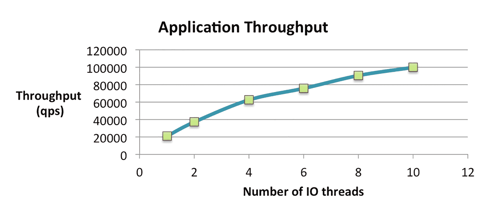
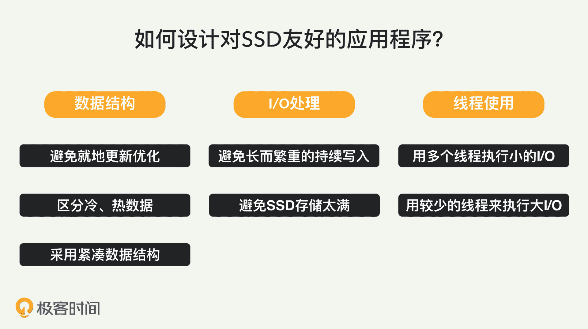
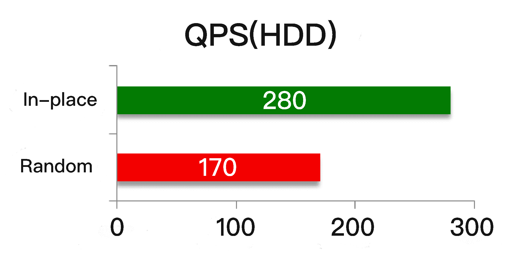
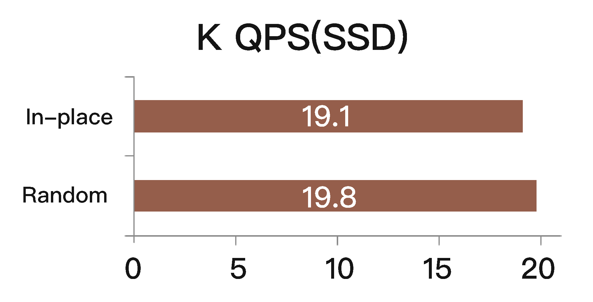
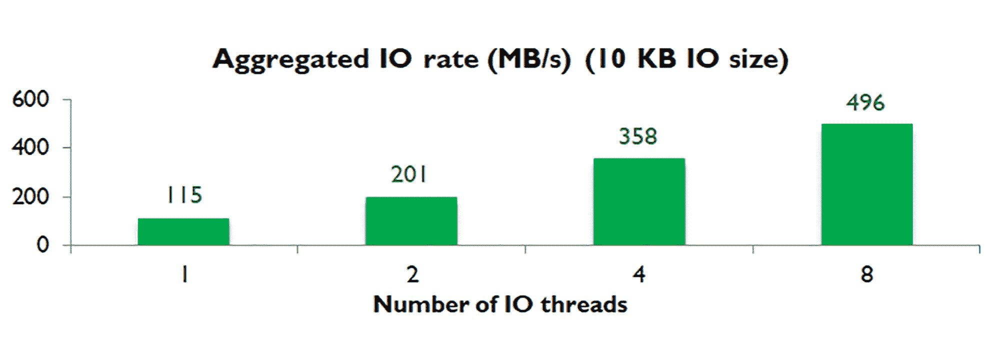
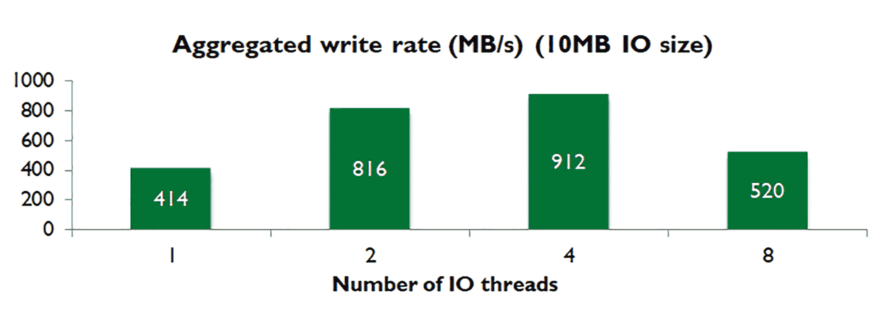
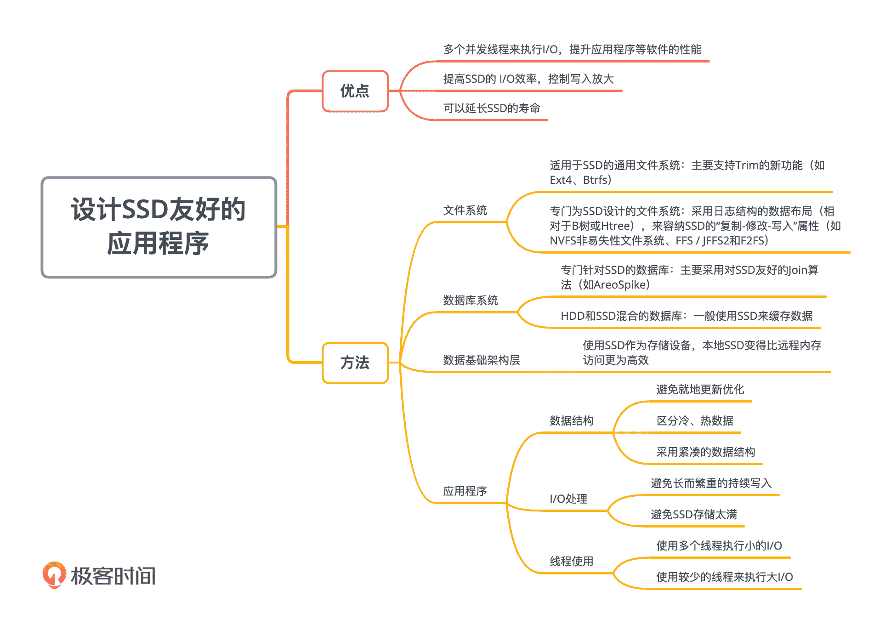

# 29 | 如何彻底发挥SSD的潜力？

 

你好，我是庄振运。

今天是“性能工程实践”这个模块的最后一讲，我们来讨论一种“软硬件结合”的性能工程优化实践，与 SSD（硬件）有关。现在 SSD 用的越来越普遍的情况你一定非常清楚，但是你设计的应用程序（软件）真的充分利用了 SSD 的特点，并发挥 SSD 的潜力了吗？

要知道，SSD 可不仅仅是“更快的 HDD”。

SSD 的好处显而易见，它作为存储时，应用程序可以获得更好的 I/O 性能。但是这些收益，主要归因于 SSD 提供的更高的 IOPS 和带宽。如果你因此只将 SSD 视为一种“更快的 HDD”，那就真是浪费了 SSD 的潜力。

如果你在设计软件时，能够充分考虑 SSD 的工作特点，把应用程序和文件系统设计为“对 SSD 友好”，会使服务性能有个质的飞跃。

今天我们就来看看，**如何在软件层进行一系列 SSD 友好的设计更改**。

## 为什么要设计 SSD 友好的软件？

设计对 SSD 友好的软件有什么好处呢？简单来说，你可以获得三种好处：

1. 提升应用程序等软件的性能；
2. 提高 SSD 的 I/O 效率；
3. 延长 SSD 的寿命。

先看第一种好处——**更好的应用程序性能**。在不更改应用程序设计的情况下，简单地采用 SSD 可以获得性能提升，但无法获得最佳性能。

我为你举个例子来说明。我们曾经有一个应用程序，它需要不断写入文件以保存数据，主要性能瓶颈就是硬盘 I/O。使用 HDD 时，最大应用程序吞吐量为 142 个查询 / 秒（QPS）。无论我们对应用程序设计进行什么样的更改或调优，这就是使用 HDD 可以获得的最好性能了。

而当迁移到具有相同应用程序的 SSD 时，吞吐量提高到了 20,000 QPS，速度提高了 140 倍。这种提高，主要来自 SSD 提供的更高的 IOPS。你是不是觉得与 HDD 相比，应用程序吞吐量有了显着提高，性能已经很好了？

但这并不是 SSD 能实现的最佳性能。

我们对应用程序设计进行了优化，使其对 SSD 友好之后，应用程序吞吐量提高到 100,000QPS，与简单设计相比，提高了 4 倍。

你可能会问，这是如何做到的？

这其中的秘密，就是**使用多个并发线程来执行 I/O**。如下图所示，这利用了 **SSD 的内部并行性**。

这里你需要注意的是，在这个系统中，多个 I/O 线程对 HDD 是毫无益处的。因为 HDD 只有一个磁头，所以用多个 I/O 线程，并不能提高旧系统的吞吐量。

第二种好处是**更高效的存储 I/O**。

我在第 17 讲中提到过，SSD 上的最小内部 I/O 单元是一页，比如 4KB 大小。因此对 SSD 的单字节读 / 写，必须在页面级进行。应用程序对 SSD 的写操作，可能会导致对 SSD 上的物理写操作变大，这就是“写入放大（参见第 23 讲）”。

因为有这个特性，如果应用程序的数据结构或 I/O 对 SSD 不友好，就会让写放大效果更大，导致 SSD 的 I/O 不能被充分利用。

设计 SSD 友好软件的最后一个好处是**延长 SSD 的寿命**。

SSD 会磨损，是因为每个存储单元，只能维持有限数量的写入擦除周期。实际上，SSD 的寿命取决于四个因素：

1. SSD 大小
2. 最大擦除周期数
3. 写入放大系数
4. 应用程序写入速率

例如，假设有一个 1TB 大小的 SSD，一个写入速度为 100MB/ 秒的应用程序和一个擦除周期数为 10,000 的 SSD。当写入放大倍数为 4 时，SSD 仅可持续 10 个月。具有 3,000 个擦除周期和写入放大系数为 10 的 SSD 只能使用一个月。

你也知道，相对于 HDD 而言，SSD 的成本比较高，我们自然希望自己设计的应用程序对 SSD 友好，从而延长 SSD 的使用寿命。

## 怎么设计对 SSD 友好的软件？

说了这么多设计 SSD 友好软件的好处，那我们具体该从哪里入手呢？

其实在软件领域，有很多地方都可以做对 SSD 友好的设计，比如文件系统、数据库系统、数据基础架构层和应用程序。接下来我会一一为你介绍。尤其是应用程序这个领域，它是这一讲的重点。

第一个可以对 SSD 友好的领域是**文件系统**。文件系统层直接处理存储，因此我们需要在此级别进行优化设计更改，来更有效地发挥 SSD 的特长。一般而言，这些设计更改集中在 **SSD 和 HDD 迥异的三个关键差异特征**上：

1. SSD 的随机访问与顺序访问具有相同的性能；
2. 需要在块级别进行擦除后才能重写；
3. 内部损耗均衡的机制会导致写入放大。

现在比较流行的有两种对 SSD 友好的文件系统。第一种，是适用于 SSD 的通用文件系统，主要支持 Trim 的新功能，比如 Ext4 和 Btrfs。第二种，是专门为 SSD 设计的文件系统。基本思想是采用日志结构的数据布局（相对于 B 树或 Htree），来容纳 SSD 的“复制 - 修改 - 写入”属性，比如 NVFS（非易失性文件系统）、FFS / JFFS2 和 F2FS。

除了文件系统，**数据库系统**也可以设计成对 SSD 友好。

SSD 和 HDD 之间的差异在数据库设计中尤其重要。近几十年来，数据库的各个组件（比如查询处理、查询优化和查询评估等）都已经在考虑 HDD 特性的情况下进行了诸多优化。

举个例子，因为普通硬盘的随机访问比顺序访问要慢得多，所以数据库组件会尽量减少随机访问。而使用 SSD 时，类似这样的假设就不成立了。

因此，业界设计了新的、对 SSD 友好的数据库。对 SSD 友好的数据库主要有两种：第一种是专门针对 SSD 的数据库，例如 AreoSpike，这种数据库主要采用对 SSD 友好的 Join 算法；第二种是 HDD 和 SSD 混合的数据库，一般是使用 SSD 来缓存数据。

第三个领域是**数据基础架构层**。

对于分布式数据系统的设计而言，数据来源大体上有两个地方：计算机上的本地磁盘或另一台计算机上的内存。这两个来源哪个更快更高效呢？还真不一定。随着技术的演化，业界也一直在争论。

过去很多年，这样的争论比较倾向于远程计算机的内存，因为速度更快；Memcached 就是一个例子。传统的本地 HDD 访问延迟，大约是好几个毫秒；而远程内存访问的延迟，包括了 RAM 访问延迟和网络传输延迟，也仅处于微秒级。同时，远程内存的 I/O 带宽与本地 HDD 大致相同甚至更多。因此，远端的内存反而比本地的硬盘的访问时间更短。

而 SSD 的出现，正在改变这个趋势和业界的决定。使用 SSD 作为存储设备后，本地 SSD 变得比远程内存访问更为高效。

首先，SSD 的 I/O 延迟降低到了微秒级，而 I/O 带宽可是比 HDD 高一个数量级。这些结果就导致了数据基础架构层的新设计。比如，新设计更希望尽可能与应用程序**共同分配数据**，以避免额外的节点和网络的限制，从而降低系统的复杂性和成本。

这么说可能你的感受不太明显，我来用 Netflix 为你举例说明一下。Netflix 就是采用这种设计的公司之一。Netflix 公司曾经采用 memcached 来缓存 Cassandra 层数据。假设 Netflix 需要缓存 10TB 的数据，如果每个内存缓存节点在 RAM 中保存 100GB 数据，则需要部署 100 个内存缓存节点。后来，Netflix 只使用 10 个 Cassandra 节点，并为每个 Cassandra 节点配备 1TB SSD 来完全取代 memcached 层。

你看，采用这种设计，就不需要 100 个 Memcached 节点，只需 10 台配备 SSD 的节点，节省了大量成本。

在**应用程序层**，我们也可以对 SSD 进行友好的设计，以获得前面提到的三种好处（更好的应用程序性能、更高效的 I/O 和更长的 SSD 寿命）。

在这一领域，我总结了七大 SSD 友好的设计原则，大体上分为三类：数据结构、I/O 处理和线程使用。

### 1. 数据结构：避免就地更新优化

传统的 HDD 的寻址延迟很大，因此，使用 HDD 的应用程序通常会进行各种优化，以执行不需要寻址的就地更新，比如只在一个文件后面写入。

比如下图所示，在执行随机更新时，吞吐量一般只能达到约 170 QPS；而对于同一个 HDD，就地更新可以达到 280QPS，远高于随机更新。

不过在设计与 SSD 配合使用的应用程序时，这些考虑就没什么意义了。对 SSD 而言，随机读写和顺序读写性能类似，就地更新不会获得任何 IOPS 优势。

此外，就地更新实际上是会导致 SSD 性能下降的。包含数据的 SSD 页面无法直接重写，因此在更新存储的数据时，必须先将相应的 SSD 页面读入 SSD 缓冲区，然后将数据写入干净的页面。 SSD 中的“读取 - 修改 - 写入”过程与 HDD 上的直接“仅写入”行为形成了鲜明的对比。

相比之下，SSD 上的随机更新，就不会引起读取和修改步骤（即仅仅“写入”），因此速度更快。

使用 SSD，以上相同的应用程序，可以通过**随机更新**或**就地更新**来达到大约 2 万 QPS；而且随机更新和就地更新的吞吐量大体相似，随机更新其实还稍微好些。如下图所示。

### 2. 数据结构：区分热、冷数据

几乎所有处理存储的应用程序，磁盘上存储的数据的访问概率均不相同。

用一个需要跟踪活动用户活动的社交网络应用程序来给你举个例子。对于用户数据存储，简单的解决方案，是基于用户属性（例如注册时间）将所有用户压缩在同一位置（例如某个 SSD 上的文件）。以后需要更新热门用户的活动时，SSD 需要在页面级别进行访问（即读取 / 修改 / 写入）。

因此，如果用户的数据大小是小于一页，那么每次读取这个用户的数据，附近的用户数据也将一起被访问。如果应用程序其实并不需要附近用户的数据，那么额外的数据访问，不仅会浪费 I/O 带宽，而且会不必要地磨损 SSD。

为了缓解这种性能问题，在将 SSD 用作存储设备时，应将热数据与冷数据分开。以不同级别或不同方式来进行分隔。例如，把它们存在不同的文件、文件的不同部分或不同的表格里。

### 3. 数据结构：采用紧凑的数据结构

在 SSD 的世界中，最小的更新单位是页面（4KB），因此，即使是一个字节的更新，也将导致至少 4KB SSD 写入。由于写入放大的效果，实际写入 SSD 的字节可能远大于 4KB。读取操作也是类似，因为 OS 具有预读机制，会预先主动地读入文件数据，以期改善读取文件时的缓存命中率。

所以当将数据保留在 SSD 上时，你最好使用紧凑的数据结构，避免分散的更新，以获得更快的应用程序性能、更有效的存储 I/O 以及节省 SSD 的寿命。

### 4. I/O 处理：避免长而繁重的持续写入

SSD 通常具有 GC 机制，不断地回收存储块以供以后使用。GC 可以用后台或前台的方式工作。 SSD 控制器通常保持一个空闲块的阈值。每当可用块数下降到阈值以下时，后台 GC 就会启动。由于后台 GC 是异步发生的（即非阻塞），因此它不会影响应用程序的 I/O 延迟。但是，如果块的请求速率超过了 GC 速率，并且后台 GC 无法跟上，则将触发前台 GC。

在前台 GC 期间，必须即时擦除（即阻塞）每个块以供应用程序使用，这时发出写操作的应用程序所经历的**写延迟**就会受到影响。具体来说，释放块的前台 GC 操作，可能会花费数毫秒以上的时间，从而导致较大的应用程序 I/O 延迟。

因此，你最好避免进行长时间的大量写入操作，这样就可能永远不触发前台 GC。

### 5. I/O 处理：避免 SSD 存储太满

SSD 磁盘存储的满存程度，会影响写入放大系数和 GC 导致的写入性能。在 GC 期间，需要擦除块以创建空闲块。擦除块前，需要移动并保留有效数据才能获得空闲块。有时为了获得一个空闲块，需要压缩好几个存储块。而每个空闲块的生产需要压缩的块数，取决于磁盘的空间使用率。

假设磁盘满百分比平均为 A％，要释放一个块，则需要压缩 1 /（1-A％）块。显然，SSD 的空间使用率越高，将需要移动更多的块以释放一个块，这将占用更多的资源，并导致更长的 I/O 等待时间。

例如，如果 A=80％，则大约移动五个数据块以释放一个块。当 A=95％时，将移动约 20 个块。

### 6. 线程：使用多个线程执行小的 I/O

SSD 内部大量使用了并行的设计，这种并行表现在多个层面上。一个 I/O 线程无法充分利用这些并行性，会导致访问时间更长。而使用多个线程，就可以充分利用 SSD 内部的并行性了。

SSD 可以有效地在可用通道之间分配读写操作，从而提供高水平的内部 I/O 并发性。例如，我们使用一个应用程序执行 10KB 写入 I/O（10KB 算是比较小的 IO 大小）。使用一个 I/O 线程，它可以达到 115MB/ 秒。使用两个线程基本上使吞吐量加倍；使用四个线程再次将其加倍；使用八个线程可达到约 500MB/ 秒，如下图所示。

你可能会很自然地问出一个问题：这里的“小”IO，到底有多小？

答案是，只要是不能充分利用内部并行性的任何 I/O 大小，都被视为“小”。例如，SSD 页面大小为 4KB，内部并行度为 16，则阈值应约为 64KB。

### 7. 线程：使用较少的线程来执行大 I/O

第七个原则同样关于线程，它与第六条原则相对应（但并不矛盾）。

对于大型 I/O，SSD 内部已经充分优化使用了 SSD 的内部并行性，因此，应使用更少的线程（即小于四个）以实现最大的 I/O 吞吐量。从吞吐量的角度来看，用太多线程不会有太大益处。更重要的是，使用太多线程可能导致线程之间的资源竞争，以及诸如 OS 级的预读和回写之类的后台活动。

例如，根据我们的实验，当写入大小为 10MB 时，一个线程可以达到 414MB/ 秒，两个线程可以达到 816MB/ 秒，而四个线程达到 912MB/ 秒，八个线程实际上只有 520MB/ 秒。如下图所示。

## 总结

这一讲我们讨论了软硬件结合的优化。

与使用 HDD 的应用程序相比，使用 SSD 的应用程序通常具有更好的性能水平。但是，如果不更改应用程序设计，则应用程序是无法获得最佳性能的。因为 SSD 的工作方式不同于 HDD。

为了发挥 SSD 的全部性能潜能，应用程序设计必须对 SSD 友好。

唐代的王维有一首《少年行》，讲几个好哥们一起喝酒：“新丰美酒斗十千，咸阳游侠多少年。相逢意气为君饮，系马高楼垂柳边。” 说的是性情投机的好朋友一起互相帮助，就会互相促进。

硬件和软件也是如此，如果互相对对方友好，互相都受益，总体性能也就更高。

我们的软件系统如果能充分考虑硬件，比如 SSD 的特性，做出的设计就会获得更好的性能和稳定性。基于这一点，我在这一讲里面提出了七个对 SSD 友好的软件设计原则，分为三类：数据结构、I/O 处理和线程使用。你在设计使用 SSD 存储的软件时，可以参考采用。

## 思考题

你正在开发、维护、使用的系统，有没有使用 SSD 作为存储的？如果有，这个系统有没有考虑到 SSD 的特殊机制和寿命问题？

欢迎你在留言区分享自己的思考，与我和其他同学一起讨论，也欢迎你把文章分享给自己的朋友。
