# 07丨性能测试工具：如何录制脚本？

 

对于一个性能测试工具来说，如果能实现以下几大功能，那么就基本上就满足了性能测试工具的功能。

1. 录制或编写脚本功能
2. 参数化功能
3. 关联功能
4. 场景功能
5. 报告生成功能

但是除此以外，在工作的细节上还有更多要求，就要看工具的实施能力了。

有很多性能测试工程师希望工具能做得非常全面，又人性化，而纵观当前的性能工具，真正能够做到傻瓜式录制完脚本，自动设置好参数化、关联、场景，直接产出结果的工具是没有的。不管是云性能测试平台，还是分布式性能测试工具（当然性能测试工具几乎全部具有分布式能力），都需要性能测试人员来定义参数化数据、设置关联、配置场景。

因此，在性能测试的过程中，对工具的配置就成为了性能测试工程师的基本能力。

今天，我们就来看下在性能测试工具中，如何录制脚本。今天的文章有些特殊，可能是专栏中少有的，有详细操作的文章。

## 性能工具的脚本能力

性能测试工具的脚本编写能力分为两类，一个是录制，另一个是手工编写。

现在市场上的性能测试工具虽然支持录制功能，但大部分也只是支持 HTTP 协议。在我们熟知的工具中，也只有 LoadRunner 支持更多协议的录制能力。不过幸好，现在我们所面对的应用大部分是 HTTP 协议的应用。

对手工编写脚本的部分，因为大部分都取决于业务场景，所以很难提出共性。如果有人提出针对性的场景，我们再做相应的示例就行。

因此今天的文章将着重讲一下测试工具的录制功能。很多人以为性能工具录制功能非常简单，点几下就能生成一个脚本，但是录制完之后，针对脚本的增强完善就做得非常少了。事实上，针对脚本，我们不仅要录制下来，还要了解录制的原理和录制完之后的脚本增强。不然，在场景中还是会遇到各种各样的问题。

## 性能工具中的录制功能

录制功能从原理上来说，分成两种：

1. 本地录制：通过截取并解析与服务器的交互协议包，生成脚本文件。比如说 LoadRunner 调起 IE 的时候，不用修改 IE 的代理设置，就可以直接抓取 HTTP 包，并通过自己的解析器解析成脚本。
2. 代理录制：通过代理服务器设置，转发客户端和服务器的交互协议包，生成脚本文件。JMeter 中的脚本录制功能就是这样做的。

这两者的不同点主要在于操作上。本地录制相对简单，但有些场景受限，比如说操作只能在某台服务器上，但是这台服务器又不允许安装工具；代理录制操作复杂一些，但可以满足更多的场景。

通过这张图，我们可以简单看到代理录制的逻辑：

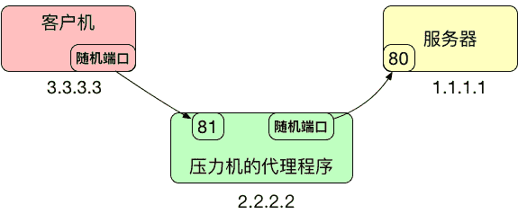

1. 我们在 IP 为 2.2.2.2 上的主机上，打开一个代理程序，开 81 端口，所有到 81 端口的都转发到 1.1.1.1 的 80 端口。
2. 当 3.3.3.3 主机要访问 1.1.1.1 的的 80 端口，可以通过访问 2.2.2.2 的 81 端口进行转发。

这里需要你注意的是，代理是用来转发数据包的，并不是重定向哦。不管是在本机用代理，还是远程用代理，这个逻辑都是不会变的。

有了这个逻辑之后，你要明白的一点是，**客户机不一定要和代理服务器在同一台机器上**。

为什么要强调这一点呢？因为有很多人用工具来录制时，都不知道这个逻辑，只知道工具是那么操作的。这也是很多人不能理解 Port mapping 的原因。

不同的工具录制方式略有不同。今天我们用常见的两个性能测试工具 LoadRunner 和 JMeter 做为示例工具。

### JMeter 的录制功能

首先打开 JMeter，添加一个线程组，再添加一个 HTTP(S) Test Script Recorder。界面如下：

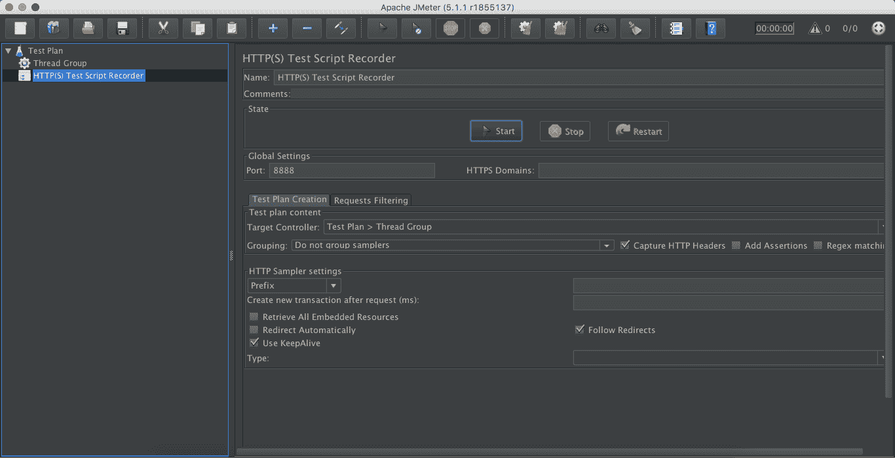

这里有几个关键点说明一下：

1. Target Controller：这里指定录制出的脚本要放到哪里去。如果你想把不同的脚本放到不同的线程组中去，在录制的时候就可以拆分开。
2. Grouping：分组，这个分组功能很实用。但是如何分组就和具体的目标相关了，这一点下面我们再细说。

点击 start 按钮时，会提示创建一个根 CA 证书。这个证书生成在 bin 目录中，文件名是：ApacheJMeterTemporaryRootCA.crt，七天有效期。这个证书将被用来客户端转发 HTTPS 的请求。与此同时，还有另一个证书在同目录中生成，名字是 proxyserver.jks，这是 JMeter 自己生成的根证书。

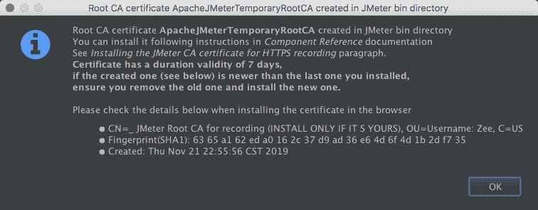

前面我们说到了，JMeter 是用代理的方式来录制的。如果服务端用了 SSL 证书，在代理时也要加 SSL 证书，那么代理录制的结构就会变成这样。

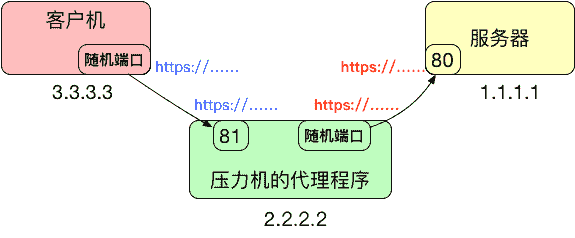

上面的 SSL 证书就是用来处理上图中蓝色的这一部分。

我们点击 ok 之后，就会出现这个界面。在这个界面中，只有两个配置项。

1. Prefix：请求名的前缀。
2. Create new transaction after request(ms)：一个请求完成之后，如果下一个请求超出了这里设置的时间间隔，就创建一个新的事务。


然后到主机上设置代理。

注意，这里我要敲黑板了呀：这里的代理设置，是在需要访问的客户机上。这个客户机，不一定是压力机所在的机器。这里的 localhost，也应该设置的是代理服务所在的主机 IP。

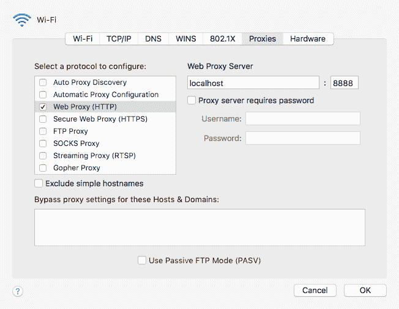

请注意，如果你要设置为录制 HTTPS，还需要做如下两步。

第一步是，浏览器代理要把 Secure Web Proxy(HTTPS) 选择上，同时填上相应的代理 IP 和端口，下图是 macOS 上的图示。

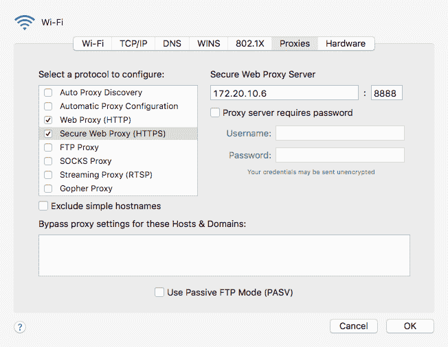

但你会发现，这时仍然录制不了 HTTPS 应用，访问时会出现如下提示：

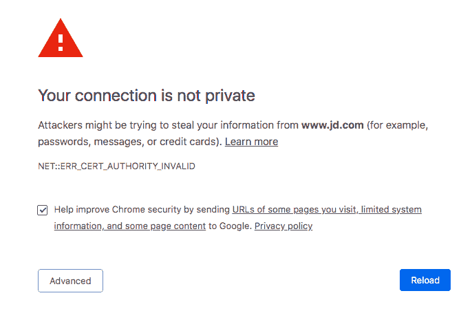

这时就要在客户端机器上导入上面提到的 ApacheJMeterTemporaryRootCA.crt。我们打开证书管理软件，在 macOS 上是 Keychain Access，Windows 上是 certmgr.msc。

这里以 macOS 为例。

首先打开 Keychain Access。

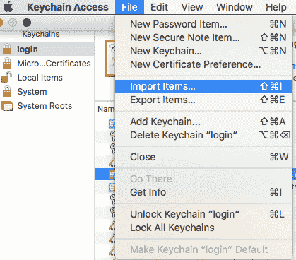

点击上图中的 Import Items。选择 ApacheJMeterTemporaryRootCA.crt，导入之后选择证书。会看到如下提示：


因为这个证书不在系统信任的默认列表里，所以会提示证书不可信。

另外这里我可以再多说一句，你注意的是，全球的可信任的根证书都是默认添加到系统中的，如果你在访问网站时，提示你要安装什么证书，一定要明确知道证书是从哪来的，不要随意安装未知来源的证书。目前国内的 HTTPS 覆盖度不高，仍然有大量的 HTTP 网页，这是需要推进的网络安全之一。

然后我们双击此证书。

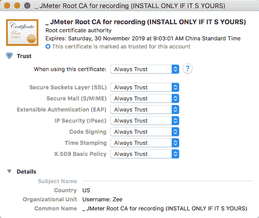

改为 Always Trust 即可。提示如下：

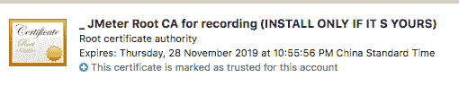

这时，HTTP 和 HTTPS 都会被录制下来。然后在客户机上打开浏览器，访问你的页面，这样就录制到脚本了。

下面我们再来说下 Grouping 这个功能。

Grouping 的设置有如下几种，如果需要将脚本分开，先确定需要如何拆分。示例如下：

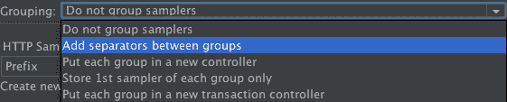

第一个选项是 Do not group samples，也就是不分组。

这是很多人使用的默认选项，这就相当于没有事务的概念了，每个请求都会单独统计 TPS 和响应时间信息。

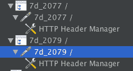

第二个选项是 Add separators between groups，在组间添加分隔，就为了好看！

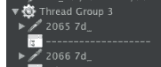

第三个选项是，Put each group in a new controller，每个组放一个新的控制器。这是一个 Simple Controller，它的作用也是只有一个：就为了好看！

因为脚本太长了，看起来不方便，所以分个组，看着清晰一些。话说回来，你们见过在 JMeter 中有很长脚本的吗？是不是很多人都没有见过？

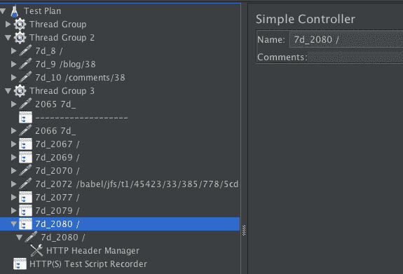

第四个选项是，Put each group in a new transaction controller，将每个组放入一个新的事务控制器中。

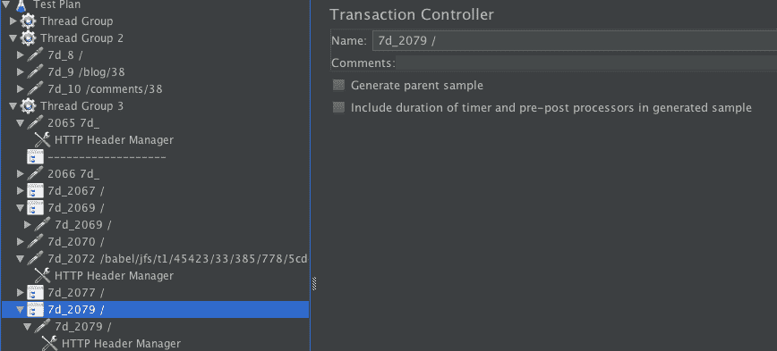

Transaction Controller 和 Simple Controller 的区别就是 Transaction Controller 会做为事务统计脚本执行的时间，而 Simple controller 不会。

第五个选项是 Store 1st sampler for each group only，只存储每个组的第一个样本。

网上大部分都只描述了上面这句，但是请注意我这里还有一句关键的：从 HTML 文件获取所有内含的资源和自动重定向将开启。也就是说，虽说只记录了一个 Sampler，但是资源也会下载，重定向也会开启。

我们把这个过程抓出来看一下，因为 JMeter 没有把这个过程显示出来。所以这里用 Chrome Developer Tool 抓一下看看。举例来说，我们在浏览器里只输入了一个 https://www.jd.com。抓出如下结果。

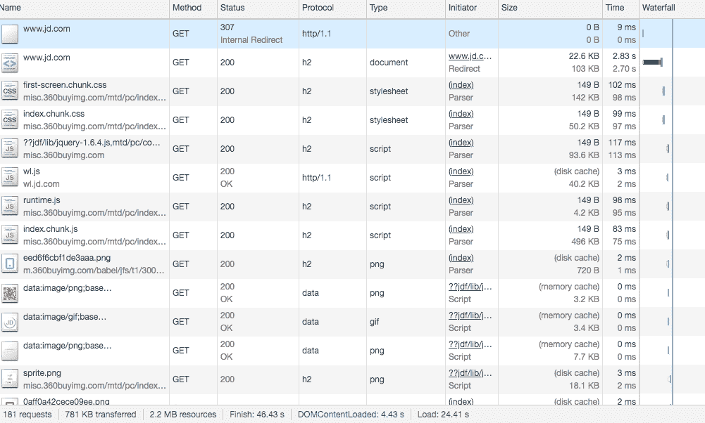

在上面的图中，你可以看到，www.jd.com，第一个就是 307 Internal Redirect。接着请求 Document，然后下面是静态资源。在录制时，选择 Store 1st sampler for each group only 之后，只会录制到第一个请求，而后面这些在回放脚本时也都会访问。

在 JMeter 的代理录制中，还有一个界面如下：

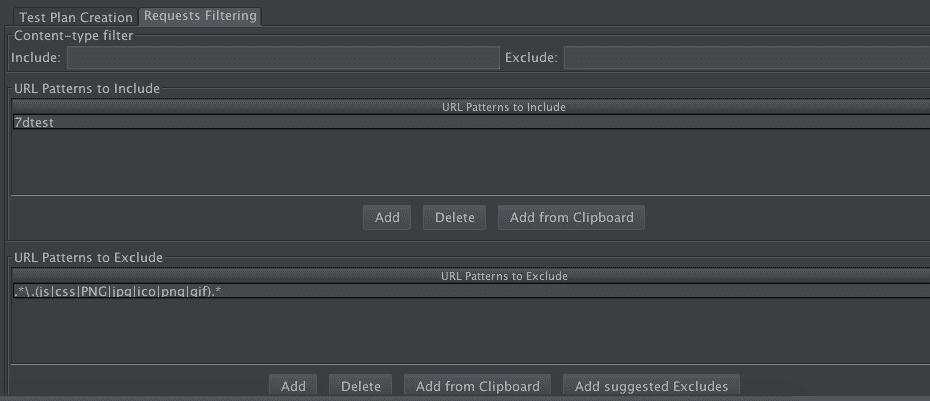

中文界面中通常将之翻译为包含模式、排除模式。“模式”一词一加就显得格外高大上了。

通常这里都会写上正则表达式，比如说常用的一些：

```
.*  
.*.png  
.*.gif  
.*.jpg  
.*.php  
.*.jsp  
.*.html  
.*.htm  
.*.js  
..(js|css|PNG|jpg|ico|png|gif).
```

由于正则是一个很大的话题，这里我们就不展开了，只要你懂正则，在这里就可以适用。

通过上面的内容，我们已经把 JMeter 录制的原理和操作的过程都详细地描述了一遍，关于 JMeter 的录制功能，就介绍到这里。

在此重点提醒你一下，录制是通过代理做的，一定要知道代理的原理，代理就是转发的功能。

### 承上启下的话

为什么 JMeter 这样的功能单一，性能又不好的性能测试工具能这么快的占领市场呢？

在我看来，工具能不能用取决于它能不能满足需要。在很多的性能测试场景中，JMeter 已经够用了。因为性能压力工具只需要两条曲线：TPS 和响应时间（如果出错最多就再看一下错误率曲线）。这些功能，JMeter 都可以提供。

现在的性能项目中，我们要的压力其实并没有很大，并且大部分都是 HTTP、TCP 之类的常见协议，脚本所使用的资源并不多。一般能达到万级 TPS 的都很少很少，所以弄几个机器，JMeter 也就够用了，再加上免费开源，何乐而不为呢？

而 LoadRunner 的失败之处就是价格高，更新慢。一想到 HP 糟蹋了 LoadRunner，我就伤心落泪。

### LoadRunner 中的录制功能

我们都知道 LoadRunner 其实可以录制很多协议，这也是它前期扩展市场的很重要的功能。应该说，在录制这个功能点上，所有的性能测试工具都不如 LoadRunner。并且 LoadRunner 在其他很多功能上都是强大的，强大到什么程度呢？就是有很多你不需要的，不常用的功能，它都具备。

很多人都知道，LoadRunner 中的 Vuser Generator 只支持 Windows。你有没有想过这是为什么？其实解释起来也简单，LoadRunner 一开始是基于 WinInet 做的，就是 Windows Internet API。后来可能是觉得 WinInet 太恶心了，于是换成了 Windows socket。而 Windows socket 跟 UNIX socket 还是有一些小区别。

所以从历史延续下来，Vuser Gnenerator 就一直在 Windows 上了。

为什么不做 UNIX 的版本呢？其实在我看来，完全没有这个必要。因为 Load Generator 已经支持 UNIX 了。从使用的角度说，Vuser Gnenerator 没有必要做 UNIX 的版本，因为它还有 Port Mapping 的功能，这样在 UNIX 上的操作也照样录得下来。。

下面我们就单说 LoadRunner 的录制功能。

### 常规录制

首先，我们打开 Vuser Generator，点击 Start Record，出现如下界面：

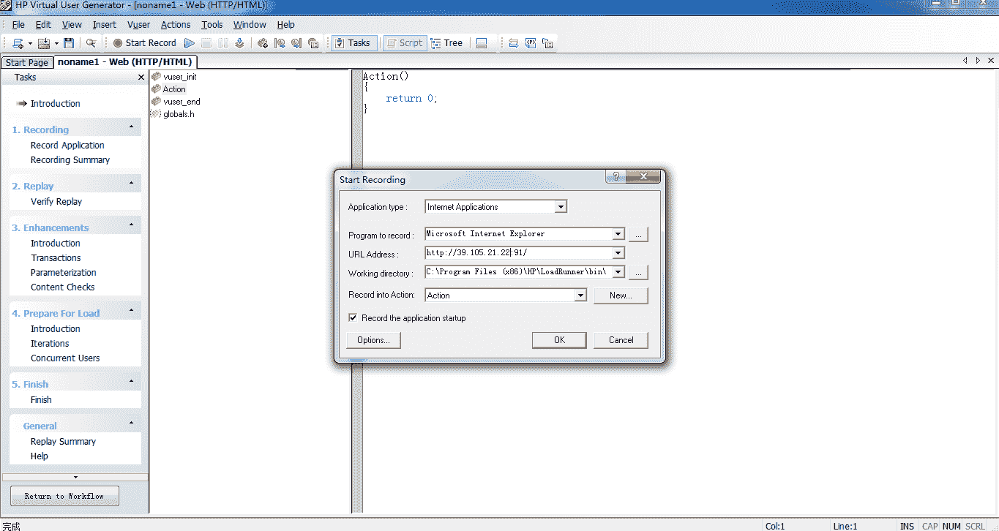

在这个图中，首先的选择是：

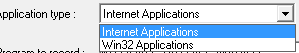

这里用 IE 或者应用程序都可以，只要支持我们选择的 HTTP 协议就行。

Recording into action 这里是默认的 action，请你一定要注意的是 init、action、end 这三个都是 action，并没有什么区别。控制 init 和 end 只执行一遍和 action 会重复执行多次的功能也不在它们自己身上，而是在 run logic 里。这一点我将在后面的文章中再细说。

点击 Options 之后，跳出界面如下：

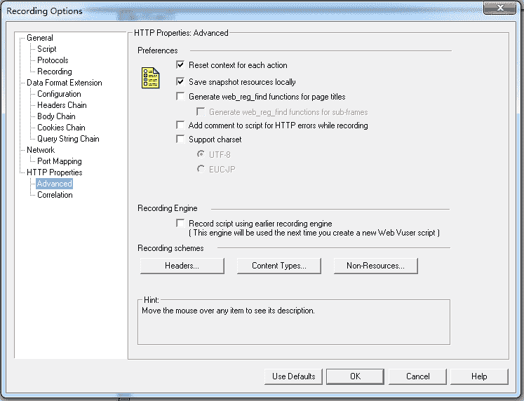

在这个界面中，有很多可以调的内容。这里举几个重要的点。

首先是 HTML-based script 和 URL-based script。

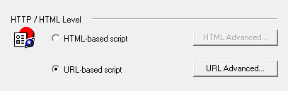

这个功能点之所以重要，是因为这两个选项录制出来的脚本有很大差别。

其实这一点和 JMeter 的 Store 1st sampler for each group only 是一样的含义。

如果选择了 HTML-based script，就是一个页面一个请求了，而在回放和压力时，这个页面的所有资源都会请求。

如果选择了 URL-based script，就是每个资源一个请求。这个选项有好处是，便于控制和查找问题。如果不想要某个资源，直接注释掉就好。

其次，我们需要注意关联功能。

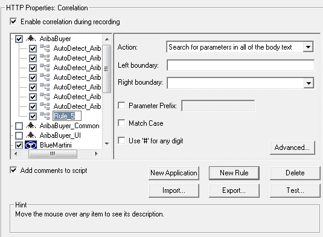

你可以在这里事先设置好关联的规则，比如说这样的：

```
JSESSIONID=5687300192384o4^&&^&890523#123456;
```

你就可以设置左边界为：JSESSIONID=，左边界为冒号，然后在你录制的时候，如果规则匹配到就会自动创建关联。

点击 OK 之后就开始录制了。出现一个工具条，如下所示：


在这个功能条上具有的功能是：暂停、停止、新建 Action，创建集合点、创建事务的起点和终端、加备注、加文检查点。

一般在业务流比较长的脚本中，

性能测试工程师都会通过新建 Action 把操作区分开，也会在录制过程中创建好必要的事务。

最后录制出的脚本如下：

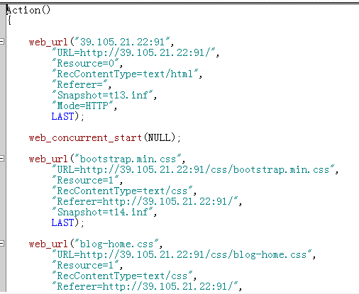

注意哦，URL-based script 的时候，有一个 concurrent group，这个并发组是同时发出请求的。

在 JMeter 中有一个 Parallel Downloads，你还记得吗？

这两者功能一样。

上面就是 LR 中常规的录制功能。录制前，看下 readme，看 LR 支持什么浏览器。在版本 12.6 的 readme 中，已经声明支持 Windows 10 + IE 了。但是我们在使用的过程中还是遇到各种各样的问题，比如调不出浏览器、录不出脚本、卡死的问题。

还有，有些应用只支持 Chrome，而有时，有些应用只能在某些特定的机器的执行，而那些机器又不能装 Vuser Generator。

在这样的场景中，我们只能使用 Port Mapping 的功能。是的，在 LoadRunner 中，Port Mapping 就是代理录制的方式。

### Port Mapping

首先打开 Vuser Generator，点击 Start Record，配置成如下界面：

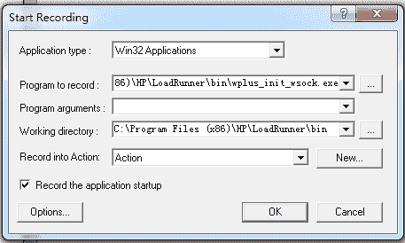

注意，这里一定要选择的是 LoadRunner 安装目录 bin 中的 wplus_init_wsock.exe，从这个名字你也能知道它是基于 Windows Socket 的。

然后，点击 Options - Port Mapping，如下所示：

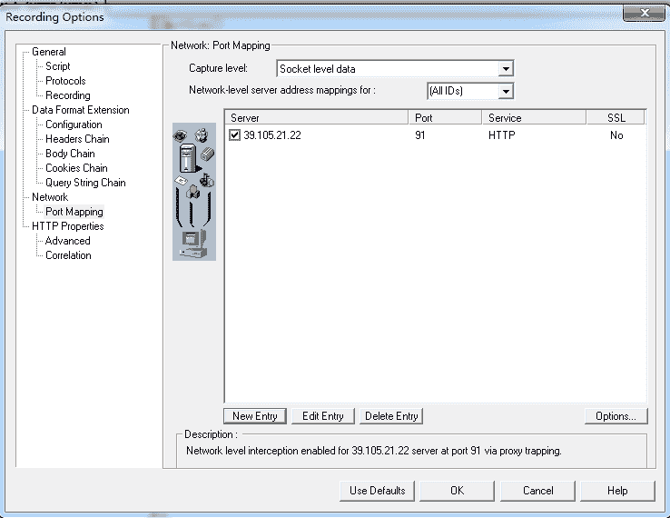

点击 New Entry。配置如下：

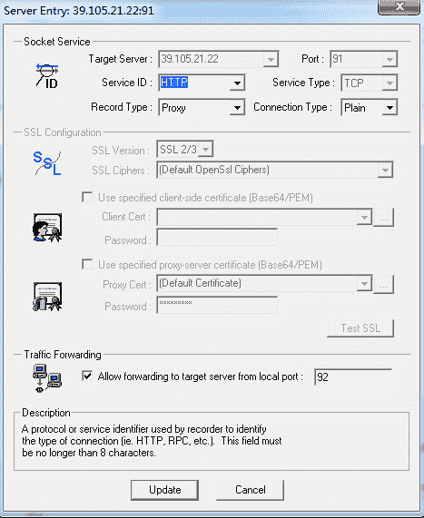

从上图中你可以看到，它的代理功能是很全面和强大的，不仅支持不同的 Service ID，也支持 SSL。

这时的访问逻辑是下面这样的：

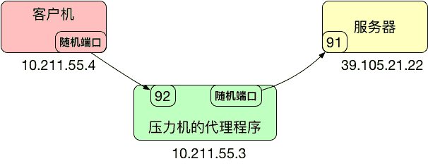

一路 OK，返回之后我们就可以开始录制了。会打开一个代理程序。截图如下：

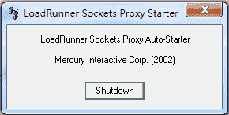

这时候本地会开一个 92 的端口。

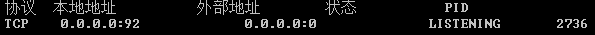

请注意，这时如果是远程访问，要注意不要让防火墙拦截了。

接着打开浏览器，输入地址 http://10.211.55.3:92/，可以看到打开的是 http://39.105.21.22:91/ 的界面。

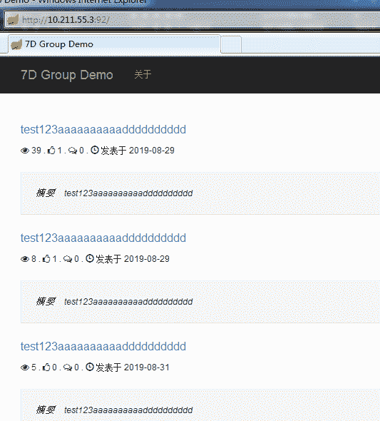

同时，录制工具条中也显示出有事件产生。


当我们停止录制后，查看脚本如下：

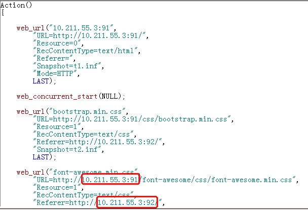

看到没有，这里的访问 IP 在直接回放时是不对的。所以要将 ip:port 换成 39.105.21.22:91 才能回放。替换后如下：

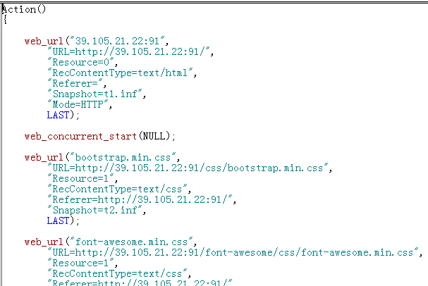

这样就可以回放成功了。

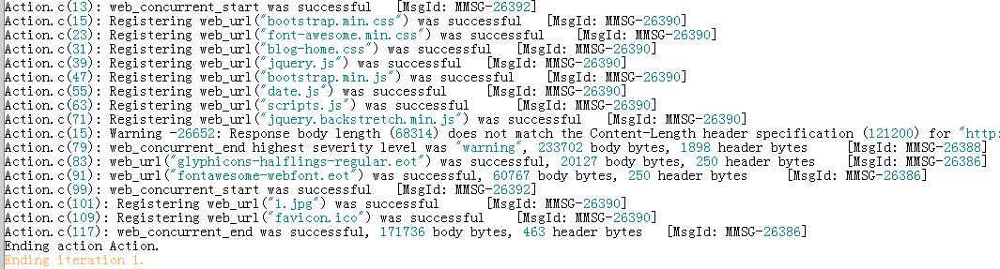

如果回放不成功，我们就需要根据出错日志判断要做什么样的脚本增强。大部分的脚本都是需要做关联的，所以后面我们将讲一下关联的功能如何做，以及关联的原理。

Loadrunner 的 Port Mapping 还可以支持 FTP、SOCKET、POP 等协议。这个功能点也不复杂，操作起来也简单，只要想明白访问链路就可以了。

LR 的录制常用功能基本就这些了。

## 总结

这篇文章，应该是我写的所有的文章中，最最基础的一篇了，并且，从操作上，一步步地描述，也比较清晰。如果你有性能工具使用经验，肯定会觉得这篇过于简单。

可是为什么还要写呢？

因为在性能测试的过程中，有很多新手对录制的逻辑并不清楚。代理录制的这个动作他们也可以很快学会。但是很快就忘记了，我曾经给一些人手把手教过如何做代理录制。结果第二天就不记得了。其实并不是不记得动作，而是出了问题，脑子里没有判断问题的逻辑，所以根本无从下手排查。

另外，你需要注意的是，录制功能并不是性能测试工具必备的功能。对性能测试工具来说，关键功能是能实现模拟批量的真实请求逻辑。至于脚本是如何实现的，怎么做就是可以的。所以我们可以用其他的工具，比如说 BadBoby、Fiddler 甚至 Wireshark 抓到交互请求，再放到 JMeter 中实现脚本，也完全是可以的。

当然没有脚本就无从实现压力，所以脚本的实现是性能测试工程师必备的基础技术，理解原理也是必须的。

## 思考题

学完今天的文章后，你能用自己的话说一下代理录制的逻辑是什么吗？以及，当访问网页时，为什么第一个请求至关重要？

欢迎你在评论区写下你的思考，也欢迎把这篇文章分享给你的朋友或者同事，一起交流进步一下。
