# 11丨性能脚本：用案例和图示帮你理解HTTP协议

 

当前使用得最为广泛的应用层协议就是 HTTP 了。我想了好久，还是觉得应该把 HTTP 协议写一下。

因为做性能测试分析的人来说，HTTP 协议可能是绕不过去的一个槛。在讲 HTTP 之前，我们得先知道一些基本的信息。

HTTP（HyperText Transfer Protocol，超文本传输协议），显然是规定了传输的规则，但是它并没有规定内容的规则。

HTML（HyperText Marked Language，超文本标记语言），规定的是内容的规则。浏览器之所以能认识传输过来的数据，都是因为浏览器具有相同的解析规则。

希望你先搞清楚这个区别。

我们首先关注一下 HTTP 交互的大体内容。想了很久，画了这么一张图，我觉得它展示了我对 HTTP 协议在交互过程上的理解。

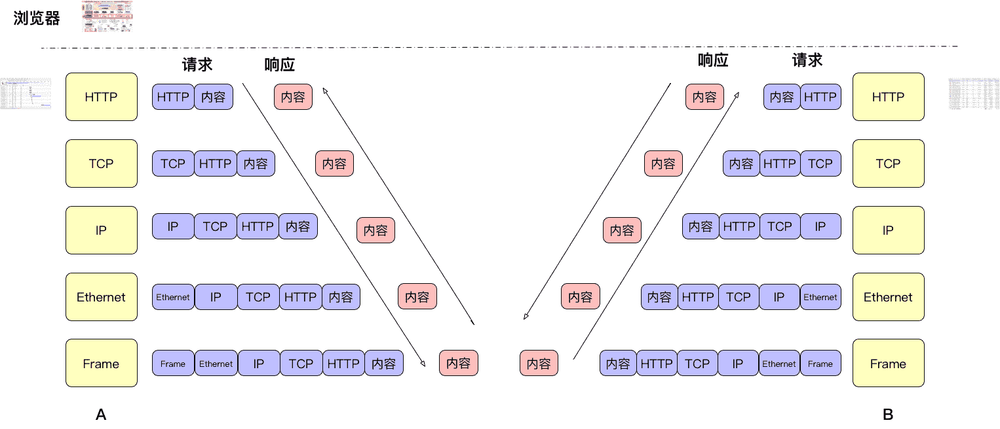

在这张图中，可以看到这些信息：

1. 在交互过程中，数据经过了 Frame、Ethernet、IP、TCP、HTTP 这些层面。不管是发送和接收端，都必须经过这些层。这就意味着，任何每一层出现问题，都会影响 HTTP 传输。
2. 在每次传输中，每一层都会加上自己的头信息。这一点要说重要也重要，说不重要也不重要。重要是因为如果这些头出了问题，非常难定位（在我之前的一个项目中，就曾经出现过 TCP 包头的一个 option 因为 BUG 产生了变化，查了两个星期，一层层抓包，最后才找到原因）。不重要是因为它们基本上不会出什么问题。
3. HTTP 是请求 - 应答的模式。就是说，有请求，就要有应答。没有应答就是有问题。
4. 客户端接收到所有的内容之后，还要展示。而这个展示的动作，也就是前端的动作。**在当前主流的性能测试工具中，都是不模拟前端时间的****，**比如说 JMeter。我们在运行结束后只能看到结果，但是不会有响应的信息。你也可以选择保存响应信息，但这会导致压力机工作负载高，压力基本上也上不去。也正是因为不存这些内容，才让一台机器模拟成千上百的客户端有了可能。

如果你希望能理解这些层的头都是什么，可以直接抓包来看，比如如下示图：

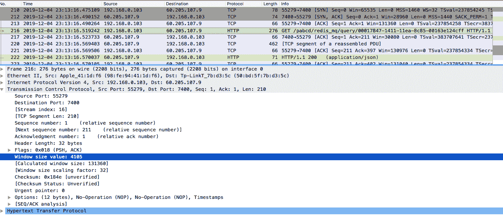

从这个图中，我们就能看到各层的内容都是什么。当然了，这些都属于网络协议的知识范围，如果你有兴趣，可以去看一下《TCP/IP 详解 卷 1：协议》。

我们还是主要来说一说 HTTP 层的内容。同样，我希望通过最简单的示例的方式，给你解释一下 HTTP 的知识，而不是纯讲压力工具，或纯理论。

在我看来，只有实践的操作和理论的结合，才能真正的融会贯通。只讲压力工具而不讲原理，是不可能学会处理复杂问题的；空有理论没有动手能力是不可能解决实际问题的。

由于压力工具并不处理客户端页面解析、渲染等动作，所以，以下内容都是从协议层出发的，不包括前端页面层的部分。

## JMeter 脚本

在这里，我写了一个简单的 HTTP GET 请求（由于 HTTP2.0 在市场上还没有普及，所以这里不做特别说明的话，就是 HTTP1.1）。

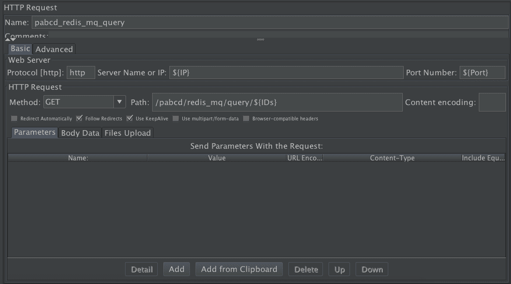

在前面的文章中，我已经写过了 HTTP GET 和 POST 请求。在这里只解释几个重要信息：

第一个就是 Protocol。

这个当然重要。从“HTTP”这几个字符中，我们就能知道这个协议有什么特点。 HTTP 的特点是建议在 TCP 之上、无连接（TCP 就是它的连接）、无状态（后来加了 Cookies、Session 技术，用 KeepAlive 来维持，也算是有状态吧）、请求 - 响应模式等。

第二个是 Method 的选项 GET。

HTTP 中有多少个 Method 呢？我在这里做个说明。在 RFC 中的 HTTP 相关的定义中（比如 RFC2616、2068），定义了 HTTP 的方法，如下：GET、POST、PUT、PATCH、DELETE、COPY、HEAD、OPTIONS、LINK、UNLINK、PURGE。

回到我们文章中的选项中来。GET 方法是怎么工作的呢？

> The GET method means retrieve whatever information (in the form of an entity) is identified by the Request-URI.

也就是说，GET 可以得到由 URI 请求（定义）的各种信息。同样的，其他方法也有清楚的规定。我们要注意的是，HTTP 只规定了你要如何交互。它是交互的协议，就是两个人对话，如何能传递过去？小时候一个人手上拿个纸杯子，中间有根线，相互说话能听到，这就是协议。

第三个是 Path，也就是请求的路径。这个路径是在哪里规定的呢？在我这个 Spring Boot 的示例中。

```
   @RequestMapping(value = "pabcd")  
    public class PABCDController {  
        @Autowired  
        private PABCDService pabcdService;  
        @Autowired  
        private PABCDRedisService pabcdRedisService;  
        @Autowired  
        private PABCDRedisMqService pabcdRedisMqService;  
        @GetMapping("/redis_mq/query/{id}")  
        public ResultVO<User> getRedisMqById(@PathVariable("id") String id) {  
            User user = pabcdRedisMqService.getById(id);  
            return ResultVO.<User>builder().success(user).build();  
        }
```

看到了吧。因为我们定义了 request 的路径，所以，我们必须在 Path 中写上`/pabcd/redis_mq/query`这样的路径。

第四个是 Redirect，重定向。HTTP 3XX 的代码都和重定向有关，从示意上来看，如下所示。

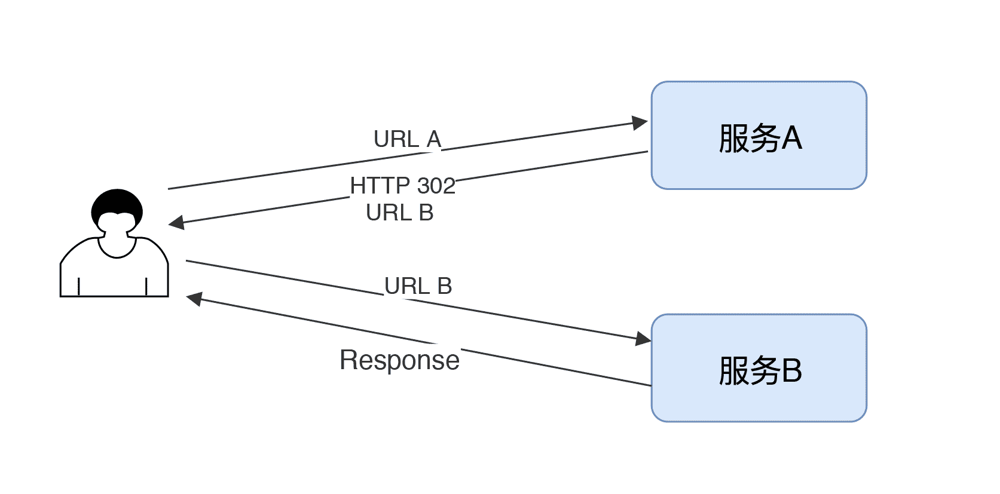

用户发了个 URL A 到服务 A 上，服务 A 返回了 HTTP 代码 302 和 URL B。 这时用户看到了接着访问 URL B，得到了服务 B 的响应。对于 JMeter 来说，它可以处理这种重定向。

第五个是 Content-Encoding，内容编码。它是在 HTTP 的标准中对服务端和客户端之间处理内容做的一种约定。当大家都用相同的编码时，相互都认识，或者有一端可以根据对端的编码进行适配解释，否则就会出现乱码的情况。

默认是 UTF8。但是我们经常会碰到这种情况。当我们发送中文字符的时候。比如下面的名字。

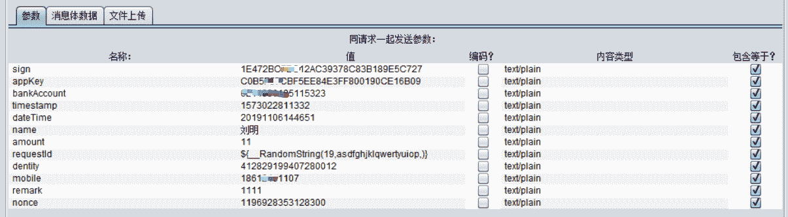

当我们发送出去时，会看到它变成了这种编码。如下图所示：

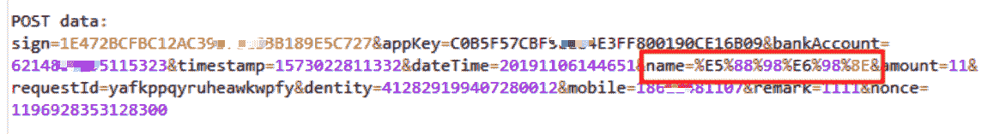

如果服务端不去处理，显然交互就错了。如下图所示：

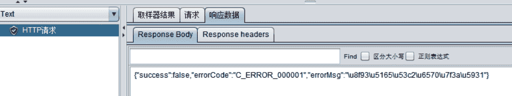

这时，只能把配置改为如下：

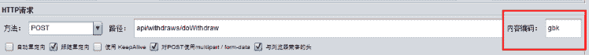

我们这里用 GBK 来处理中文。就会得到正确的结果。

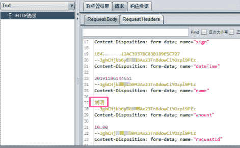

你就会发现现在用了正常的中文字符。在这个例子，有人选择用 URL 编码来去处理，会发现处理不了。这是需要注意的地方。

第六个是超时设置。在 HTTP 协议中，规定了几种超时时间，分别是连接超时、网关超时、响应超时等。

如下所示，JMeter 中可以设置连接和响应超时：

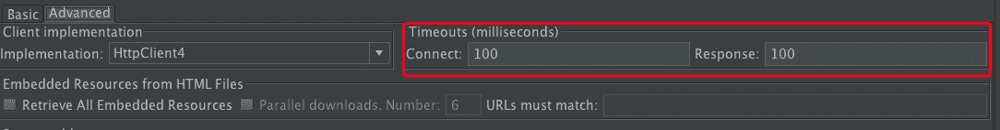

在工具中，我们可以定义连接和响应的超时时间。但通常情况下，我们不用做这样的规定，只要跟着服务端的超时走就行了。但在有些场景中，不止是应用服务器有超时时间，网络也会有延迟，这些会影响我们的响应时间。如果 HTTP 默认的 120s 超时时间不够，我们可以将这里放大。

在这里为了演示，我将它设置为 100ms。我们来看一下执行的结果是什么样。

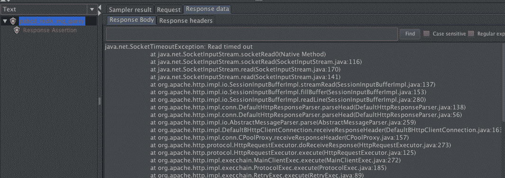

从栈的信息上就可以看到，在读数据的时候，超时了。

超时的设置是为了保证数据可以正常地发送到客户端。做性能分析的时候，经常有人听到“超时”这个词就觉得是系统慢导致的，其实有时也是因为配置。

通常，我们会对系统的超时做梳理，每个服务应该是什么样的超时设置，我们要有全局的考量。比如说：

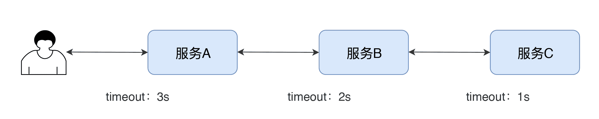

超时应该是逐渐放大的（不管你后面用的是什么协议，超时都应该是这个样子）。而我们现在的系统，经常是所有的服务超时都设置得一样大，或者都是跟着协议的默认超时来。在压力小的时候，还没有什么问题，但是在压力大的时候，就会发现系统因为超时设置不合理而导致业务错误。

如果倒过来的话，你可以想像，用户都返回超时报错了，后端还在处理着呢，那就更有问题了。

而我们性能测试人员，都是在压力工具中看到的超时错误。如果后端的系统链路比较长，就需要一层层地往后端去查找，看具体是哪个服务有问题。所以在架构层级来分析超时是非常有必要的。


在上图中，还有一个参数是客户端实现（Client Implementation）。其中有三个选项：空值、HTTPClient4、Java。

官方给出如下的解释。

JAVA： 使用 JVM 提供的 HTTP 实现，相比 HttpClient 实现来说，这个实现有一些限制，这个限制我会在后面提到。

HTTPClient4：使用 Apache 的 HTTP 组件 HttpClient 4.x 实现。

空值：如果为空，则依赖 HTTP Request 默认方法，或在`jmeter.properties`文件中的`jmeter.httpsample`定义的值。

用 JAVA 实现可能会有如下限制。

1. 在连接复用上没有任何控制。就是当一个连接已经释放之后，同一个线程有可能复用这个已经释放掉的连接。
2. API 最适用于单线程，但是很多设置都是依赖系统属性值的，所以都应用到所有连接上了。
3. 不支持 Kerberos Authentication（这是一种计算机网络授权协议，用在非安全网络中，对个人通信以安全的手段进行身份认证）。
4. 不支持通过 keystore 配置的客户端证书。
5. 更容易控制重试机制。
6. 不支持 Virtual hosts。
7. 只支持这些方法： GET、POST、HEAD、OPTIONS、PUT、DELETE 和 TRACE。
8. 使用 DNS Cache Manager 更容易控制 DNS 缓存。

第八个就是 HTTP 层的压缩。我们经常会听到在性能测试过程中，因为没有压缩，导致网络带宽不够的事情。当我们截获一个 HTTP 请求时，你会看到如下内容。

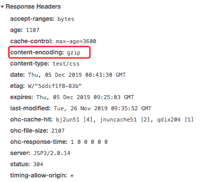

这就是有压缩的情况。在我们常用的 Nginx 中，会用如下常见配置来支持压缩：

```
    gzip  on;   # 打开 gzip  
    gzip_min_length 2k; # 低于 2kb 的资源不用压缩  
    gzip_comp_level 4; # 压缩级别【1-9】值越大，压缩率就越高，但是 CPU 消耗也越多，根据我们在网上看到建议，大部分都是建议设置为中间 4、5 之类的，这里我建议大家根据自己的项目实际情况，在压力测试之后给出适合的值。  
    gzip_types text/plain application/javascript;  # 设置压缩类型  
    gzip_disable "MSIE [1-6]\.";  # 禁用 gzip 的条件，支持正则
```

在 RFC2616 中，Content Codings 部分定义了压缩的格式 gzip 和 Deflate，不过我们现在看到的大部分都是 gzip。

不过在压缩这件事情上，我们在压力工具中并不需要做什么太多的动作，最多也就是加个头。

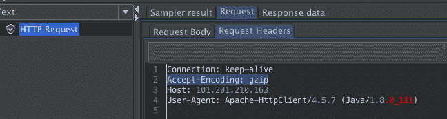

第九个就是并发。在 RFC2616 中的 8.1.1 节明确说明了为什么要限制浏览器的并发。大概翻译如下，有兴趣的去读下原文：

1. 少开 TCP 链接，可以节省路由和主机（客户端、服务端、代理、网关、通道、缓存）的 CPU 资源和内存资源。
2. HTTP 请求和响应可以通过 Pipelining 在一个连接上发送。Pipelining 允许客户端发出多个请求而不用等待每个返回，一个 TCP 连接更为高效。
3. 通过减少打开的 TCP 来减少网络拥堵，也让 TCP 有充足的时间解决拥堵。
4. 后续请求不用在 TCP 三次握手上再花时间，延迟降低。
5. 因为报告错误时，没有关闭 TCP 连接的惩罚，而使 HTTP 可以升级得更为优雅（原文使用 gracefully）。
6. 如果不限制的话，一个客户端发出很多个链接到服务器，服务器的资源可以同时服务的客户端就会减少。

我们常见的浏览器有如下的并发限制。

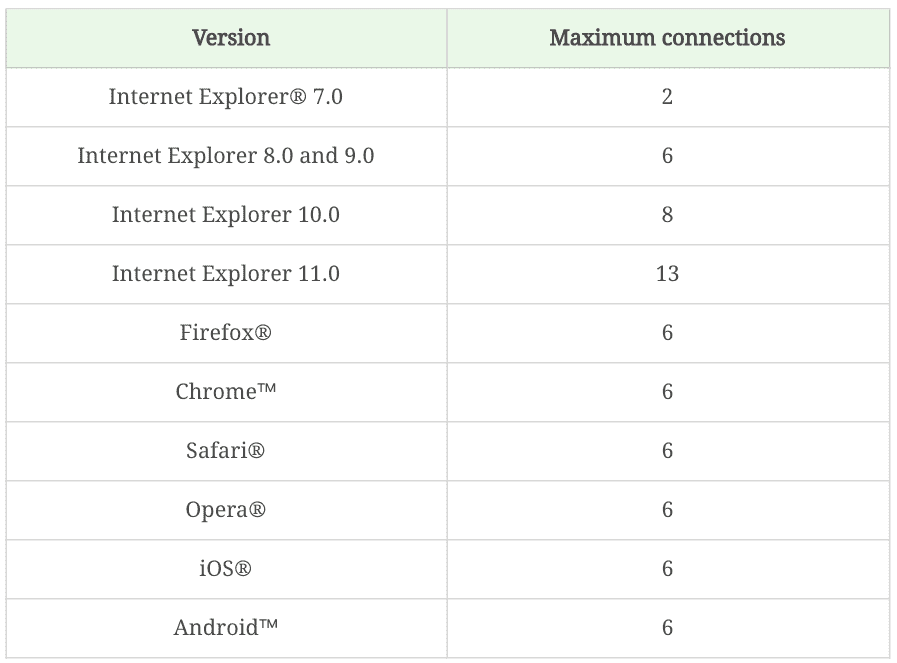

在压力工具中，并没有参数来控制这个并发值，如果是在同一个线程中，就是并行着执行下去。

HTTPS 只是加了一个 S，就在访问中加了一层。这一层可以说的话题有很多，因为技术原理比较多。还好对性能测试中的脚本部分来说，关系并不大，需要时导进去就可以了。而在性能分析中，基本上除了看下不同产品、不同软件硬件的性能验证之外，其他的也没什么可分析的部分。因为证书是个非常标准的产品，加在中间，就是加密算法和位数也会对性能产生影响。如果执行场景时报：`javax.net.ssl.SSLHandshakeException: Remote host closed connection during handshake`，就应该把证书也加载进来。

有了前面这些压力工具中常用的 HTTP 知识之后，有些人肯定会有一种感觉，总觉得有什么内容没有讲到。对了，就是 HTML。前面我们提到了，HTML 是属于内容的规则，前端是个宏大的话题，以后有机会详聊。

其实对我们做性能测试的人来说，无需关心 HTTP 的内容，我们只要关心数据的流向和处理的逻辑就可以了。至于你是 A 业务还是 B 业务，在性能分析中都是一样的，逻辑仍然没有变化。

从性能测试的角度来看，如果你要模拟页面请求，最多也就是正常实现 HTTP 的方法 GET、POST 之类的。它发送和接收的内容，只要符合业务系统的正常流程就可以，这样业务才能正常运行。

比如说，前面提到的 POST 请求。如果我们发送了一段 JSON。内容如下：

```
{  
    "userNumber": "${Counter}",  
    "userName": "Zee_${Counter}",  
    "orgId": null,  
    "email": "test${Counter}@dunshan.com",  
    "mobile": "18611865555"  
}
```

代码中的 Service 负责接收 User 对象，同时转换它的是如下代码：

```
@Override  
    public String toString() {  
        return "User{" +  
            "id='" + id + '\'' +  
            ", userNumber='" + userNumber + '\'' +  
            ", userName='" + userName + '\'' +  
            ", orgId='" + orgId + '\'' +  
            ", email='" + email + '\'' +  
            ", mobile='" + mobile + '\'' +  
            ", createTime=" + createTime +  
            '}';  
    }
```

然后通过 Service 的 add 方法 insert 到数据库中，这里后面使用的 MyBatis：

```
    Boolean result = paRedisService.add(user);
```

而这些，都属于业务逻辑处理的部分，我们分析时把这个链路都想清楚才可以一层层剥离。

## 总结

对于 HTTP 协议来说，我们在性能分析中，主要关心的部分就是传输字节的大小、超时的设置以及压缩等内容。在编写脚本的时候，要注意 HTTP 头部，至于 Body 的内容，只要能让业务跑起来即可。

## 思考题

你能说一下为什么压力机不模拟前端吗？

欢迎你在评论区写下你的思考，也欢迎把这篇文章分享给你的朋友或者同事，一起交流一下。
