# 18丨CentOS：操作系统级监控及常用计数器解析（下）

 

在上一篇文章中，我们已经讲了监控系统层面的分析思路以及 CPU 分析，今天我们分析一下操作系统中其他的层面。

首先是 I/O。

## I/O

I/O 其实是挺复杂的一个逻辑，但我们今天只说在做性能分析的时候，应该如何定位问题。

对性能优化比较有经验的人（或者说见过世面比较多的人）都会知道，当一个系统调到非常精致的程度时，基本上会卡在两个环节上，对计算密集型的应用来说，会卡在 CPU 上；对 I/O 密集型的应用来说，瓶颈会卡在 I/O 上。

我们对 I/O 的判断逻辑关系是什么呢？

我们先画一个 I/O 基本的逻辑过程。我们很多人嘴上说 I/O，其实脑子里想的都是 Disk I/O，但实际上一个数据要想写到磁盘当中，没那么容易，步骤并不简单。

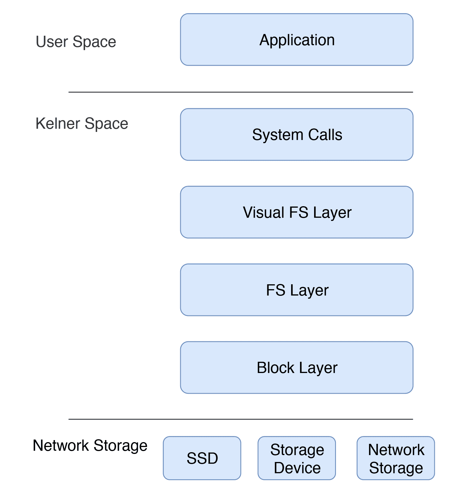

这个简化的图是思虑再三的结果。

I/O 有很多原理细节，那我们如何能快速地做出相应的判断呢？首先要祭出的一个工具就是`iostat`。

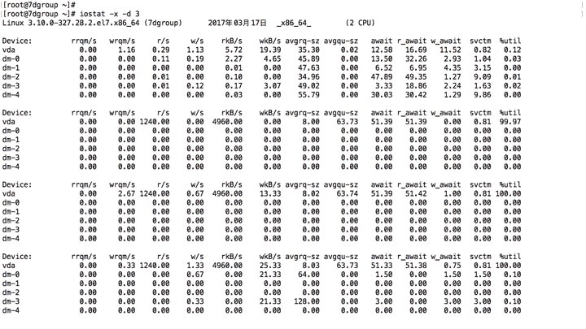

在这张图中，我们取出一条数据来做详细看下：

```
Device:   rrqm/s   wrqm/s     r/s     w/s    rkB/s    wkB/s  avgrq-sz   
vda        0.00     0.67   18.33  114.33   540.00 54073.33   823.32  
avgqu-sz   await r_await w_await  svctm  %util  
127.01  776.75    1.76  901.01   7.54 100.00 
```

我解释一下其中几个关键计数器的含义。

`svctm`代表 I/O 平均响应时间。请注意，这个计数器，有很多人还把它当个宝一样，实际上在 man 手册中已经明确说了：“Warning! Do not trust this field any more. This field will be removed in a future sysstat version.” 也就是说，这个数据你爱看就爱，不一定准。

`w_await`表示写入的平均响应时间；`r_await`表示读取的平均响应时间；`r/s`表示每秒读取次数；`w/s`表示每秒写入次数。

而 IO/s 的关键计算是这样的：

```
IO/s = r/s + w/s = 18.33+114.33 = 132.66  
%util = ( (IO/s * svctm) /1000) * 100% = 100.02564%
```

这个`%util`是用`svctm`算来的，既然`svctm`都不一定准了，那这个值也只能参考了。还好我们还有其他工具可以接着往深了去定位，那就是`iotop`。

```
Total DISK READ :       2.27 M/s | Total DISK WRITE :    574.86 M/s  
Actual DISK READ:       3.86 M/s | Actual DISK WRITE:      34.13 M/s  
  TID  PRIO  USER     DISK READ  DISK WRITE  SWAPIN     IO>    COMMAND  
  394 be/3 root        0.00 B/s  441.15 M/s  0.00 % 85.47 % [jbd2/vda1-8]  
32616 be/4 root     1984.69 K/s    3.40 K/s  0.00 % 42.89 % kube-controllers  
13787 be/4 root        0.00 B/s    0.00 B/s  0.00 % 35.41 % [kworker/u4:1]  
...............................
```

从上面的`Total DISK WRITE/READ`就可以知道当前的读写到底有多少了，默认是按照`I/O`列来排序的，这里有`Total`，也有`Actual`，并且这两个并不相等，为什么呢？

因为 Total 的值显示的是用户态进程与内核态进程之间的速度，而 Actual 显示的是内核块设备子系统与硬件之间的速度。

而在`I/O`交互中，由于存在`cache`和在内核中会做`I/O`排序，因此这两个值并不会相同。那如果你要说磁盘的读写能力怎么样，我们应该看的是`Actual`。这个没啥好说的，因为`Total`再大，不能真实写到硬盘上也是没用的。

在下面的线程列表中，通过排序，就可以知道是哪个线程（注意在第一列是 TID 哦）占的`I/O`高了。

## Memory

关于内存，要说操作系统的内存管理，那大概开一个新专栏也不为过。但是在性能测试的项目中，如果不做底层的测试，基本上在上层语言开发的系统中，比如说 Java、Go、C++ 等，在分析过程中都直接看业务系统就好了。

在操作系统中，分析业务应用的时候，我们会关注的内存内容如下面的命令所示：

```
[root@7dgroup ~]# free -m               
        total        used        free      shared  buff/cache   available  
Mem:           3791        1873         421         174        1495        1512  
Swap:             0           0           0  
[root@7dgroup ~]#  

```

`total`肯定是要优先看的，其次是`available`，这个值才是系统真正可用的内存，而不是`free`。

因为 Linux 通常都会把用的内存给`cache`，但是不一定会用，所以`free`肯定会越来越少，但是`available`是计算了`buff`和`cache`中不用的内存的，所以只要`available`多，就表示内存够用。

当出现内存泄露或因其他原因导致物理内存不够用的时候，操作系统就会调用`OOM Killer`，这个进程会强制杀死消耗内存大的应用。这个过程是不商量的，然后你在“`dmesg`”中就会看到如下信息。

```
[12766211.187745] Out of memory: Kill process 32188 (java) score 177 or sacrifice child  
[12766211.190964] Killed process 32188 (java) total-vm:5861784kB, anon-rss:1416044kB, file-rss:0kB, shmem-rss:0kB
```

这种情况只要出现，TPS 肯定会掉下来，如果你有负载均衡的话，压力工具中的事务还是可能有成功的。但如果你只有一个应用节点，或者所有应用节点都被`OOM Killer`给干掉了，那 TPS 就会是这样的结果。

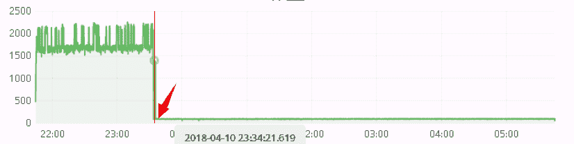

对内存监控，可以看到这样的趋势：

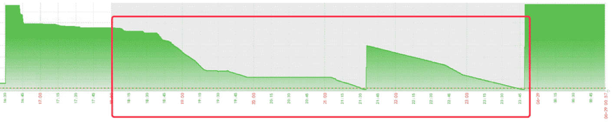

内存慢慢被耗光，但是杀掉应用进程之后，`free`内存立即就有了。你看上面这个图，就是一个机器上有两个节点，先被杀了一个，另一个接着泄露，又把内存耗光了，于是又被杀掉，最后内存全都空闲了。

在我的性能工作生涯中，这样的例子还挺常见。当然对这种情况的分析定位，只看物理内存已经没有意义了，更重要的是看应用的内存是如何被消耗光的。

对于内存的分析，你还可以用`nmon`和`cat/proc/meminfo`看到更多信息。如果你的应用是需要大页处理的，特别是大数据类的应用，需要关注下`HugePages`相关的计数器。

内存我们就说到这里，总之，要关注`available`内存的值。

## NetWork

这里我们就来到了网络分析的部分了，在说握手之前，我们先看网络的分析决策链。

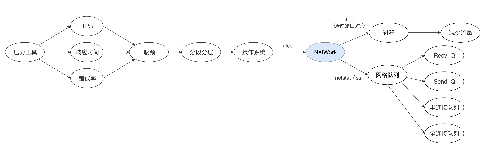

请看上图中，在判断了瓶颈在网络上之后，如果知道某个进程的网络流量大，首先肯定是要考虑减少流量，当然要在保证业务正常运行，TPS 也不降低的情况下。

### Recv_Q 和 Send_Q

当然我们还要干一件事，就是可能你并不知道是在哪个具体的环节上出了问题，那就要学会判断了。网络`I/O`栈也并不简单，看下图：

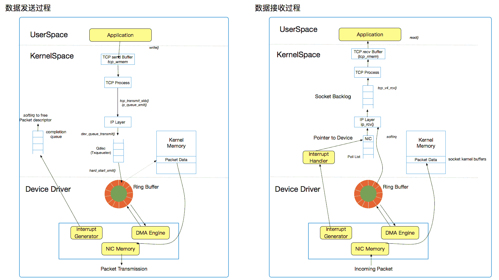

数据发送过程是这样的。

应用把数据给到`tcp_wmem`就结束它的工作了，由内核接过来之后，经过传输层，再经过队列、环形缓冲区，最后通过网卡发出去。

数据接收过程则是这样的。

网卡把数据接过来，经过队列、环形缓冲区，再经过传输层，最后通过`tcp_rmem`给到应用。

你似乎懂了对不对？那么在这个过程中，我们有什么需要关注的呢？

首先肯定是看队列，通过`netstat`或其他命令可以看到`Recv_Q`和`Send_Q`，这两项至少可以告诉你瓶颈会在哪一端。如下图所示：

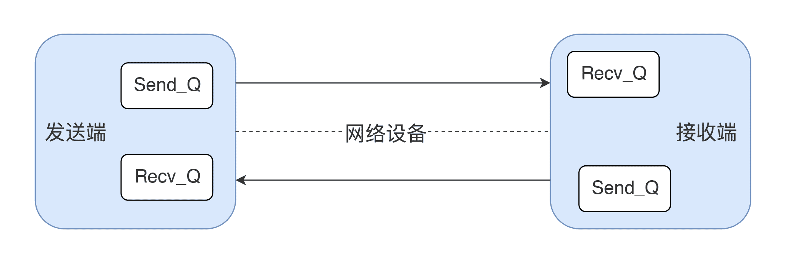

我画个表清晰地判断一下瓶颈点。

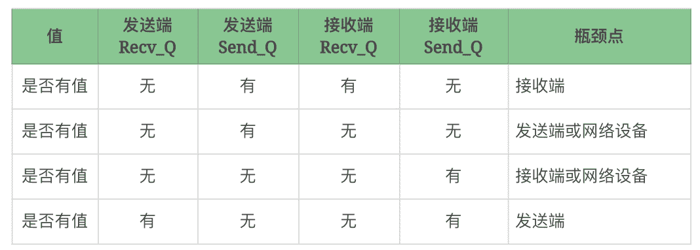

其实这个过程中，我还没有把防火墙加进去，甚至我都没说`NAT`的逻辑，这些基础知识你需要自己先做足功课。

在我们做性能分析的过程中，基本上，基于上面这个表格就够通过接收和发送判断瓶颈点发生在谁身上了。

但是，要是这些队列都没有值，是不是网络就算好了呢？还不是。

### 三次握手和四次挥手

我们先看握手图：

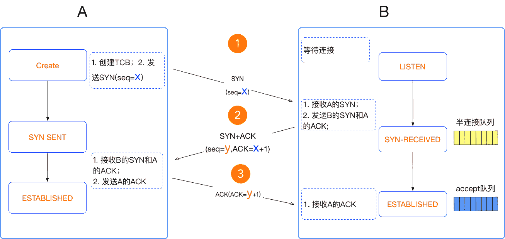

我发现一点，很多人以为三次握手是非常容易理解的，但是没几个人能判断出和它相关的问题。

握手的过程，我就不说了，主要看这里面的两个队列：半连接队列和全连接队列。

在 B 只接到第一个`syn`包的时候，把这个连接放到半连接队列中，当接到`ack`的时候才放到全连接队列中。这两个队列如果有问题，都到不了发送接收数据的时候，你就看到报错了。

查看半连接全连接溢出的手段也很简单，像下面这种情况就是半连接没建立起来，半连接队列满了，`syn`包都被扔掉了。

```
[root@7dgroup ~]# netstat -s |grep -i listen      
8866 SYNs to LISTEN sockets dropped
```

那么半连接队列和什么参数有关呢？

1. 代码中的`backlog`：你是不是想起来了`ServerSocket(int port, int backlog)中的backlog`？是的，它就是半连接的队列长度，如果它不够了，就会丢掉`syn`包了。
2. 还有操作系统的内核参数`net.ipv4.tcp_max_syn_backlog`。

而像下面这样的情况呢，就是全连接队列已经满了，但是还有连接要进来，已经超过负荷了。

```
[root@7dgroup2 ~]# netstat -s |grep overflow      
154864 times the listen queue of a socket overflowed
```

这是在性能分析过程中经常遇到的连接出各种错的原因之一，它和哪些参数有关呢？我列在这里。

1. `net.core.somaxconn`：系统中每一个端口最大的监听队列的长度。
2. `net.core.netdev_max_backlog`：每个网络接口接收数据包的速率比内核处理这些包的速率快时，允许送到队列的数据包的最大数目。
3. `open_file`：文件句柄数。

我们再来看下四次挥手。我遇到性能测试过程中的挥手问题，有很多都是做性能分析的人在不了解的情况下就去做各种优化动作而产生的。

先看一下 TCP 挥手图：

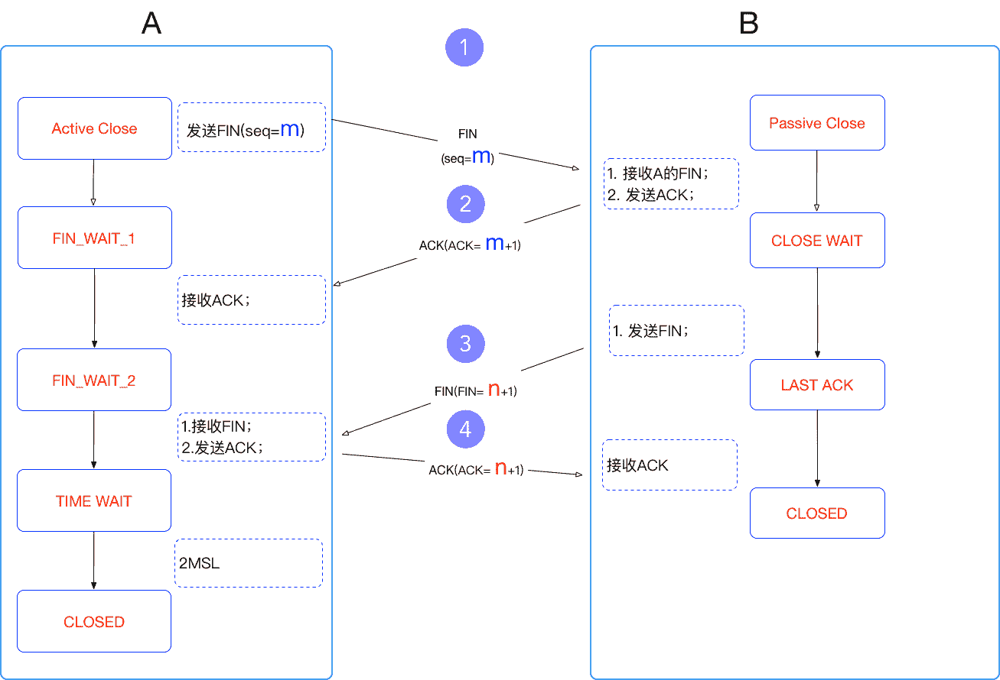

在挥手的逻辑中，和性能相关的问题真的非常少。

但有一个点是经常会问到的，那就是`TIME_WAIT`。不知道为什么，很多人看到`TIME_WAIT`就紧张，就想去处理掉，于是搜索一圈，哦，要改`recycle/reuse`的 TCP 参数，要改`fin_time_out`值。

至于为什么要处理`TIME_WAIT`，却没几个人能回答得上来。

在我的性能工作经验中，只有一种情况要处理`TIME_WAIT`，那就是**端口不够用**的时候。

`TCP/IPv4`的标准中，端口最大是 65535，还有一些被用了的，所以当我们做压力测试的时候，有些应用由于响应时间非常快，端口就会不够用，这时我们去处理`TIME_WAIT`的端口，让它复用或尽快释放掉，以支持更多的压力。

所以处理`TIME_WAIT`的端口要先判断清楚，如果是其他原因导致的，即使你处理了`TIME_WAIT`，也没有提升性能的希望。

如果还有人说，还有一种情况，就是内存不够用。我必须得说，那是我没见过世面了，我至今没见过因为`TIME_WAIT`的连接数把内存耗光了的。

一个 TCP 连接大概占 3KB，创建 10 万个连接，才`100000x3KB≈300M`左右，何况最多才 65535 呢？服务器有那么穷吗？

## System

确切地说，在性能测试分析的领域里，System 似乎实在是没有什么可写的地方。

我们最常见的 System 的计数器是`in(interrupts:中断)`和`cs(context switch：上下文切换)`。

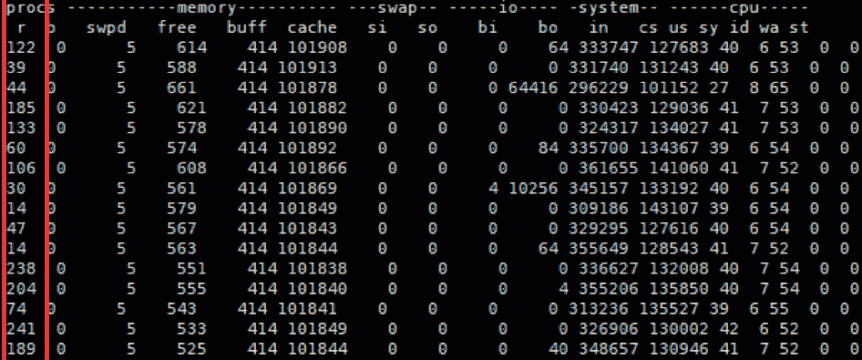

因为这是我能找得到的最疯狂的 System 计数器了。

中断的逻辑在前面跟你说过了。

`cs`也比较容易理解，就是 CPU 不得不转到另一件事情上，听这一句你就会知道，中断时肯定会有`cs`。但是不止中断会引起 cs，还有多任务处理也会导致`cs`。

因为`cs`是被动的，这个值的高和低都不会是问题的原因，只会是一种表现，所以它只能用来做性能分析中的证据数据。

在我们的这个图中，显然是由于`in`引起的`cs`，CPU 队列那么高也是由`in`导致的。像这样的问题，你可以去看我们在上篇文章中提到的`si CPU`高的那个分析链了。

## Swap

Swap 的逻辑是什么呢？它是在磁盘上创建的一个空间，当物理内存不够的时候，可以保存物理内存里的数据。如下图所示：

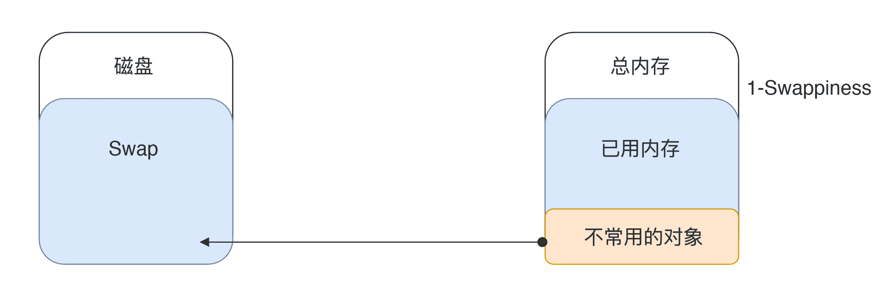

先看和它相关的几个参数。

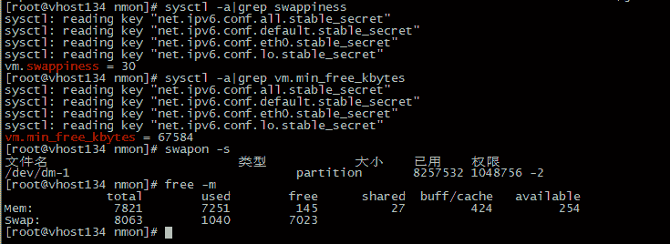

也就是说，当操作系统中配置了`vm.swappiness`是 30%，那么当内存用到`1-30%=70%`的时候，就会发生 Swap。

`swapiness`默认是 60%。注意，下面还有一个参数叫`vm.min_free_kbytes`。即使把`vm.swappiness`改为 0，当内存用到小于`vm.min_free_kbytes`时照样会发生 Swap。

想关掉 Swap 就`swapoff -a`。

和 Swap 相关的计数器有：`top`中的`Total`、`free`、`used`和`vmstat`里的`si`、`so`。

说到 Swap，在性能测试和分析中，我的建议是直接把它关了。

为什么呢？因为当物理内存不足的时候，不管怎么交换性能都是会下降的，不管是 Swap 还是磁盘上的其他空间，都是从磁盘上取数据，性能肯定会刷刷往下掉。

## 总结

对操作系统的监控及常用计数器的分析会涉及到很多的内容，所以两篇文章可能也是覆盖不全的，我只把在性能测试分析工作中经常见到的计数器解析了一遍。总体来说，你需要记住以下三点：

1. 监控平台再花哨，都只是提供数据来给你分析的。只要知道了数据的来源、原理、含义，用什么工具都不重要。
2. 性能分析的时候，不会只看操作系统一个模块或哪几个固定计数器的。这些动态的数据，需要有分析链把它们串起来。
3. 操作系统提供的监控数据是分析链路中不可缺少的一环，除非你能绕过操作系统，又能很确切地定位出根本原因。

## 思考题

我为什么说用什么监控平台并不重要呢？

欢迎你在评论区写下你的思考，也欢迎把这篇文章分享给你的朋友或者同事，一起交流进步。
