# 32丨当Postgres磁盘读引起I/O高的时候，应该怎么办？

 

在性能分析的人眼里，性能瓶颈就是性能瓶颈。无论这个性能瓶颈出现在代码层、操作系统层、数据库层还是其他层，最终的目的只有一个结果：解决掉！

有人可能会觉得这种说法过于霸道。

事实上，我要强调的性能分析能力，是一套分析逻辑。在这一套分析逻辑中，不管是操作系统、代码还是数据库等，所涉及到的都只是基础知识。如果一个人都掌握这些内容，那确实不现实，但如果是对一个性能团队的要求，我觉得一点也不高。

在性能测试和性能分析的项目中，没有压力发起，就不会有性能瓶颈，也就谈不上性能分析了。所以每个问题的前提，都是要有压力。

但不是所有的压力场景都合理，再加上即使压力场景不合理，也能压出性能瓶颈，这就会产生一种错觉：似乎一个错误的压力场景也是有效的。

我是在介入一个项目时，首先会看场景是否有效。如果无效，我就不会下手去调了，因为即使优化好了，可能也给不出生产环境应该如何配置的结论，那工作就白做了。

所以要先调场景。

我经常会把一个性能测试项目里的工作分成两大阶段：

### 整理阶段

在这个阶段中，要把之前项目中做错的内容纠正过来。不止有技术里的纠正，还有从上到下沟通上的纠正。

### 调优阶段

这才真是干活的阶段。

在这个案例中，同样，我还是要表达一个分析的思路。

## 案例问题描述

这是一个性能从业人员问的问题：为什么这个应用的 update 用了这么长时间呢？他还给了我一个截图：

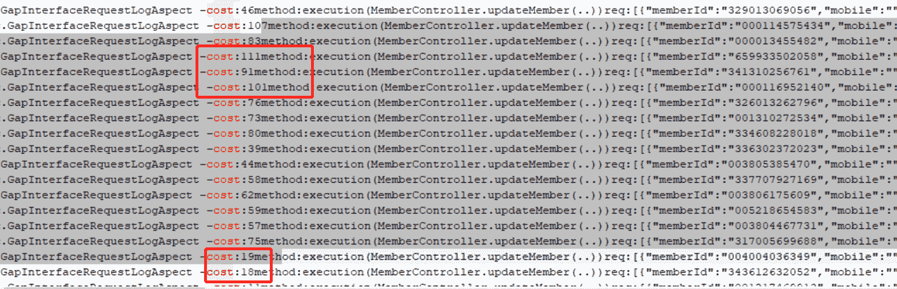

从这个图中可以看到时间在 100 毫秒左右。根据我的经验，一个 SQL 执行 100ms，对实时业务来说，确实有点长了。

但是这个时间是长还是短，还不能下结论。要是业务需要必须写成这种耗时的 SQL 呢？

接着他又给我发了 TPS 图。如下所示：

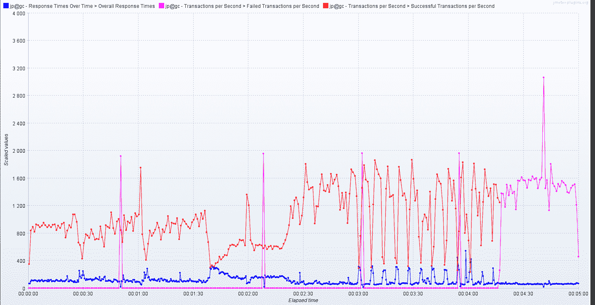

这个 TPS 图确实……有点乱！还记得前面我对 TPS 的描述吧，在一个场景中，TPS 是要有阶梯的。

如果你在递增的 TPS 场景中发现了问题，然后为了找到这个问题，用同样的 TPS 级别快速加起来压力，这种方式也是可以的。只是这个结果不做为测试报告，而是应该记录到调优报告当中。

而现在我们看到的这个 TPS 趋势，那真是哪哪都挨不上呀。如此混乱的 TPS，那必然是性能有问题。

他还告诉了我两个信息。

1. 有 100 万条参数化数据；
2. GC 正常，dump 文件也没有死锁的问题。

这两个信息应该说只能是信息，并不能起到什么作用。另外，我也不知道他说的“GC 正常”是怎么个正常法，只能相信他说的。

以上就是基本的信息了。

## 分析过程

照旧，先画个架构图出来看看。

每次做性能分析的时候，我几乎都会先干这个事情。只有看了这个图，我心里才踏实。才能明确知道要面对的系统范围有多大；才能在一个地方出问题的时候，去考虑是不是由其他地方引起的；才能跟着问题找到一条条的分析路径……

下面是一张简单的架构图，从下面这张架构图中可以看到，这不是个复杂的应用，是个非常典型的微服务结构，只是数据库用了 PostgreSQL 而已。

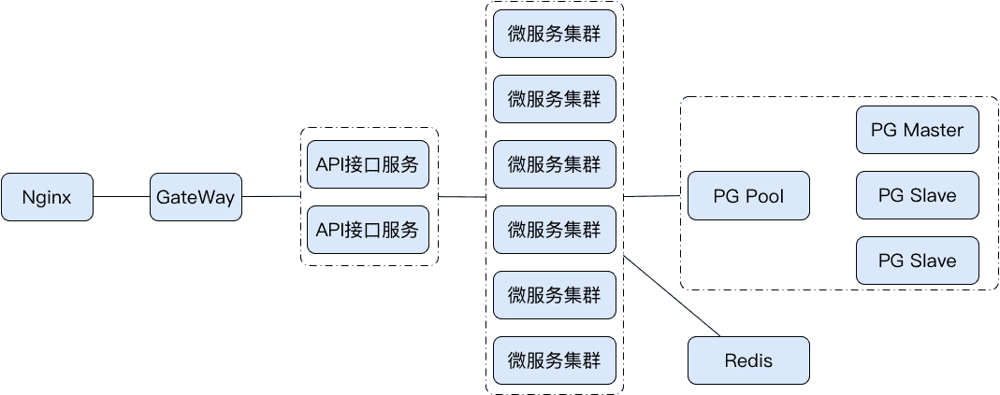

由于这个问题反馈的是从服务集群日志中看到的 update 慢，所以后面的分析肯定是直接对着数据库去了。

这里要提醒一句，我们看到什么现象，就跟着现象去分析。这是非常正规的思路吧。但就是有一些人，明明看着数据库有问题，非要瞪着眼睛跟应用服务器较劲。

前不久就有一个人问了我一个性能问题，说是在压力过程中，发现数据库 CPU 用完了，应用服务器的 CPU 还有余量，于是加了两个数据库 CPU。但是加完之后，发现数据库 CPU 使用率没有用上去，反而应用服务器的 CPU 用完了。我一听，觉得挺合理的呀，为什么他在纠结应用服务器用完了呢？于是我就告诉他，别纠结这个，先看时间耗在哪里。结果发现应用的时间都耗在读取数据库上了，只是数据库硬件好了一些而已。

因为这是个在数据库上的问题，所以我直接查了数据库的资源。

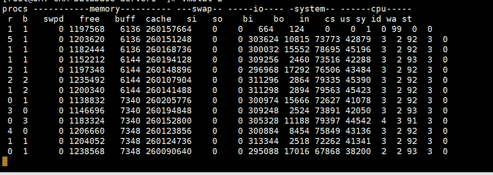

查看 vmstat，从这个结果来看，系统资源确实没用上。不过，请注意，这个 bi 挺高，能达到 30 万以上。那这个值说明了什么呢？我们来算一算。

bi 是指每秒读磁盘的块数。所以要先看一下，一块有多大。

```
[root@7dgroup1 ~]# tune2fs -l /dev/vda1 | grep "Block size"  
Block size:               4096  
[root@7dgroup1 ~]#
```

那计算下来大约就是：

(300000∗1024)/1024/1024≈293M

将近 300M 的读取，显然这个值是不低的。

接下来查看 I/O。再执行下 iostat 看看。

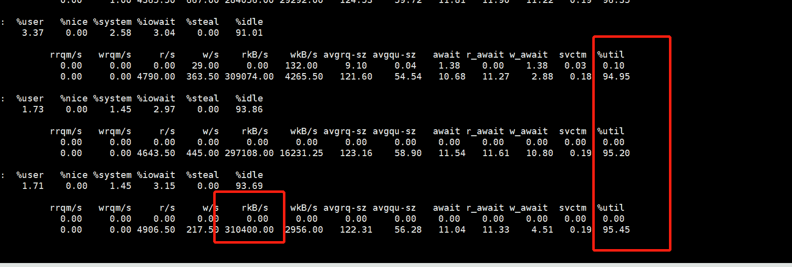

从这个结果来看，%util 已经达到了 95% 左右，同时看 rkB/s 那一列，确实在 300M 左右。

接着在 master 上面的执行 iotop。

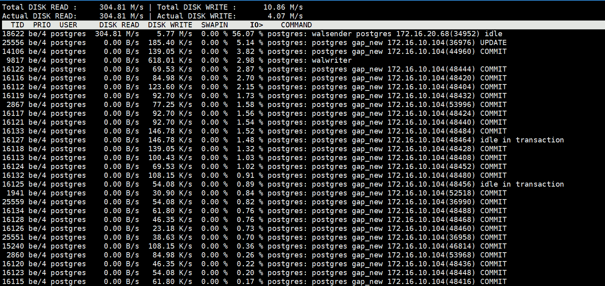

我发现 Walsender Postgres 进程达到了 56.07% 的使用率，也就是说它的读在 300M 左右。但是写的并不多，从图上看只有 5.77M/s。

结合上面几个图，我们后面的优化方向就是：**降低读取，提高写入**。

到这里，我们就得说道说道了。这个 Walsender Postgres 进程是干吗的呢？

我根据理解，画了一个 Walsender 的逻辑图：

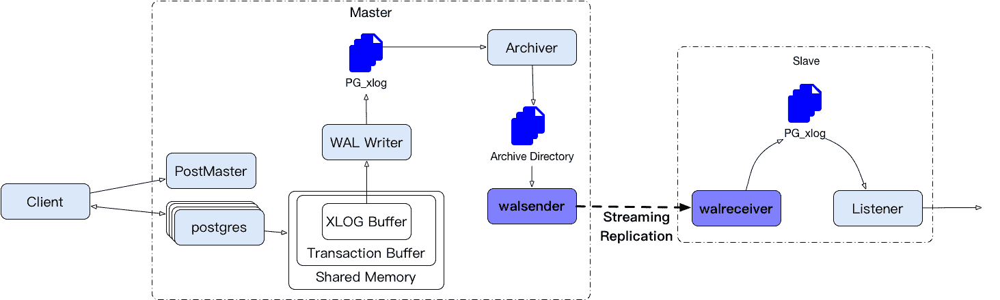

从这个图中就可以看得出来，Walsender 和 Walreceiver 实现了 PostgreSQL 的 Master 和 Slave 之间的流式复制。Walsender 取归档目录中的内容（敲黑板了呀！），通过网络发送给 Walreceiver，Walreceiver 接收之后在 slave 上还原和 master 数据库一样的数据。

而现在读取这么高，那我们就把读取降下来。

先查看一下几个关键参数：

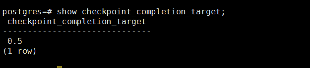

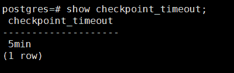

这两个参数对 PostgreSQL 非常重要。checkpoint_completion_target 这个值表示这次 checkpoint 完成的时间占到下一次 checkpoint 之间的时间的百分比。

这样说似乎不太好理解。画图说明一下：

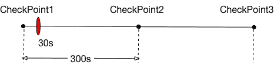

在这个图中 300s 就是 checkpoint_timeout，即两次 checkpoint 之间的时间长度。这时若将 checkpoint_completion_target 设置为 0.1，那就是说 CheckPoint1 完成时间的目标就是在 30s 以内。

在这样的配置之下，你就会知道 checkpoint_completion_target 设置得越短，集中写的内容就越多，I/O 峰值就会高；checkpoint_completion_target 设置得越长，写入就不会那么集中。也就是说 checkpoint_completion_target 设置得长，会让写 I/O 有缓解。

在我们这个案例中，写并没有多少。所以这个不是什么问题。

但是读取的 I/O 那么大，又是流式传输的，那就是会不断地读文件，为了保证有足够的数据可以流式输出，这里我把 shared_buffers 增加，以便减轻本地 I/O 的的压力。

来看一下优化动作：

```
checkpoint_completion_target = 0.1  
checkpoint_timeout = 30min  
shared_buffers = 20G  
min_wal_size = 1GB  
max_wal_size = 4GB
```

其中的 max_wal_size 和 min_wal_size 官方含义如下所示。

max_wal_size (integer)：

> Maximum size to let the WAL grow to between automatic WAL checkpoints. This is a soft limit; WAL size can exceed max_wal_size under special circumstances, like under heavy load, a failing archive_command, or a high wal_keep_segments setting. The default is 1 GB. Increasing this parameter can increase the amount of time needed for crash recovery. This parameter can only be set in the postgresql.conf file or on the server command line.

min_wal_size (integer)：

> As long as WAL disk usage stays below this setting, old WAL files are always recycled for future use at a checkpoint, rather than removed. This can be used to ensure that enough WAL space is reserved to handle spikes in WAL usage, for example when running large batch jobs. The default is 80 MB. This parameter can only be set in the postgresql.conf file or on the server command line.

请注意，上面的 shared_buffers 是有点过大的，不过我们先验证结果再说。

## 优化结果

再看 iostat：

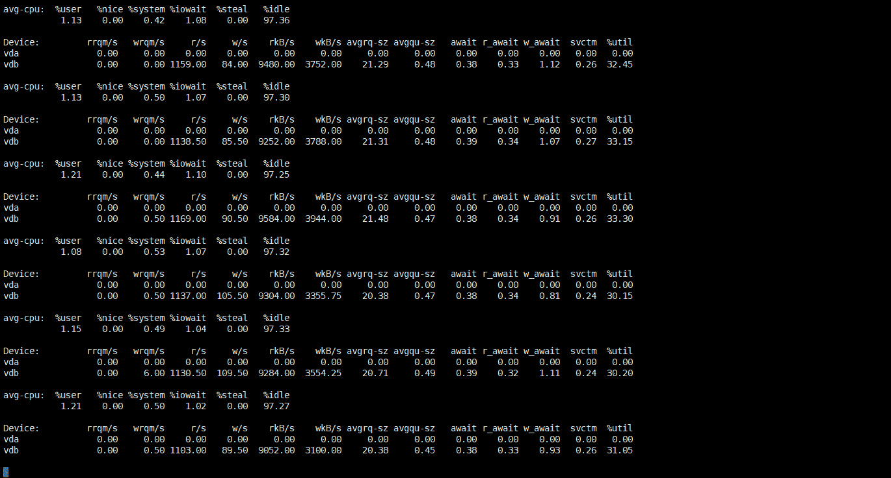

看起来持续的读降低了不少。效果是有的，方向没错。再来看看 TPS：

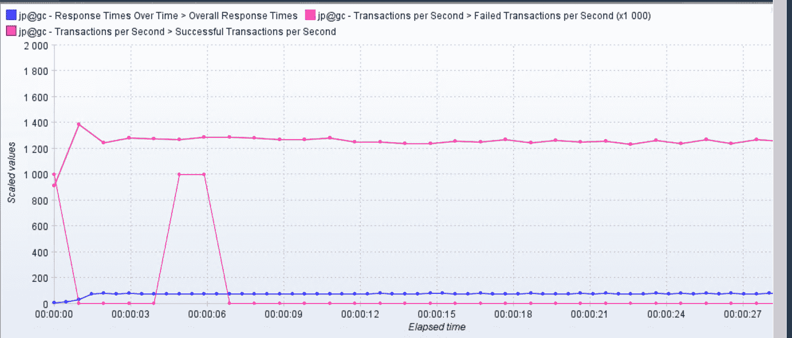

看这里 TPS 确实稳定了很多，效果也比较明显。

这也就达到我们优化的目标了。就像在前面文章中所说的，在优化的过程中，当你碰到 TPS 非常不规则时，请记住，一定要先把 TPS 调稳定，不要指望在一个混乱的 TPS 曲线下做优化，那将使你无的放矢。

## 问题又来了？

在解决了上一个问题之后，没过多久，另一个问题又抛到我面前了，这是另一个接口，因为是在同一个项目上，所以对问问题的人来说，疑惑还是数据库有问题。

来看一下 TPS：

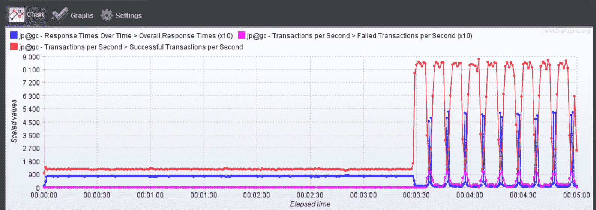

这个问题很明显，那就是后面的成功事务数怎么能达到 8000 以上？如果让你蒙的话，你觉得会是什么原因呢？

在这里，告诉你我对 TPS 趋势的判断逻辑，那就是 **TPS 不能出现意外的趋势。**

什么叫意外的趋势？就是当在运行一个场景之前就已经考虑到了这个 TPS 趋势应该是个什么样子（做尝试的场景除外），当拿到运行的结果之后，TPS 趋势要和预期一致。

如果没有预期，就不具有分析 TPS 的能力了，最多也就是压出曲线，但不会懂曲线的含义。

像上面的这处 TPS 图，显然就出现意外了，并且是如此大的意外。前面只有 1300 左右的 TPS，后面怎么可能跑到 8000 以上，还全是对的呢？

所以我看到这个图之后，就问了一下：是不是没加断言？

然后他查了一下，果然没有加断言。于是重跑场景。得到如下结果：

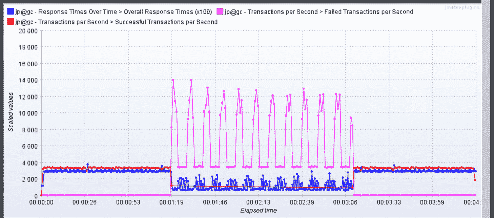

从这个图上可以看到，加了断言之后，错误的事务都正常暴露出来了。像这种后台处理了异常并返回了信息的时候，前端会收到正常的 HTTP Code，所以才会出现这样的问题。

这也是为什么通常我们都要加断言来判断业务是否正常。

## 总结

在性能分析的道路上，我们会遇到各种杂七杂八的问题。很多时候，我们都期待着性能测试中的分析像破案一样，并且最好可以破一个惊天地泣鬼神的大案，以扬名四海。

然而分析到了根本原因之后，你会发现优化的部分是如此简单。

其实对于 PostgreSQL 数据库来说，像 buffer、log、replication 等内容，都是非常重要的分析点，在做项目之前，我建议先把这样的参数给收拾一遍，不要让参数配置成为性能问题，否则得不偿失。

## 思考题

最后问你两个问题吧。为什么加大 buffer 可以减少磁盘 I/O 的压力？为什么说 TPS 趋势要在预期之内？

欢迎你在评论区写下你的思考，我会和你一起交流。也欢迎把这篇文章分享给你的朋友或者同事，一起交流一下。
