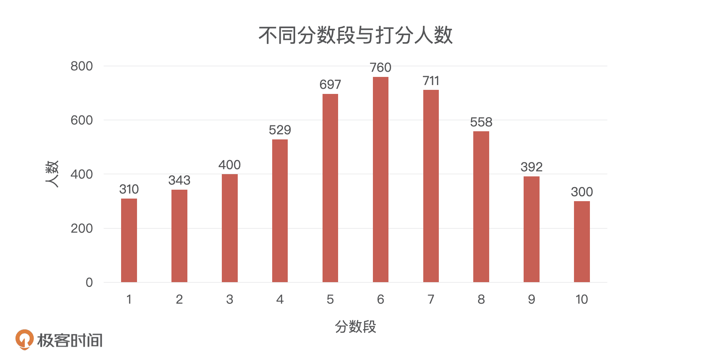
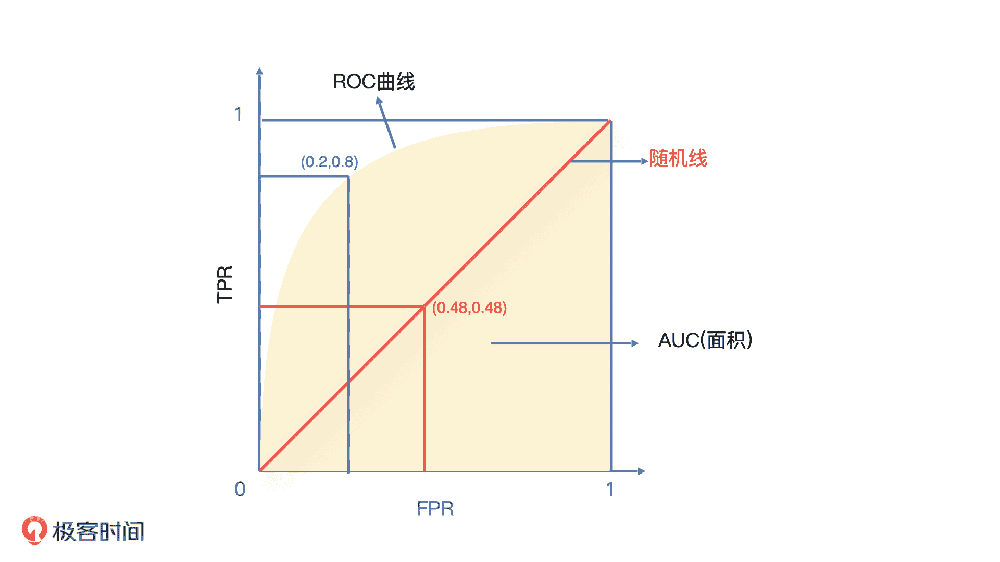
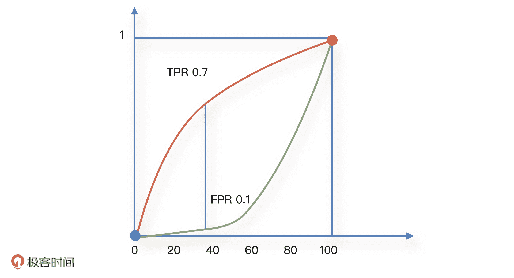
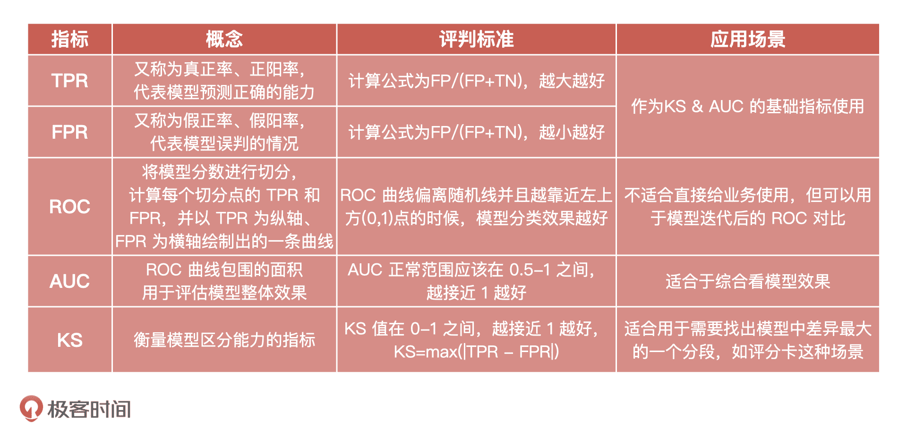
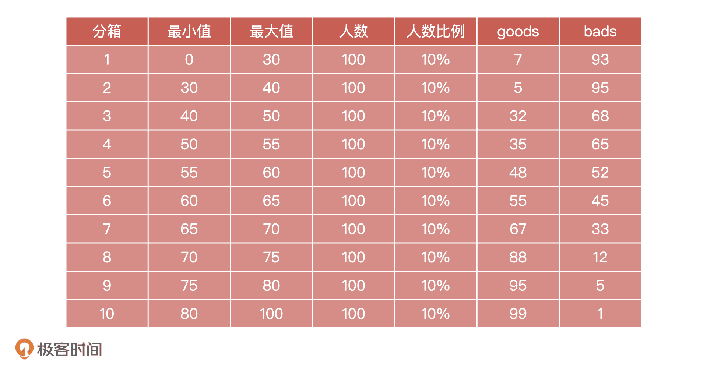

# 20 | 模型性能评估（二）：从信用评分产品看什么是KS、AUC？

 

你好，我是海丰。

上节课，我们学习了混淆矩阵，以及准确率、精确率和召回率这 3 个基础指标的计算。这节课，我们依然会借助上节课的信用评估模型，来学习二分类模型中常用的两个综合性指标，KS 和 AUC。

## 构建 KS 和 AUC 的基础：TPR 和 FPR

首先，我们来看两个基础指标：TPR 和 FPR，它们是计算 KS 和 AUC 的基础指标。

在信用评分模型中，TPR（True Positive Rate）代表模型找到真坏人（对应混淆矩阵中的 TP）占实际坏人（TP+FN）的比例，它的计算公式为 TPR=TP/(TP+FN)。一般来说，这个指标被称为：真正率、真阳率，用来评估模型正确预测的能力。不过，因为它的计算公式和召回率是一样的，所以为了方便我们也经常叫它召回率。

FPR（False Positive Rate）代表模型误伤（认为是坏人，实际是好人）的人占总体好人的比例，它的计算公式为 FPR=FP/(FP+TN)。一般来说，这个指标被称为：假正率、假阳率，它用来评估模型误判的比率或者误伤的比率，为了方便我们也叫它误伤率。

那这两个指标是怎么构建 KS 和 AUC 的呢？别着急，我们慢慢往下看。

## ROC 曲线绘制和 AUC 的计算

在实际工作中，我们最希望的模型一定是找到的坏人足够多，并且误伤的好人足够少，也就是 TPR 尽量高、FPR 尽量低。为了形象地表达它们之间的关系，我们引入了 ROC 曲线。

那么，ROC 曲线具体是怎么得到呢？

这里，我们先来回顾一下上节课的信用评分模型，这个模型的分数范围是[0,100]。算法团队给出的参考阈值（60 分），我们根据它对模型进行了简单的划分，得到了混淆矩阵以及相应的召回率等指标。

如果我们没有这个阈值呢？实际上，我们在模型分数的每一个点上都可以做这样的划分（也就是把每一个分数点都当作是一个阈值），这样就可以得到一连串的指标。想想都知道，对所有分数进行划分会非常麻烦。虽然不能对所有分数进行划分，但是我们可以对分数进行分段处理。比如说，我们的打分人数有 5000 人，我们按照每 10 分进行一个分段，就能得到下面这张图。

结合上面的图，我们可以分 3 种情况进行讨论。

**第一种情况是一种极端情况：阈值定在 0 分上，小于 0 的是坏人，大于 0 的是好人。** 这个时候，虽然 0 分以下没有任何人，但是我们仍然可以得到相应的混淆矩阵，也就可以得到对应的 TPR 和 FPR。

这个时候的 TPR 是多少呢？我们不需要计算，根据定义思考一下就知道了。因为模型只有[0,100]，没有人的打分是小于 0 的，这也就意味着模型没有分辨出任何一个坏人，所有人都是好人，找坏人的能力 TPR 就是 0。

那么，FPR 是多少呢？同样的，因为模型认为没有人是坏人，所以它没有产生任何一个误伤，误伤率 FPR 就是 0。

**第二种情况也是一个极端的情况：阈值定在 100 分，小于 100 分都是坏人，大于 100 分都是好人。** 这个时候，模型会认为所有人都是坏人，所以模型能找到所有的坏人，TPR=1。同理，模型把所有人都当成了坏人，就相当于误伤了所有的好人，所以 FPR=1。

**第三种情况是正常情况：阈值定在一个非 0 分和非 100 分的分数上，如 60 分。** 那么，TPR 和 FPR 分别会得到一个在 0-1 范围内的值，如 TPR=0.8，FPR=0.2。

同样的，我们也可以把这个阈值分别定在 10 分、20 分、30 分这些点位上，就会得到一连串的 TPR 和 FPR。如果我们把 FPR 做横轴，TPR 做纵轴，一个 TPR 和 FPR 就对应了一个点。当把这些点都连起来之后，我们就可以得到如下一条蓝色的曲线：

**总的来说，ROC 曲线就是在没有准确阈值的情况下，对所有分数进行分段处理，计算每一个切分点对应的 TPR 和 FPR，以 FPR 做横轴、TPR 做纵轴绘制出的一条曲线。**

除了蓝线，我们看到图中还有一条红线，它是一条随机线，这条随机线上的每一个切分点的 FPR 和 FPR 都是相等的。它表示模型每次切分时，抓到坏人的概率和误伤好人的概率都是一样的。这和我们随机猜测的概率相同，所以模型的 ROC 曲线越贴近这条随机线，模型的分类效果就越差。甚至，如果 ROC 曲线在随机线下面，就说明模型预测结果和我们预期结果是反的，而当 ROC 曲线越偏离随机线并且靠近左上方 (0,1) 点的时候，说明模型分类效果越好，因为这个时候，模型的 TPR=1，FPR=0。

虽然，我们通过 ROC 曲线可以区分模型的好坏，但这还不够直观，而且和业务方沟通时候，我们也不能直接让他们去看这张图。

因此我们想到，是不是可以把曲线右下方和横坐标轴闭合起来的面积作为一个评估指标。这个面积就是我们图上蓝色的阴影部分，它就是 AUC 指标。一般来说 AUC 都在 0.5 到 1 之间，AUC 越高代表模型的区分能力越好。如果 AUC=0.5，那 ROC 曲线与图中红线重合，表示模型没有区分能力，它的结果等于随机猜测；如果 AUC 小于 0.5，说明这个模型大概率很差。

## KS 的计算

现在我们知道了 AUC 是什么，那么 KS 又是什么呢？其实，KS 曲线和 ROC 曲线的本质和数据的来源都是一致的。只不过，**ROC 代表的是模型召回率和误伤率之间的变化关系，KS 代表的是在某一点上，模型召回率最大并且误伤率最小**。

因此，我们在绘制 ROC 曲线的时候，是用召回率和误伤率来做纵轴和横轴，而在绘制 KS 曲线的时候，我们把召回率和误伤率都作为纵轴，把切分的分数点作为横轴。这个时候，一个切分点会同时得到 TPR 和 FPR 两个值，所以我们可以画出来两条曲线。具体是怎么操作的呢

我们还是以[0,100]的模型分数范围为例，每 10 分做一个分段（如 0 分是一个切分点，10 分是一个切分点，20 分是一个切分点....），在每一个切分点上，我们都可以得到一对 TPR 和 FPR。

对于得到的 TPR 和 FPR，我们也可以和刚才一样，分三种情况讨论。

第一种情况，切分点在 0。这个时候，模型认为没有任何人是坏人，所以 TPR = 0，FPR 也是 0。因此，在横坐标 0 这个点上，我们得到了两个数值相同的点，也就是图上左下角蓝色的点。

第二种情况，切分点在 100。这个时候，TPR 和 FPR 都是 1，所以得到右上角橘色的点。

第三种情况，切分点非 0、非 100。假设，我们还是以 60 分作为切分点，也会得到一对 TPR 和 FPR。

就这样，等我们把所有切分点遍历之后，就能得到所有切分点的 TPR 和 FPR 值。然后，我们把它们放到坐标系中，把得到的 TPR 和 FPR 的值分别连接起来，就能得到两条曲线。这个坐标系的横轴就是我们对信用评分的切分点，如果我们信用分是[0,100]范围，那它就是从 0 到 100 的数值。

如下图所示，红色线是我们在不同的切分点得到的所有 TPR 的曲线，绿色线是相应的 FPR 曲线。它们在（0，0）和（100，1）这两个点相交。

**由于 KS 代表的是在某一点上，模型召回率最大同时误伤率最小，所以 KS 就是图中红色线和绿色线间隔最大时候的距离。**

如图，TPR 和 FPR 在切分点为 40 的时候距离最大，这就意味着当我们拒绝给 40 分以下的人进行贷款，同时通过 40 分以上的人的信贷请求时，业务的收益最大。这是因为，我们拒绝了足够多的坏人，同时误伤了足够少的好人。那么，KS 就是在这个点上，TPR-FPR 的数值了。

具体到图中，KS = 0.7- 0.1=0.6，所以我们这个模型的 KS 就是 0.6。在实际业务中也有人会说“我们 KS 是 60”，这也是正常的。

那么，对于信用评分产品来说，KS 指标是多少才合适呢？对于用于贷前审批的信用评分（申请评分卡）模型来说，一般业内会分为 4 种情况：

1. KS<20：欠拟合，模型基本不具备可用性
2. KS>20&KS<30：模型可用
3. KS>30&KS<40：模型预测能力优秀
4. KS>40：模型的区分度很高。但同时我们也要对这个结果持怀疑态度，进一步去分析入模变量中是否有一些滞后变量，来确认结果的准确性

总的来说，如果模型的 KS 或者 AUC 值很高，不一定是一件好事情。我们需要了解背后的原因，这有可能是数据不准确导致的。比如，在贷前信用评分场景下，KS 值大于 50 或者 AUC 大于 80 时，我们就需要注意一下数据的准确性了。

## 小结

这节课，我们讲了分类模型评估的进阶指标：KS 和 AUC，它们是我们在模型评估中用得比较多的指标。围绕它们的构建，我们又讲了 TPR、FPR 和 ROC 曲线，为了方便你记忆和对比，我把它们的核心概念、公式适用场景都总结在了下面的表格中，你可以看看。

这两节课，我们以一个信用评估模型的例子，讲完了分类模型的评估。总的来说，不同类型和不同公司的 AI 产品经理需要掌握的评估能力可能不同。

比如说，应用层的 AI 产品经理可能只需要知道召回率、精确率这些就可以了。但是，B 端做金融风控模型的产品经理，就需要知道 KS 是什么，它是怎么来的，甚至要学会看不同测试集下面的 KS 是否合理。

就像我之前遇到一个情况：OOT 测试的 KS 是 40，测试集的 KS 是 39，训练集的 KS 是 35。虽然我们用的都是真实数据，但结果依然不合理，如果我把这样的结果交付给客户，客户不只会质疑我的专业程度，更有可能怀疑我们公司的技术能力。

因此，我们只有确定好自己要努力的目标，才能知道这些内容自己要掌握哪些，掌握到什么程度，比如做互联网应用的产品经理一般掌握召回率、准确率、AUC 这些指标就可以完成大部分的工作了。当然，如果你想全面系统化地学习 AI 技术，那么尽可能地拓展自己的知识面总没有错。

## 课后讨论

在这里，我想请你尝试手动计算一下 KS 值。虽然实际工作中我们不需要手工计算，但是我希望你可以通过本次课后题，加深对 KS 的理解。

下面是我们一个信用评分产品的测试数据，我已经将分数做好了分箱（我这里使用了等频分箱），并且得到了好、坏用户的数量（goods,bads），请你计算这个产品的 KS 值是多少。

期待在留言区看到你的分享和答案，我们下节课见！
