# 复习课（三） | 团队建设

 

---

继上一篇的“**管理规划**”之后，接下来我们继续来复习“管理方法论”的另外一个方面：**团队建设**。

### （三）团队建设

如何带好团队呢？

这里依然类比“马车模型”，如何让“马队”跑得动、跑得快、跑得远呢？

可以将“马队”拆解为：**“马匹个体”“马匹之间”“马队整体”**。那对应地，团队也可拆解为：**“员工个体”“员工个体之间”“团队整体”**。类比分析后，有如下：

 
1. 马匹个体：力气 + 意愿 **VS** 员工个体：能力 + 意愿 
2. 马匹之间：阵型 + 节奏 **VS** 员工之间：分工 + 协作 
3. 马队整体：构成 + 面貌 **VS** 团队整体：梯队 + 文化 

所以，就可以得出如下“团队建设全透视图”，也引出**能力、激励、分工、协作、梯队**和**文化**6 个维度的工作要素。

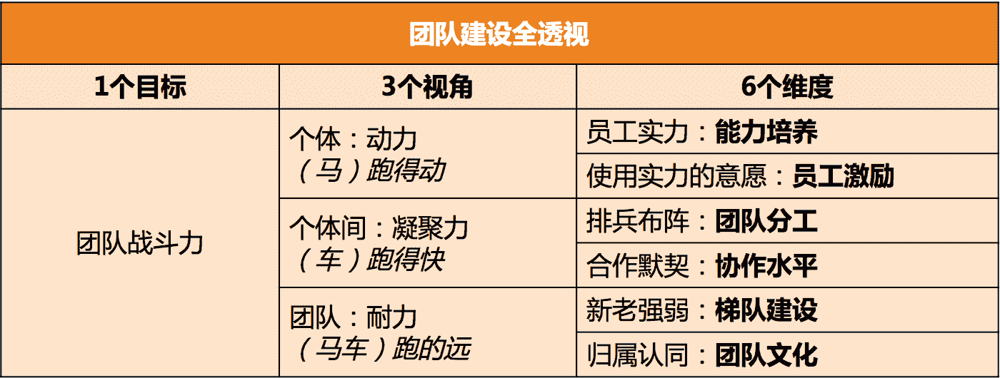

（来自[第 16 篇《团队建设该从哪里入手？》](https://time.geekbang.org/column/article/40043)）

**1. 员工能力**

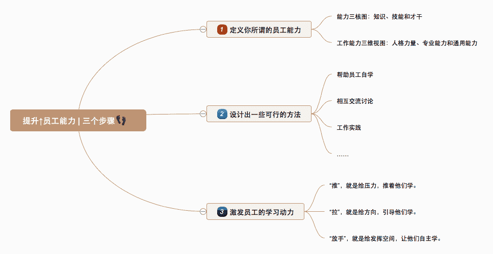

总结自[第 17 篇《如何提升员工的个人能力？》](https://time.geekbang.org/column/article/40277)

**2. 员工激励**

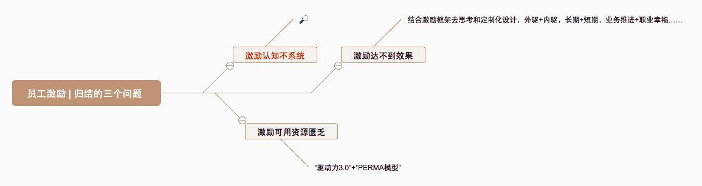

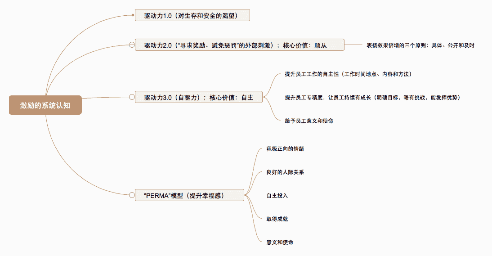

总结自[第 18 篇《如何提升员工的工作意愿和积极性？》](https://time.geekbang.org/column/article/40313)

**3. 团队分工**

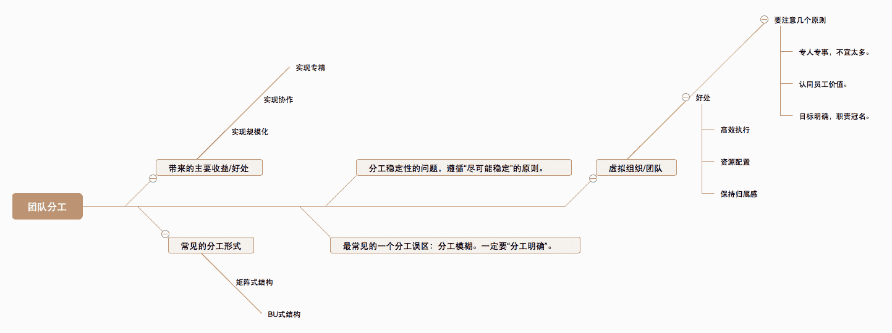

总结自[第 19 篇《如何兼顾团队分工的稳定性和灵活性？》](https://time.geekbang.org/column/article/40513)

**4. 团队协作**

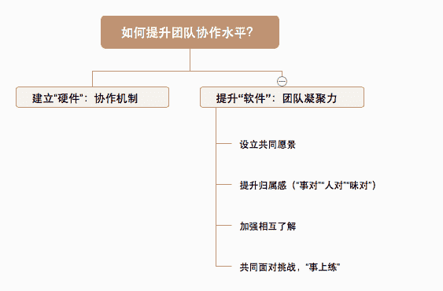

总结自[第 20 篇《有什么方法可以有效提升团队凝聚力吗？》](https://time.geekbang.org/column/article/40516)

**5. 梯队培养**

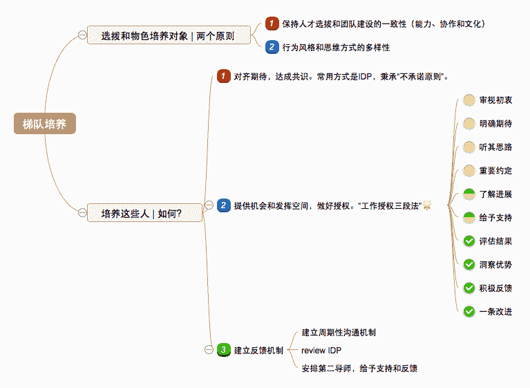

总结自[第 21 篇《如何物色和培养核心人才？》](https://time.geekbang.org/column/article/40771)

**6. 团队文化**

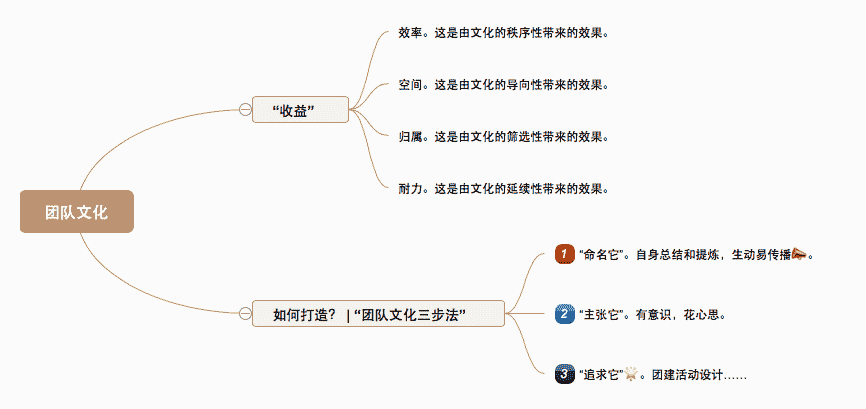

总结自[第 22 篇《如何建设团队文化，营造团队氛围？》](https://time.geekbang.org/column/article/40772)

**7. 场景 1，绩效沟通**

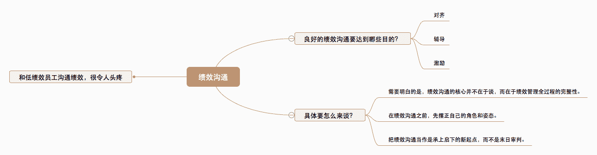

总结自[第 23 篇《如何和低绩效员工谈绩效？》](https://time.geekbang.org/column/article/40776)

**8. 场景 2，团建活动**

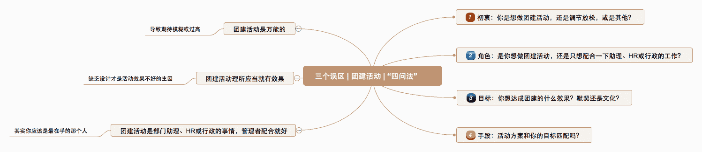

总结自[第 24 篇《如何让团建活动不再“收效甚微”？》](https://time.geekbang.org/column/article/40780)

至此我们就复习完了团队建设的全部 6 个要素：**能力、激励、分工、协作、梯队**和**文化**，以及相关的两个工作场景：**绩效沟通**和**团建活动**。详细内容也可戳文中所附的链接。

---

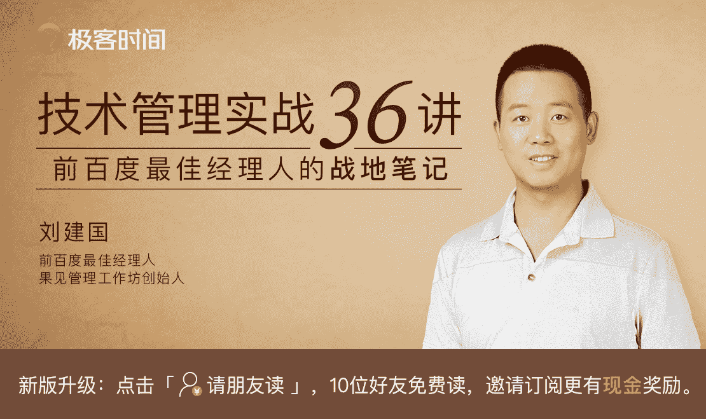
