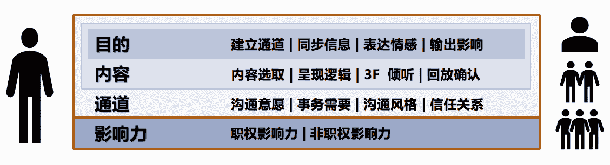
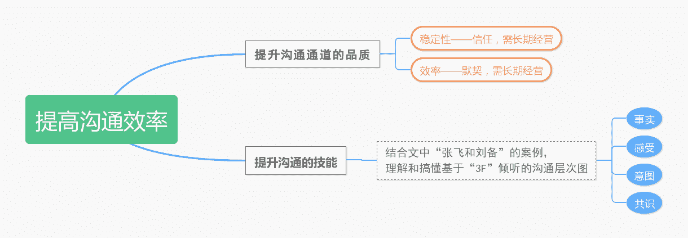
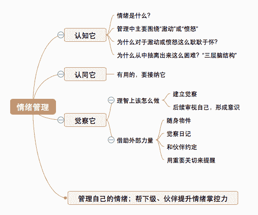
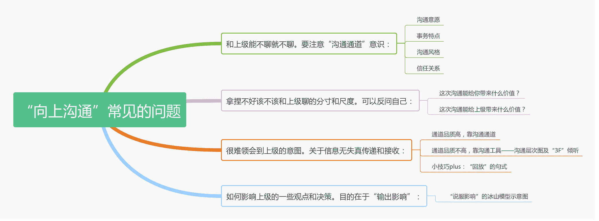
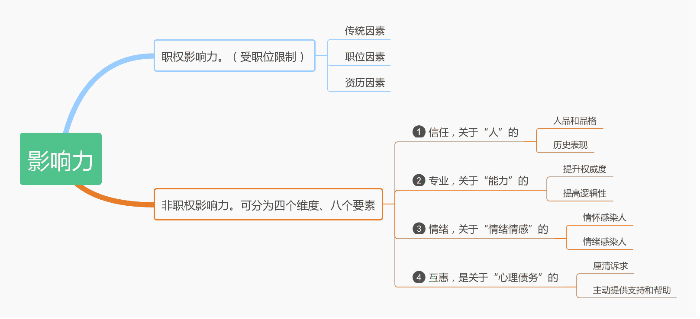
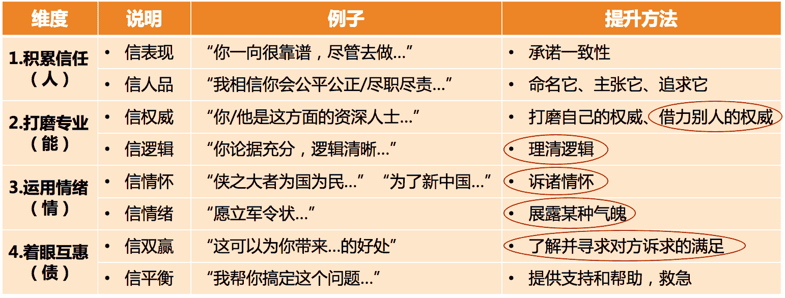
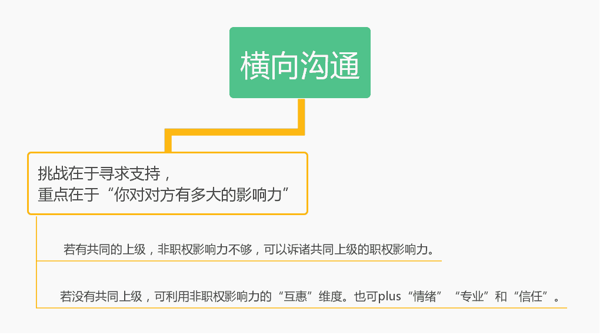
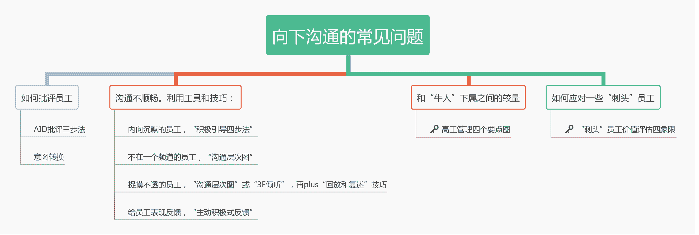
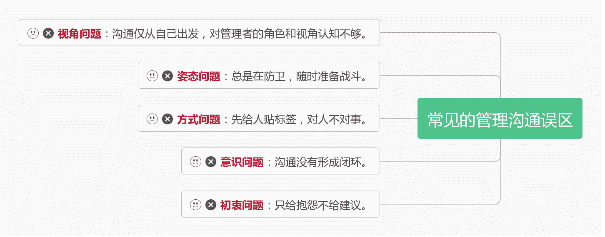

# 复习课（五） | 管理沟通

 

---

继上一篇的“**任务管理**”之后，接下来我们继续来复习“管理方法论”的最后一个方面：**管理沟通**。

### （五）管理沟通

管理沟通是技术管理者心中当之无愧的“最具挑战管理主题 NO.1”。（我个人觉得这个主题之于其他行业的管理者应该也是一个棘手的挑战吧。）

**1. 管理沟通框架图**

之于技术管理者，这挑战的主因是确定性和规则性的减弱，不确定性的大幅度上升。为了让管理沟通这事儿不那么“飘逸”，有迹可循，作者从和人沟通这个不稳定的工作之中，提取出了一些稳定的因素，为我们总结和构建了下面这个“管理沟通框架图”，分为目的、内容、通道和影响力四部分。  
 

“果见管理沟通框架”

从中，我们也可以看到在沟通这个不稳定的事物中，管理逻辑、沟通通道、工具流程和影响力这四个因素是稳定的，是我们可以依靠和突破的。

总结自[第 28 篇《管理沟通那些事儿》](https://time.geekbang.org/column/article/41968)

**2. 沟通层次图**

总结自[第 29 篇《沟通经常鸡同鸭讲，说不到一块怎么办？》](https://time.geekbang.org/column/article/42064)

**3. 情绪管理**

总结自[第 30 篇《如何掌控自己的情绪，以及如何管理情绪化的员工？》](https://time.geekbang.org/column/article/42393)

**4. 向上沟通**

总结自[第 31 篇《我各方面做得都很好，就是做不好向上沟通》](https://time.geekbang.org/column/article/42582)

**5. 影响力**

总结自[第 32 篇《横向沟通和非职权影响力》](https://time.geekbang.org/column/article/42770)

但关于“非职权影响力”，我更喜欢下面作者“带有灵魂”的总结“提升非职权影响力的方法”（表中红圈圈出来的部分是一些短时间内可以提升的影响力）：

**6. 横向沟通**

总结自[第 32 篇《横向沟通和非职权影响力》](https://time.geekbang.org/column/article/42770)

**7. 向下沟通**

总结自[第 33 篇《向下沟通的常见实例解析》](https://time.geekbang.org/column/article/42904)

**8. 常见的管理沟通误区**

总结自[第 34 篇《管理沟通上有哪些常见的坑儿呢？》](https://time.geekbang.org/column/article/64371)

至此我们就系统地复习完了管理方法论的五大方面：**角色认知、管理规划、团队建设、任务管理**和**管理沟通**。就此我所总结的思维导图也只是将文章中的某些“骨架”或“关节点”抽取出来，可能也只是帮助你有个大的逻辑思维框架的提示，至于其中的“血肉”和“灵魂”还是很建议你仔细研读原文的（详细内容可戳文中所附的链接），然后系统地积累自己的方法论，收获属于自己的精彩。

最后附上专栏文章中我很喜欢的一句话：“**生活就是这样，如果你不主动去争取你想要的，你就不得不接受一些你不想要的。因此，主动规划自己的管理之路，让我们对未来的发展有更多的掌控感，是很有必要的**。”与君共勉！

---

