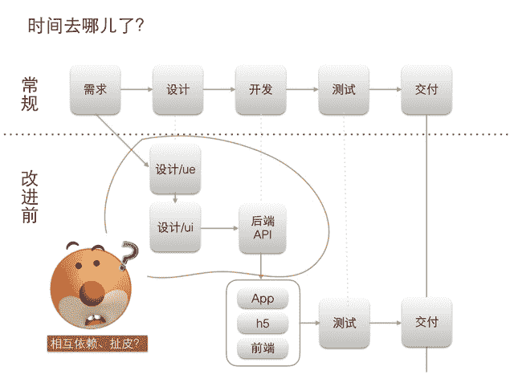
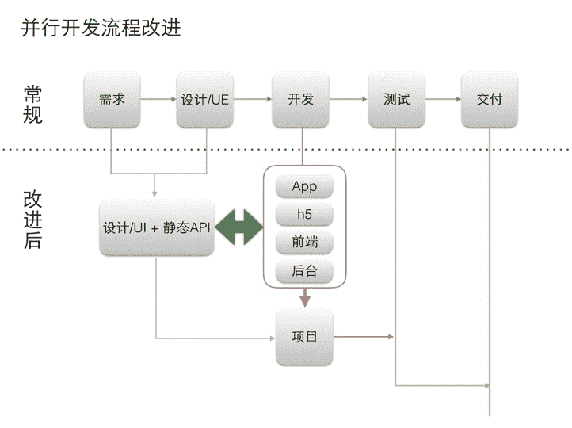
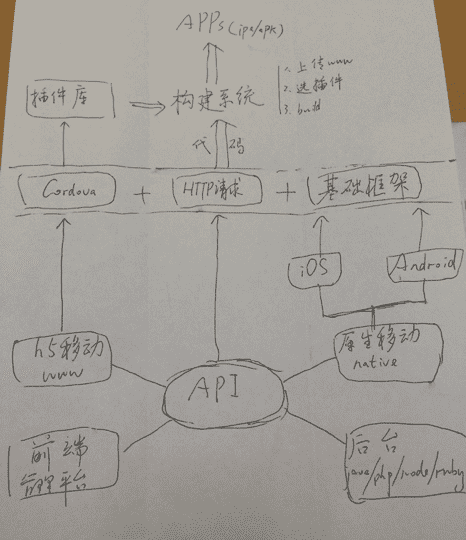
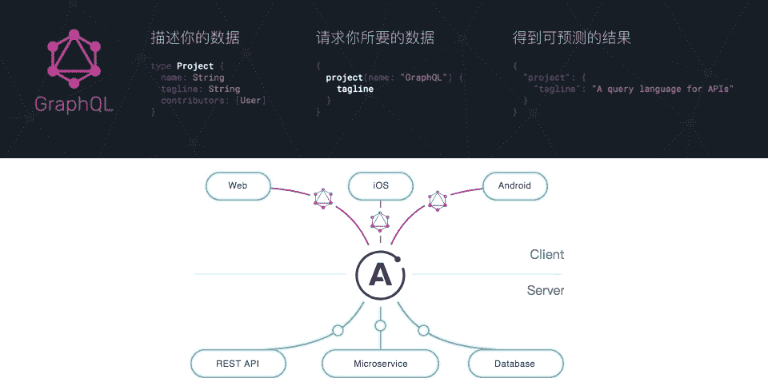
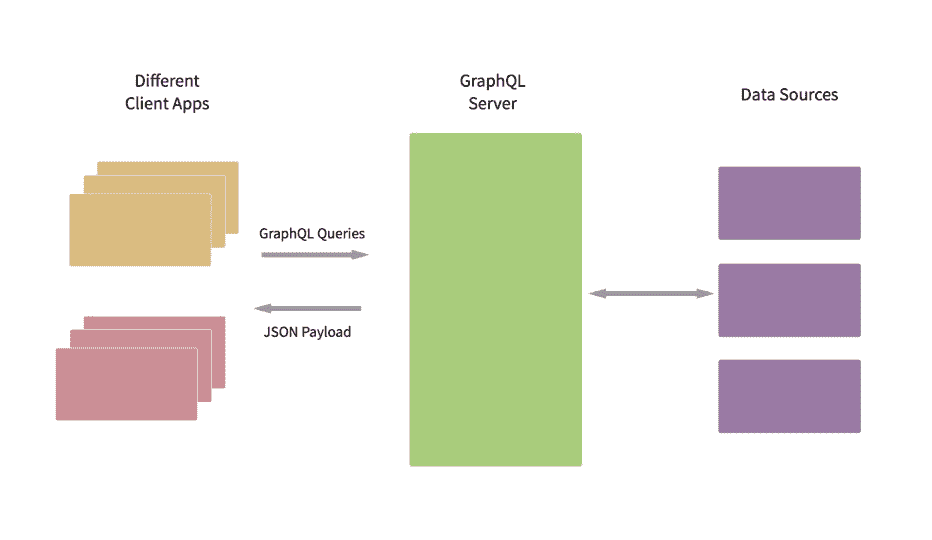
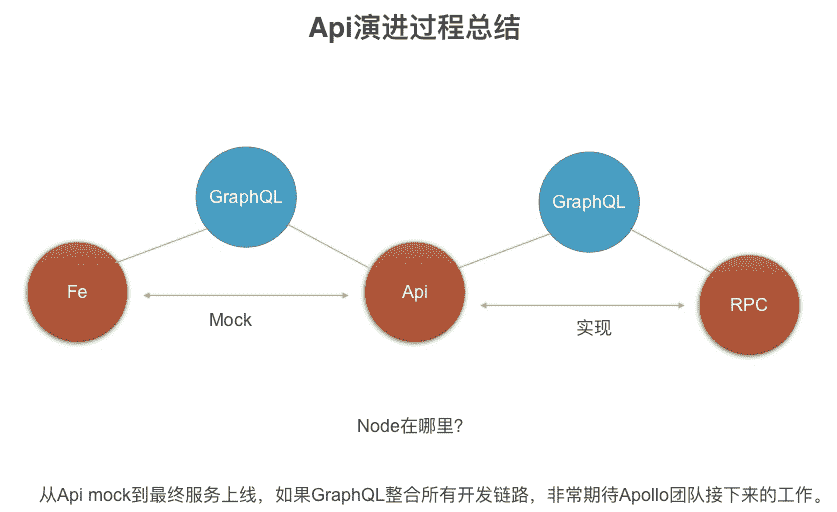
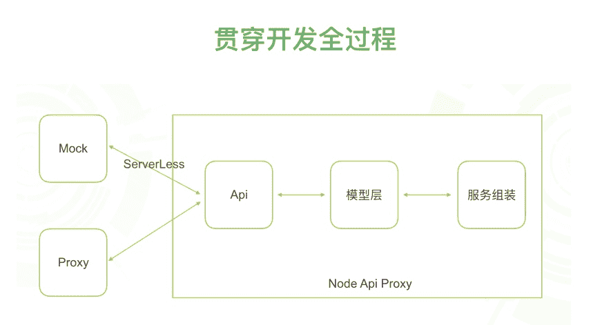
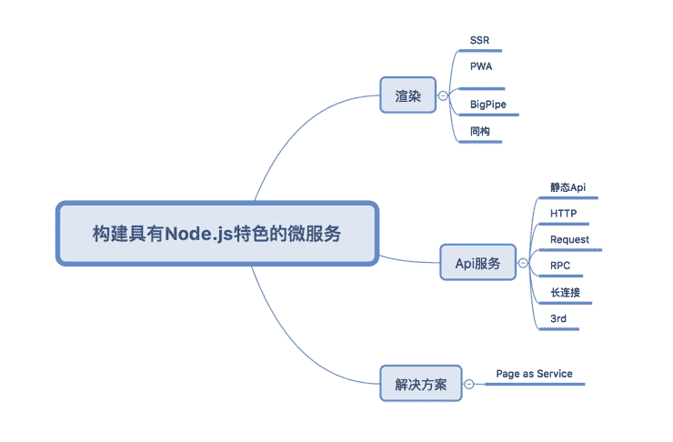
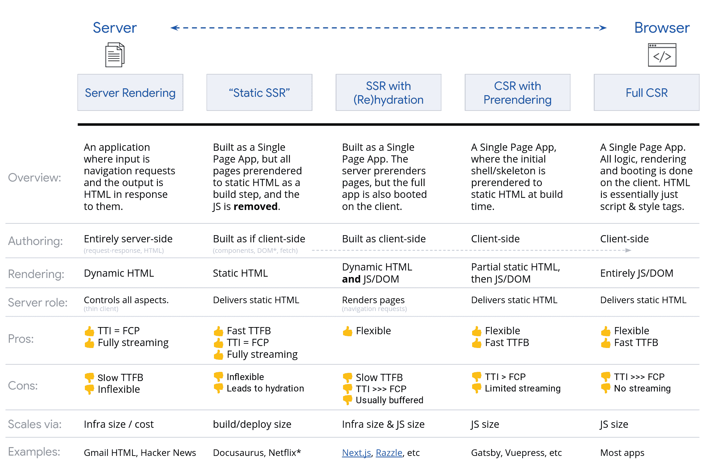

# 第189讲 | 狼叔：2019年前端和Node的未来—Node.js篇（上）

 

你好，我是阿里巴巴前端技术专家狼叔，前两篇文章，我分享了大前端的现状和未来，接下来的两篇文章，我将会注重分享一些跟 Node.js 结合比较密切的点。

## Node.js

Node.js 在大前端布局里意义重大，除了基本构建和 Web 服务外，这里我还想讲 2 点。首先它打破了原有的前端边界，之前应用开发只分前端和 API 开发。但通过引入 Node.js 做 BFF 这样的 API proxy 中间层，使得 API 开发也成了前端的工作范围，让后端同学专注于开发 RPC 服务，很明显这样明确的分工是极好的。其次，在前端开发过程中，有很多问题不依赖服务器端是做不到的，比如场景的性能优化，在使用 React 后，导致 bundle 过大，首屏渲染时间过长，而且存在 SEO 问题，这时候使用 Node.js 做 SSR 就是非常好的。当然，前端开发 Node.js 还是存在一些成本，要了解运维等，会略微复杂一些，不过也有解决方案，比如 Servlerless 就可以降级运维成本，又能完成前端开发。直白点讲，在已有 Node.js 拓展的边界内，降级运维成本，提高开发的灵活性，这一定会是一个大趋势。

2018 年 Node.js 发展的非常好，InfoQ 曾翻译过一篇文章《2018 Node.js 用户调查报告显示社区仍然在快速成长》。2018 年 5 月 31 日，Node.js 基金会发布了 2018 年用户调查报告，涵盖了来自 100 多个国家 1600 多名参与者的意见。报告显示，Node.js 的使用量仍然在快速增长，超过¾的参与者期望在来年扩展他们的使用场景，另外和 2017 年的报告相比，Node 的易学程度有了大幅提升。

该调查远非 Node 快速增长的唯一指征。根据 ModuleCounts.com 的数据，Node 的包注册中心 NPM 每天会增加 507 个包，相比下一名要多 4 倍多。2018 年 Stack Overflow 调查也有类似的结果，JavaScript 是使用最广泛的语言，Node.js 是使用最广泛的框架。

本节我会主要分享一些跟 Node.js 结合比较密切的点：首先介绍一下 API 演进与 GraphQL，然后讲一下 SSR 如何结合 API 落地，构建出具有 Node.js 特色的服务，然后再简要介绍下 Node.js 的新特性、新书等，最后聊聊我对  
 Deno 的一点看法。

### API 演进与看起来较火的 GraphQL

书本上的软件工程在互联网高速发展的今天已经不那么适用了，尤其是移动开发火起来之后，所有企业都崇尚敏捷开发，快鱼吃慢鱼，甚至觉得 2 周发一个迭代版本都慢，后面组件化和热更新就是这样产生的。综上种种，我们对传统的软件工程势必要重新思考，如何提高开发和产品迭代效率成为重中之重。

先反思一下，开发为什么不那么高效？

从传统软件开发过程中，可以看到，需求提出后，先要设计出 ui/ue，然后后端写接口，再然后 APP、H5 和前端这 3 端才能开始开发，所以串行的流程效率极低。



于是就有了 mock api 的概念。通过静态 API 模拟，使得需求和 ue 出来之后，就能确定静态 API，造一些模拟数据，这样 3 端 + 后端就可以同时开发了。这曾经是提效的非常简单直接的方式。



静态 API 实现有很多种方式，比如简单的基于 Express / Koa 这样的成熟框架，也可以采用专门的静态 API 框架，比如著名的 [typicode/json-server](https://github.com/typicode/json-server)，想实现 REST API，你只需要编辑 db.json，放入你的数据即可。

```
{  "posts": [    { "id": 1, "title": "json-server", "author": "typicode" }  ],  "comments": [    { "id": 1, "body": "some comment", "postId": 1 }  ],  "profile": { "name": "typicode" }}
```

启动服务器

```
$ json-server --watch db.json
```

此时访问网址 `http://localhost:3000/posts/1`，即我们刚才仿造的静态 API 接口，返回数据如下：

```
{ "id": 1, "title": "json-server", "author": "typicode" }
```

还有更好的解决方案，比如 YApi ，它是一个可本地部署的、打通前后端及 QA 的、可视化的接口管理平台（[http://yapi.demo.qunar.com/](http://yapi.demo.qunar.com/) ）。

其实，围绕 API 我们可以做非常多的事儿，比如根据 API 生成请求，对服务器进行反向压测，甚至是 check 后端接口是否异常等。很明显，这对前端来说是极其友好的。下面是我几年前画的图，列出了我们能围绕 API 做的事儿，至今也不算过时。



通过社区，我们可以了解到当下主流的 API 演进过程。

1.GitHub v3 的[restful api](https://developer.github.com/v3/)，经典 rest；  
 2.[微博 API](https://open.weibo.com/wiki/%E5%BE%AE%E5%8D%9AAPI)，非常传统的 json 约定方式；  
 3. 在 GitHub 的 v4 版本里，使用 GraphQL 来构建 API，这也是个趋势。

GraphQL 目前看起来比较火，那 GitHub 使用 GraphQL 到底解决的是什么问题呢？

>  
> GraphQL 既是一种用于 API 的查询语言也是一个满足你数据查询的运行时
 

下面看一个最简单的例子：

 
- 首先定义一个模型； 
- 然后请求你想要的数据； 
- 最后返回结果。 

很明显，这和静态 API 模拟是一样的流程。但 GraphQL 要更强大一些，它可以将这些模型和定义好的 API 和后端很好的集成。于是 GraphQL 就统一了静态 API 模拟和和后端集成。



开发者要做的，只是约定模型和 API 查询方法。前后端开发者都遵守一样的模型开发约定，这样就可以简化沟通过程，让开发更高效。



如上图所示，GraphQL Server 前面部分，就是静态 API 模拟。GraphQL Server 后面部分就是与各种数据源进行集成，无论是 API、数据还是微服务。是不是很强大？

下面我们总结一下 API 的演进过程。

传统方式：Fe 模拟静态 API，后端参照静态 API 去实习 rpc 服务。

时髦的方式：有了 GraphQL 之后，直接在 GraphQL 上编写模型，通过 GraphQL 提供静态 API，省去了之前开发者自己模拟 API 的问题。有了 GraphQL 模型和查询，使用 GraphQL 提供的后端集成方式，后端集成更简单，于是 GraphQL 成了前后端解耦的桥梁。集成使用的就是基于 Apollo 团队的 GraphQL 全栈解决方案，从后端到前端提供了对应的 lib ，使得前后端开发者使用 GraphQL 更加的方便。



GraphQL 本身是好东西，和 Rest 一样，我的担心是落地不一定那么容易，毕竟接受约定和规范是很麻烦的一件事儿。可是不做，又怎么能进步呢？

### 构建具有 Node.js 特色的服务



2018 年，有一个出乎意料的一个实践，就是在浏览器可以直接调用 grpc 服务。RPC 服务暴漏 HTTP 接口，这事儿 API 网关就可以做到。事实上，gRPC-Web 也是这样做的。

如果只是简单透传，意义不大。大多数情况，我们还是要在 Node.js 端做服务聚合，继而为不同端提供不一样的 API。这是比较典型的 API Proxy 用法，当然也可以叫 BFF(backend for frontend)。

从前端角度看，渲染和 API 是两大部分，API 部分前端自己做有两点好处：1. 前端更了解前端需求，尤其是根据 ui/ue 设计 API；2. 让后端更专注于服务，而非 API。需求变更，能不折腾后端就尽量不要去折腾后端。这也是应变的最好办法。

构建具有 Node.js 特色的微服务，也主要从 API 和渲染两部分着手为主。如果说能算得上创新的，那就是 API 和渲染如何无缝结合，让前端开发有更好的效率和体验。



### Server Side Render

尽管 Node.js 中间层可以将 RPC 服务聚合成 API，但前端还是前端，API 还是 API。那么如何能够让它们连接到一起呢？比较好的方式就是通过 SSR 进行同构开发。服务端创新有限，搞来搞去就是不断的升 v8，提升性能，新东西不多。今天我最头疼的是，被 Vue/React/Angular 三大框架绑定，喜忧参半，既想用组件化和双向绑定（或者说不得不用），又希望保留足够的灵活性。大家都知道 SSR 因为事件 /timer 和过长的响应时间而无法有很高的 QPS（够用，优化难），而且对 API 聚合处理也不是很爽。更尴尬的是 SSR 下做前后端分离难受，不做也难受，到底想让人咋样？

对于任何新技术都是一样的，不上是等死，上了是找死。目前是在找死的路上努力的找一种更舒服的死法。



目前，我们主要采用 React 做 SSR 开发，上图中的 5 个步骤都经历过了（留到 QCon 广州场分享），这里简单介绍一下 React SSR。React 16 现在支持直接渲染到节点流。渲染到流可以减少你内容的第一个字节（TTFB）的时间，在文档的下一部分生成之前，将文档的开头至结尾发送到浏览器。当内容从服务器流式传输时，浏览器将开始解析 HTML 文档。渲染到流的另一个好处是能够响应背压。 实际上，这意味着如果网络被备份并且不能接受更多的字节，那么渲染器会获得信号并暂停渲染，直到堵塞清除。这意味着你的服务器会使用更少的内存，并更加适应 I / O 条件，这两者都可以帮助你的服务器拥有具有挑战性的条件。

在 Node.js 里，HTTP 是采用 Stream 实现的，React SSR 可以很好的和 Stream 结合。比如下面这个例子，分 3 步向浏览器进行响应。首先向浏览器写入基本布局 HTML，然后写入 React 组件`<MyPage/>`，然后写入`</div></body></html>`。

```
// 服务器端// using Expressimport { renderToNodeStream } from "react-dom/server"import MyPage from "./MyPage"app.get("/", (req, res) => {  res.write("<!DOCTYPE html><html><head><title>My Page</title></head><body>");  res.write("<div id='content'>");   const stream = renderToNodeStream(<MyPage/>);  stream.pipe(res, { end: false });  stream.on('end', () => {    res.write("</div></body></html>");    res.end();  });});
```

这段代码里需要注意`stream.pipe(res, { end: false })`，res 本身是 Stream，通过 pipe 和`<MyPage/>`返回的 stream 进行绑定，继而达到 React 组件嵌入到 HTTP 流的目的。

上面是服务器端的做法，与此同时，你还需要在浏览器端完成组件绑定工作。react-dom 里有 2 个方法，分别是 render 和 hydrate。由于这里采用 renderToNodeStream，和 hydrate 结合使用会更好。当 MyPage 组件的 html 片段写到浏览器里，你需要通过 hydrate 进行绑定，代码如下。

```
// 浏览器端import { hydrate } from "react-dom"import MyPage from "./MyPage"hydrate(<MyPage/>, document.getElementById("content"))
```

可是，如果有多个组件，需要写入多次流呢？使用 renderToString 就简单很多，普通模板的方式，流却使得这种玩法变得很麻烦。

伪代码

```
const stream1 = renderToNodeStream(<MyPage/>);const stream2 = renderToNodeStream(<MyTab/>); res.write(stream1)res.write(stream2)res.end()
```

核心设计是先写入布局，然后写入核心模块，然后再写入其他模块。

 
-  
 
  1. 布局 (大多数情况静态 html 直接吐出，有可能会有请求)； 
  
-  
 
  1. Main（大多数情况有请求）； 
  
-  
 
  1. Others。 
  

于是

```
class MyComponent extends React.Component {   fetch(){    // 获取数据  }   parse(){    // 解析，更新 state  }   render(){    ...  }}
```

在调用组件渲染之前，先获得 renderToNodeStream，然后执行 fetch 和 parse 方法，取到结果之后再将 Stream 写入到浏览器。当前端接收到这个组件编译后的 html 片段后，就可以根据 containerID 直接写入，当然如果需要，你也可以根据服务器端传过来的 data 进行定制。

前后端如何通信、服务端代码如何打包、css 如何直接插入、和 eggjs 如何集成，这是目前我主要做的事儿。对于 API 端已经很成熟，对于 SSR 简单的做法也是有的，比如 next.js 通过静态方法 getInitialProps 完成接口请求，但只适用比较简单的应用场景（一键切换 CSR 和 SSR，这点设计的确实是非常巧妙的）。但是如果想更灵活，处理更负责的项目，还是很有挑战的，需要实现上面更为复杂的模块抽象。在 2019 年，应该会补齐这块，为构建具有 Node.js 特色的服务再拿下一块高地。

小结一下，本文主要分享了 API 演进与 GraphQL，SSR 如何结合 API 落地，以及如何构建出具有 Node.js 特色的服务等前端与 Node.js 紧密相关的内容，下一篇文章中，我将主要分享一些 Node.js 的新特性，以及我对大前端、Node.js 未来的一点看法，欢迎继续关注，也欢迎留言与我多多交流。

## 作者简介

狼叔（网名 i5ting），现为阿里巴巴前端技术专家，Node.js 技术布道者，Node 全栈公众号运营者。曾就职于去哪儿、新浪、网秦，做过前端、后端、数据分析，是一名全栈技术的实践者，目前主要关注技术架构和团队梯队建设方向。即将出版《狼书》3 卷。


