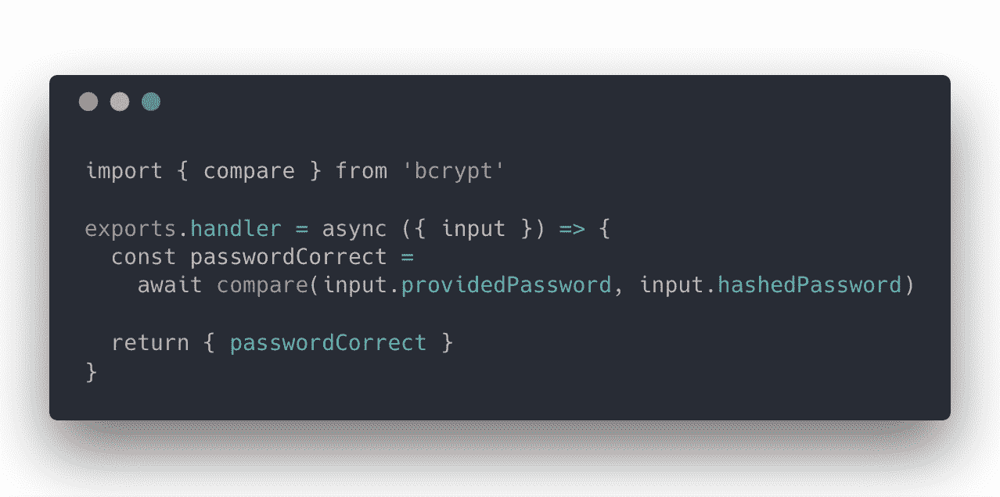
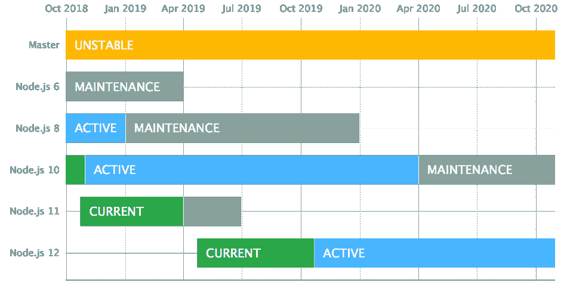
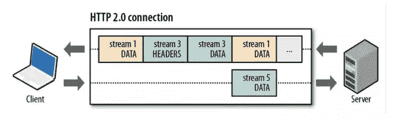
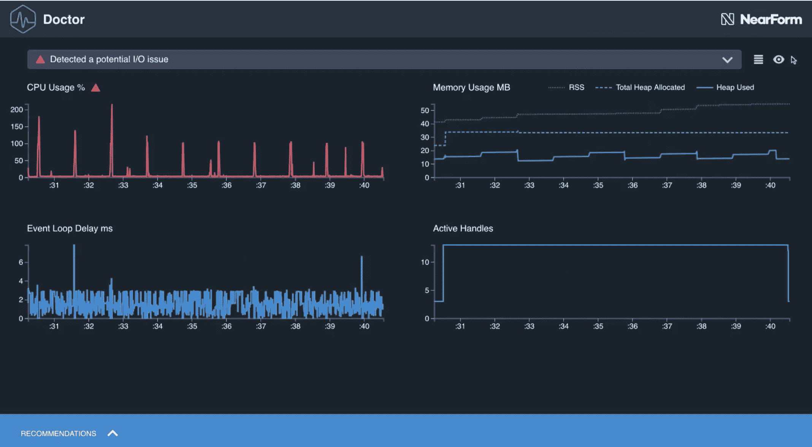
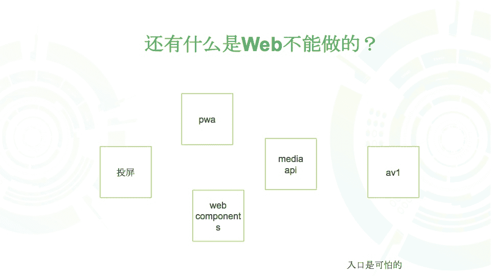
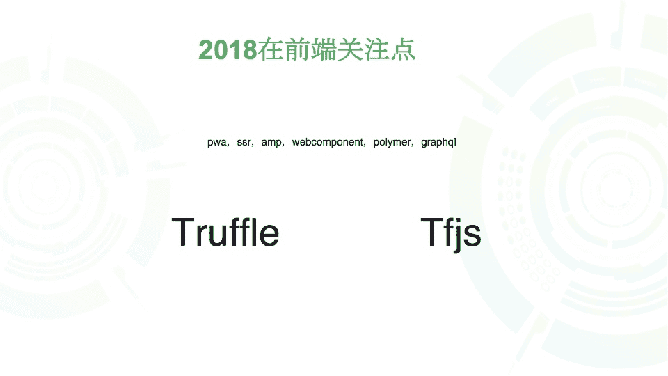

# 第190讲 | 狼叔：2019年前端和Node的未来—Node.js篇（下）

 

你好，我是阿里巴巴前端技术专家狼叔，今天是咱们大前端趋势系列的最后一篇文章，我将主要分享一些 Node.js 的新特性，以及我对大前端、Node.js 未来的一点看法，但在开始之前，我想先聊一聊 Serverless 这个当下很火，同时未来可期的技术。

### Serverless

简单地说，Serverless = FAAS + BaaS ，服务如果被认为是 Serverless 的，它必须无需显式地配置，并能自动调整扩缩容以及根据使用情况进行计费。云 function 是当今无 Serverless 计算中的通用元素，并引领着云的简化和通用编程模型发展的方向。2015 年亚马逊推出了一项名为 AWS Lambda 服务的新选项。Node.js 领域 TJ 大神去创业，开发了[http://apex.run](http://apex.run/)。目前，各大厂都在 Serverless 上发力，比如 Google、AWS、微软，阿里云等。


这里不得不提一下 Eventloop，Node.js 成也 Eventloop，败也 Eventloop，本身 Eventloop 是黑盒，开发将什么样的代码放进去你是很难全部覆盖的，偶尔会出现 Eventloop 阻塞的情况，排查起来极为痛苦。

而利用 Serverless，可以有效的防止 Eventloop 阻塞。比如加密，加密是常见场景，但本身的执行效率非常慢。如果加解密和你的其他任务放到一起，很容易导致 Eventloop 阻塞。



如果加解密服务是独立的服务呢？比如在 AWS 的 Lambda 上发布上面的代码，它自身是独立的，按需来动态扩容机器，可以去除 CPU 密集操作对 Node.js 的影响，快速响应流量变化。

这是趋势，对于活动类的尤其划算。你不知道什么时候是峰值，需要快速动态扩容能力，你也不会一直使用，按需付费更好。就算这个服务挂了，对其他业务也不会有什么影响，更不会出现阻塞 Eventloop 导致雪崩的情况。

 
- 可靠性：99.999999999% 
- 可用性：99.99% 
- 无限存储空间 
- 按量付费 

在前端领域，Serverless 会越来越受欢迎，除了能完成 API Proxy，BFF 这种功能外，还可以减少前端运维成本，还是可以期望一下的。

### Node.js 新特性

2018 年有一个大家玩坏的梗：想提升性能，最简单的办法就是升级到最新 LTS 版本。因为 Node.js 依赖 v8 引擎，每次 v8 发版优化，新版 Node.js 集成新版 v8，于是性能就被提升了。其他手段，比如使用 fast-json-stringify 加速 JSON 序列化，通过 Schema 知道每个字段的类型，那么就不需要遍历、识别字段类型，而是可以直接用序列化对应的字段，这就大大减少了计算开销，这就是 fast-json-stringfy 的原理，在某些情况下甚至可以比 JSON.stringify 快接近 10 倍左右。

在 2018 年，Node.js 非常稳定的前进着。下面看一下 Node.js 发版情况，2018-04-24 发布 Node.js v10，在 2018-10-23 发布 Node.js v11，稳步增长。下图是 Node.js 的发布计划。



可以看到，Node.js 非常稳定，API 也非常稳定，变化不大，一直紧跟 V8 升级的脚步，不断的提升性能。在新版本里，能够值得一说的，大概就只有 http2 的支持。

在 HTTP/2 里引入的新特性有：

1.Multiplexing 多路复用  
 2.Single Connection 每个源一个连接  
 3.Server Push 服务器端推送  
 4.Prioritization 请求优先级  
 5.Header Compression 头部压缩



目前，HTTP/2 已经开始落地，并且越来越稳定，高性能。HTTP/2 在 Node.js v8.4 里加入，在 Node.js v10 变为 Stable 状态，大家可以放心使用。示例代码如下。

```
const http2 = require('http2');const fs = require('fs');const server = http2.createSecureServer({  key: fs.readFileSync('localhost-privkey.pem'),  cert: fs.readFileSync('localhost-cert.pem')}); server.on('error', (err) => console.error(err));
```

其他比如 trace_events，async_hooks 等改进都比较小。Node.js 10 将 npm 从 5.7 更新到 v6，并且在 node 10 里增强了 ESM Modules 支持，但还是不是很方便（官方正在实现新的模块加载器），不过很多知名模块已经慢慢支持 ESM 特性了，一般在 package.json 里增加如下代码。

```
{    "jsnext:main": "index.mjs",}
```

另外异常处理，终于可以根据 code 来处理了。

```
try {// foo} catch (err) {if (err.code === 'ERR_ASSERTION') { . . . }else { . . . }}
```

最后再提 2 个模块：

1.node-clinic 性能调试神器（[https://clinicjs.org](https://clinicjs.org)）

这是一个 Node.js 性能问题的诊断工具，可以生成 CPU、内存使用、事件循环（Event loop) 延时和活跃的句柄的相关数据折线图。



2.Lowjs 使用 Node.js 去开发 IoT（[https://www.lowjs.org/）](https://www.lowjs.org/%EF%BC%89)

Node-RED 构建 IoT 很久前就有了，这里介绍一下 Lowjs。Low.js 是 Node.js 的改造版本，可以对低端操作有更好的支持。它是基于内嵌的对内存要求更低的 js 引擎 DukTape。Low.js 仅需使用不到 2MB 的硬盘和 1.5MB 的内存。

### Node.js 新书

这里想再分享两本 Node.js 新书。

第一本是赵坤写的《Node.js 调试指南（全彩）》（[https://item.jd.com/12356929.html），](https://item.jd.com/12356929.html%EF%BC%89%EF%BC%8C) 这本书从 CPU、内存、代码、工具、APM、日志、监控、应用这 8 个方面讲解如何调试 Node.js，大部分小节都会以一段经典的问题代码为例进行分析并给出解决方案。虽然内容比较散，但还是蛮有意思的一本书，属于进阶书。

第二本是吉姆·威尔逊（Jim，R.，Wilson）的《Node.js 开发实战》（[https://item.jd.com/12460185.html），](https://item.jd.com/12460185.html%EF%BC%89%EF%BC%8C) 书中主要是 Node.js 新特性汇总，是 2018 年引进版，the pragmatic programmer 的书，还算比较新，我印象比较深的有拿 Elastic Search 作为数据，以及 node-red 这种 IoT 编程。不过需要注意的是，说是基于 Node 8，但没多少感觉，另外 mocha 等模块比较老，微服务和 Rest 写的也都比较浅，属于入门书。

在 2018 年，我也被小伙伴们各种花式催书，《狼书》3 卷，历时 3 年，终于在 2019 年要面世了。

### 关于 Deno

Ry 把 Deno 用 Rust 重写了之后，就再也没有人说 Deno 是下一代 Node.js 了。其中的原因大家大概能够想明白，别有用心的人吹水还是很可怕的。Deno 基于 ts 运用时环境，底层使用 Rust 编写。性能、安全性上都很好，但舍弃了 npm 生态，需要做的事儿还是非常多的，甚至有人将 Koa 移植过去，也是蛮有意思的事儿。如果 Deno 真的能走另一条路，也是非常好的事儿。

### 未来已来

不知道还有多少人还记得，Google 的 ChromeOS 的理念是“浏览器即操作系统”。现在看来，未来已经不远了。通过各种研究，我们有理由坚定 Web 信仰，未来大前端的前景会更好，此时此刻，只是刚刚开始。



这里我再分享一些参加 Google IO 时了解到的信息：  
 1.PWA 证明了浏览器的缓存能力；  
 2. 投屏、画中画、push 等原生应用有的功能也都支持了；  
 3.Web Components 标准化；  
 4. 编解码新方案 av1，效率有极大的提升。

为什么会产生这样的改变？原因在于：

1.Web 开发主流化，无论移动端还是 PC 端，都能够复用前端技能，又能跨平台，这是 ROI 最高的方式。  
 2.Node 和 Chrome 一起孕育出了 Electron/Nw.js 这样的打包加壳工具，打通了前端和 Native API 的通道，让 WebView 真正的跨平台。  
 3.PWA 对于缓存的增加，以及推送、安装过程等抽象，使得 Web 应用拥有了可以媲美 native client 的能力。

这里首先要感谢 Chrome+Android 的尝试，使得 PWA 拥有和 Android 应用同等的待遇和权限。谷歌同时拥有 Chrome 和 Android，所以才能够在上面做整合，进一步扩大 Web 开发的边界。通过尝试，开放，最终形成标准，乃至是业界生态。很明显，作为流量入口，掌握底层设施能力是无比重要的。

Chrome 还提供了相应 Web 端的 API，如 web pay、web share、credential management api、media session 等。

Chrome 作为入口是可怕，再结合 Android，使得 Google 轻松完成技术创新，继而形成标准规范，推动其他厂商，一直领先是可怕的。



前端的爆发，说来也就是最近 3、4 年的事情，其最根本的创造力根源在 Node.js 的助力。Node.js 让更多人看到了前端的潜力，从服务器端开发，到各种脚手架、开发工具，前端开始沉浸在造轮子的世界里无法自拔。组件化后，比如 SSR、PWA 等辅助前端开发的快速开发实践你几乎躲不过去，再到 API 中间层、代理层到专业的后端开发都有非常成熟的经验。

我亲历了从 Node 0.10 到 iojs，从 Node v4 到目前的 Node v11，写了很多文章，参加过很多技术大会，也做过很多次演讲，有机会和业内很多高手交流。当然，我也从 Qunar 到阿里，经历了各种 Node 应用场景，对于 Node 的前景我是非常笃定的。善于使用 Node 有无数好处，想快速出成绩，想性能调优，想优化团队结构，想人员招聘，选择 Node 是不会有错的，诸多利好都让我坚定的守护 Node.js，至少 5 年以上。

我想跟很多技术人强调的是，作为前端开发，你不能只会 Web 开发技术，你需要掌握 Node，你需要了解移动端开发方式，你需要对后端有更多了解。而拥有更多的 Node.js 和架构知识，能够让你如鱼得水，开启大前端更多的可能性。

如果前面有二辆车，一辆是保时捷一辆是众泰，如果你必须撞一辆，你选哪个？


理性思维是哪个代价最低撞哪个，前提是你能够判断这两辆车的价值，很明显保时捷要比众泰贵很多。讲这个的目的是希望大家能够理解全栈的好处。全栈是一种信仰，不是拿来吹牛逼的，而是真的可以解决更多问题，同时也能让自己的知识体系不留空白，享受自我实现的极致快乐。另外，如果你需要了解更多的架构知识，全栈也是个不错的选择。

以我为例，我从接触全栈概念到现在，经历了以下四个阶段：

 
- 第一阶段各种折腾，写各种代码，成了一个伪全栈，还挺开心的； 
- 第二阶段折腾开源，发现了新大陆，各种新玩法，好东西，很喜欢分享； 
- 第三阶段布道，觉得别人能行自己也能行，硬抗了二年，很累； 
- 第四阶段带人管理，参加超级项目，心脑体都是煎熬，但对心智的打磨很有意思。 

不忘初心，坚持每天都能写代码，算是我最舒服自豪的事儿了吧，以前说越大越忙，现在要说越老越忙了，有了孩子，带人，还想做点事儿，能安静的写会代码其实不容易。

说了这么多，回到大前端话题，至少目前看 2019 年都是好事，一切都在趋于稳定和标准化，大家不必要过于焦虑。不过，掌握学习能力始终是最重要的，还是那两句话：“广积粮，高筑墙，缓称王”，“少抱怨，多思考，未来更美好”。

做一个坚定的 Web 信仰者，把握趋势，选择比努力更重要！

最后给自己打一个广告，今年 6 月 20 日北京举办的 GMTC 大会上 ([https://gmtc2019.geekbang.org/](https://gmtc2019.geekbang.org/))，我会担任 Node 专场出品人，主要关注 Serverless，TypeScript 在 Web 开发框架里相关实践，以及性能，SSR，架构相关的 topic，如果你有想法，想分享的话，欢迎联系我。

## 作者简介

狼叔（网名 i5ting），现为阿里巴巴前端技术专家，Node.js 技术布道者，Node 全栈公众号运营者。曾就职于去哪儿、新浪、网秦，做过前端、后端、数据分析，是一名全栈技术的实践者，目前主要关注技术架构和团队梯队建设方向。即将出版《狼书》3 卷。


