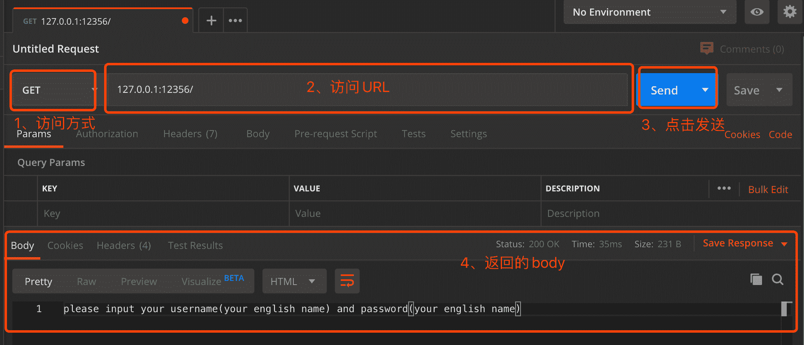
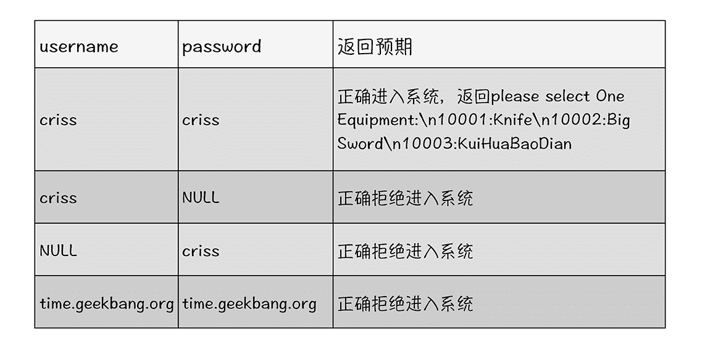
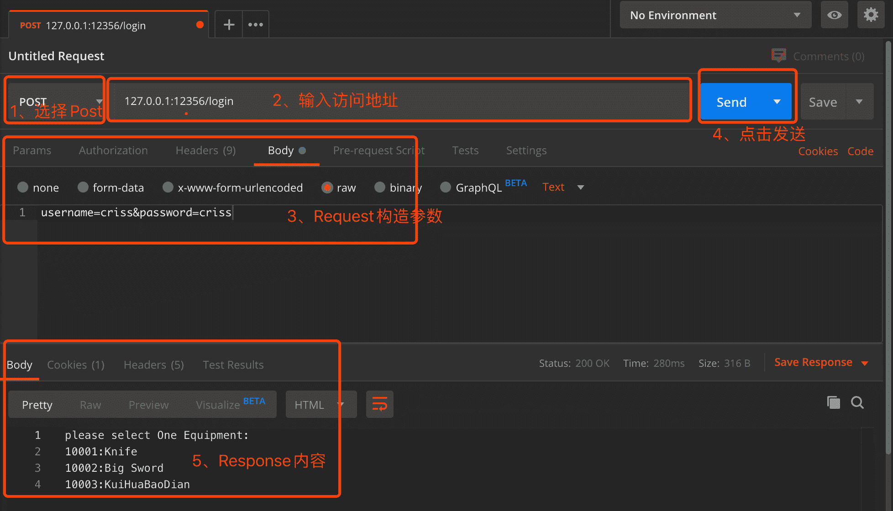
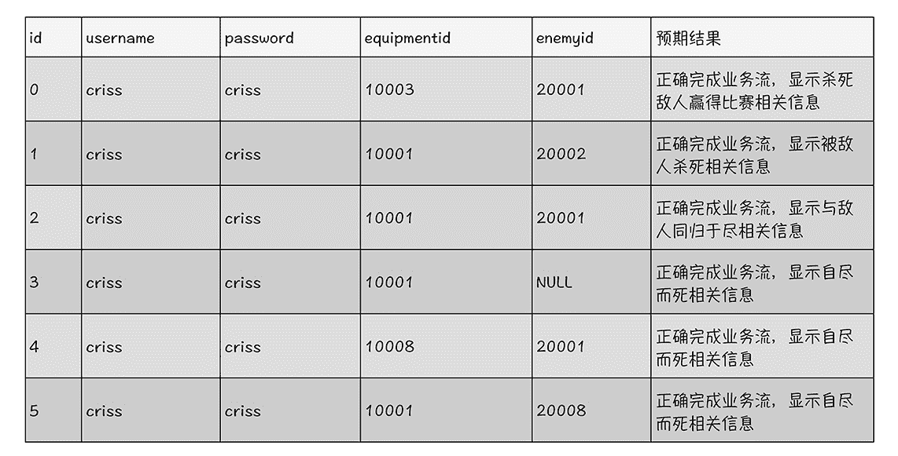
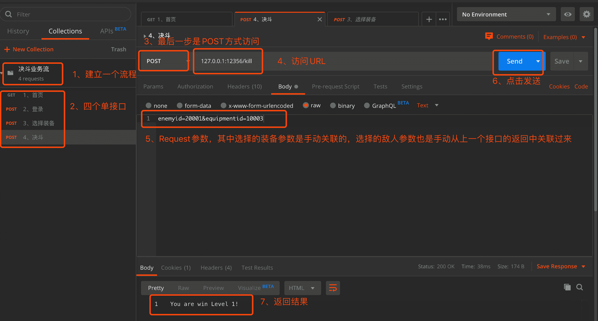

# 03 | 思维方式：用一个案例彻底理解接口测试的关键逻辑

 

你好，我是陈磊。

在前面的课程中，我们聊到了如何开始一个接口测试，我相信你一定掌握了整个过程的推进方法，这包括如何分析一个不理想的提测项目的接口，并在自己的能力范围内完善和维护接口文档，最终设计一个流程化接口测试用例。

你还记得这其中的关键点吗？其实就是：

1. 工具辅助。借助一些工具的辅助来完成接口分析。
2. 分析问题。通过分析接口的访问方式、参数等信息整理出要解决问题。
3. 询问解惑。针对问题和研发工程师进行沟通，把一些不知道的参数含义、参数取值范围等问题沟通清楚。

那么，这些都准备好后，你又如何通过一个实际方法落地接口测试呢？这里面就涉及到怎么做单接口的接口测试，怎么完成业务逻辑接口测试，以及用什么手段来完成接口测试等问题。接下来我会为你详细解答这些问题。

今天，我会带你一起利用Postman这款工具来测一个系统。

简单来说，Postman 就是一个 HTTP 协议客户端工具。但它只是我们完成这次任务的手段，接口测试用例的设计和实现过程才是我今天想告诉你的重点内容，所以，我在这里不会给你讲它的详细使用方法，而是会花更多时间告诉你怎么利用接口测试的思维方式来使用它。你也不用担心，今天我们这节课涉及的 Postman 的功能都很简单，不会因为你没有基础而显得晦涩难懂。

## 明确被测系统

有了被测系统我们才能开始聊接口测试，但是，目前网络上可以看到的系统例如极客时间的手机应用、百度网站等并不适合做接口测试的讲解，这是因为我们需要知道接口的每一个参数，以及一些接口的处理逻辑。

所以，我给你准备了我自己专门制作的一个小型系统 **Battle**，它是一个理想的被测系统，你可以在GitHub中下载它的详细系统代码。

我先来简单介绍一下它，它是一个类似回合制的游戏，通过接口测试的方法和服务器发生交互，模拟两个角色进行决斗，最后可以知道到底是谁赢了。详细的说明和代码都在 GitHub 上，你可以自行查看。除了 GitHub 上你可以看到的单个接口的说明以外，还有一个就是业务流程，这个系统的业务流程是：**进入系统后，选择武器，然后和你选择的敌人决斗。**

## 开始接口测试

在开始业务逻辑接口测试之前，你要先通过接口测试的方法，测试每一个接口都是正确的，既要保证单接口的正确性，也要保证接口的业务逻辑正确性，这里所说的“正确”指的是“正确接受合法 Request 入参，正确拒绝非法 Request 入参”。

### 单接口的测试

单接口测试的重点，其实就是保证该接口的正确性和健壮性，也就是说，你既要保证这个接口可以按照需求，正确处理传入的参数，给出正确的返回；也可以按照需求，正确的拒绝传入非正确的参数，给出正确的拒绝性返回。

现在，我就带你一起使用 Postman 来检测单接口的测试。

首先，打开 Postman，你可以看到它的 UI 结构很简单，为了可以检测首页接口，你需要设定 HTTP 的访问方式为 GET，URL 是http://127.0.0.1:12356/，点击发送按钮后，就可以在工具下面的 Body 部分看到接口返回的说明性文本内容了，这个内容是“please input your username(your english name) and password(your english name)”。

对于一个 GET 请求的接口，我们在上面已经完成了单个接口的测试工作。那么接下来，我们就要检测第二个接口：登录接口，它的访问方式是 POST，参数是 username 和 password，这两个参数均不可以为空，也不可以超过 10 个字符；如果 username 和 password 这两个字符串相同，会登录成功并返回后续的说明性文本，否则，就会正确拒绝登录。所以在这一步，我们会多检查一项 Request 的参数设计，用边界值方法设计的参数如下图所示：

在获取了参数后，下面你就要借助 Postman 这个工具，选择 Post 访问方式，输入登录接口的 URL，在 Request 的 Body 中输入 username=criss&password=criss 的参数，然后点击发送，接下来，你就会在 Response 的 Body 中对应返回内容。如下图所示：

按照上面的方法，依次完成剩余两个接口的测试用例设计和测试用执行过程后，你就完成了单个接口的测试工作。

然而完成了这一步，只能算是把接口测试工作完成了一半，另外一半就是要按系统的业务逻辑来完成“正确的流程可以完成处理，不正确的流程可以正确拒绝处理”这个验证。

### 业务流程接口测试

业务流程接口测试，主要是保障通过多个接口的串联操作可以完成原来需求中提出的业务逻辑，这也是它主要关注的内容。

在前面，我已经告诉过你这个系统的主要业务逻辑：“进入系统后，选择武器，然后和你选择的敌人决斗。”

依据上面这种业务逻辑描述，还不能完成业务流程的接口测试，我们需要对其做进一步的分析和细化。依据这个业务需求，至少有下面这几个业务流程：

1. 正确登录系统后，选择武器，与敌人决斗，杀死了敌人；
2. 正确登录系统后，选择武器，与敌人决斗，被敌人杀死；
3. 正确登录系统后，选择武器，与敌人决斗，两个人同归于尽；
4. 正确登录系统，选择武器，没有选择敌人，自尽而死；
5. 正确登录系统，选择一个未提供的武器编号，选择一个敌人，自尽而死；
6. 正确登录系统，选择武器，选择一个未出战的敌人（不在返回提示列表中），自尽而死。

那么针对这些业务流程，我们设计的参数如下：

接着你就可以利用 Postman，将过程参数手动传递给下一步接口，这样，你就可以建立一个业务流程的接口测试，并最终完成测试了。Postman 也提供了参数化的方法，如果你对此感兴趣，也可以自行学习。

继续按照上面的流程，用 Postman 将上述其它五个流程完成，你就完成自己的接口测试了。如下图：

现在，你已经有五个业务逻辑接口测试用例了，但是通过观察上面的业务流测试，你会不会感觉与你自己平时手动写的业务测试相比，好像少了点什么？

没错，它和业务测试的测试用例相比，确实少了很多异常状况，比如正确登录、正拒绝登录、正确登陆选择的装备参数是字符串等等，这一系的业务流中的反向用例都没有进行验证。

这也是接口测试和业务测试在设计测试和执行测试过程中的差异点，在接口测试中，我们通过单个接口测试完成了全部异常状态的覆盖；而在业务流程中，我们更需要关心业务流和数据流的关系，并不需要再过度关心如何用业务流的方法覆盖更多的代码逻辑异常，这也是分层测试中为什么在单元测试和界面测试之间要加入一层接口测试的主要原因之一。

通过单接口测试，可以更加接近于单元测试；通过业务流的接口测试，可以更加接近于界面所承载的交互中的业务流验证，这也是为什么现在很多人在提倡将测试模型由原来的金字塔形往菱形转变的依据之一了。

**而完成了这一系列流程，其实你也就掌握了接口测试的思维：先从单个接口的测试开始，保障单个接口的正确性和健壮性，然后通过单个接口的测试完成多个接口的业务逻辑串联，站在业务逻辑的角度完成业务逻辑的正确性检测。**

## 你的接口测试也可以和持续集成结合到一起

通过 Postman 这个工具完成从单接口测试用例的设计到业务逻辑接口测试用例的设计，你就已经掌握了接口测试的思维以及具体的实现方法。但是到目前为止，你还处在手动测试的阶段，虽然已经和以前基于界面的业务测经有了很大区别，但是距离自动化的接口测试还有一定的差距。不过你不用担心，因为这个差距仅仅是一个工具的距离。

我相信你一定听说过持续集成，在持续集成中，有一个很重要的环节就是要持续测试，通过持续集成平台调取自动化测试，完成质量保障工作。现在你已经有了 Postman，已经完成了基于 Postman 的接口测试脚本，那么如何将其赋能给持续集成平台呢？

这里我们要借助 Newman 这款工具，它就是 shell 下的 Postman，我们将 Postman 的业务逻辑接口测试脚本导出后，push 到本地的 Git 仓库中，持续集成平台就可以通过 pull 对应的接口测试脚本，然后通过 Newman 执行，这样就可以完成持续集成平台的赋能了。

在这里我只提供给你一个思路，具体的完成方式，你可以通过学习持续集成平台 Jenkins 和 Newman 运行 Postman 脚本完成对应的内容。

## 总结

我相信今天的内容你一定可以挪为己用了，如果你和我一起完成了这些操作，同时在课后，你也弥补了我在课上跳过去没有讲到的一些接口测试脚本，那么我相信你现在肯定被成功的喜悦所围绕了。

走到这一步，你已经掌握了接口测试的思维，在这种思维的指导之下，用什么技术手段或者工具去完成接口测试，也就显得没那么重要了，这也是为什么我并没有将 Postman 这个工具一步一步教你怎么用的原因，因为你既可以选择我推荐给你的 Postman，也可以找到一个你自己喜欢的工具或技术方式完成接口测试。

接口测试的执行方式、设计思维都和业务测试不完全一致，它们既有交集又有差异。交集部分是它们都会涉及到业务逻辑测试，但是接口测试更加关注有数据流驱动的业务流程，而不再着眼于代码异常、代码边界等，这些边界问题在接口测试过程中已经由单接口测试完成了。

接口测试在单接口测试的设计思维上也更加贴近于代码的单元测试，但它还是站在 Client 端的角度来完成测试；而接口测试的业务逻辑测试更加靠近手工业务测试，但却更加聚焦于业务逻辑本身，不再将一些非法业务异常放到该部分进行测试。

## 思考题

今天我并没有将全部测试用例都用 Postman 完成，那么你自己完成了吗？如果你已经完成了，那么你能用 Newman 驱动执行单接口测试脚本和业务逻辑测试脚本了吗？如果单接口测试中登录测试用例有一条执行失败了，你可以告诉我是哪一个测试用例吗？

我是陈磊，欢迎你在留言区留言分享你的观点，如果这篇文章让你有新的启发，也欢迎你把文章分享给你的朋友，我们一起探讨和学习。
