# 18 | 基础手机后期（上）：VSCO 完整指南（@随你们去）

 

你好，我是小麥，这两节课我们要学习一下怎么用手机修照片。

因为大势所趋，大多数人用手机拍照片的频率显然高于用相机拍照片，那自然对手机后期的需求就会变得很强烈。但鉴于手机不是我的主战场，所以我找来了去哥，年轻有为的手机摄影大神，来讲两节有关手机后期的内容。第一节课，先是 VSCO 这个软件，第二节课是 Snapseed，如果你手机里还没有这俩软件，你就先下载一下，然后再听课。

好，欢迎去哥！

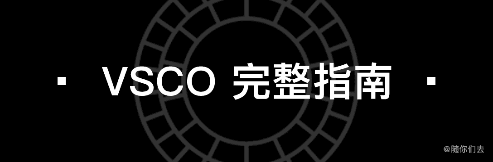

你好，我是 @随你们去。今天由我来代课说说 VSCO 这个软件怎么用。

从我开始用 iPhone 拍照起，VSCO 就一直伴随着我，至今已五年有余。由于独一无二的滤镜，良好交互体验的调整工具，加上多年以来稳定可靠的品质，使 VSCO 有着非常高的人气和非常好的口碑。如果你希望利用手机产出好照片，那么 VSCO 是一个很好的选择。

这节课不仅是 VSCO 的完整使用指南，同时也是一节较为完整的后期入门教程，只要你对手机摄影感兴趣，那么这节课就很可能对你有帮助。

**注：**

1. 本课基于 VSCO v102.1 (10229) for iOS 版本撰写；
2. 社区功能在不同网络环境下有所区别，本课主要以常规网络环境为例；
3. 为了便于理解，课中的“滤镜”即指 VSCO 里的预设。

**目录一览**

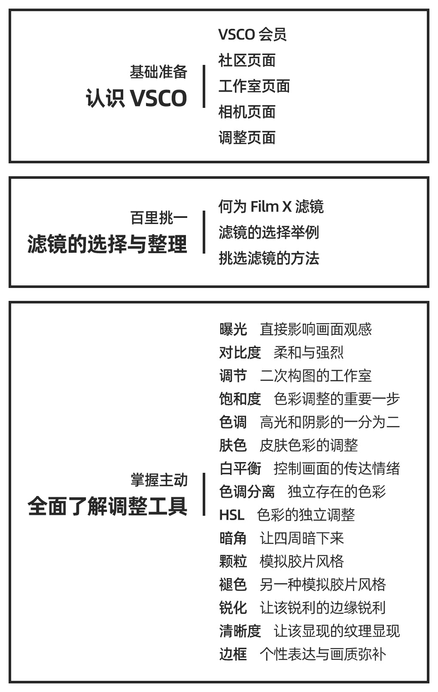

**　**

## 

基础准备：认识 VSCO

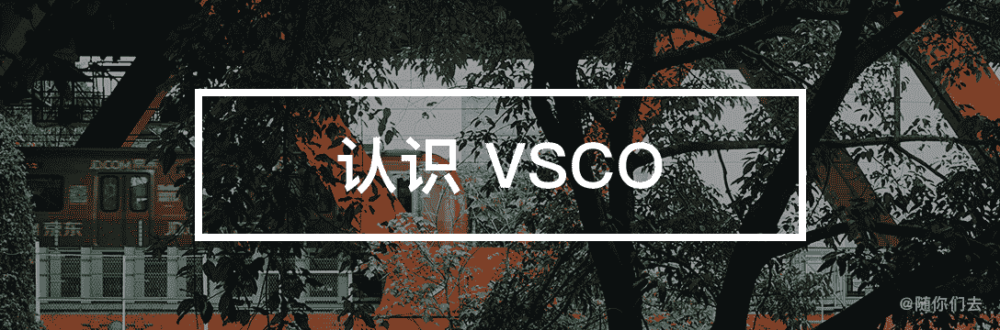

VSCO 是一款在 iOS 以及 Android 端均可下载的应用程序，你可以免费使用其中的大部分功能和少许滤镜，如果想享用全部滤镜以及功能，则需要订阅会员。

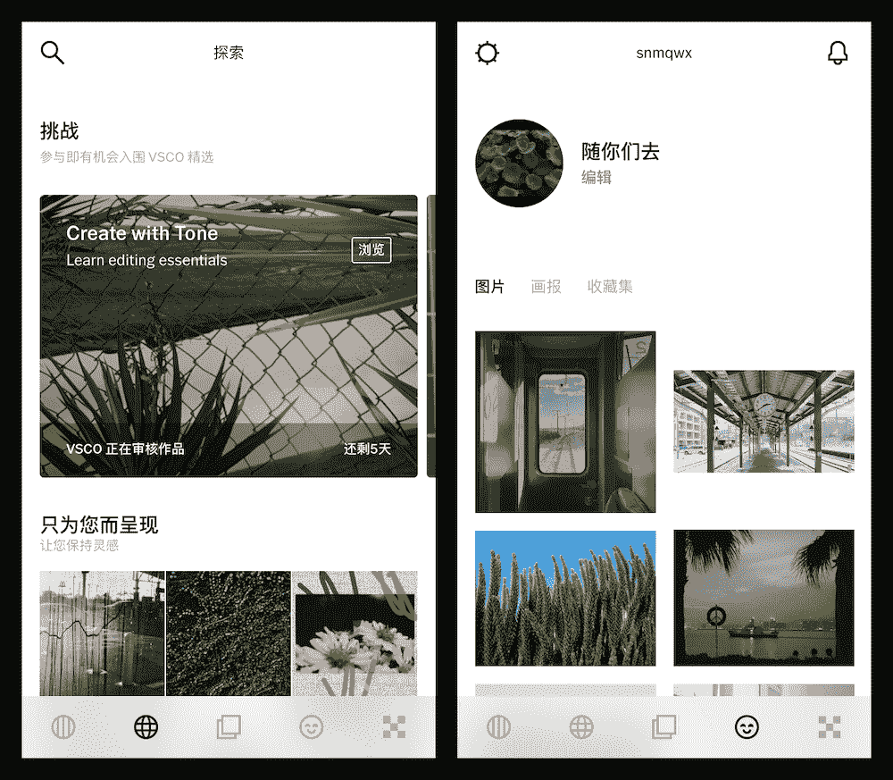

在特定网络环境下，VSCO 底部会有 5 个栏目，从左到右分别是：**动态**、**探索**、**工作室**、**个人主页**和**商店**。

其中，**动态**、**探索**以及**个人主页**均是图片社区的功能，但是在常规网络环境下，我们的 VSCO 底部仅有**动态**、**工作室**和**商店**这三个页面。

**VSCO 会员**

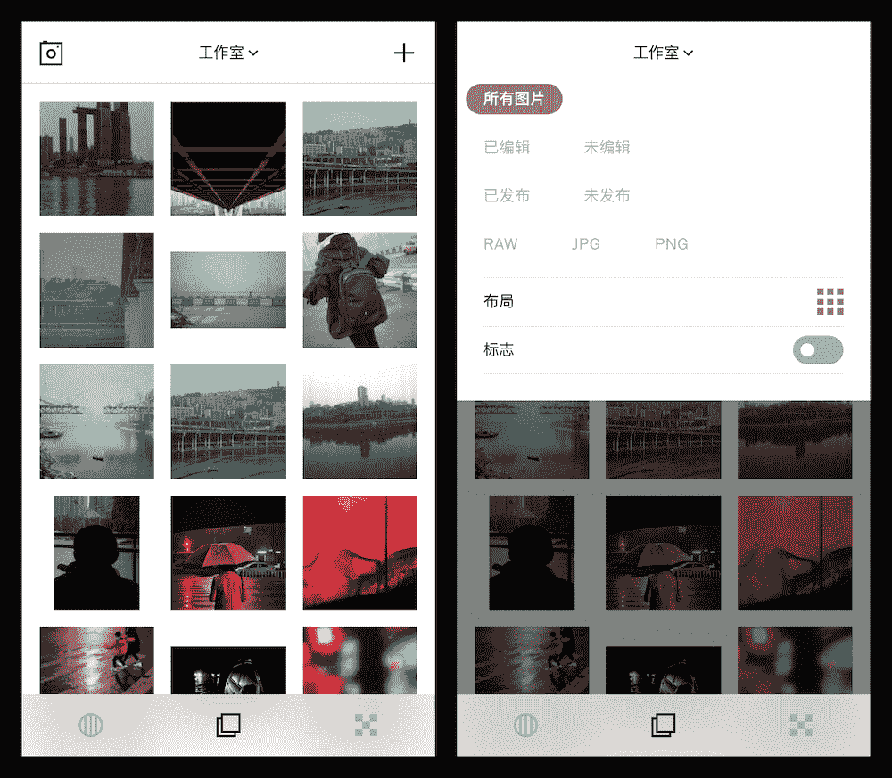

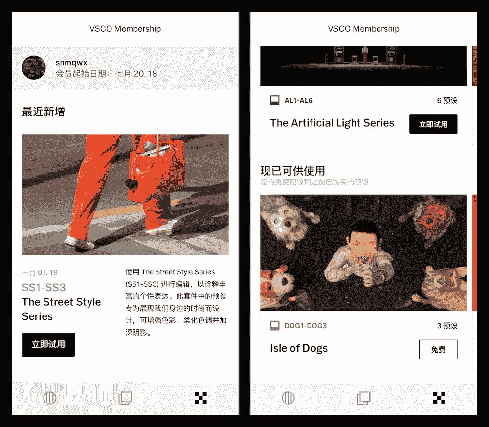

VSCO 会员是按年订阅，每年 138 元，提供所有滤镜。除此之外，你还可以解锁一些会员专属功能。目前，会员专属功能有：视频编辑、10 个自定义配方（非会员为 1 个）、HSL、边框。

我认为，会员是否值得购买取决于个人的使用需求。VSCO 会员提供 7 天试用，**你可以在上完本课并试用体验后再看是否需要购买。**（Android 版用户可借用 iOS 设备购买会员，会员是跟随账号同步的。）

**社区页面**

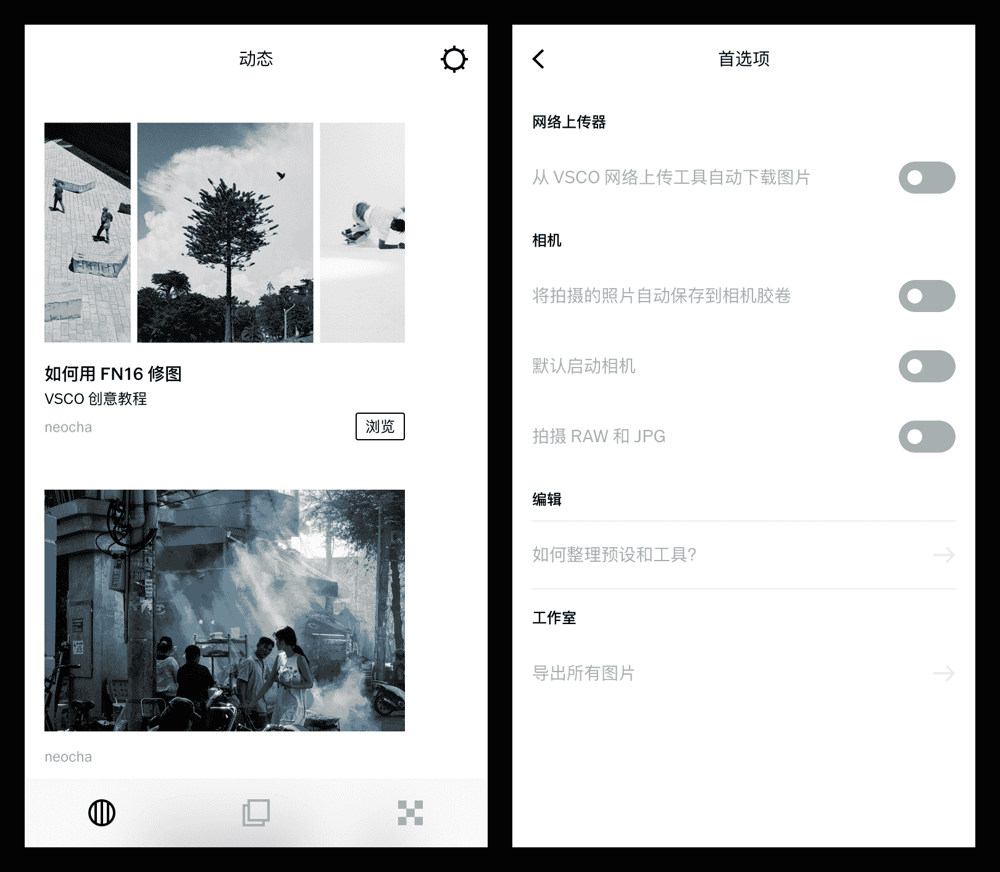

图片社区是 VSCO 目前的一个发展方向，在社区页面里，你可以看到一些不错的推荐文章以及图片。通过这些文章和图片，你或许可以为自己的拍摄找到一些灵感。

在**社区页面的右上角是设置入口**，你可以在这里进行一些相关设置，**默认情况下这里是不需要调整的，除非你有一些自己特定的需求。**

**工作室页面**

工作室页面是默认打开的首页。点击顶部的**工作室**可以对布局方式以及显示的图片类别进行调整。

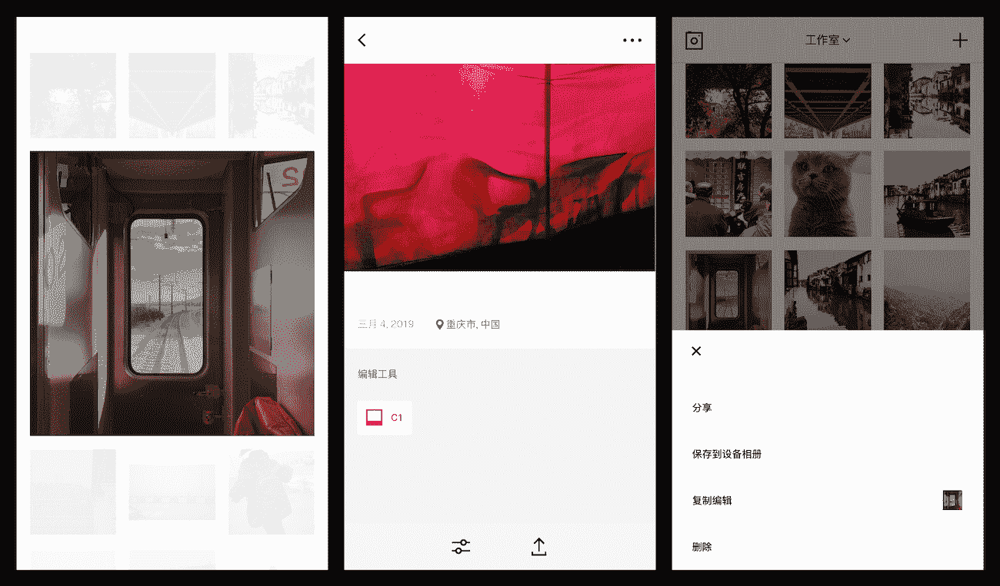

在工作室页面里，长按图片可以进行预览，双击图片可以进入到详情页面，选中图片则可以进行其他操作。

值得一提的是，VSCO 提供了复制 / 粘贴的编辑功能，可以将某个图片的编辑内容（裁剪、拉直、倾斜除外）直接复制到其他图片上。**利用这个功能，我们可以快速完成同场景里一组照片的编辑工作。**

页面左右上角两个按钮分别会进入到相机和添加照片页面，你也可以通过向右以及向左滑动快速进入到这两个页面。

**相机页面**

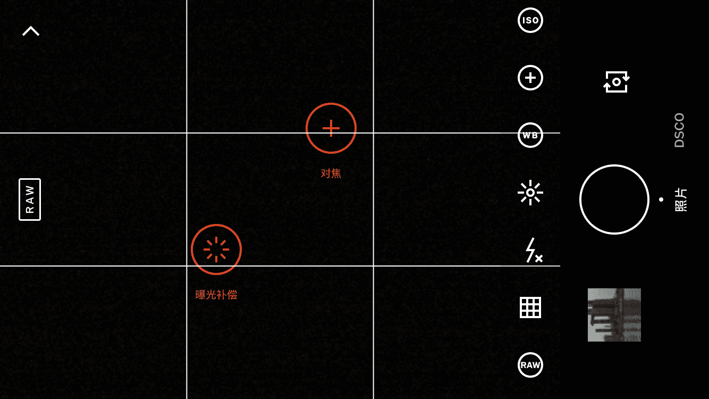

**VSCO 内建了一个非常完善的相机系统，**你可以通过这个相机来拍摄 RAW 格式相片，以及对相机参数进行自定义调整。自定义调整包括：曝光、白平衡、对焦、ISO、快门速度等。在构图辅助方面，VSCO 相机还提供了九宫格以及水平仪功能。

由于 iOS 系统本身的限制，这套手动相机系统的快门最慢仅能调到 1/3s，所以整体来说，它除了 RAW 格式拍摄、手动对焦以及白平衡调整以外，在其他方面作用不是很大。而且 iPhone 通常也无需调整白平衡，所以并没有必要用这个相机替代系统自带的相机作为默认相机使用。

不过，这的的确确是一个免费提供在 iOS 上的全功能手动相机系统，**当你有一些特定拍摄需求时，不妨一用。**

**调整页面**

调整页面是这节课的重点，也是 VSCO 作为一款优秀摄影工具的核心所在。调整页面里分为四个主要功能：**滤镜**、**工具**、**历史**、**整理**。

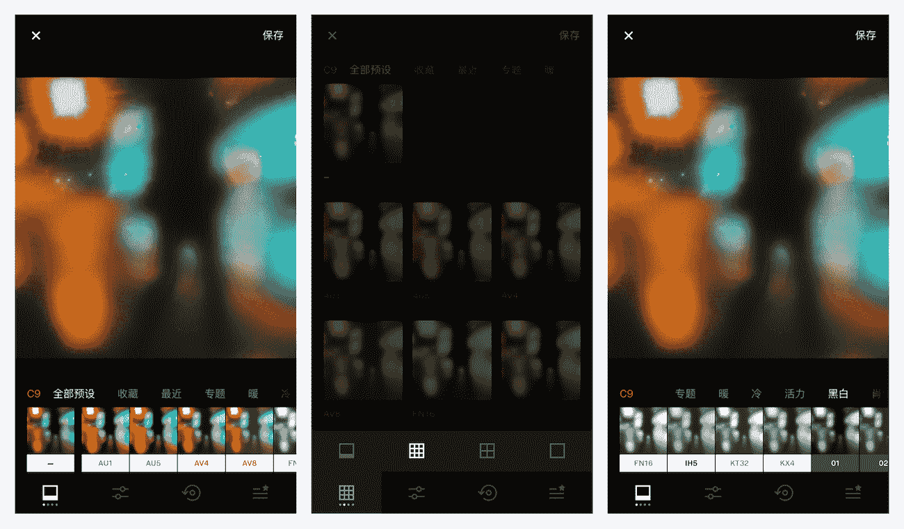

**滤镜**页面是进入调整页面后默认显示的第一页。我建议你在平时使用的时候，也先挑选滤镜，随后再做一些细微调整。

在滤镜页面点击左下角的滤镜按钮，可以选择滤镜的布局模式。此外，VSCO 提供了一个简单的默认分类，包括全部、收藏、最近、专题、暖、冷、活力、黑白等。这样的简单分类对我们使用滤镜会有一定的帮助，**但在有上百个滤镜的情况下，最重要的还是需要靠自己辨识和整理。**关于这点，我们后面再展开说。

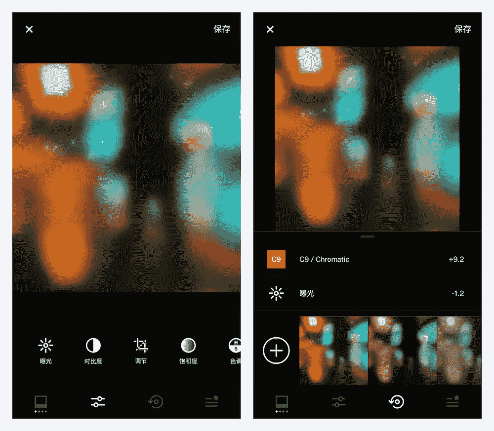

这是**调整工具**与**历史操作**页面。调整工具里提供了多个调整项，由于数目众多以及内容相对重要，后面我会详细展开说，此处暂时略过。

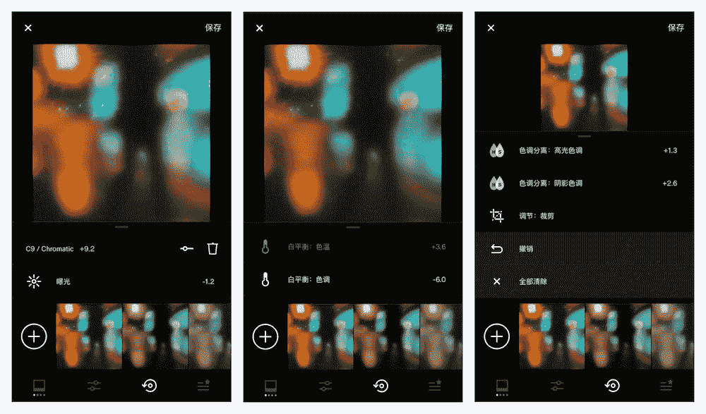

在历史操作页面里，你可以看到当前照片都进行了哪些更改。

向左滑动调整项可以进行编辑或删除，长按调整项可以看到去掉当前调整项后的画面效果。如果你想查看整个照片调整前后的对比效果，在调整页面的任意页面里长按图片大图即可。

将调整项列表滑动到最后，你可以看到撤销以及全部清除选项。常驻在最底部的是配方，你可以将自己本次的编辑保存为一个配方，或者是使用之前保存好的配方编辑现在的图片。

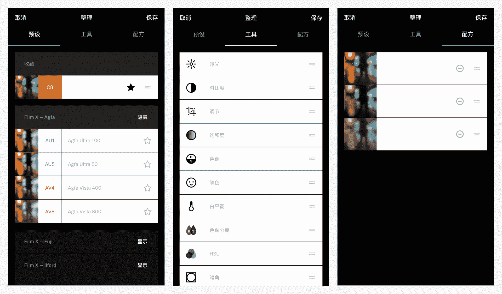

最后一个是**整理**页面。在这里你可以整理预设、工具和配方。

在预设项目里，你可以快速收藏自己喜欢的滤镜，以及调整收藏滤镜的排序，还可以隐藏掉自己不需要的滤镜。除此之外，在滤镜页面里长按某个滤镜也可以进行收藏。在工具和配方项目里，你还可以调整工具和配方的展示顺序，以及删除掉自己不需要的配方。

**我这里显示的工具顺序是根据我个人的使用习惯和逻辑理解调整过后的，之后工具的讲解顺序也是按此顺序展开。**

**　**

## 

百里挑一：滤镜的选择与整理

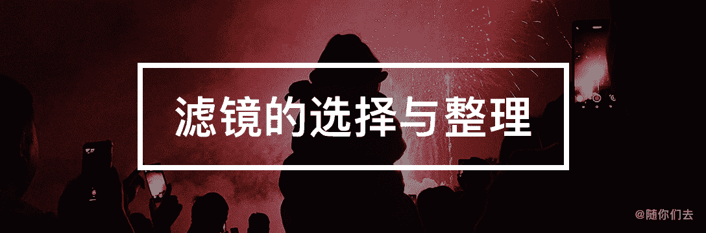

VSCO 目前拥有 130+ 个滤镜，面对数量如此庞大的滤镜，我们如何快速挑选出适合自己的滤镜，就显得尤为重要。

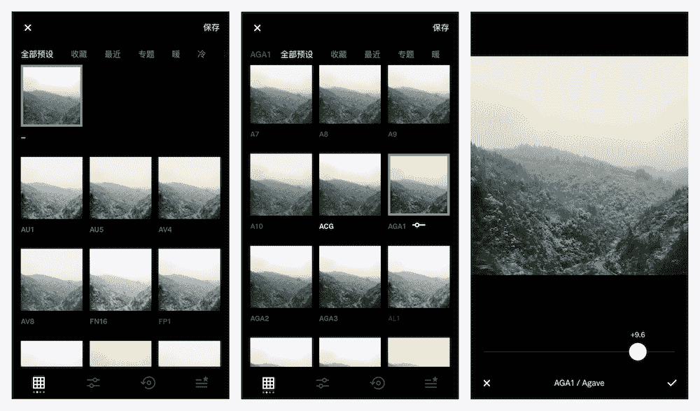

在使用滤镜时，我们可以选择滤镜应用的强度，此时你可以看到当前使用滤镜的完整名称。**这些完整名称可以帮助你大致判断当前滤镜的用途。**在谈滤镜的选择与整理之前，我们先来看看何为 Film X 滤镜。

**何为 Film X 滤镜**

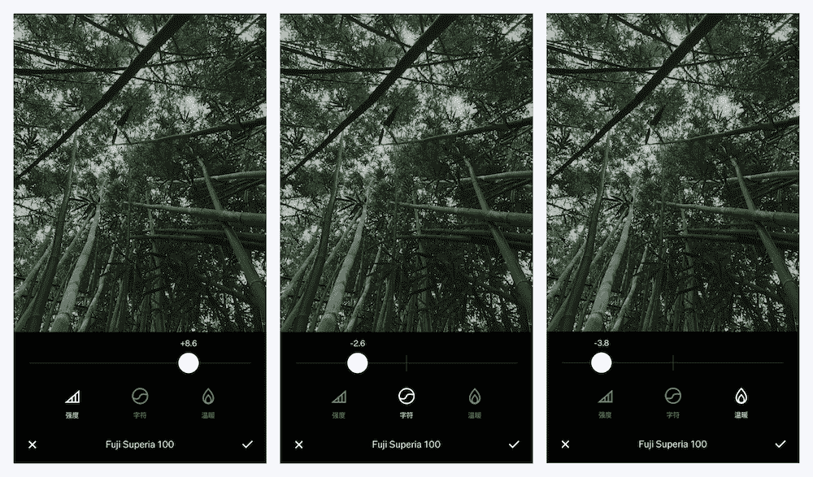

Film X 是 VSCO 推出的一系列模拟胶片风格的滤镜。这一系列滤镜跟普通滤镜的主要区别是：除了强度调整以外，它还提供了字符和温暖两个调整项。

字符：字符的官方英文名称为 Character，按官方的说法，这是模拟了胶片曝光不足或是过曝时候的情况。从观感上来看，较多的字符通常会产生更鲜艳明亮的色彩，而较少的字符通常会导致褪色、柔和的色调。

温暖：温暖的官方英文名称为 Warmth，这是模拟色温的调整，往左是偏冷，往右则是偏暖。例如，在城市夜景里，我们就需要一些偏冷的色调，而在日落时分，我们则需要一些偏暖的色调。**当然，这并不绝对。**

**滤镜的选择举例**

相比 Film X 滤镜，我个人使用较多的还是普通滤镜，其中， 00、B、C 这几个系列使用得较多。VSCO 的这些系列滤镜首先会有一个整体针对的风格，不同的滤镜编号则会对应不同的环境情况或色调等。

**通常来说，我会先确定照片是需要调整为黑白色调还是彩色色调，随后确定照片所需的风格是偏柔和还是强烈，最后再在这样较为确定的风格取向里挑选相适合的滤镜。**

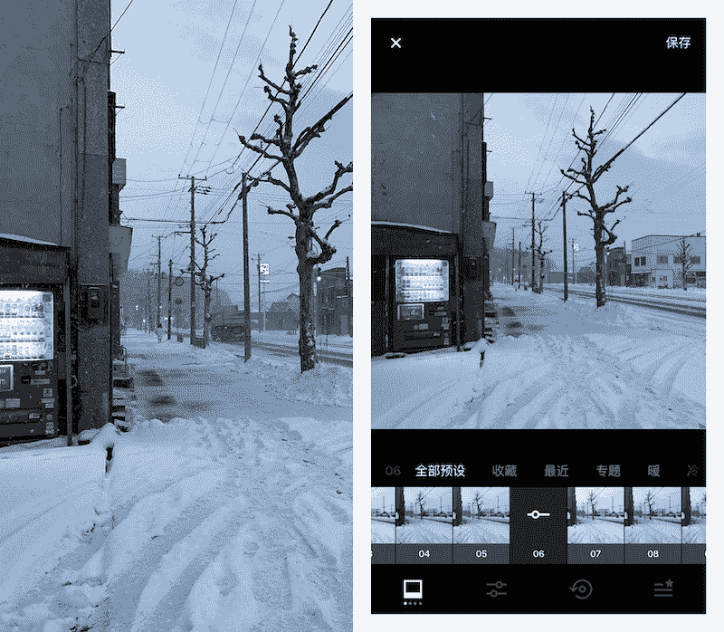

00 系列滤镜的名称是 Legacy（遗产） ，Legacy 是 VSCO 最早期推出的滤镜，彩色与黑白滤镜皆有，适用范围比较广。

例图中雪景使用的 06 滤镜会加强画面对比度，在暗部添加一些偏绿的冷色调，与我所想要的环境氛围表达比较契合。

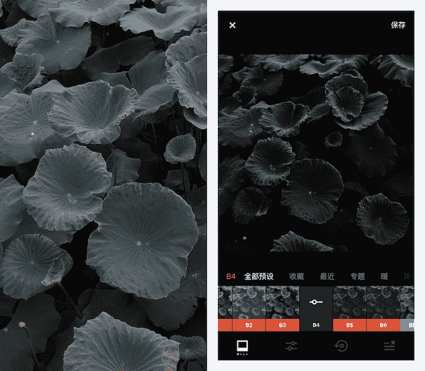

B 系列的完整名称是 B&W Classic（经典黑白），很显然，这是一套实用性比较强的黑白滤镜。其中 B1 - B3 是画面偏柔和的黑白滤镜，而 B4 - B6 则是强对比的黑白滤镜。

例图中使用的 B4 滤镜是明暗对比较为明显的一款黑白滤镜，这款滤镜可以很好地表现出图中荷叶场景的明暗关系。

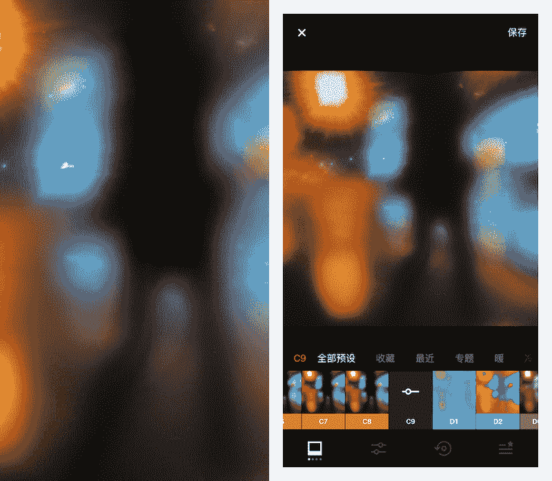

C 系列的完整名称是 Chromatic （色），C 系列有着良好的色彩表现，适用于一些色彩丰富突出的场景。

例图中选用的 C9 滤镜恰好在当前场景中表现较好，C 系列滤镜的整体风格较为一致，但不同编号的滤镜会适用于不同的色彩场景。

**挑选滤镜的方法**

VSCO 提供的滤镜众多，但选择多则意味着容易纠结，而且如此多的滤镜我们也很难记住各自特性。因此**，如果你对滤镜的依赖比较大，滤镜整理就很有必要了。**

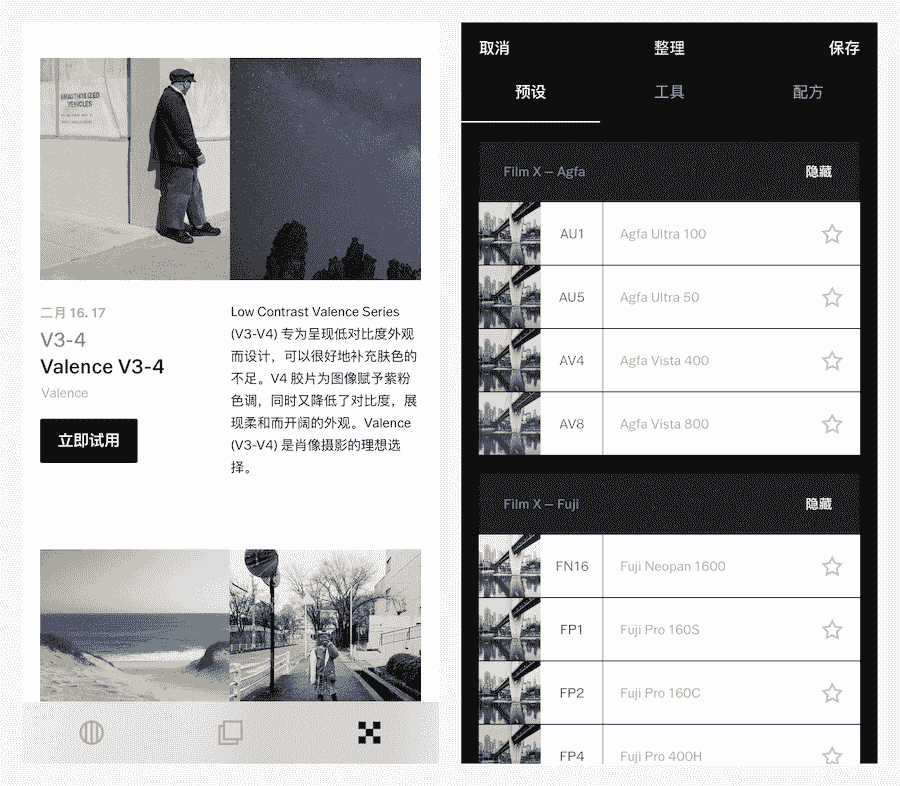

了解，但无需记住，这些滤镜相对应的特性并不需要你全部记住。

我们可以通过滤镜全称结合官方解释建立一个大致印象，除了上面提到的滤镜外，再比如 A 系列的滤镜全称为 Analog（类似物），官方描述为受到模拟胶片的启发而推出的滤镜，这样一来，我们就知道这个 Analog 指的是类似胶片的风格。

如何看到滤镜的相关信息？在使用滤镜的时候，你可以看到相应滤镜的完整名称，通过滤镜的完整名称，你能大致了解到这款滤镜的特性。而更为详细的信息，则可以在会员页面里查看对应滤镜的官方介绍，那是快速了解一款滤镜最为可靠的方式。

整理与收藏：在大致了解完滤镜风格后，对于一些你认为风格类似或你不喜欢的滤镜，可以在整理页面对其隐藏。**同时，对于常用或者较为喜欢的滤镜，你也可以进行收藏。**

在实际使用时，你还可以利用默认提供的分类来快速找到一些滤镜，我觉得，其中的冷、暖、黑白这些风格明确的滤镜，是新手用起来比较好上手的。

**想把这款软件打造成一件特别顺手、特别定制化的工具，花一些时间来整理滤镜是很有必要的，这可以提高你使用 VSCO 的效率，而避免在上百个滤镜里进行盲目尝试和挑选。需要注意的是，尽管官方有为我们提供一些滤镜的介绍和分类，但具体来说，滤镜是讲适合度，你完全可以根据自己喜好进行选择。**

**　**

## 

掌握主动：全面了解调整工具

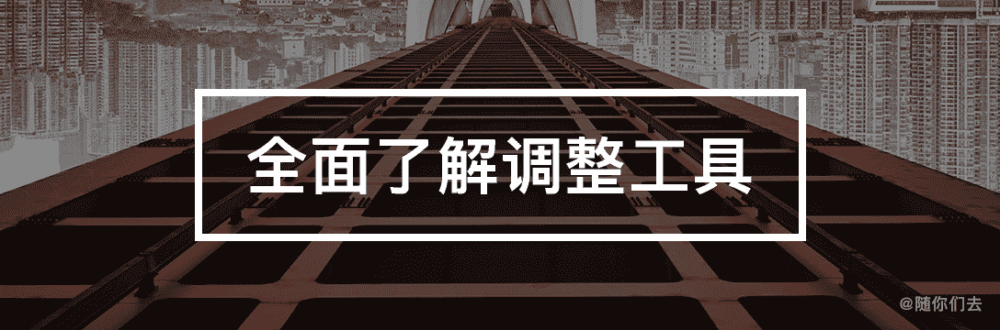

VSCO 目前提供了 15 个调整工具，基本满足我们平时修图所需。合理使用调整工具，可以使我们的相片在对应滤镜下拥有更好的表现。**甚至，你可以完全不使用滤镜，仅利用调整工具来调出你所想要的照片风格。**

所以，这部分既是 VSCO 调整工具的介绍，同时也是后期修图的入门教程。根据我个人的使用和逻辑理解，调整工具的介绍顺序有做调整，以调色靠前、细节修理靠后排序。

**曝光：直接影响画面观感**

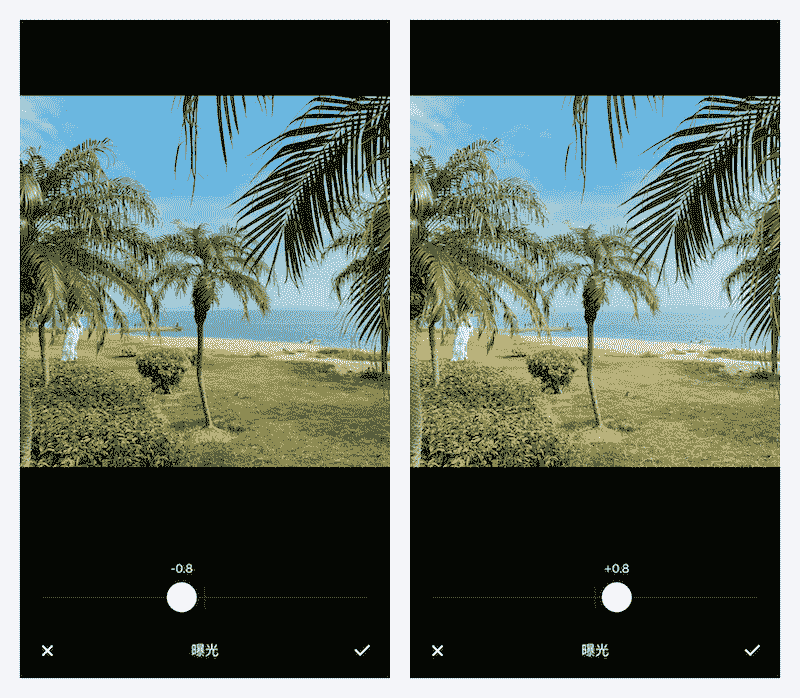

我们对曝光最直观的感受就是画面亮度的变化，但这与我们调节屏幕亮度不同，曝光对于观感的影响远不止亮度这一项。画面色彩、环境氛围、场景明暗细节等都会因为曝光的不同而不同。

所以，对于一张照片的曝光调节来说：**准确曝光并不一定是合适曝光，**根据照片所需表达的内容不同，画面曝光可不足，可准确，可过度。

**对比度：柔和与强烈**

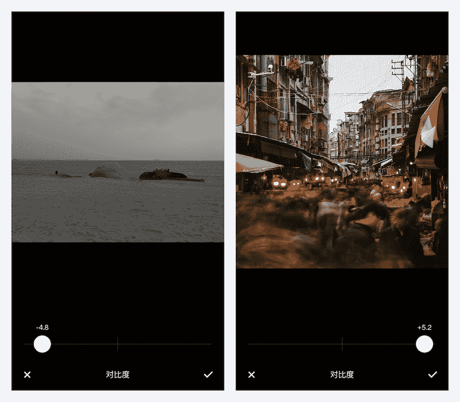

对比度也是对画面影响较大的一个调整项。较低对比度的画面看着柔和，明暗反差小，色彩相对较平淡，而较高对比度的画面看着强烈，明暗反差大，色彩相对浓烈。

另外，从观感的体现来说，对比度还会对画面亮度有着一定的影响。对比度较高会使得画面偏暗，而对比度较低会使得画面偏亮。所以在实际调整时，曝光和对比度可以配合调整。

**调节：二次构图的工作室**

VSCO 的调节里将裁剪、旋转（这里称拉直）、透视纠正（这里称倾斜）整合在了一起，这是一个非常好的整合，更方便我们使用和调整。

裁剪 + 拉直

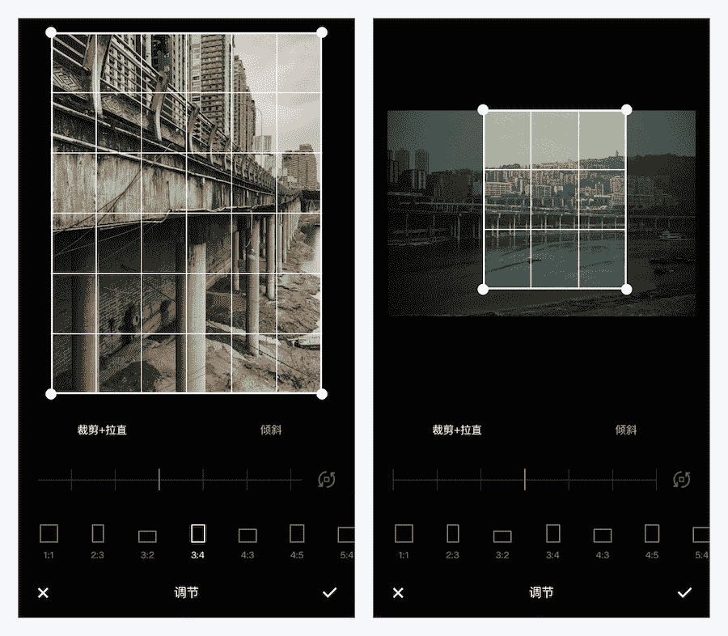

拉直，通常用于纠正拍摄时水平线倾斜的画面。例如左图的场景里，我的构图要求这些柱子是完全竖直的。

裁剪，则是用于二次调整画面内容，这是非常重要的一个工作，我们可以在此重新考虑画面的主次元素，去掉一些不必要的内容，选择出我们需要的画面以及合适的画面比例。在右边的例图中，我不需要画面底部的内容，同时希望以偏长的画面比例来表现内容的层次感。

倾斜

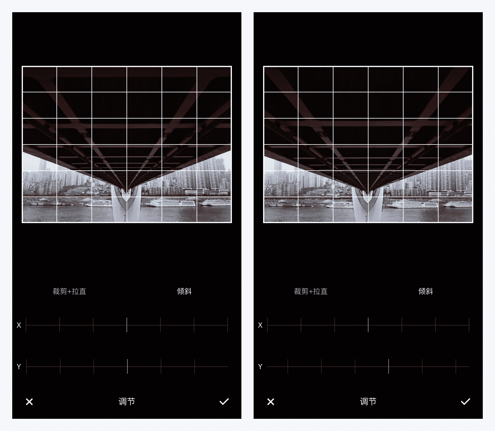

倾斜，当你拍摄一个非常正的场景时不小心倾斜了，或许就要用到这个功能。倾斜调节分为 X 和 Y 轴两个方向，如果你拍摄时镜头左右环动了，就可能需要调整 X 轴，如果你拍摄时镜头上仰下俯了，就可能需要调整 Y 轴。

在拍摄上面的例图时，我控制水平和 X 方向尽可能对齐，最终仅需调整 Y 轴，看远处的楼就能看出来。在 VSCO 的倾斜调节里，X 轴调节对于画面内容的影响是比较大的，所以我建议尽可能在拍摄时做好工作。

与此同时，倾斜有时候需配合拉直来反复调整，以达到满意的状态。这也是我为什么说这几项调整整合在一起，我们使用起来会更方便的原因之一。

如果你仍然不太理解上面有关拉直和倾斜的描述，现在请将你的头部视为镜头：

1. 当你左右偏头时，你看到的画面相对来说便是水平线倾斜的；
2. 当你左右环视时，你看到的画面相对来说便是 X 轴倾斜的；
3. 当你抬头仰视或低头俯视时，你看到的画面相对来说便是 Y 轴倾斜的。

**其实，当画面拍歪的时候，我们并不是一定需要调整，甚至有时候为了更为准确地表达画面情绪，我们需要把它调得更歪。**

**饱和度：色彩调整的重要一步**

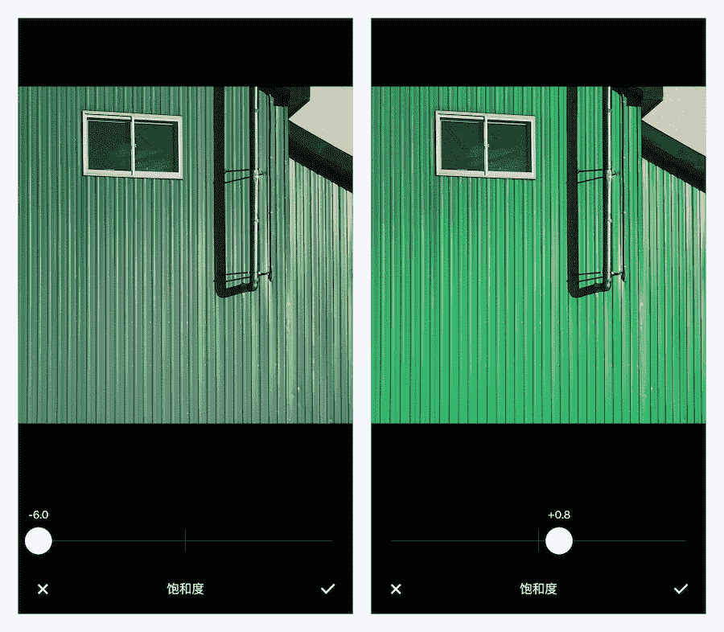

饱和度影响着画面的色彩表现。饱和度越高，画面色彩越鲜艳，反之画面色彩则越灰。

VSCO 的饱和度调整有一个特性是：即便是饱和度降至最低，色彩也不会趋向于呈完全黑白色，这与常规的饱和度调整工具不同。一方面，如果你需要将相片调为黑白色调，只能使用滤镜将相片转为黑白色；另一方面，在饱和度降至最低后，你仍然可以调整画面的白平衡来控制画面的色彩表现。

**色调：高光和阴影的一分为二**

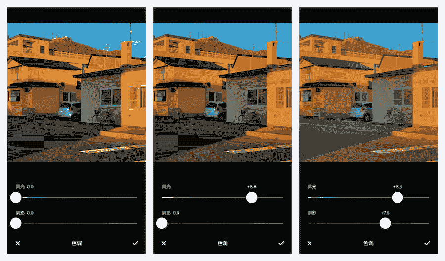

色调调整里分别有高光和阴影调整。在 VSCO 里，这两项分别对应的是高光减弱和阴影补偿。

从例图中我们可以看到，调整高光会使得画面里较亮的部分暗下来，使得亮部的细节显现；而调整阴影时，会使得画面里较暗的部分亮度提高，使得暗部的细节得以显现。

对于这张例图来说，当我们同时调整高光和阴影时，会双向使得画面明暗反差减少，整体看起来更为柔和。

**肤色：皮肤色彩的调整**

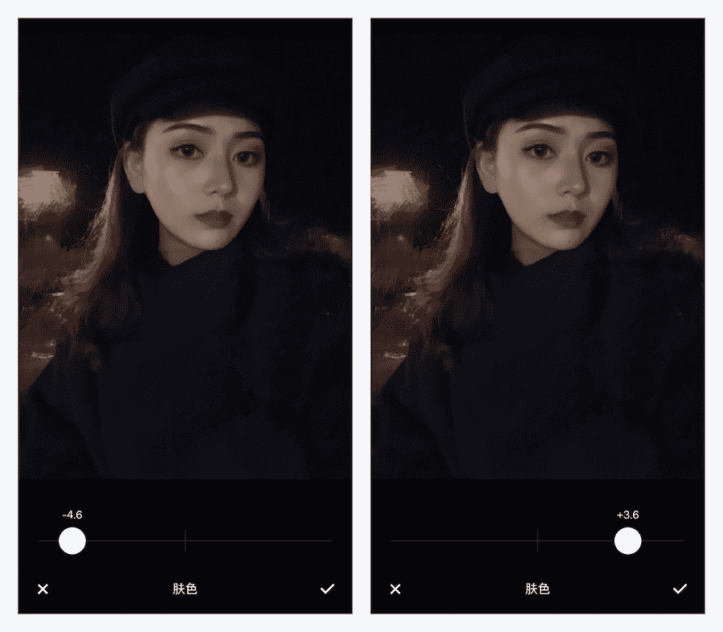

肤色调整时，往左滑动会使得肤色偏紫偏红润，而往右滑动调整会使得肤色偏绿偏冷。尽管这是针对肤色的调整工具，但有时候还是会以较小的幅度影响着画面的整体色调。

**白平衡：控制画面的传达情绪**

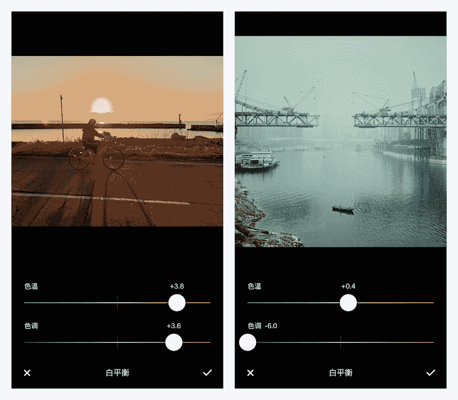

在白平衡调整里，有色温和色调两个调整项，两者的调整方向主要与相片内容以及你想表达的情绪有关。

从不同调整项对应的滑杆颜色，我们可以看到，色温是调整画面冷暖色调的，而色调则会使得画面偏绿或者偏紫。在实际使用时，色温调整相对色调调整来说会更为明显。我通常会先调整色温来为画面色彩定一个基调，随后再通过色调来进行微妙调整。

**色调分离：独立存在的色彩**

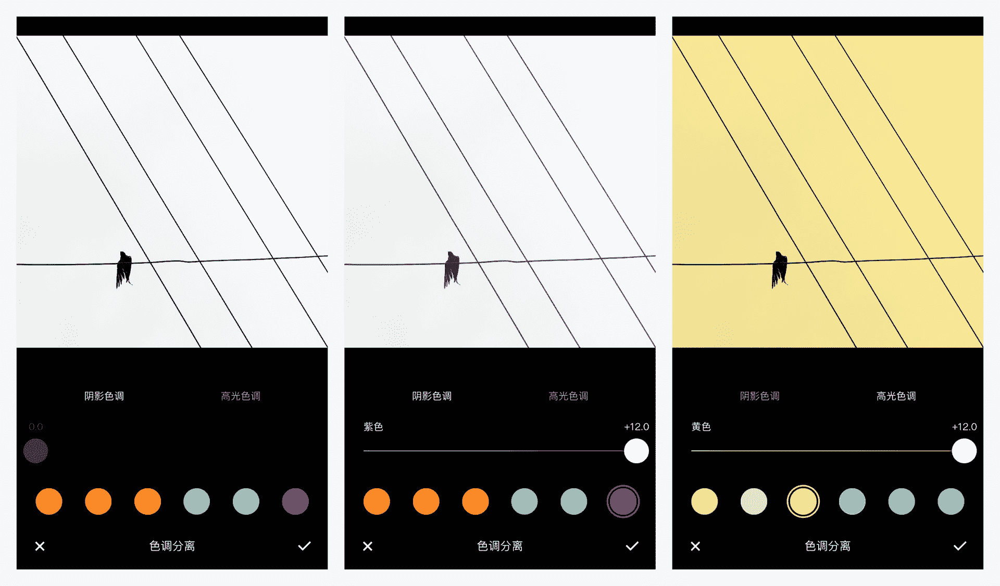

在色调分离调整项里，我们可以对阴影和高光分别添加一些色调，这里添加的色调是分离的，不受其他调整项（例如饱和度、对比度、曝光）的影响。

色调分离有助于我们对画面色彩进行进一步的微调，以达到自己想要的氛围。像例图里这样极简画面的极端情况时，你甚至可以利用色调分离功能直接更改场景的颜色。

**HSL：色彩的独立调整**

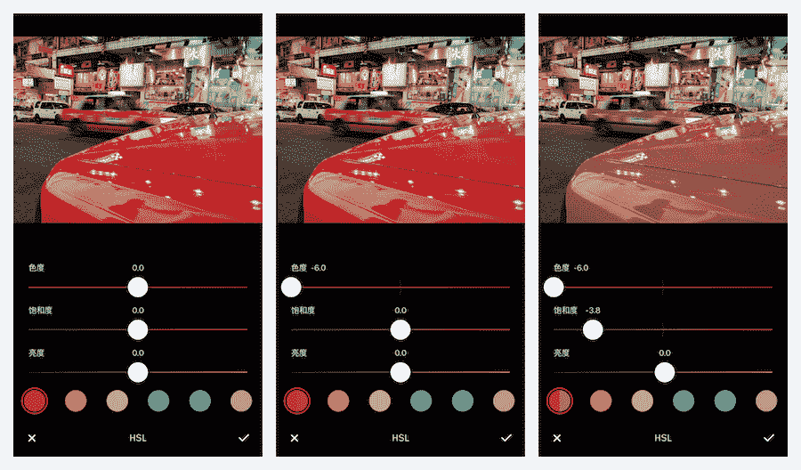

HSL 是单类色彩调整工具，利用这个工具，你可以调整单类色彩的色度、饱和度以及亮度。

在例图里，我选择了调整红色，并改变了红色的色度以及饱和度，你可以看到图片中的红色色彩随着相应的调整而变化。

**暗角：让四周暗下来**

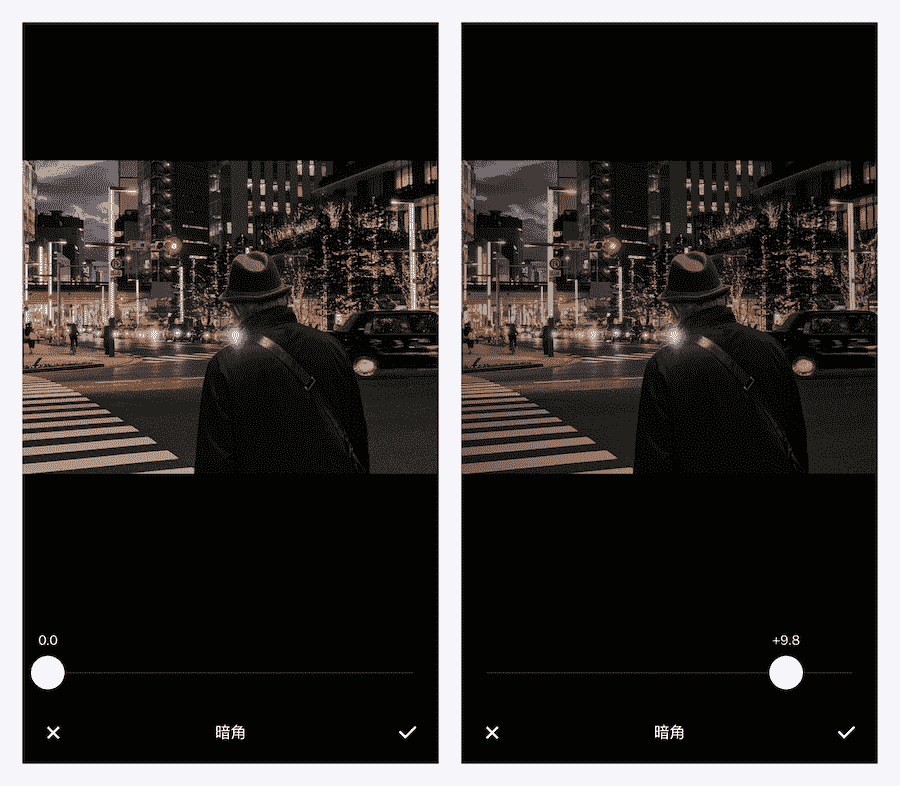

暗角调整，可以使得画面四角的亮度暗下来。在实际使用时，如果画面四周偏泛白，可以使用暗角来进行调节，或者有时候为了相片风格化而添加一点点暗角。

**无论如何，对于暗角的添加，我个人的建议是：要自然。**

**颗粒：模拟胶片风格**

颗粒会给画面添加一些质感独特的颗粒，这是一种模拟胶片风格的效果。

对于一些场景画面，适当添加颗粒，画面会有独特的风格表现。此外，对于一些画质不太好或噪点较多的照片，也可以通过添加颗粒来缓解画质问题。**但特定特用，不建议盲目添加。**

**褪色：另一种模拟胶片风格**

同样，褪色也是一种模拟胶片风格的效果。在增加褪色后，会给照片盖上一层灰色蒙版。**这是一个风格化的功能，请根据个人喜好酌情使用。**

**锐化：让该锐利的边缘锐利**

锐化，会使得画面看起来更锐利。

并不是所有图片都需要锐化调整，也不是所有图片都需要锐利的画面表现，我们需根据实际画面的不同以及画面的表达需求而定。**同时，在调整锐化时也要避免过度锐化，否则会使得画面观感变得非常糟糕。**

**清晰度：让该显现的纹理显现**

清晰度和锐化有一些相似，但实际上清晰度是使得画面整体细节表现更好。同样，这也是需要根据实际画面的不同以及画面的表达需求而适度考虑的调整项。

整体来说，锐化和清晰度调整都属于比较细节的调整工作。当画面内容需要，或者画质较差时，我们可以利用这两个功能进行一些调整改善。

**边框：个性表达与画质弥补**

利用边框功能，我们可以给相片添加各种颜色的边框，并且调整边框与相片的比例。

合理使用边框功能，也有利于画面的情绪表达。除此之外，由于 VSCO 的边框功能是基于原图画质生成的，**在图片画质较差的情况下，我们也可以利用这个功能，通过缩小画面来缓解照片的画质问题**。

**　**

## 

最后小结一下

当你看到此处时，你并不是完成了有关 VSCO 的学习，而是刚刚开始这个软件的使用。

**修图这件事，花时间动手尝试远比看更重要**。这背后的原因不仅仅是因为我们需要熟练操作、熟悉各个滤镜特性以及各个调整工具之间的相互牵连影响，更重要的是：我们修图是为了更准确地表达出我们想在相片里表达的情绪，而这个情绪，是我们自己的，需反复练习尝试，在别处学不来。

**　**

## 

课后小练习

翻出一张你近期拍的最满意的照片，或者现拍一张，好好地现拍一张照片，把它拖进 VSCO 里后期一下，然后点击文末的图片，去部落发你的原图和成片，谈谈心得体会。

**　**

我们下节课见。
