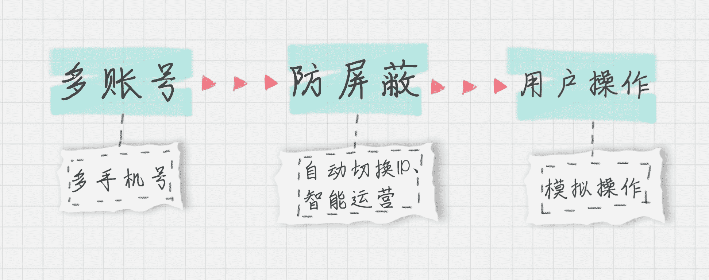
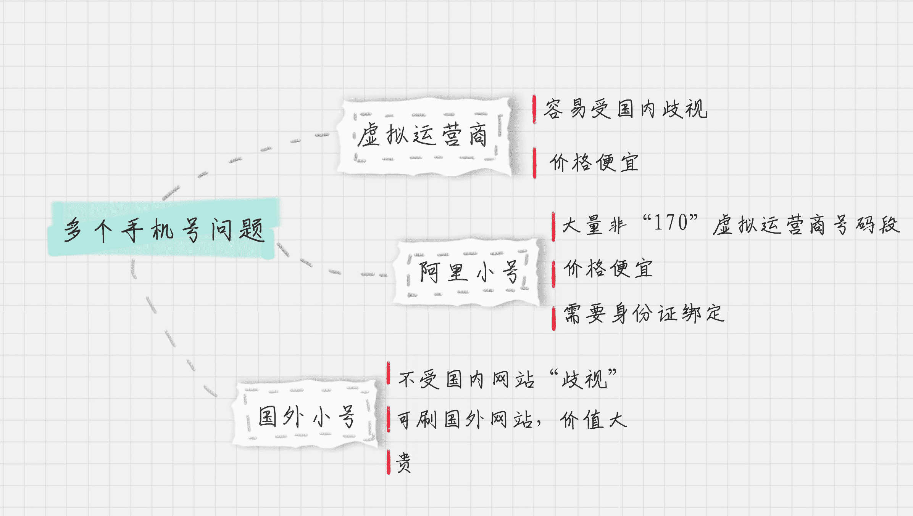
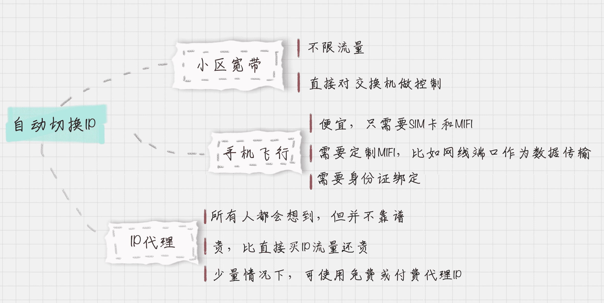
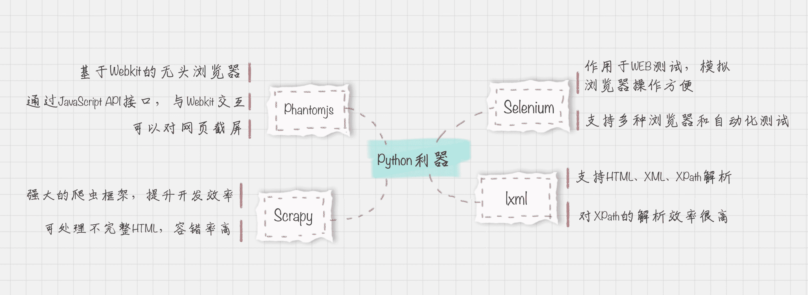
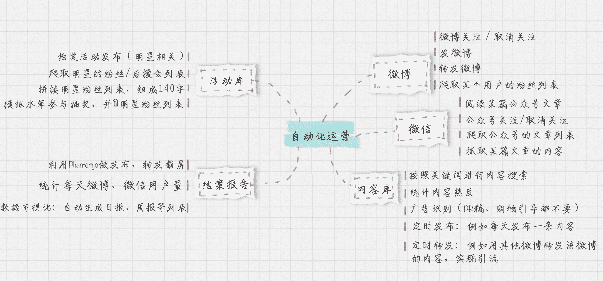

# 加餐丨在社交网络上刷粉刷量，技术上是如何实现的？

 

我们都知道很多社交网络上可以刷粉，也可以刷阅读量，这已经形成了一个“产业链”，我们也经常会看到很多记者报道过这样的灰色产业链。

你也许很好奇，这些技术都是怎么实现的？

首先我梳理了一下整个流程，可以分成 3 个步骤。

  
 在这个流程里，需要有下面三个准备。

**1. 多个手机号**

尽管早期注册只需要邮箱就可以，但现在账号注册都是需要绑定手机号的，所以手机号是必备的。

**2. 多个 IP**

因为很多社交网站都会有反垃圾的措施。共用同一个 IP，一定会被封号。

**3. 模拟操作**

因为我们的需求是个性化的。所以在这一步，可以封装出一些基本的操作，比如关注、发布动态、转发、阅读文章等。

## 那么多手机号从哪弄？

于是问题来了，从哪里弄这么多手机号？比如说 1 万个！

**虚拟手机号：被歧视的号码段**

很多从事相关产业的人首先想到的，便是虚拟手机号，因为虚拟手机号不限数量，其他号码段都需要绑定身份证。不过虚拟手机号有个最大的问题，就是“会被歧视”。在社交网络里，虚拟手机号注册的账号被封的概率远超其他账号，比如说以“170”开头的手机号。

**阿里小号：一个看似可行的解决方案**

既然虚拟手机号容易被封，那怎样才能找到既不会被封，还便宜的号码呢？阿里小号是个选择。阿里小号的价格比较亲民，5 元 / 月。可以自己选择号码段，这些号码段很多都不是 170 号码段的。但是阿里小号有个问题，就是需要用身份证来绑定。

**国外号码，贵但价值明显**

那有没有既不会被封，又不用绑定身份证的办法呢？国外的手机号是可以的，但最大的问题就是贵，差不多 5 美金一个月，相当于一个账号就要 35 元。

我调查了一下，其实国外也有类似的刷量刷粉的操作，比如刷 Facebook、Twitter、YouTube 等。这些网站刷粉、刷量的收费更高，所以相比之下，手机号带来的成本其实不算什么。

一个手机号就相当于你雇了一个工人，在雇佣的这段期间里，你需要让它的任务“充实”起来。一般的做法都是先从高价值的网站开始刷，在完成后，再来刷国内的 APP。如果有足够多的刷粉刷量的任务，这个“工人”就会 7X24 小时不间断地工作。

这些号码各有特点，根据实际情况，不同人手里用到的号码是不同的。我总结了一下。

## 如何自动切换 IP？

在解决多个手机号的情况后，那下个问题就来了，如何自动切换 IP 呢？这是一个自动化运营绕不开的问题。

有三种方式可以选择。

 
1.  

IP 代理。
  
2.  

飞行模式。
  
3.  

小区宽带。
  

**IP 代理：所有人都能想到，但并不靠谱的方案**

IP 代理应该是很多人首先想到的解决方案，因为在编写 Python 爬虫的时候，是可以使用代理机制的。网上就有很多做 IP 代理的。但这里有两个认知，你需要注意。

 
1.  

IP 代理没有你想得那么便宜。以不重复的 100 万 IP 为例，单日价格在 2700 元，相当于 1 万 IP=27 元。所以你会有这样一个疑惑：那些刷网站流量的，1 万流量只需要几元的是怎么做到的？
  
2.  

免费 IP 比你想象得要好用。实际上，有很多免费 IP 代理可以使用，它们主要的问题在于数量比较少。
  

所以在量少的情况下，IP 代理是可以使用的。在量大的情况下，IP 代理就没那么好用了，因为成本太高，并不是一个靠谱的方案。

**飞行模式，一个让人飞起来的 idea！**

当你发现，购买 IP 代理的价格比淘宝上售卖流量的还要贵的时候，你就知道他们用的根本不是 IP 代理。换个思维，有没有免费的 IP 呢？这里会用到手机的飞行模式，它和路由器断开重连一样完美！

这是为什么呢？

当我们的手机采用飞行模式后再关闭，你会发现手机的 IP 发生了变化。同样，当你断开路由器后，再进行重连，IP 也自动发生了变化。这个就是动态 IP。

**WIFI 和 MIFI**

那么问题来了，怎样写程序来控制手机呢？这里你可以使用 MIFI 设备，MIFI 其实就是 Mobile WIFI 的意思。MIFI 设备最大的好处，就是脱离了手机，你不需要一台手机，而只需要一台 MIFI 设备和一张 SIM 卡。

MIFI 设备集成了路由器和调制解调器的功能，使用的流量还是 SIM 卡的流量。所以当我们断开 MIFI 设备重连的时候，就相当于自动换了 IP。当然，这个过程需要定制 MIFI 设备，也就是多一个网线接口，把数据传输出来，这样就可以自动进行控制了。

**MIFI 可能存在的问题**

MIFI 可以说是个很方便的解决方案，但是依然存在一个问题，就是当流量大的时候，手机的流量费是很高的。那这样的话，就不能采用 MIFI 的方式了，可以考虑使用小区宽带。小区宽带最大的好处，就是不限流量。

当然除了控制 MIFI 设备外，还需要控制交换器，才能做到自动切换 IP。所以在流量较小的情况下，MIFI 是个好的解决方案。流量大的情况，比如要访问视频网站，小区宽带是更好的方案。

在自由切换 IP 这个部分，我整理了以下的 3 种方案，一般来说手机飞行适合轻度的并发访问，而重度的流量访问方式还需要采用小区宽带的方案。

## 如何模拟操作，是一个技术活

模拟操作，就是文章开头中，我提到的流程中的最后一步。

所有的流程，如果想要实现机器自动化，就需要一个利器。这里 Python 最适合不过。那么该怎么做呢？

首先这里需要用到 Python 的几个工具。在做自动化运营的过程中，会经常使用这些工具，我简单给你介绍下。

**Selenium**：用于 Web 测试的工具，支持多种浏览器和自动化测试。

**lxml**：网页解析利器，支持 HTML、XML、XPath 解析，而且解析效率很高。

**Scrapy**：强大的爬虫框架，提升开发效率。

**PhantomJS**：基于 WebKit 的无头浏览器，无头就是没有 UI 界面的意思。同时 PhantomJS 提供了 JavaScript API 接口，可以直接与 WebKit 内容交互。通过它，你可以完成无界面的自动化测试、网页截屏等。通过网页截屏，就可以帮水军做结案报告。通过结案报告，就可以看到刷量的直观数据结果。

通过以上的工具，我们就可以达到实时抓取，实时刷量的目的。当然这些工具只是表象，更重要的是模块化的思维。也就是如何使用这些工具，具体都做哪些事。一般来说，我们可以把自动化运营拆解成不同的模块。

下图是我以微信、微博为例，整理的自动化运营所需模块的全景图，这些模块都需要编写相应的代码来实现，从而打造整个社交网络上自动化运营的机器人团队。

虽然这篇文章给你讲了这个灰色地带，但我还是想强调一下，我只想通过这篇文章让你直观地体验数据思维是什么样的以及实现的方式是什么，这样才能更好地帮助你解决工作或者生活中遇到的问题。

作为技术出身的从业人员，我倡导不作恶的理念。所以我不建议你去购买这么多的手机号和 MIFI 设备，我希望你把重点放到如何掌握 Python 中数据分析的工具上，以及慢慢培养你的数据化思维。

我是一个数据分析爱好者，总是被各种问题吸引，带着好奇心，脑海中提出各种问题，然后通过思考一步一步进行解决。

所以，我希望你能在实际工作中，和我一样具有数据思维，以及数据分析的解决能力，这也是我们在《数据分析实战 45 讲》这个专栏里想要讨论的内容。

而我也希望你能通过这个专栏获得这样的能力。如果你觉得这篇文章有帮助，欢迎点击“请朋友读”，把它分享给你的朋友或者同事。
