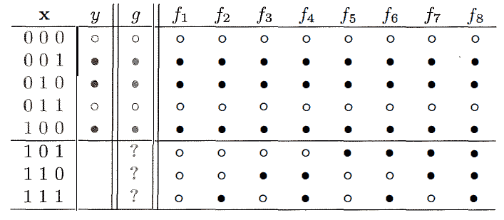
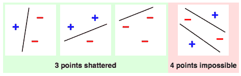
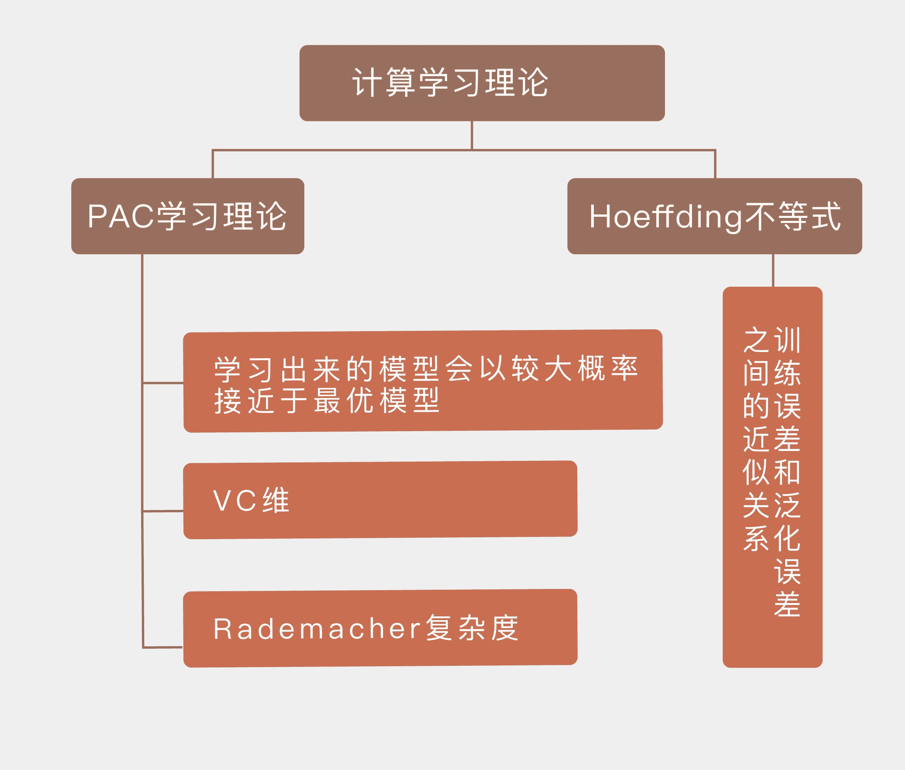

# 04 | 计算学习理论

 

无论是频率学派的方法还是贝叶斯学派的方法，解决的都是怎么学的问题。但对一个给定的问题到底能够学到什么程度，还需要专门的**计算学习理论**（computational learning theory）来解释。与机器学习中的各类具体算法相比，这部分内容会略显抽象。
 

学习的目的不是验证已知，而是探索未知，人类和机器都是如此。**对于机器学习来说，如果不能通过算法获得存在于训练集之外的信息，学习任务在这样的问题上就是不可行的**。
 

下图就是来自于加州理工大学教授亚瑟·阿布 - 穆斯塔法（Yaser S. Abu-Mostafa）的课程 Learning from Data 中的一个例子：假设输入 xx 是个包含三个特征的三维向量，输出 yy 则是二元的分类结果，训练集中包含着五个训练数据，学习的任务是预测剩下的三个测试数据对应的分类结果。
 

 学习任务示意图（图片来自 Yaser S. Abu-Mostafa, et. al., Learning from Data）
 

横线上方为训练数据，下方为待估计的分类结果，f1f1~f8f8 代表所有可能的映射关系。
 

预测三个二分类的输出，总共就有 23=823=8 种可能的结果，如上图所示。可在这穷举出来的 8 个结果里，到底哪个是符合真实情况的呢？遗憾的是，单单根据这 5 个输入数据其实是没有办法确定最适合的输出结果的。输出结果为黑点可能对应所有只有 1 个特征为 1 的输入数据（此时三个测试数据的结果应该全是白点）；也可能对应所有奇偶校验和为奇数的输入数据（此时三个测试数据的结果应该是两白一黑）；或者还有其他的潜在规律。关于这个问题唯一确定的结果就是不确定性：不管生成机制到底如何，训练数据都没有给出足以决定最优假设的信息。
 

既然找不到对测试数据具有更好分类结果的假设，那机器学习还学个什么劲呢？别忘了，我们还有概率这个工具，可以对不同假设做出定量描述。**虽然不能对每个特定问题给出最优解，但概率理论可以用来指导通用学习问题的求解，从而给出一些基本原则**。
  

不妨想象一下这个问题：一个袋子里有红球和白球，所占比例分别是 μμ 和 1−μ1−μ。在这里，作为总体参数的 μμ 是个未知量，其估计方法就是从袋子里抽出若干个球作为样本，样本中的红球比例 νν 是可以计算的，也是对未知参数 μμ 最直接的估计。
 

但是，用 νν 来近似 μμ 有多高的精确度呢？
 

直观看来，两者的取值应该相差无几，相差较大的情况虽然不是不可能发生，但是希望渺茫。在真实值 μ=0.9μ=0.9 时，如果从袋子中抽出 10 个球，你可以利用二项分布来计算一下 ν≤0.1ν≤0.1 的概率，由此观察 νν 和 μμ 相差较大的可能性。
 

直观的印象之所以准确，是因为背后存在科学依据。**在概率论中，有界的独立随机变量的求和结果与求和数学期望的偏离程度存在一个固定的上界，这一关系可以用 Hoeffding 不等式（Hoeffding's Inequality）来表示**。在前面的红球白球问题中，Hoeffding 不等式可以表示为
 

P[|ν−μ|>ϵ]≤2e−2ϵ2NP[|ν−μ|>ϵ]≤2e−2ϵ2N 

这个式子里的 ϵϵ 是任意大于 0 的常数，NN 是样本容量，也就是抽出的球的数目。
 

Hoeffding 不等式能够说明很多问题。首先，它说明用随机变量 νν 来估计未知参数 μμ 时，虽然前者的概率分布在一定程度上取决于后者，但估计的精度只和样本容量 NN 有关；其次，它说明要想提高估计的精度，最本质的方法还是增加样本容量，也就是多采一些数据，当总体的所有数据都被采样时，估计值也就完全等于真实值了。反过来说，只要样本的容量足够大，估计值与真实值的差值将会以较大的概率被限定在较小的常数 ϵϵ 之内。
 

红球白球的问题稍做推广，就是对机器学习的描述。把装球的袋子看成数据集，里面的每个球就都是一个样本，球的颜色则代表待评估的模型在不同样本上的表现：红球表示模型输出和真实输出不同；白球表示模型输出和真实输出相同。这样一来，抽出来的所有小球就表示了训练数据集，真实值 μμ 可以理解成模型符合实际情况的概率，估计值 νν 则表示了模型在训练集上的错误概率。
 

经过这样的推广，Hoeffding 不等式就变成了对单个模型在训练集上的错误概率和在所有数据上的错误概率之间关系的描述，也就是训练误差和泛化误差的关系。**它说明总会存在一个足够大的样本容量 NN 使两者近似相等，这时就可以根据模型的训练误差来推导其泛化误差，从而获得关于真实情况的一些信息**。当训练误差 νν 接近于 0 时，与之接近的泛化误差 μμ 也会接近于 0，据此可以推断出模型在整个的输入空间内都能够以较大的概率逼近真实情况。可如果小概率事件真的发生，泛化误差远大于训练误差，那只能说是运气太差了。
 

按照上面的思路，**让模型取得较小的泛化误差可以分成两步：一是让训练误差足够小，二是让泛化误差和训练误差足够接近**。正是这种思路催生了机器学习中的“**概率近似正确**”（Probably Approximately Correct, PAC）学习理论，它是一套用来对机器学习进行数学分析的理论框架。在这个框架下，**机器学习利用训练集来选择出的模型很可能（对应名称中的“概率”）具有较低的泛化误差（对应名称中的“近似正确”）**。
 

如果观察**PAC 可学习性**（PAC learnable）的数学定义（这里出于可读性的考虑没有给出，大部分机器学习教材里都会有这个定义），你会发现其中包含两个描述近似程度的参数。**描述“近似正确”的是准确度参数 ϵϵ，它将模型的误差水平，也就是所选模型和实际情况之间的距离限制在较小的范围内；描述“概率”的是置信参数 δδ，由于训练集是随机生成的，所以学好模型只是以 1−δ1−δ 出现的大概率事件，而并非 100% 发生的必然事件**。
 

如果问题是可学习的，那需要多少训练数据才能达到给定的准确度参数和置信参数呢？这要用样本复杂度来表示。**样本复杂度**（sample complexity）是保证一个概率近似正确解所需要的样本数量。可以证明，所有假设空间有限的问题都是 PAC 可学习的，其样本复杂度有固定的下界，输出假设的泛化误差会随着样本数目的增加以一定速度收敛到 0。
 

但是在现实的学习任务中，并非所有问题的假设空间都是有限的，像实数域上的所有区间、高维空间内的所有超平面都属于无限假设空间。如何判断具有无限假设空间的问题是否是 PAC 可学习的呢？这时就需要 VC 维登场了。**VC 维**（Vapnik-Chervonenkis dimension）的名称来源于统计学习理论的两位先驱名字的首字母，它是对无限假设空间复杂度的一种度量方式，也可以用于给出模型泛化误差在概率意义上的上界。
 

想象一下，如果要对 3 个样本进行二分类的话，总共有 23=823=8 种可能的分类结果。当所有样本都是正例或都是负例时，是不需要进行区分的；可当样本中既有正例又有负例时，就需要将两者区分开来，让所有正例位于空间的一个区域，所有负例位于空间的另一个区域。区域的划分方式是由模型来决定，如果对于 8 种分类结果中的每一个，都能找到一个模型能将其中的正负例完全区分，那就说明由这些模型构成的假设空间就可以将数据集打散（shatter）。
 

 

 数据集打散示意图（图片来自维基百科）
 

上图就是一个利用线性模型打散容量为 3 的数据集的例子。其实对于 3 个数据来说，所有对分类结果的划分本质上都是把其中的某两个点和另外一个区分开来，而完成这个任务只需要一条直线，而无需更加复杂的形状。可以证明，线性模型可以对任何 3 个不共线的点进行划分，也就是将这个数据集打散。
 

可是一旦数据集的容量增加到 4，线性模型就没法把它打散了。容量为 4 的数据集总共有 16 种类别划分的可能，但线性模型只能区分开其中的 14 种，不能区分开的是什么呢？就是异或问题的两种情况，也就是红色图示中的特例。要将位于对角线位置的正例和负例区分开来，要么用一条曲线，要么用两条直线，单单一条直线是肯定做不到的。
 

在打散的基础上可以进一步定义 VC 维。假设空间的 VC 维是能被这个假设空间打散的最大集合的大小，它表示的是完全正确分类的最大能力。上面的例子告诉我们，对于具有两个自由度的线性模型来说，它最多能打散容量为 3 的集合，其 VC 维也就等于 3。如果假设空间能打散任意容量的数据集，那它的 VC 维就是无穷大了。一个具有无穷 VC 维的假设空间是 y=sin(kx)y=sin(kx)，你可以思考一下这背后的原因。
 

从可学习性的角度来看，一旦假设空间的 VC 维有限，就可以通过调整样本复杂度来使训练误差以任意的精度逼近泛化误差，使泛化误差和训练误差足够接近。这个性质取决于模型的特性，与学习方法、目标函数、数据分布都没有关系，因而是通用的。从这个结论出发就可以得到，**任何 VC 维有限的假设空间都是 PAC 可学习的**。
 

在维度有限的前提下，VC 维的大小也会影响模型的特性。**较小的 VC 维虽然能够让训练误差和泛化误差更加接近，但这样的假设空间不具备较强的表达能力（想想上面线性模型的例子），训练误差本身难以降低。反过来，VC 维更大的假设空间表达能力更强，得到的训练误差也会更小，但训练误差下降所付出的代价是训练误差和泛化误差之间更可能出现较大的差异，训练集上较小的误差不能推广到未知数据上**。这其实也体现了模型复杂度和泛化性能之间的折中关系。
 

由于 VC 维并不依赖于数据分布的先验信息，因此它得到的结果是个松散的**误差界**（error bound），这个误差界适用于任意分布的数据。要是将数据的分布特性纳入可学习性的框架，复杂性的指标就变成了**Rademacher 复杂度**（Rademacher complexity）。
 

函数空间的**经验 Rademacher 复杂度**（empirical Rademacher complexity）描述函数空间和随机噪声在给定数据集上的相关性，这里的随机噪声以 Rademacher 变量（Rademacher variable）的形式出现，它以各 50% 的概率取 ±1±1 这两个值。如果存在多个数据集，而每个数据集中的数据都是对同一个概率分布的独立重复采样，那么对每个数据集的经验 Rademacher 复杂度求解数学期望。得到的就是“**没有经验的**”**Rademacher 复杂度**，它表示了函数空间在给定的数据分布上拟合噪声的性能。
 

看到这里你可能不明白了，学得好好的为什么要去拟合噪声呢？其实引入 Rademacher 复杂度的初衷是刻画训练误差和泛化误差之间的区别。泛化误差是没办法计算的，只能想方设法地去近似，而交叉验证就是最常用的近似手段。如果将容量为 mm 数据集等分成训练集 S1S1 和验证集 S2S2，那训练误差与泛化误差之差就可以写成
 

ES1(h)−ES2(h)=2m[∑xi∈S1e(h,xi)−∑xi∈S2e(h,xi)]ES1(h)−ES2(h)=2m[∑xi∈S1e(h,xi)−∑xi∈S2e(h,xi)] 

其中 hh 表示待评价的假设。显然，当 xixi 落入 S1S1 时，损失函数 e(⋅)e(⋅) 的系数为 1；当 xixi 落入 S2S2 时，损失函数 e(⋅)e(⋅) 的系数为 -1。如果用随机变量 σiσi 对 ±1±1 的系数进行建模的话，上面的式子就可以改写称
 

ES1(h)−ES2(h)=2m[∑iσie(h,xi)]ES1(h)−ES2(h)=2m[∑iσie(h,xi)] 

如果把 σiσi 看成 Rademacher 变量，那这个式子就是 Rademacher 复杂度。到这儿就不难理解 Rademacher 复杂度的含义了。在已知的数据分布下，Rademacher 复杂度既可以表示函数空间的复杂度，也可以用来计算泛化误差界，其数学细节在这儿就不做介绍了。
 

今天我和你分享了计算学习理论的一些最主要的概念，并没有深入数学细节。这是评估机器学习的理论基础，也是机器学习理论研究的主要对象，其要点如下：
 
 
- 

 Hoeffding 不等式描述了训练误差和泛化误差之间的近似关系；
  
- 

PAC 学习理论的核心在于学习出来的模型会以较大概率接近于最优模型；
  
- 

假设空间的 VC 维是对无限假设空间复杂度的度量，体现了复杂性和性能的折中；
  
- 

Rademacher 复杂度是结合了先验信息的对函数空间复杂度的度量。
  
 

和各种具体的模型相比，计算学习理论充斥着各种各样的抽象推导，其内容也显得比较枯燥无味。那么关于学习理论的研究对解决实际问题到底具有什么样的指导意义呢？
 

欢迎发表你的观点。
 

 

