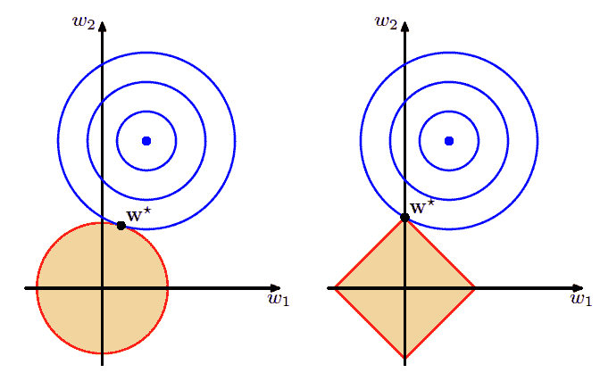
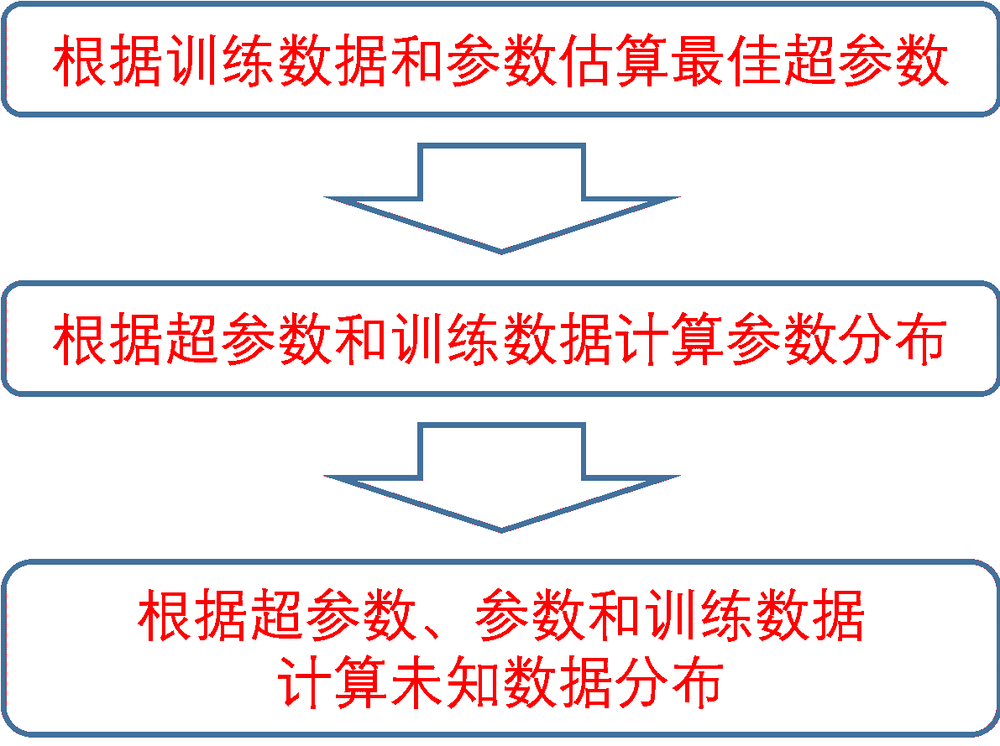
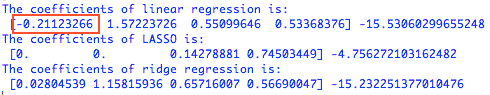
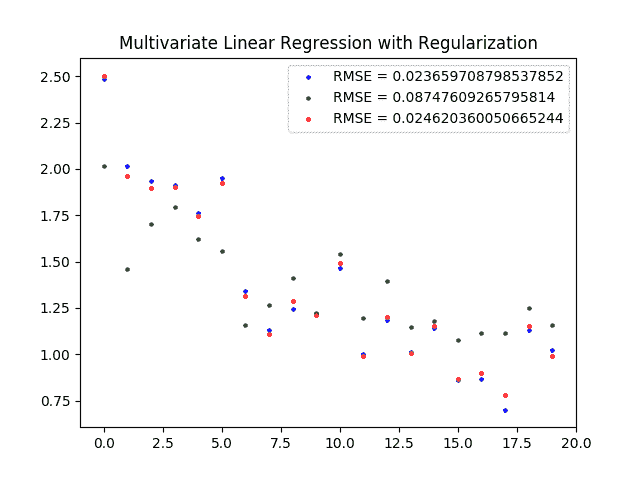
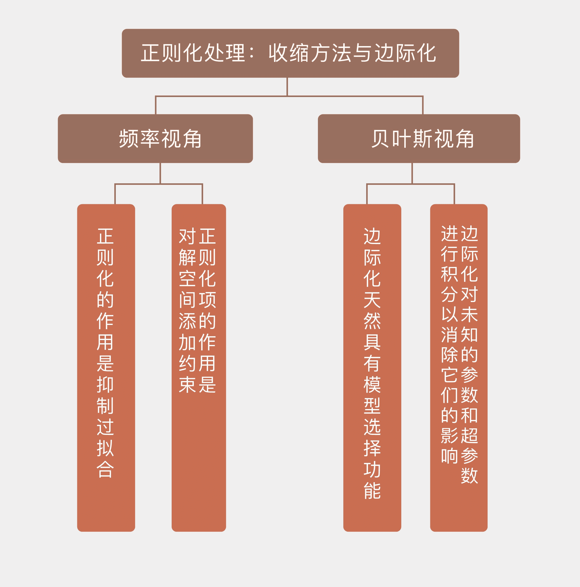

# 12 | 正则化处理：收缩方法与边际化

 

今天的内容是线性回归的正则化扩展。正则化称得上是机器学习里的刮骨疗毒，刮的是过拟合（overfitting）这个任何机器学习方法都无法摆脱的附骨之疽。
 

本质上讲，**过拟合就是模型过于复杂，复杂到削弱了它的泛化性能**。由于训练数据的数目是有限的，因此我们总是可以通过增加参数的数量来提升模型的复杂度，进而降低训练误差。可人尽皆知的是，学习的本领越专精，应用的口径就越狭窄，过于复杂的模型就像那个御膳房里专门切黄瓜丝的御厨，让他改切萝卜就下不去刀了。
 

正则化（regularization）是用于抑制过拟合的方法的统称，它**通过动态调整估计参数的取值来降低模型的复杂度，以偏差的增加为代价来换取方差的下降**。这是因为当一些参数足够小时，它们对应的属性对输出结果的贡献就会微乎其微，这在实质上去除了非相关属性的影响。
 

在线性回归里，最常见的正则化方式就是在损失函数（loss function）中添加**正则化项**（regularizer），而添加的正则化项 R(λ)R(λ) 往往是待估计参数的 pp- 范数。将均方误差和参数的范数之和作为一个整体来进行约束优化，相当于额外添加了一重关于参数的限制条件，避免大量参数同时出现较大的取值。由于正则化的作用通常是让参数估计值的幅度下降，因此在统计学中它也被称为**系数收缩方法**（shrinkage method）。
 

将正则化项应用在基于最小二乘法的线性回归中，就可以得到**线性回归的不同修正**（penalized linear regression）。添加正则化项之后的损失函数可以写成**拉格朗日乘子**的形式
 

E~(w)=12∑n=1N[f(xn,w)−yn]2+λg(||w||p),g(||w||p)<tE~(w)=12∑n=1N[f(xn,w)−yn]2+λg(||w||p),g(||w||p)<t 

其中的 λλ 是用来平衡均方误差和参数约束的超参数。当正则化项为 1- 范数时，修正结果就是**LASSO**；当正则化项为 2- 范数的平方时，修正结果就是**岭回归**；当正则化项是 1- 范数和 2- 范数平方的线性组合 α||w||22+(1−α)||w||1α||w||22+(1−α)||w||1 时，修正结果就是**弹性网络**（elastic net）。
 

 

 

正则化对线性回归的改进（图片来自 Pattern Recognition and Machine Learning，图 3.4）
 

岭回归和 LASSO 具有不同的几何意义。上图给出的是岭回归（左）和 LASSO（右）的可视化表示。图中的蓝色点表示普通最小二乘法计算出的最优参数，外面的每个蓝色圆圈都是损失函数的等值线，每个圆圈上的误差都是相等的，从里到外误差则越来越大。
 

红色边界表示的则是正则化项对参数可能取值的约束，这里假定了未知参数的数目是两个。岭回归中要求两个参数的平方和小于某个固定的取值，即 w21+w22<tw12+w22<t，因此解空间就是浅色区域代表的圆形；而 LASSO 要求两个参数的绝对值之和小于某个固定的取值，即 |w1|+|w2|<t|w1|+|w2|<t，因此解空间就是浅色区域代表的方形。
 

不管采用哪种正则化方式，最优解都只能出现在浅色区域所代表的约束条件下，因而误差等值线和红色边界的第一个交点就是正则化处理后的最优参数。交点出现的位置取决于边界的形状，圆形的岭回归边界是平滑的曲线，误差等值线可能在任何位置和边界相切。
 

相形之下，方形的 LASSO 边界是有棱有角的直线，因此切点最可能出现在方形的顶点上，这就意味着某个参数的取值被衰减为 0。
 

这张图形象地说明了岭回归和 LASSO 的区别。岭回归的作用是衰减不同属性的权重，让所有属性一起向圆心收拢；LASSO 则直接将某些属性的权重降低为 0，完成的是属性过滤的任务。
 

而弹性网络作为两者的折中，结合了不同的优点：它不会轻易地将某些属性抛弃，从而使全部信息得以保留，但对不重要的特征也会毫不手软地大幅削减其权重系数。
 

对正则化以上的认识都来自于频率主义的视角。在上一季的专栏中我曾介绍过，从概率的角度看，岭回归是当参数 ww 满足正态分布时，用最大后验概率进行估计得到的结果；LASSO 是当参数 ww 满足拉普拉斯分布时，用最大后验概率进行估计得到的结果。
 

这样的结论体现出贝叶斯主义对正则化的理解：**正则化就是引入关于参数的先验信息**。
 

但是翻开贝叶斯主义的机器学习词典，你不会找到“正则化”这个词，因为这个概念并没有显式地存在，而是隐式地融于贝叶斯定理之中。贝叶斯方法假设待估计的未知参数满足一定的概率分布，因此未知参数对预测结果的影响并不体现为满足某种最优性的“估计值”，而是通过积分消除掉未知参数引入的不确定性。这个过程在之前探讨贝叶斯视角下的概率时，已经通过 Alice 和 Bob 投球的例子加以解释，你可以回忆一下。
 

在贝叶斯的术语里，将未知随机变量按照其概率分布积分成常量的过程叫**边际化**（marginalization）。边际化是贝叶斯估计中非常重要的核心概念，它起到的正是正则化的作用。
 

还是以线性回归为例，假定每个输出 yy 都是其属性 xx 的线性组合与服从正态分布 N(0,σ2)N(0,σ2) 的噪声的叠加，属性的权重系数 ww 则服从 N(0,α)N(0,α) 的先验分布。
 

那么利用训练数据 yy 估计测试数据 y∗y∗ 时，输出的预计分布（predictive distribution）就可以写成以下的条件概率
 

p(y∗|y,α,σ2)p(y∗|y,α,σ2) 

 
=∫p(y∗|w,σ2)p(w|y,α,σ2)dw=∫p(y∗|w,σ2)p(w|y,α,σ2)dw 

在这个式子中，αα 和 σ2σ2 都是独立于训练数据的超参数。在频率主义的最大似然估计中，预测结果并不会将参数 ww 的估计准确性表示到结果中。
 

而贝叶斯主义则根据 ww 每一个可能的取值计算出对应结果 y∗y∗，再对连续分布的 ww 取平均。
 

就可以得到 y∗y∗ 的概率分布，这就是上面这个表达式的含义。
 

对于预测结果 y∗y∗ 来说，它的不确定性既来自于训练数据 yy，也来自于未知的超参数 αα 和 σ2σ2。
 

但事实上超参数只是人为设定的数值，在真实的估计任务中，我们需要得到与任何多余参量都没有关系的 p(y∗|y)p(y∗|y)。
 

在全贝叶斯的框架下，要积分掉超参数的影响，就必须一视同仁地对超参数进行概率分布 p(α)p(α) 和 p(σ2)p(σ2) 的建模，这些超参数的先验信息就被叫作**超先验**（hyperprior）。
 

引入超先验后，目标概率就可以写成
 

p(y∗|y)p(y∗|y) 

=∫p(y∗|w,σ2)p(w,α,σ2|y)dwdαdσ2=∫p(y∗|w,σ2)p(w,α,σ2|y)dwdαdσ2 

看到这里，你肯定被这么多乱七八糟的符号搞的晕头转向了！因为正常人都会有这种感觉。这正是贝叶斯概率为人诟病的一个缺点：**难以求出解析解**！
 

要计算这个复杂的积分必须使用一些近似的技巧。首先，利用条件概率的性质，上式中的第二个积分项，也就是已知训练数据时参数和超参数的条件概率可以改写成
 

p(w,α,σ2|y)=p(w|y,α,σ2)p(α,σ2|y)p(w,α,σ2|y)=p(w|y,α,σ2)p(α,σ2|y) 

等式右侧的第一项其实就是岭回归的最优参数，可以证明这个概率服从参数已知的正态分布，因而可以看成一个确定项。可在计算第二项，也就是根据训练数据确定超参数时，就只能将实数域上的概率密度近似为最可能（most probable）的取值 αMPαMP 和 σ2MPσMP2，用点估计结果代替原始的概率分布。
 

利用贝叶斯定理可以得出，最可能的超参数取值应该让下面的后验概率最大化
 

p(α,σ2|y)=p(y|α,σ2)p(α)p(σ2)p(y)p(α,σ2|y)=p(y|α,σ2)p(α)p(σ2)p(y) 

在计算中，分母上的 p(y)p(y) 与超参数无关，因此可以忽略不计；由于超参数的取值是任意的，将它们的超先验分布设定为**无信息的先验**（uninformative prior）就是合理的选择，p(α)p(α) 和 p(σ2)p(σ2) 也就会以常数形式的均匀分布出现。
 

所以，寻找最可能的 αMPαMP 和 σ2MPσMP2 就变成了计算**边际似然概率**（marginal probability）p(y|α,σ2)p(y|α,σ2) 的最大值。把边际似然概率对待估计的参数进行展开，就可以将后验概率最大化等效成似然概率最大化
 

p(y|α,σ2)=∫p(y|w,σ2)p(w|α)dwp(y|α,σ2)=∫p(y|w,σ2)p(w|α)dw 

积分的第一项是最大似然估计的解，第二项则是参数满足的先验分布，经过复杂的计算可以得出，积分结果仍然具有正态分布的形式，下面的任务就是找到使训练数据 yy 出现概率最大的一组超参数 αα 和 σ2σ2。表示噪声的强度的超参数 σ2σ2 其实是个固定的取值，通常可以通过多次试验直接测出。在确定 σ2σ2 之后，就可以用梯度下降法来找到最优的 αα 了。
 

总结起来，利用贝叶斯概率来确定最优参数的步骤可以归纳如下：求解的对象是已知训练数据时，测试数据的条件概率 p(y∗|y)p(y∗|y)，要计算这个条件概率就要对所有未知的参数和超参数进行积分，以消除这些变量。
 

而在已知的数据和未知的超参数之间搭起一座桥梁的，正是待估计的参数 ww，它将 p(y∗|y)p(y∗|y) 的求解分解成两部分，一部分是根据已知数据推断参数，另一部分是根据参数推断未知数据。
 

而在根据已知数据推断参数时，又要先推断超参数，再利用超参数和数据一块儿推断参数。对超参数的推断则可以通过边际似然概率简化。
 

 贝叶斯推断过程示意图 

和具有直观几何意义的岭回归相比，贝叶斯边际化处理中一个接一个的条件概率没法不让人头疼。这么复杂的方法到底意义何在呢？它的价值就在于**计算出的结果就是最优的结果**。
 

频率主义的正则化只是引入了一个正则化系数 λλ，但 λλ 的最优值到底是多少呢？只能靠重复试验确定，这就需要用验证数据集（validation set）来评估每个备选 λλ 的最优性。
 

相比之下，贝叶斯主义的边际化就简化了最优化的过程，让边际似然概率最大的超参数就是最优的超参数。
 

这样做的好处就是所有数据都可以用于训练，不需要额外使用验证集，这在数据较少时是非常有用的。
 

在编程中，很多第三方的 Python 库都可以直接实现不同的正则化处理。在 Scikit-learn 库中，线性模型模块 linear_model 中的 Lasso 类和 Ridge 类就可以实现 l1l1 正则化和 l2l2 正则化。使用这两个类对上一篇文章中拟合出来的多元线性回归模型进行正则化处理，将两种算法中的正则化项参数均设置为 λ=0.05λ=0.05，就可以得到修正后的结果：
 

 不同线性回归方法的结果比较 

线性系数的变化直观地体现出两种正则化的不同效果。在未经正则化的多元线性回归中，用红框圈出来的系数比较反直觉，因为它意味着门将的表现对球队积分起到的是负作用，这种结论明显不合常理。
 

这个问题在两种正则化操作中都得以解决。
 

LASSO 将 4 个特征中 2 个的系数缩减为 0，这意味着一半的特征被淘汰掉了，其中就包括倒霉的守门员。在 LASSO 看来，对比赛做出贡献的只有中场和前锋球员，而中场的作用又远远不及前锋——这样的结果是否是对英超注重进攻的直观印象的佐证呢？
 

和 LASSO 相比，岭回归保留了所有的特征，并给门将的表现赋予了接近于 0 的权重系数，以削弱它对结果的影响，其它的权重系数也和原始多元回归的结果更加接近。但 LASSO 和岭回归的均方误差都高于普通线性回归的均方误差，LASSO 的性能还要劣于岭回归的性能，这是抑制过拟合和降低误差必然的结果。
 

 

不同回归算法的拟合结果示意图（蓝点为多元线性回归，绿点为 LASSO，红点为岭回归）
 

今天我和你分享了频率观点下的正则化和贝叶斯观点下的边际化，以及它们在线性回归中的应用，其要点如下：
 
 
- 

 正则化的作用是抑制过拟合，通过增加偏差来降低方差，提升模型的泛化性能；
  
- 

正则化项的作用是对解空间添加约束，在约束范围内寻找产生最小误差的系数；
  
- 

频率视角下的正则化与贝叶斯视角下的边际化作用相同；
  
- 

边际化对未知的参数和超参数进行积分以消除它们的影响，天然具有模型选择的功能。
  
 

最后需要说明的是，正则化的最优参数通常会通过交叉验证进行模型选择来产生，也就是在从不同数据子集上计算出的不同 λλ 中择优取之。由于英超数据集的样本数目较少，所以没有添加交叉验证的过程。
 

岭回归和 LASSO 虽然都能降低模型的方差，但它们处理参数的方式不同，得到的结果也不一样。那么在你看来，这两种正则化手段分别适用于什么样的场景呢？
 

欢迎发表你的观点。
 

 

