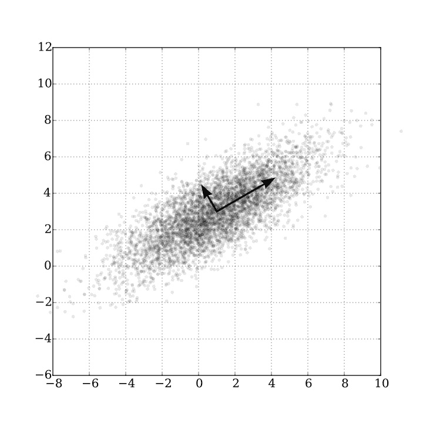
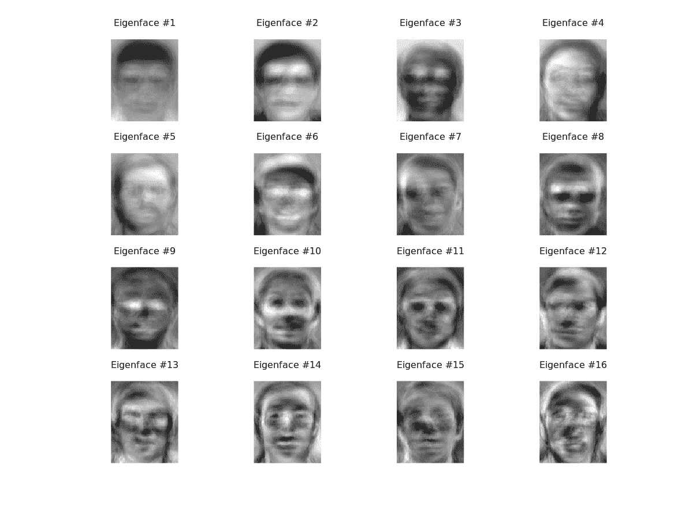
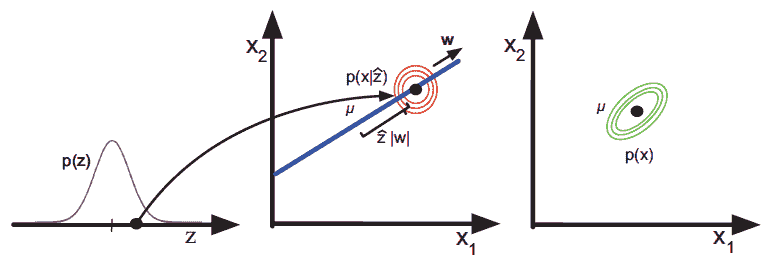
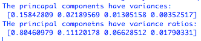
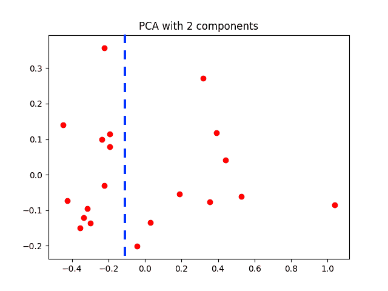
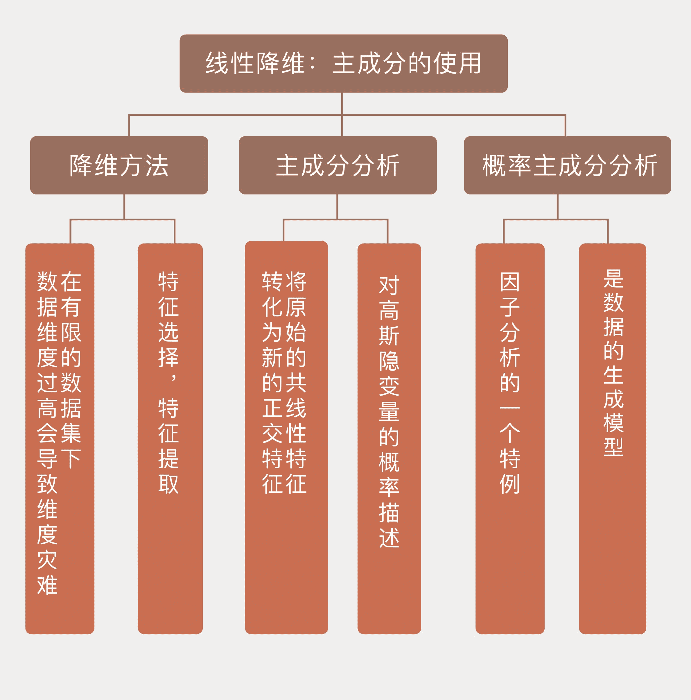

# 13 | 线性降维：主成分的使用

 

在前一篇文章中，我以岭回归和 LASSO 为例介绍了线性回归的正则化处理。这两种方法都属于**收缩方法**（shrinkage method），它们能够使线性回归的系数连续变化。但和岭回归不同的是，LASSO 可以将一部分属性的系数收缩为 0，事实上起到了筛选属性的作用。
 

和 LASSO 这种间接去除属性的收缩方法相对应的是**维度规约**。维度规约这个听起来个高大上的名称是数据挖掘中常用的术语，它有一个更接地气的同义词，就是**降维**（dimensionality reduction），也就是直接降低输入属性的数目来削减数据的维度。
 

对数据维度的探讨来源于“**维数灾难**”（curse of dimensionality），这个概念是数学家理查德·贝尔曼（Richard Bellman）在动态优化问题的研究中提出的。
 

发表于《IEEE 模式分析与机器智能汇刊》（IEEE Transactions on Pattern Analysis and Machine Intelligence）第 1 卷第 3 期的论文《维数问题：一个简单实例（A Problem of Dimensionality: A Simple Example）》在数学上证明了当所有参数都已知时，属性维数的增加可以让分类问题的错误率渐进为 0；可当未知的参数只能根据数量有限的样本来估计时，属性维数的增加会使错误率先降低再升高，最终收敛到 0.5。
 

这就像一群谋士七嘴八舌在支招，当领导的要是对每个人的意见都深入考虑再来拍板的话，这样的决策也没什么准确性可言了。
 

**维数灾难深层次的原因在于数据样本的有限**。当属性的维数增加时，每个属性每个可能取值的组合就会以指数形式增长。对于二值属性来说，2 个属性所有可能的取值组合共有 4 种，可每增加一个属性，可能的组合数目就会翻番。
 

一般的经验法则是每个属性维度需要对应至少 5 个数据样本，可当属性维数增加而样本数目不变时，过少的数据就不足以体现出属性背后的趋势，从而导致过拟合的发生。当然，这只是维数灾难的一种解释方式，另一种解释方式来源于几何角度的数据稀疏性，这里暂且按下不表。
 

在数据有限的前提下解决维数灾难问题，化繁为简的降维是必经之路。降维的对象通常是那些“食之无味，弃之可惜”的鸡肋属性。食之无味是因为它们或者和结果的相关性不强，或者和其他属性之间有较强的关联，使用这样的属性没有多大必要；弃之可惜则是因为它们终究还包含一些独有的信息，就这么断舍离又会心有不甘。
 

如果像亚历山大剑斩戈尔迪之结一般直接砍掉鸡肋属性，这种“简单粗暴”的做法就是**特征选择**（feature selection）。另一种更加稳妥的办法是破旧立新，将所有原始属性的信息一点儿不浪费地整合到脱胎换骨的新属性中，这就是**特征提取**（feature extraction）的方法。
 

无论是特征选择还是特征提取，在“人工智能基础课”中都有相应的介绍。
 

今天我要换个角度，先从刚刚介绍过的岭回归说起。假设数据集中有 NN 个样本，每个样本都有 pp 个属性，则数据矩阵 XX 的维度就是 N×pN×p。将中心化处理后，也就是减去每个属性平均值的 XX 进行奇异值分解（singular value decomposition）可以得到
 

X=UDVTX=UDVT 

其中的 UU 和 VV 分别是 N×pN×p 维和 p×pp×p 维的正交矩阵，其各自的所有列向量可以张成一个子空间；DD 则是对角矩阵，对角线上的各个元素是数据矩阵 XX 按从大到小顺序排列的奇异值（singular value）djdj。可以证明，岭回归求出的最优系数可以写成 β^=(XTX+λI)−1XTyβ^=(XTX+λI)−1XTy。将 XX 的奇异值分解代入岭回归的预测输出中，就可以得到：
 

Xβ^=∑j=1pujd2jd2j+λuTjyXβ^=∑j=1pujdj2dj2+λujTy 

其中的 ujuj 是矩阵 UU 的列向量，也是 XX 的列空间的一组正交基，而岭回归计算出的结果正是将训练数据的输出 yy 投影到以 ujuj 为正交基的子空间上所得到的坐标。除了空间变换之外，岭回归的收缩特性也有体现，那就是上式中的系数。当正则化参数 λλ 一定时，奇异值 djdj 越小，它对应的坐标被衰减地就越厉害。
 

除了经历不同的收缩外，奇异值 djdj 还有什么意义呢？djdj 的平方可以写成对角矩阵 DD 的平方，利用奇异值分解又可以推导出 D2D2 和数据矩阵 XX 如下的关系
 

XTX=VD2VTXTX=VD2VT 

这个表达式实际上就是矩阵的**特征分解**（eigen decomposition）：等式左侧的表达式实际上就是数据的协方差矩阵（covariance matrix）乘以维度 NN，VV 中的每一列 vjvj 都是协方差矩阵的特征向量，D2D2 中的每个对角元素 d2jdj2 则是对应的特征值。如果你对主成分分析还有印象，就不难发现每一个 XvjXvj 都是一个主成分（principal component），第 jj 个主成分上数据的方差就是 d2j/Ndj2/N。
 

解释到这儿，就能够看出岭回归的作用了：**岭回归收缩系数的对象并非每个单独的属性，而是由属性的线性组合计算出来的互不相关的主成分，主成分上数据的方差越小，其系数收缩地就越明显**。
 

数据在一个主成分上波动较大意味着主成分的取值对数据有较高的区分度，也就是上一季中提到的“最大方差原理”。反之，数据在另一个主成分上方差较小就说明不同数据的取值较为集中，而聚成一团的数据显然是不容易区分的。岭回归正是通过削弱方差较小的主成分、保留方差较大的主成分来简化模型，实现正则化的。
 

  
 不同方差的主成分示意图，2 点钟方向的主成分方差较大，11 点钟方向的主成分方差较小（图片来自维基百科）
 

看到这里你可能就想到了：既然主成分都已经算出来了，与其用岭回归兜一个圈子，莫不如直接使用它们作为自变量来计算线性回归的系数，这种思路得到的就是**主成分回归**（principal component regression）。
 

主成分回归以每个主成分 zj=Xvjzj=Xvj 作为输入计算回归参数。由于不同的主成分是两两正交的，因此这个看似多元线性回归的问题实质上是多个独立的简单线性回归的组合，每个主成分的权重系数可以表示为
 

θ^m=<zm,y><zm,zm>θ^m=<zm,y><zm,zm> 

其中 <><> 表示内积运算。需要注意的是这里的 yy 和数据矩阵的每一列 xjxj 都要做去均值的处理，主成分回归的常数项就是 yy，也就是所有数据输出结果的均值 y¯y¯。
 

当主成分回归中使用的主成分数目等于数据的属性数目 pp 时，主成分回归和岭回归的结果是一致的。可如果放弃方差最小的若干个主成分，得到的就是约化的回归结果，从而更加清晰地体现出主成分分析的思想。
 

主成分分析是典型的特征提取方法，它和收缩方法的本质区别在于将原始的共线性特征转化为人为生成的正交特征，从而带来了数据维度的约简和数据压缩的可能性。数字图像处理中的特征脸方法是主成分回归最典型的应用之一。
 

所谓“**特征脸**”（eigenface）实际上就是用于人脸识别的主成分。用特征脸方法处理的人脸图像都具有相同的空间维度，假定图像的像素数目都是 100×100100×100，那么每一个像素点都是一个属性，数字图像就变成了 10000 维空间中的一个点。可一般数字图像慢变特性决定了这 10000 个特征之间具有很强的关联，直接处理的话运算量较大不说，还未必有好的效果，可谓事倍功半。
 

  
 根据 AT&T Laboratories Cambridge Facedatabase 人脸数据库生成的特征脸
 

图片来自 https://www.bytefish.de/blog/eigenfaces/
 

引入主成分分析后，情况就不一样了。主成分分析可以将 10000 个相互关联的像素维度精炼成 100～150 个特征脸，再用这些特征脸来重构相同形状的人脸图像。
 

上图是真实计算出的一组特征脸图像，如果是晚上一个人在家玩手机的话，那这组惊悚的特征脸很可能让你吓得不轻。可如果你能想明白一个问题：这只是一组被打成正方形的 10000 多维的相互正交的主成分，而原始图像让它们碰巧具有了人脸的轮廓，这些人不人鬼不鬼的东西就没有那么恐怖了。
 

这些主成分可以用来分解任意一张面孔，说不定我的一寸照片就可以表示成 2727 的组合呢。
 

前面对主成分分析的解释都是从降维的角度出发的。换个角度，主成分分析可以看成**对高斯隐变量的概率描述**。隐变量（latent variable）是不能直接观测但可以间接推断的变量，虽然数据本身处在高维空间之中，但决定其变化特点的可能只是有限个参数，这些幕后的操纵者就是隐变量，寻找隐变量的过程就是对数据进行降维的过程。
 

**概率主成分分析**（probabilistic principal component analysis）体现的就是高斯型观测结果和高斯隐变量之间线性的相关关系，它是因子分析（factor analysis）的一个特例。概率主成分分析的数学推导比较复杂，在这里不妨直接给出结论：
 

假定一组数据观测值构成了 DD 维向量 XX，另外一组隐变量构成了 QQ 维向量 ZZ，两者之间的线性关系就可以表示为
 

X=WZ+μ+ϵX=WZ+μ+ϵ 

其中关联矩阵 WW 是由标准正交基构成的矩阵，非零向量 μμ 表示观测值的均值，ϵϵ 则是服从标准多维正态分布 N(0,σ2I)N(0,σ2I) 的各向同性的噪声。如果假设隐变量 ZZ 具有多元标准正态形式的先验分布 p(Z)p(Z)，去均值观测数据 XX 的对数似然概率可以写成
 

logp(X|W,σ2)=−N2ln|C|−12∑i=1NxTiC−1xilog⁡p(X|W,σ2)=−N2ln⁡|C|−12∑i=1NxiTC−1xi 

其中 C=WWT+σ2IC=WWT+σ2I。计算可得，让似然概率取得最大值的参数值为 W^=V(D2−σ2I)1/2W^=V(D2−σ2I)1/2。根据这个 W^W^ 又可以计算出超参数 σ2σ2 得最大似然估计值 σ^2=1D−Q∑j=Q+1Dd2jσ^2=1D−Q∑j=Q+1Ddj2，这说明噪声方差就是所有被丢弃的主成分方差的均值。而当 ϵ→0ϵ→0 时，概率主成分分析的线性系数 W^W^ 就会退化为经典的主成分分析中的 VV。
 

除了似然概率外，根据正态分布的性质也可以计算出隐变量的后验概率 p(Z|X)p(Z|X)。令 F^=W^TW^+σ^2IF^=W^TW^+σ^2I，后验概率满足的就是以 F^−1W^XF^−1W^X 为均值，σ2F^−1σ2F^−1 为方差的正态分布。当 ϵ→0ϵ→0 时，隐变量的最优值就会收敛为经典主成分 XVXV。
 

在实际问题中，使用的主成分数目是个超参数，需要通过模型选择确定，而概率主成分分析对测试数据的处理就可以完成模型选择的任务。从重构误差的角度出发，经典主成分分析一般会让被选中的主成分的特征值之和占所有特征值之和的 95% 以上。在贝叶斯框架下，计算最优的主成分数目需要对所有未知的参数超参数进行积分，其过程非常复杂，在这里就不讨论了。
 

同其他隐变量模型一样，概率主成分分析也是个生成模型，其生成机制如下图所示。首先从服从一维正态分布的隐变量 zz 中得到采样值 z^z^，以 wz+μwz+μ 为均值的单位方差二维正态分布就是数据 xx 的似然分布，将先验分布与似然分布相乘，得到的就是最右侧的二维分布 p(x)p(x) 了。
 

  概率主成分分析表示的数据生成机制 

图片来自 Machine Learning: A Probabilistic Perspective, 图 12.1
 

在 Scikit-learn 中，主成分分析对应的类是 PCA，它在 decomposition 的模块种。还是以英超数据集为例，对多元线性回归的数据进行主成分分析，可以得到 10 个主成分的方差，以及它们占总方差的比例：
 

 

英超数据集上所有主成分的方差及其比例
 

从结果中可以看出，方差最大的主成分占据了近 4/5 的总方差，前两个主成分的方差之和的比例则超过了 90%。在对数据进行降维时，如果将方差的比例阈值设定为 95%，保留的主成分数目就是 2 个，这说明 2 个主成分已经足以解释输出结果中 90% 的变化。
 

 

使用前两个主成分对英超数据集进行变换的结果
 

为了对主成分分析后的数据分布产生直观的认识，可以将变换后的数据点显示在低维空间中，以观察它们的集中程度。出于观察方便的考虑，在可视化时只选择了方差最大的前两个主成分，虽然这样做会造成较大的误差，但变换后的数据就可以在平面直角坐标系上显示出来，如上图所示。
 

可以看出，经过变换后的数据点依然分散在整个二维平面上，但根据它们在横轴上的取值已经可以近似地将数据划分为两个类别，其原因很可能是蓝线两侧的数据代表了两种类型的球队风格，就像来自两个高斯分布的随机数。
 

今天我和你分享了从岭回归到主成分回归的推导过程，以及作为降维方法和特征提取技术的主成分分析，其要点如下：
 
 
-  

 在有限的数据集下，数据维度过高会导致维数灾难；
  
-  

降维的方法包括特征选择和特征提取；
  
-  

主成分分析将原始的共线性特征转化为新的正交特征，从而实现特征提取；
  
-  

概率主成分分析是因子分析的一种，是数据的生成模型。
  
 

在机器学习中，还有一种和主成分分析名字相似的方法，叫作**独立成分分析**（independent component analysis）。那么这两者之间到底有什么区别和联系呢？
 

你可以查阅资料加以了解，并在这里分享你的理解。
 

 

