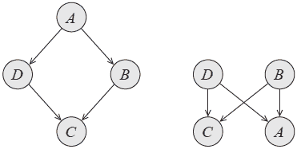
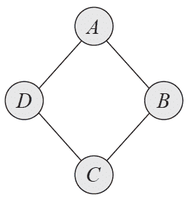
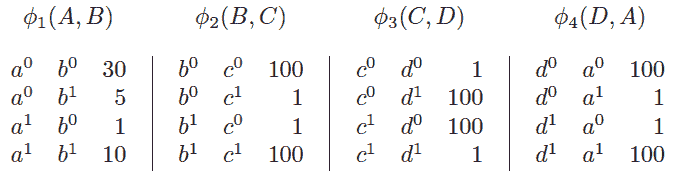
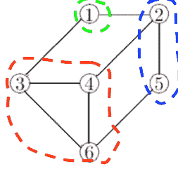
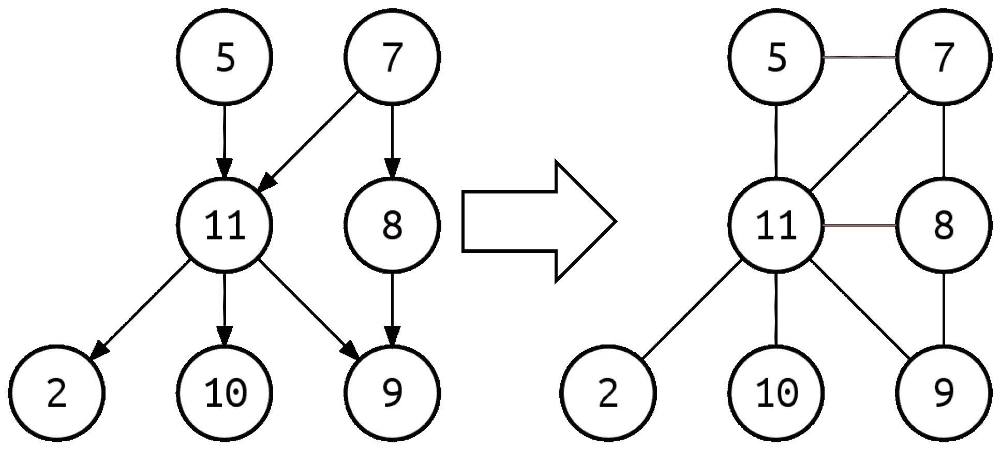
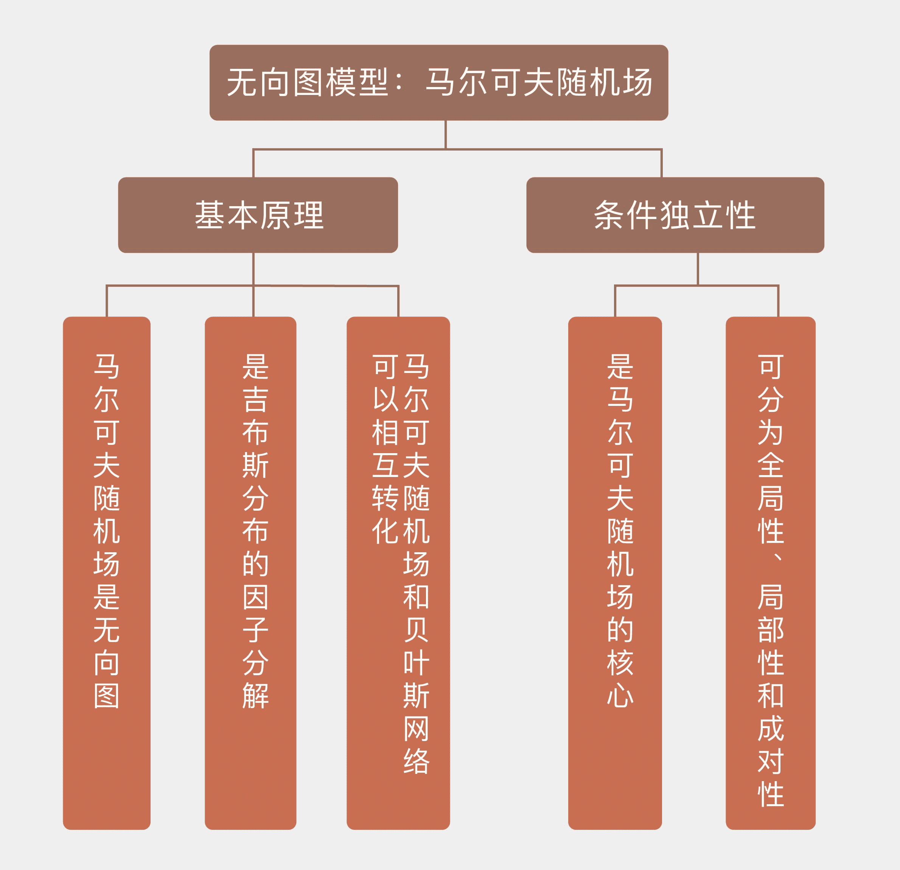

# 30 | 无向图模型：马尔可夫随机场

 

作为有向图模型的代表，贝叶斯网络将随机变量之间的条件独立性与依赖关系嵌入到图结构之中，既有助于直观表示，又能简化计算。但这是不是意味着贝叶斯网络可以通吃所有概率关系呢？并非如此。
 

下面这个例子就说明了贝叶斯网络的局限之处，它取自达芙妮·科勒（Daphne Koller）的经典教材《概率图模型》（Probabilistic Graphical Models）的例 3.8。
 

“四个学生 Alice、Bob、Charles 和 Debbie 在一个学习小组中，但由于 A 和 C、B 和 D 两两之间因为感情的纠葛导致没有交流，因此每个人可以交流的对象都只有 2 个。这样的关系应该如何表示呢？”
 

这四个学生可以建模成概率图中的四个结点，也就是四个随机变量。用贝叶斯网络构造这组关系时，由于 A 和 C 之间不存在交流，两者之间也就没有信息的流动，所以在给定 B 和 D 的前提下，A 和 C 是条件独立的；同样的道理，在给定 A 和 C 的前提下，B 和 D 也是条件独立的。这就要求构造出来的贝叶斯网络能够同时表示这两组条件独立性。
 

 

贝叶斯网络的局限性（图片来自 Probabilistic Graphical Models，图 3.10）
 

上图表示的是两种可能的贝叶斯网络结构，但两者都没法同时表示两个条件独立性。在左侧的子图中，从 A 到 C 的两条通路都是顺连结构，中间的结点分别是 B 和 D。固定的 B 和 D 堵塞了信息流动的通道，从而保证了 A 和 C 的条件独立性。
 

但反过来，B 和 D 是不是独立的呢？这两个结点与 A 共同构成了分连结构，因此它们关于 A 是条件独立的。可同时它们又和 C 构成了汇连结构，这意味着 C 的确定会同时导致 B 和 D 的变化，条件独立性也就无从谈起了。
 

右侧的子图同样存在缺陷。从上向下看，这是两个分连结构的拼凑，保证了 A 和 C 的条件独立；可如果换个角度，从下往上看的话，这又是两个汇连结构的拼凑，无论是 A 还是 C 都搭建了从 B 到 D 的通路，这样的结构也不能同时形成两组条件独立性。
 

说到底，这个例子中的结构就像咬住自己尾巴的贪食蛇，是一个典型的环状结构：每一个结点只与和它相邻的两个结点相关，和其他结点全部条件独立。这其实是将顺连结构的首尾扣在了一起，可就是这么简单的操作就足以让作为无环图的贝叶斯网络无计可施了。环状结构中其实不存在方向的概念，不管是顺时针还是逆时针的流动都能够回到原点，就像环路公交车不管是正向出发还是反向出发最终都要回到始发站。如果在这样的循环依赖结构上强加方向的限制，反而会起到适得其反的效果。
 

将贝叶斯网络中边的方向去掉，得到的就是马尔可夫随机场。**马尔可夫随机场**（Markov random field）又叫**马尔可夫网络**（Markov network），也是一种用来表示随机变量之间关系的概率图模型，但它的特点和贝叶斯网络恰恰相反：**连接顶点的边没有方向，图中也可以存在环路结构**。
 

和贝叶斯网络相比，马尔可夫随机场侧重于表示随机变量之间的相互作用：虽然它不能进行因果的推理，却可以对循环依赖关系建模。如果用马尔可夫随机场来表示前文中的例子，得到的就是下图的结果。
 

 

马尔可夫随机场（图片来自 Probabilistic Graphical Models，图 3.10）
 

马尔可夫随机场的结构确定之后，接下来就要对它进行参数化（parameterization），以完成定量的计算。由于马尔可夫随机场中的变量之间的相互作用不再是明确的条件依赖关系，贝叶斯网络中的条件概率分布也就不再适用了。在参数化的过程中，马尔可夫随机场着重刻画变量之间的连接关系，并由此引入了**因子**（factor）的概念。
 

因子也叫**势函数**（potential function），是定义在结点所表示的变量子集上的非负函数，随机变量每一组可能的取值都对应着一个因子值。如果两个随机变量在某个特定取值上的因子越大，说明这两个随机变量在这一组取值上的兼容性越好，也就意味着这一组取值同时出现的可能性比较大。
 

利用因子概念就可以对前文的马尔可夫随机场加以参数化。假定 ABCD 四个随机变量都是二元变量，取值非 0 即 1，下图给出了对每两个相互关联的变量之间的因子定义。在第一个因子 ϕ1(A,B)ϕ1(A,B) 中，(a0,b0)(a0,b0) 的因子值最大，意味着两个变量最可能同时取 0；ϕ1(a0,b1)>ϕ1(a1,b0)ϕ1(a0,b1)>ϕ1(a1,b0) 则说明当 Alice 和 Bob 意见相左时，Bob 更加容易占据上风。同理可以得到，Bob 和 Charles、Alice 和 Debbie 都容易达成共识，而 Charles 和 Debbie 在一起就吵架。
 

 

上例的因子图（图片来自 Probabilistic Graphical Models，图 4.2）
 

定义的所有因子都有相同的作用，那就是定量描述直接关联的随机变量的关联性。将所有局部上的因子组合起来，得到的就是马尔可夫随机场整体的分布。和贝叶斯网络一样，局部因子也是通过相乘的方式加以结合，形成所有随机变量的联合概率分布。但由于对因子直接计算的结果不等于 1，所以还需要额外的归一化过程。从因子函数到概率分布的数学表达式可以写成
 

p(a,b,c,d)=ϕ1(a,b)⋅ϕ2(b,c)⋅ϕ3(c,d)⋅ϕ4(d,a)∑a,b,c,dϕ1(a,b)⋅ϕ2(b,c)⋅ϕ3(c,d)⋅ϕ4(d,a)p(a,b,c,d)=ϕ1(a,b)⋅ϕ2(b,c)⋅ϕ3(c,d)⋅ϕ4(d,a)∑a,b,c,dϕ1(a,b)⋅ϕ2(b,c)⋅ϕ3(c,d)⋅ϕ4(d,a) 

上式中分母上的归一化常数被称为划分函数（partition function），它的取值等于所有因子的和。可以看出，无向的马尔可夫随机场实际上建模了所有变量的联合分布，这就和贝叶斯网络对条件分布的建模形成了对比。在上面的例子中，如果要计算四个随机变量分别等于 a0,b0,c1,d1a0,b0,c1,d1 的概率，就需要先将反映它们之间的依赖关系的因子相乘
 

ϕ1(a0,b0)⋅ϕ2(b0,c1)⋅ϕ3(c1,d1)⋅ϕ4(d1,a0)=30×1×1×1=30ϕ1(a0,b0)⋅ϕ2(b0,c1)⋅ϕ3(c1,d1)⋅ϕ4(d1,a0)=30×1×1×1=30 

在计算中需要注意的是，在两个因子相乘时，将这两个因子联系起来的中间变量的取值必须是匹配的。
 

上面求出的只是一种可能出现的取值。对于 4 个二值变量来说，所有取值的组合共有 16 种。计算出所有 16 个值后再进行归一化，就可以得出 a0,b0,c1,d1a0,b0,c1,d1 的概率 p(a0,b0,c1,d1)=4.1⋅10−6p(a0,b0,c1,d1)=4.1⋅10−6。
 

上面的这个表达式其实还蕴含着另外一层含义，那就是因子的概念不仅适用于单个随机变量，也适用于随机变量的集合。如果不做归一化的话，按照上面的方法所计算出的 ϕ1(a,b)⋅ϕ2(b,c)⋅ϕ3(c,d)⋅ϕ4(d,a)ϕ1(a,b)⋅ϕ2(b,c)⋅ϕ3(c,d)⋅ϕ4(d,a) 实际上就是 ABCD 这四个变量整体的因子。
 

需要说明的是，虽然因子在形式上看起来和条件概率很像，但两者的意义是不同的，这种不同也会体现在数值上。**每个因子都是联合分布的一部分，因子之间也会产生相互作用，只有对因子之间的相互作用进行边际化处理之后，得到的才是真正的条件概率**。
 

如果把单个因子视为概率，那么前文中因子的归一化所形成的概率分布就是**吉布斯分布**（Gibbs distribution）；如果把吉布斯分布中的所有因子都改写成指数函数的形式，它就又变成了**玻尔兹曼分布**（Boltzmann distribution）。在统计力学中，玻尔兹曼分布可以用于描述系统的能量分布，相关的内容属于物理学的范畴，在这儿就不多说了。
 

马尔可夫随机场和吉布斯分布是等价的，其等价性由**哈默斯利 - 克利福德定理**（Hammersley-Clifford theorem）所保证。这个定理的内容比较复杂，其中最主要的一点是**只有当非负的概率分布可以进行因子分解时，它才能和无向的图结构等价**。可以进行因子分解的概率分布是吉布斯分布，其等价的图结构就是马尔可夫随机场。
 

对马尔可夫随机场进行因子分解，其目标是将原始的图结构整合成若干个团。团（clique）是由结点的组合形成的全连接结构，团中的任意两个结点之间都存在互相连接的边。如果在已有的团中加入任何一个多余的结点都不能成团的话，这样的团就是**极大团**（maximal clique），极大团和吉布斯分布的关系可以类比为贝叶斯网络中的独立图和概率分布的关系。下图给出了划分极大团的一个实例。
 

 马尔可夫随机场中的极大团 

和贝叶斯网络一样，马尔可夫随机场也需要体现条件独立关系。如果两组结点 XX 和 YY 通过第三组结点 ZZ 相连接，XX 中的任意一个结点到 YY 中的任意一个结点的路径都要经过 ZZ 中的结点，而不存在绕过点集 ZZ 的通路的话，那就可以说 XX 和 YY 被 ZZ 所分离，ZZ 是 XX 和 YY 的分离集（separation set）。如果把概率的变化想象成水的流动，那么 ZZ 就是上游 XX 和下游 YY 之间的一道大闸。一旦 ZZ 中的随机变量不再变化，这道大闸就会堵住信息流动的通道，从而让 XX 和 YY 条件独立。
 

**马尔可夫随机场中的条件独立性就是马尔可夫性**。根据分离集在图结构上的不同特点，马尔可夫性也被分为以下三种形式。
 
 
-  

**全局马尔可夫性**（global Markovianity）：给定两个变量子集的分离集，则这两个变量子集条件独立。
  
-  

**局部马尔可夫性**（local Markovianity）：给定一个变量子集的邻接变量，则这个变量和其他所有变量条件独立，也就是邻接变量构成了此变量和其他变量的分离集。
  
-  

**成对马尔可夫性**（pairwise Markovianity）：给定其他所有变量，则剩下的两个非邻接变量条件独立，也就是其他所有变量共同构成非邻接变量的分离集。
  
 

要用 Python 建模马尔可夫随机场可以使用 pgmpy，这里以前文中四人小组的例子为例。马尔可夫随机场的核心是因子，建模马尔可夫随机场需要用到 models 模块的 MarkovModel 类，因子的定义则需要通过调用 factors.discrete 模块的 DiscreteFactor 类来实现。构造出模型后可以计算划分函数，进而计算所有随机变量的联合分布。
 

作为两种最主要的概率图模型，贝叶斯网络和马尔可夫随机场虽然结构不同，但都是对概率分布的参数化和对条件独立性的表示，因而可以相互转化。将贝叶斯网络变成马尔可夫随机场较为简单，只需要将所有边的方向全部去掉，同时在汇连结构的两个共父结点结点之间添加无向边，这个过程被称为**端正化**（moralization），得到的结果就是**端正图**（moral graph）。
 

 

贝叶斯网络的端正化（图片来自维基百科）
 

相比之下，将马尔可夫随机场转化成贝叶斯网络就没那么容易了。这其中最关键的问题在于因果关系的确定，也就是有向边到底由谁指向谁，不同的指向会导致不同的条件独立性。这时就不光要给已有的边添加方向，还要给原始马尔可夫随机场中的环结构添加额外的边来形成弦图（chordal graph），这个过程被称为**三角化**（triangulation）。构造出的弦图可以进一步表示为贝叶斯网络，其具体细节在这里就不介绍了。
 

今天我和你分享了马尔可夫随机场的基本原理，包含以下四个要点：
 
 
-  

马尔可夫随机场是无向图，可以用于建模变量之间的相互作用；
  
-  

马尔可夫随机场与可以进行因子分解的吉布斯分布等价；
  
-  

马尔可夫随机场中的条件独立性可以分为全局性、局部性和成对性；
  
-  

马尔可夫随机场和贝叶斯网络可以相互转化。
  
 

虽然不能用于因果推断，但马尔可夫随机场在图像处理中有着非常广泛的应用，图像分割、去噪、目标识别等计算机视觉任务中都能见到马尔可夫随机场的身影。
 

你可以查阅资料，了解马尔可夫随机场在不同图像处理任务中的应用方式，并在这里分享你的见解。
 

 

