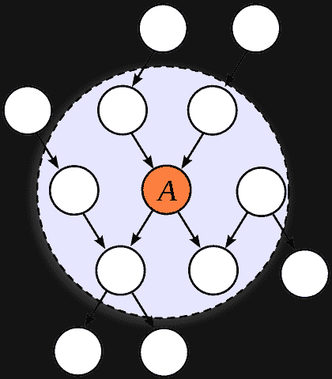
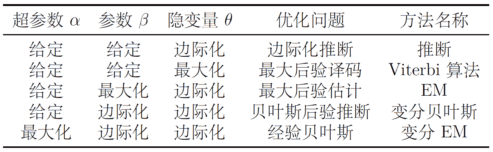
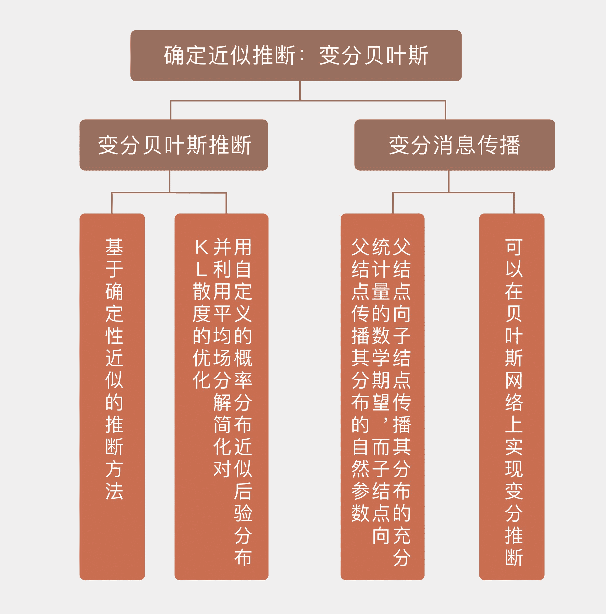

# 36 | 确定近似推断：变分贝叶斯

 

虽然精确推断能够准确计算结果，但它的应用范围却严重受限。当网络的规模较大、结点较多时，大量复杂的因子会严重削弱精确推断的可操作性，虽然这类方法在原则上依然可行，却难以解决实际问题。
 

另一方面，如果模型中同时存在隐变量等非观测变量和未知的参数时，复杂的隐藏状态空间也会让精确的数值计算变得难以实现。要在这样的模型上实现推断，就不得不借助近似推断。
 

**近似推断是在精确性和计算资源两者之间的折中**。如果具有无限的计算资源，精确推断也不是不能实现，但近似推断可以在有限时间内解决问题，而不是画一张水月镜花的大饼。从实现方式上看，近似推断可以分为**确定性近似**和**随机性近似**两类，今天我先和你聊聊确定性近似。
 

**确定性近似**（deterministic approximation）属于**解析近似**（analytical approximation）的范畴。**绝大多数贝叶斯推断任务最终都可以归结到后验概率的计算，算出来的后验概率在理想情况下应该以解析式的形式出现**。
 

当这个函数复杂到没法用解析式表达时，一个直观的思路是找到另一个形式更简洁的函数按照一定规则来尽可能地逼近这个复杂函数，这种方法就是确定性近似。我们再熟悉不过的四舍五入其实就是最简单的确定性近似。
 

**确定性近似的典型代表是变分贝叶斯推断**（variational Bayesian inference），它解决的问题是对隐变量 yy 关于已知输入 xx 的后验概率 p(y|x)p(y|x) 的近似，近似的方式是利用最优的近似概率分布 q(y)q(y) 来逼近 p(y|x)p(y|x)。
 

这里的 q(y)q(y) 表示的是 yy 在 xx 这一组特定的输入数据之上的分布，它并不会将 xx 视为可变的参量。
 

从数学上看，如果假定模型的参数 αα 是固定不变的，那么隐变量 yy 关于输入 xx 的后验概率可以写成
 

p(y|x,α)=p(y,x|α)∫yp(y,x|α)p(y|x,α)=p(y,x|α)∫yp(y,x|α) 

虽然后验概率将数据和模型联系起来，但隐变量的不可观察性使分母上的积分式变得无法计算。期望最大化算法（EM）虽然能够用于求解隐变量，但它是使输出结果最大的那个隐变量取值来代替原本的求和运算，简化求解的同时也失去了贝叶斯推断的边际化这一精髓。要在保留边际化操作的基础上做出近似，就得借助于变分法。
 

变分法的出发点是观测的概率分布 p(x)p(x)，它的对数可以利用条件概率的性质来加以改写
 

log[p(x)]=log∫yp(x,y)=log∫yp(x,y)q(y)q(y)=logEqp(x,Y)q(y)log⁡[p(x)]=log⁡∫yp(x,y)=log⁡∫yp(x,y)q(y)q(y)=log⁡Eqp(x,Y)q(y) 

上面的表达式中涉及对求和项的对数运算，这时利用**简森不等式**（Jensen’s inequality）可以将它简化为对对数项的求和，也就是
 

log[p(x)]≥Eqp(x,Y)q(y)=Eqlogp(x,Y)−Eqlogq(y)log⁡[p(x)]≥Eqp(x,Y)q(y)=Eqlog⁡p(x,Y)−Eqlog⁡q(y) 

等式右侧的结果被称为**变分下界**（variational lower bound），也叫**证据下界**（evidence lower bound），它小于或者等于等式左侧的 log[p(x)]log⁡[p(x)]，用对数概率减去变分下界就可以得到 q(y)q(y) 和 p(y|x)p(y|x) 的 KL 散度。
 

这说明变分下界可以用来表示隐变量的预测分布 q(y)q(y) 和根据观测结果推导出的真实分布 p(y|x)p(y|x) 到底相差多少，也就是近似的接近程度。两个分布之间的变分下界越大，它们之间的 KL 散度就会越小，分布特性也就越接近。
 

提升变分下界要两手抓：一方面要尽可能地增加 p(x)p(x)，因为等式左侧不小于等式右侧，变分下界的增加意味着 log[p(x)]log⁡[p(x)] 得增加得更多，这一过程被称为**近似学习**（approximate learning）；另一方面，在 p(x)p(x) 确定之后，就需要找到在这个确定的 p(x)p(x) 上，让变分下界最大的隐变量分布，也就是 q(y)q(y)，这一过程被称为**近似推断**（approximate inference）。
 

要对变分下界做出优化，需要引入平均场理论的方法。**平均场理论**（mean field theory）与其说是方法，不如说是思想：它将复杂的整体模型简化为若干个相互独立的局部模型的组合。
 

在变分贝叶斯中，平均场理论将复杂的多变量 yy 分解成一系列独立的因子 yiyi，多变量的分布 q(y)q(y) 则被因子化成所有因子分布的乘积
 

q(y)=∏i=1Nqi(yi)q(y)=∏i=1Nqi(yi) 

不难看出，这和前面介绍过的朴素贝叶斯的思想不谋而合，只不过朴素贝叶斯拆分的是属性，平均场拆分的是因子。将平均场的因子化结果回过头代入到变分下界的表达式中，可以将高维的 q(y)q(y) 拆解成低维概率分布乘积的形式，并给出每个低维概率分布的最优解表达式
 

q∗j(yj)=1Zexp[Ei≠j(logp(y,x))]qj∗(yj)=1Zexp⁡[Ei≠j(log⁡p(y,x))] 

其中 ZZ 是归一化的常数。当然，实际情况是隐变量之间是存在着依赖关系的，因而平均场理论在简化运算的同时，也会付出精确性的代价。
 

从宏观层面看，变分法将推断问题改造成了泛函（functional）的优化问题，这也是“变分”一词的来源。优化的目的是用简单的、容易计算的分布 q(y)q(y) 来拟合复杂的、不容易计算的后验分布 p(y|x)p(y|x)，优化的对象是变分下界。
 

将变分推断应用在贝叶斯网络中可以实现自动化的推理，对应的方法被称为**变分消息传播**（variational message passing）。
 

对贝叶斯网络中的结点应用变分贝叶斯推断时，只需要关注这个节点的**马尔可夫毯**，也就是它的父结点（parent）、子节点（child）以及共父结点（co-parent）。在计算结点 HjHj 对应的低维概率分布 Q∗jQj∗ 时，这些结点和 HjHj 之间的条件概率都会作为变量出现，而不在马尔可夫毯中的其他结点的作用就体现为常数。
 

 

马尔可夫毯示意图（图片来自维基百科）
 

出于简化计算的考虑，变分消息传播算法假设待计算节点 HjHj 关于其父结点的条件概率分布属于**指数分布族**，并且是父结点分布的共轭先验，这样的模型叫作**共轭指数模型**（conjugate-exponential model）。
 

指数分布族具有计算上的便利：它的对数形式是可计算的，状态也完全可以由自然参数表示；先验分布的共轭特性同样有助于简化运算，它保证了后验分布和先验分布具有相同的形式，区别只在于参数的不同。
 

有马尔可夫毯和共轭指数模型作为基础，就可以对贝叶斯网络进行消息传播了。虽然变分消息传播的具体机制比较复杂，但其基本原则无外乎两条：**父结点向子结点传播自身分布的充分统计量的数学期望，而子结点向父结点传播自身分布的自然参数**。
 

在子结点向父结点传播消息之前，首先要接收来自共父结点的消息，这是由汇连结构中变量之间的依赖性所决定的。接收到所有来自父结点和子结点的消息后，目标结点用这些消息来更新自己的自然参数，进而更新后验分布，在一轮一轮的迭代过程中，变分分布就会逐渐接近最优值——这与置信传播的思路不谋而合。
 

同为处理未知参数和隐变量的方法，变分贝叶斯和后面要介绍的 EM 算法之间有着千丝万缕的联系。下面的表格来自约翰霍普金斯大学的自然语言处理专家杰森·艾斯纳教授（Jason Eisner）的讲义《变分推断的高层次解释》（High-Level Explanation of Variational Inference），它将变分法和 EM 算法纳入到了统一的框架下。
 

 

表格的第一行给出了最简单的情形：当问题超参数和参数全部给定时，相当于用确定的模型来估计隐变量，这种对隐变量的预测就是典型的推断问题。具体的实现方式是前向 - 后向算法（forward-backward algorithm），如果对前向 - 后向算法进行近似处理，就可以得到变分推断（variational inference）。
 

如果放弃对隐变量分布的求解，而是直接给出最可能的状态，推断问题就被简化成为解码问题（decoding），最典型的方法非基于最大后验的维特比译码（Viterbi decoding）莫属。
 

在此基础上把问题复杂化一些，将参数设定为未知的话，推断问题就变成了估计模型参数的学习问题（learning），这在后面会有详细的阐述。出于运算复杂性的考虑，处理未知参数时可以直接找到让输出后验概率最大化的那一组参数，这就是 EM 算法。
 

将 EM 算法中参数的最大化替换成标准贝叶斯推断中的边际化操作，其结果就是本讲的主题——变分贝叶斯。这也体现出变分贝叶斯和 EM 的区别：**EM 中应用了隐变量的概率分布，但对待估计的参数只是做出点估计；变分贝叶斯则一视同仁，对两类非观测变量都使用分布来描述**。
 

最复杂的情形发生在连超参数都无法确定时，解决这类问题需要借助**经验贝叶斯方法**（empirical Bayes method）。
 

经验贝叶斯方法其实就是在统计学习模块中介绍的贝叶斯方法，也就是引入超先验构造层次模型的做法。经验贝叶斯会计算出级别最高的超先验分布的参数最可能的取值，而不是对它的分布进行积分，这让它有别于全贝叶斯的途径。这种方法在计算隐变量的后验分布时使用变分推断来估计，所以被称为**变分 EM**（variational EM）。
 

在专门用于贝叶斯机器学习的库 PyMC3 中，变分推断可以通过 ADVI 类实现。ADVI 的全称是自动微分变分推断（Automatic Differentiation Variational Inference），是一种基于平均场理论的高效算法，它将变分后验分布初始化为球面高斯分布，不同参数的后验彼此无关，再通过训练数据拟合到真实的后验上。
 

将变分推断运用到前面介绍过的简单线性回归中，可以模拟出线性系数和偏置的分布。受计算机性能的限制，代码中的 nn 设定得较小，但实际上 nn 越大，推断结果才会越精确。
 

今天我和你分享了变分贝叶斯推断的基本原理，以及它和 EM 算法之间的关联，包含以下四个要点：
 
 
-  

变分贝叶斯推断是基于确定性近似的推断方法；
  
-  

变分贝叶斯用简单的近似分布来拟合真实的后验分布，并利用平均场分解简化对变分下界的优化；
  
-  

变分消息传播可以在贝叶斯网络上实现变分推断；
  
-  

变分贝叶斯和 EM 算法都是对隐变量的处理，可以从统一的角度分析。
  
 

发表于《美国统计联合会会刊》（Journal of American Statistical Association）第 12 卷第 518 期上的《从统计学看变分推断》（Variational Inference: A Review for Statisticians）是一篇很好的综述，文中以贝叶斯高斯混合模型为例介绍了变分推断的具体应用。
 

你可以研究一下这个实例，来加深对变分推断的理解。
 

 

