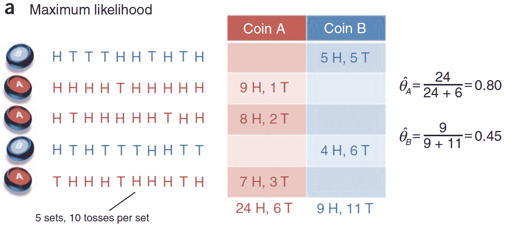
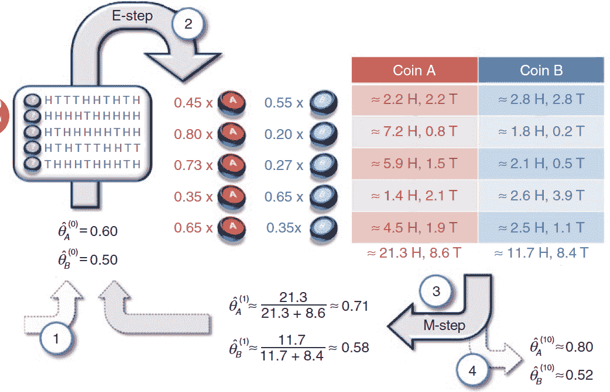
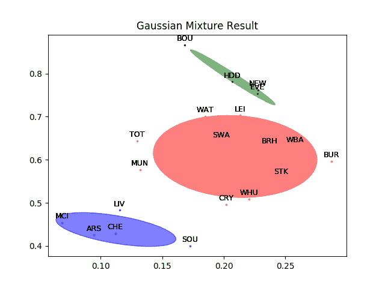
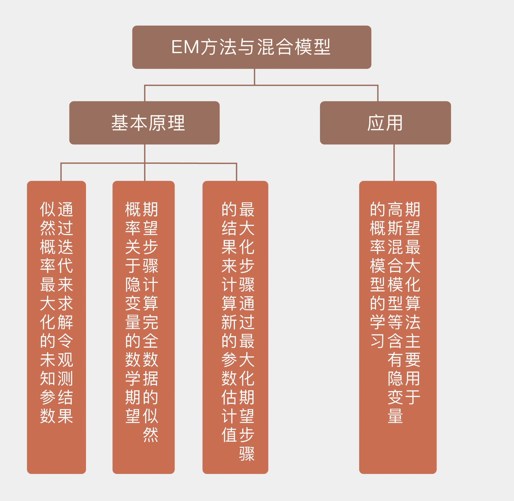

# 39 | 隐变量下的参数学习：EM方法与混合模型

 

前面我曾介绍过隐马尔可夫和线性动态系统这类隐变量模型。所谓的隐变量表示的其实是数据的不完整性，也就是训练数据并不能给出关于模型结果的全部信息，因此只能对模型中未知的状态做出概率性的推测。
 

在今天这一讲中，我将和你分享一种在隐变量模型的参数学习中发挥重要作用的方法：期望最大化算法。
 

**期望最大化算法**（expectation-maximization algorithm, EM）是用于计算最大似然估计的迭代方法，其中的期望步骤（expectation step）利用当前的参数来生成关于隐变量概率的期望函数，最大化步骤（maximization step）则寻找让期望函数最大的一组参数，并将这组参数应用到下一轮的期望步骤中。如此循环往复，算法就可以估计出隐变量的概率分布。
 

**EM 算法虽然可以在不能直接求解方程时找到统计模型的最大似然参数，但它并不能保证收敛到全局最优**。一般来说，似然函数的最大化会涉及对所有未知参量求导，这在隐变量模型中是无法实现的。
 

EM 算法的解决方法是将求解过程转化为一组互锁的方程，它们就像联动的齿轮一样，通过待求解参数和未知状态变量的不断迭代、交叉使用来求解最大似然。
 

具体的做法是给两组未知数中的一组选择任意值，使用它们来估计另一组，然后使用这些更新的取值来找到前一组的更好估计，然后在两者之间交互更新，直到得到的值都收敛到固定点。
 

EM 算法的实现方法可以通过一个通俗易懂的实例加以阐释，这个例子来源于期刊《自然 ⋅⋅ 生物技术》（Nature Biotechnology）第 26 卷第 8 期上的论文《何为期望最大化算法？》（What is the expectation maximization algorithm?）。考虑到之前关于贝叶斯统计的教程也是来源于这个期刊，概率推断与机器学习在生命科学中的重要性便不言而喻。
 

 

隐变量已知时，利用最大似然法求解参数（图片来自 What is the expectation maximization algorithm?）
 

上图就是用来解释 EM 算法的问题。假定有两枚不同的硬币 AA 和 BB，它们的重量分布 θAθA 和 θBθB 是未知的，其数值可以通过抛掷后计算正反面各自出现的次数来估计。具体的估计方法是在每一轮中随机抽出一枚硬币抛掷 10 次，同样的过程执行 5 轮，根据这 50 次投币的结果来计算 θAθA 和 θBθB 的最大似然估计。
 

在上图的单次实验中，硬币 AA 被抽到 3 次，30 次投掷中出现了 24 次正面；硬币 BB 被抽到 2 次，20 次投掷中出现了 9 次正面。用最大似然估计可以计算出 θ^A=24/(24+6)=0.8,θ^B=9/(9+11)=0.45θ^A=24/(24+6)=0.8,θ^B=9/(9+11)=0.45。
 

这样的问题显然没有什么挑战性，可如果作为观测者的我们只能知道每一轮中出现的正反面结果，却不能得知到底选取的硬币到底是 AA 还是 BB，问题可就没那么简单了。
 

这里的硬币选择就是不能直接观测的隐变量。如果把这个隐变量扔到一边不管，就没有办法估计未知的参数；可要确定这一组隐变量，又得基于未知的硬币重量分布进行最大似然估计。这样一来，问题就进入了“鸡生蛋，蛋生鸡”的死胡同了。
 

毛主席曾教导我们：“自己动手，丰衣足食”。既然数据中的信息是不完整的，那就人为地给它补充完整。在这个问题中，隐藏的硬币选择和待估计的重量分布，两者确定一个就可以确定另一个。
 

由于观测结果，也就是正反面出现的次数直接给出了关于重量分布的信息，那就不妨人为设定一组初始化的参数 θ^(t)=(θ^(t)A,θ^(t)B)θ^(t)=(θ^A(t),θ^B(t))，用这组猜测的重量分布去倒推到底每一轮使用的是哪个硬币。
 

计算出的硬币选择会被用来对原来随机产生的初始化参数进行更新。如果硬币选择的结果是正确的，就可以利用最大似然估计计算出新的参数 hatθ(t+1)hatθ(t+1)。而更新后的参数又可以应用在观测结果上，对硬币选择的结果进行修正，从而形成了“批评 - 自我批评”的循环过程。这个过程会持续到隐藏变量和未知参数的取值都不再发生变化，其结果就是最终的输出。
 

将上面的思路应用的下图的投掷结果中，就是 EM 算法的雏形。两个初始的参数被随机设定为 θ^(0)A=0.6,θ^(0)B=0.5θ^A(0)=0.6,θ^B(0)=0.5，在这两个参数下出现第一轮结果，也就是 5 正 5 反的概率就可以表示成
 

P(H5T5|A)=0.65×0.45,P(H5T5|B)=0.510P(H5T5|A)=0.65×0.45,P(H5T5|B)=0.510 

对上面的两个似然概率进行归一化可以得出后验概率，两者分别是 0.45 和 0.55，也就是下图中的结果。这说明如果初始的随机参数是准确的，那第一轮结果更可能由硬币 BB 生成。同理也可以计算出其他 4 轮的结果来自不同硬币的后验概率，结果已经在下图中显示。
 

 

隐变量未知时，利用 EM 算法求解参数（图片来自 What is the expectation maximization algorithm?）
 

在已知硬币的选择时，所有正反面的结果都有明确的归属：要么来自 AA 要么来自 BB。利用后验概率可以直接对硬币的选择做出判断：1/4 两轮使用的是硬币 BB，2/3/5 三轮使用的是硬币 AA。
 

既然硬币的选择已经确定，这时就可以使用最大似然估计，其结果和前文中的最大似然估计结果是相同的，也就是 θ^(1)A=0.8,θ^(1)B=0.45θ^A(1)=0.8,θ^B(1)=0.45。利用这组更新的参数又可以重新计算每一轮次抽取不同硬币的后验概率，你可以自己计算一下。
 

虽然这种方法能够实现隐变量和参数的动态更新，但它还不是真正的 EM 算法，而是硬输出的 kk 均值聚类。真正的 EM 算法并不会将后验概率最大的值赋给隐变量，而是考虑其所有可能的取值，在概率分布的框架下进行分析。
 

在前面的例子中，由于第一轮投掷硬币 AA 的可能性是 0.45，那么硬币 AA 对正反面出现次数的贡献就是 45%，在 5 次正面的结果中，来源于硬币 AA 的就是 5×0.45=2.255×0.45=2.25 次，来源于硬币 BB 的则是 2.75 次。同理可以计算出其他轮次中 AA 和 BB 各自的贡献，贡献的比例都和计算出的后验概率相对应。
 

计算出 AA 和 BB 在不同轮次中的贡献，就可以对未知参数做出更加精确的估计。在 50 次投掷中，硬币 AA 贡献了 21.3 次正面和 8.6 次反面，其参数估计值 θ^(1)A=0.71θ^A(1)=0.71；硬币 BB 贡献了 11.7 次正面和 8.4 次反面，其参数估计值 θ^(1)B=0.58θ^B(1)=0.58。利用这组参数继续迭代更新，就可以计算出最终的估计值。
 

上面的实例给出了对 EM 算法直观的理解。**在数学上，EM 算法通过不断地局部逼近来解决似然概率最大化的问题**。
 

假定模型中未知的参数为 θθ，隐藏的状态变量为 ZZ，输出的因变量为 YY，那么三者就构成了一个马尔可夫链 θ→Z→Yθ→Z→Y。EM 算法相当于是通过 p(z|θ)p(z|θ) 的最大化来简化 p(y|θ)p(y|θ) 的最大化，下面我将以算法在高斯混合模型中的应用来说明这个过程。
 

顾名思义，高斯混合模型（Gaussian mixture model）是由 KK 个高斯分布混合而成的模型。这个模型在前面的第 20 讲中曾经有所提及，你可以回顾一下。在高斯混合模型中，每个高斯分布的系数 πkπk 可以看成是它出现的概率。模型生成的每个样本都只能来自混合模型中的唯一一个成分，就像每一轮投掷只能使用一枚硬币一样。
 

作为一个生成模型，高斯混合先按照概率 πkπk 选择第 kk 个高斯分布，再按照这个分布的概率密度采出一个样本，因此高斯分布的选择和样本的取值共同构成了混合模型的完备数据（complete data）。但从观察者的角度看，分布的选择是在生成数据的黑箱里完成的，所以需要用隐变量 zz 来定义，单独的观测数据 xx 就只能构成不完备数据（incomplete data）。
 

对高斯混合模型的学习就是在给定不完备数据 XX 时，估计模型中所有的 πkπk、μkμk 和 σkσk，这些未知的参数可以统称为 θθ。最优的参数 θθ 应该让对数似然函数 logp(X|θ)log⁡p(X|θ) 最大化，其数学表达式可以写成
 

L(θ|X)=logp(X|θ)=log∏n=1Np(xn|θ)=∑n=1Nlog(∑k=1KπkN(xn|μk,Σk))L(θ|X)=log⁡p(X|θ)=log⁡∏n=1Np(xn|θ)=∑n=1Nlog⁡(∑k=1KπkN(xn|μk,Σk)) 

可以看到，上面的表达式涉及对求和项计算对数，这对于求解极值来说颇为棘手。好在我们还有隐变量，虽说混合模型中存在若干个成分，但落实到单个样本上，每个样本只由其中的一个高斯分布产生。
 

引入隐变量能够确定这个唯一的分布，也就是去掉上面表达式中对成分 kk 的求和，从而避免对求和项的复杂对数运算。如果已知每个样本 xnxn 所对应的隐变量 znk=1znk=1，那就意味着第 nn 个样本由第 kk 个混合成分产生，上面的表达式就可以简化为
 

L(θ|X,Z)=∑n=1NlogπkN(xn|μk,Σk)L(θ|X,Z)=∑n=1Nlog⁡πkN(xn|μk,Σk) 

但隐变量本身也是随机变量，只能用概率描述。如果将参数当前的估计值 θ(t)θ(t) 看作真实值，它就可以和不完备数据结合起来，用于估计隐变量的分布。隐变量的分布可以利用贝叶斯定理计算，将混合参数 πkπk 看作先验概率，单个的高斯分布 N(μk,Σk)N(μk,Σk) 看作似然概率，就不难计算出隐变量 znkznk 关于 kk 的后验概率
 

p(znk|xn,θ(t))=πkN(xn|θ(t))∑j=1KπjN(xn|θ(t))p(znk|xn,θ(t))=πkN(xn|θ(t))∑j=1KπjN(xn|θ(t)) 

如果你对第 20 讲的内容还有印象，就会发现这个后验概率就是其中提到的 " 责任 γnkγnk"，其意义是第 kk 个高斯分布对样本的响应度（responsibility）。由于这里计算出的后验是随机变量 znk=1znk=1 的概率，它实际上代表的就是 znkznk 的数学期望。
 

有了隐变量的后验概率，就可以将它代入到基于完备信息的对数似然概率中，通过求和对隐变量进行边际化的处理。求出的目标对数似然 L(θ|X,Z)L(θ|X,Z) 关于隐变量 ZZ 的数学期望也叫作 QQ 函数，其数学表达式为
 

Q(θ,θ(t))=∑Zp(Z|X,θ(t))L(θ|X,Z)Q(θ,θ(t))=∑Zp(Z|X,θ(t))L(θ|X,Z) 

其中 p(Z|X,θ(t))=∏Nn=1p(znk|xn,θ(t))p(Z|X,θ(t))=∏n=1Np(znk|xn,θ(t))。
 

将对隐变量求解数学期望和对每个样本对数似然求和的顺序调转，也就是先针对每个样本求出期望，再将所有期望值求和，就可以得到完备数据下对数似然的数学期望
 

Q(θ,θ(t))=∑n=1N∑k=1Kγnk[logπk+logN(xn|μk,Σk)]Q(θ,θ(t))=∑n=1N∑k=1Kγnk[log⁡πk+log⁡N(xn|μk,Σk)] 

这是期望步骤的最终结果。接下来的最大化步骤需要找到让上面的表达式最大化的新参数 θ(t+1)θ(t+1)，这只需要对 πkπk、μkμk 和 ΣkΣk 分别求偏导数就可以了。
 

在 Scikit-learn 中，EM 算法被内嵌在 mixture 模块中的 GaussianMixture 类中，调用这个类就调用了 EM 算法。用 GaussianMixture 类对 20 支英超球队的聚类数据进行分类，得到的结果如下图所示，其中不同的高斯分布用不同颜色的椭圆表示。可以看出，每个高斯分布都由相距较近的点组成。
 

你可以将高斯混合模型的结果和 20 讲中 kk 均值的结果作一比较，观察硬聚类和软聚类的区别。
 

 英超球队的高斯混合聚类结果 

今天我和你分享了期望最大化算法的基本原理，及其在高斯混合模型中的应用，包含以下四个要点：
 
 
-  

 期望最大化算法通过迭代来求解令观测结果似然概率最大化的未知参数；
  
-  

期望步骤计算完备数据的似然概率关于隐变量的数学期望；
  
-  

 最大化步骤通过最大化期望步骤的结果来计算新的参数估计值；
  
-  

期望最大化算法主要用于高斯混合模型等含有隐变量的概率图模型的学习。
  
 

除了高斯混合模型之外，对隐马尔可夫网络的学习也需要使用 EM 算法。在隐马尔可夫的文献中，EM 算法通常被称为 Baum-Welch 算法（Baum-Welch algorithm）。两者虽然名称不同，但原理是一样的。
 

你可以参考维基百科等资料，了解 Baum-Welch 算法的特点，并在这里分享你的见解。
 

 

