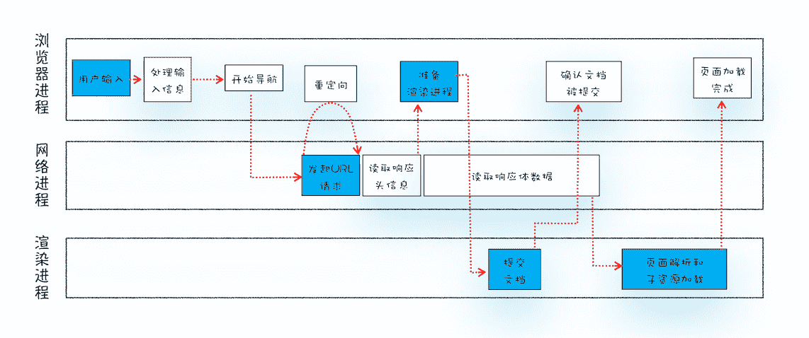
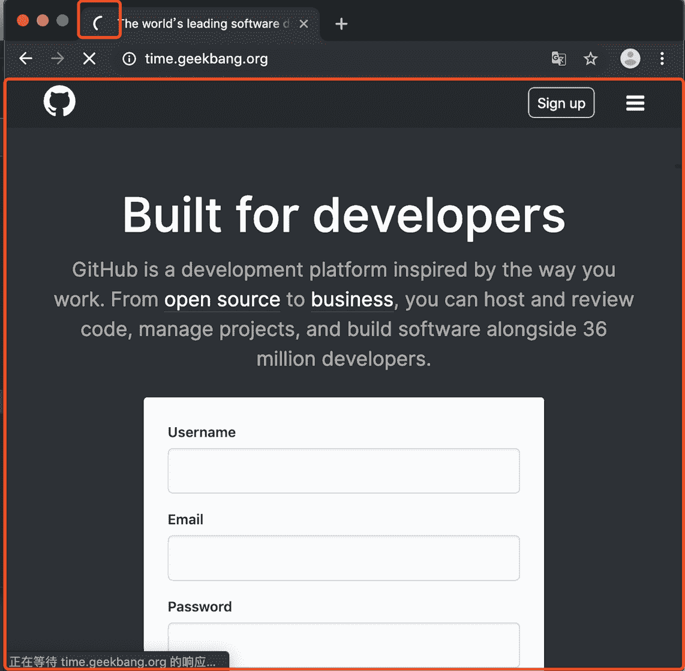
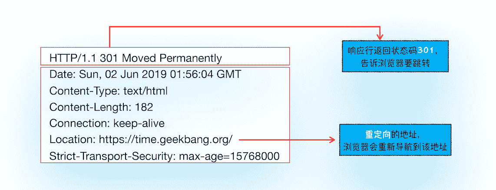
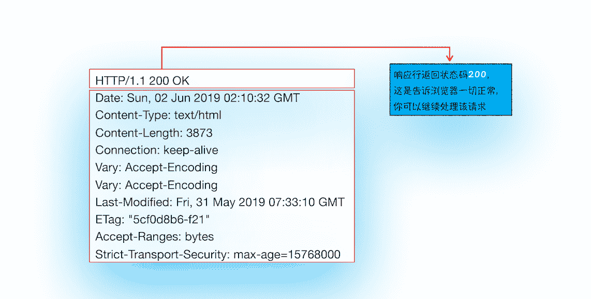
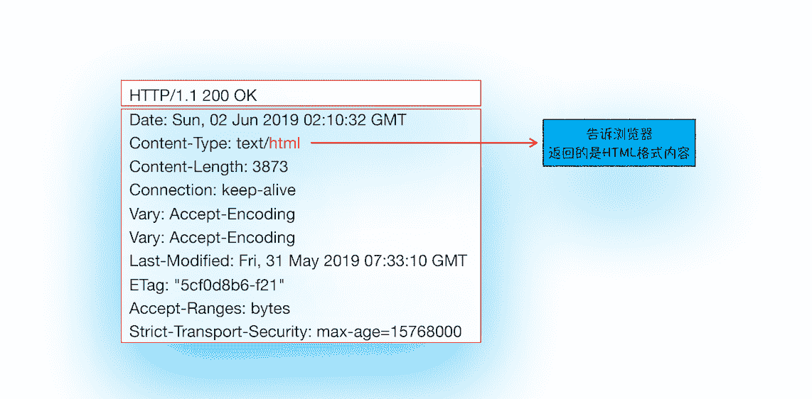
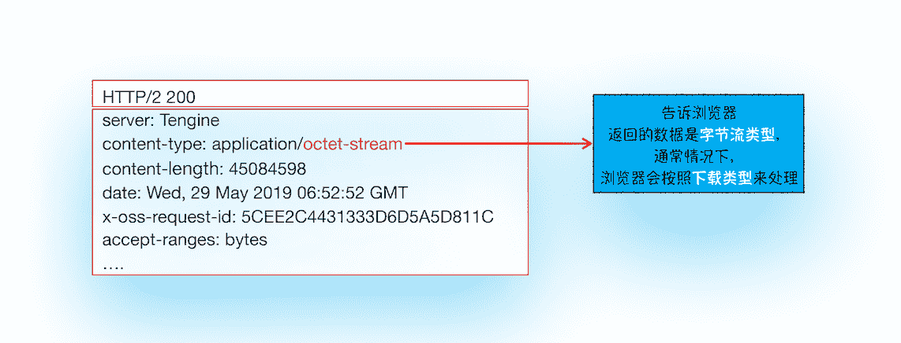
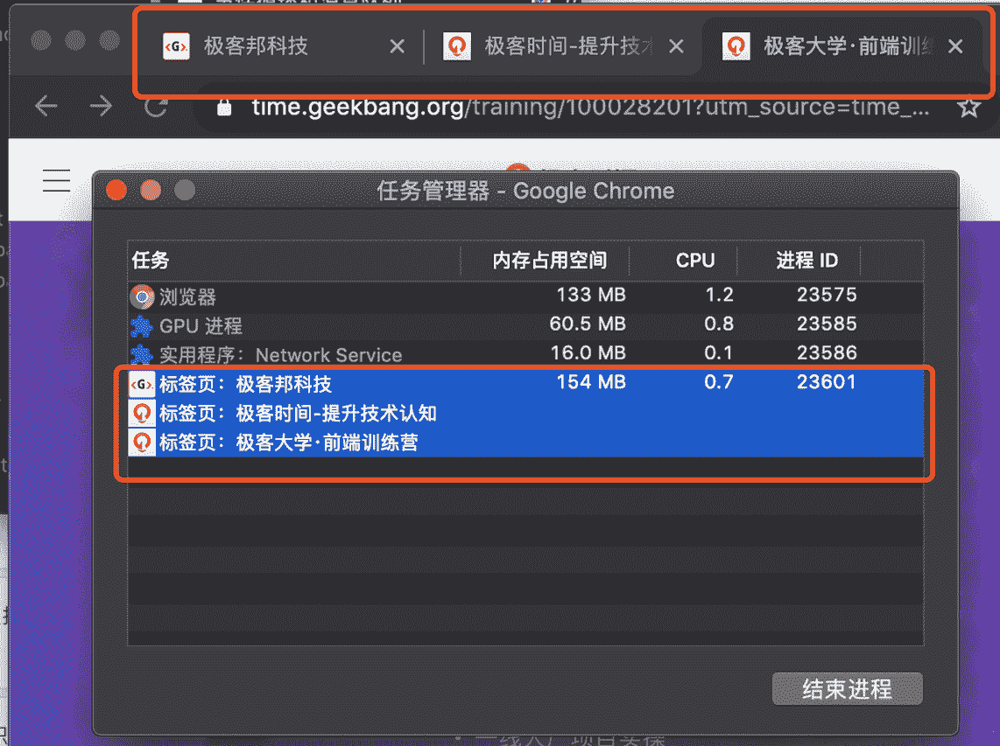
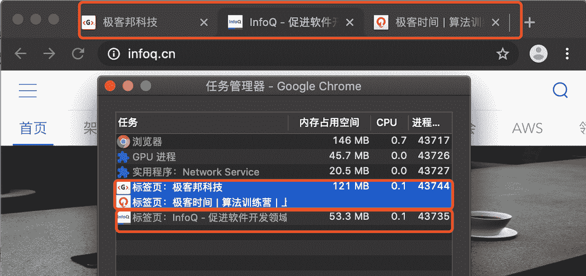
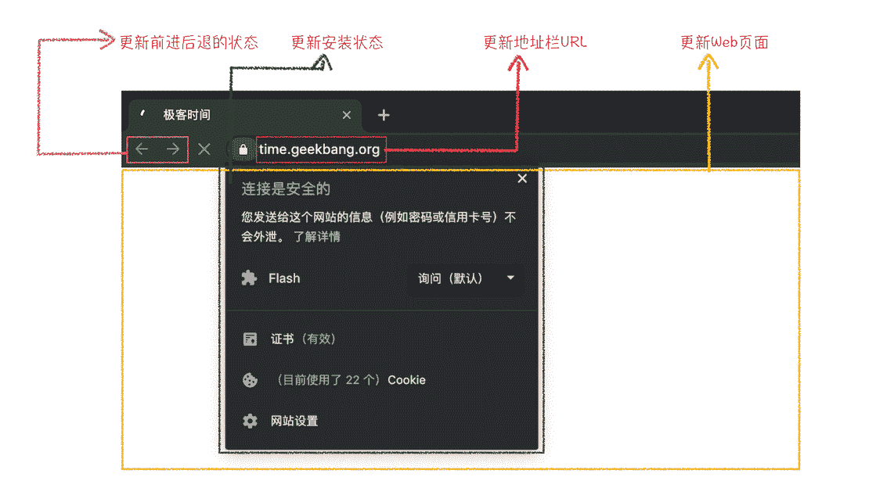

# 04 | 导航流程：从输入URL到页面展示，这中间发生了什么？

 

“在浏览器里，从输入 URL 到页面展示，这中间发生了什么？ ”这是一道经典的面试题，能比较全面地考察应聘者知识的掌握程度，其中涉及到了网络、操作系统、Web 等一系列的知识。所以我在面试应聘者时也必问这道题，但遗憾的是大多数人只能回答其中部分零散的知识点，并不能将这些知识点串联成线，无法系统而又全面地回答这个问题。

那么今天我们就一起来探索下这个流程，下图是我梳理出的“从输入 URL 到页面展示完整流程示意图”：



从输入 URL 到页面展示完整流程示意图

从图中可以看出，**整个过程需要各个进程之间的配合**，所以在开始正式流程之前，我们还是先来快速回顾下浏览器进程、渲染进程和网络进程的主要职责。

 
- 浏览器进程主要负责用户交互、子进程管理和文件储存等功能。 
- 网络进程是面向渲染进程和浏览器进程等提供网络下载功能。 
- 渲染进程的主要职责是把从网络下载的 HTML、JavaScript、CSS、图片等资源解析为可以显示和交互的页面。因为渲染进程所有的内容都是通过网络获取的，会存在一些恶意代码利用浏览器漏洞对系统进行攻击，所以运行在渲染进程里面的代码是不被信任的。这也是为什么 Chrome 会让渲染进程运行在安全沙箱里，就是为了保证系统的安全。 

当然，你也可以先回顾下前面的[《01 | Chrome 架构：仅仅打开了 1 个页面，为什么有 4 个进程？》](https://time.geekbang.org/column/article/113513)这篇文章，来全面了解浏览器多进程架构。

回顾了浏览器的进程架构后，我们再结合上图来看下这个完整的流程，可以看出，整个流程包含了许多步骤，我把其中几个核心的节点用蓝色背景标记出来了。这个过程可以大致描述为如下：

 
- 首先，用户从浏览器进程里**输入请求信息**； 
- 然后，网络进程**发起 URL 请求**； 
- 服务器响应 URL 请求之后，浏览器进程就又要开始**准备渲染进程**了； 
- 渲染进程准备好之后，需要先向渲染进程提交页面数据，我们称之为**提交文档**阶段； 
- 渲染进程接收完文档信息之后，便开始**解析页面和加载子资源**，完成页面的渲染。 

这其中，**用户发出 URL 请求到页面开始解析的这个过程，就叫做导航**。下面我们来详细分析下这些步骤，同时也就解答了开头所说的那道经典的面试题。

## 从输入 URL 到页面展示

知道了浏览器的几个主要进程的职责之后，那么接下来，我们就从浏览器的地址栏开始讲起。

### 1. 用户输入

当用户在地址栏中输入一个查询关键字时，地址栏会判断输入的关键字是**搜索内容**，还是**请求的 URL**。

 
- 如果是搜索内容，地址栏会使用浏览器默认的搜索引擎，来合成新的带搜索关键字的 URL。 
- 如果判断输入内容符合 URL 规则，比如输入的是 time.geekbang.org，那么地址栏会根据规则，把这段内容加上协议，合成为完整的 URL，如 [https://time.geekbang.org](https://time.geekbang.org)。 

当用户输入关键字并键入回车之后，浏览器便进入下图的状态：



开始加载 URL 浏览器状态

从图中可以看出，当浏览器刚开始加载一个地址之后，标签页上的图标便进入了加载状态。但此时图中页面显示的依然是之前打开的页面内容，并没立即替换为极客时间的页面。因为需要等待提交文档阶段，页面内容才会被替换。

### 2. URL 请求过程

接下来，便进入了页面资源请求过程。这时，浏览器进程会通过进程间通信（IPC）把 URL 请求发送至网络进程，网络进程接收到 URL 请求后，会在这里发起真正的 URL 请求流程。那具体流程是怎样的呢？

首先，网络进程会查找本地缓存是否缓存了该资源。如果有缓存资源，那么直接返回资源给浏览器进程；如果在缓存中没有查找到资源，那么直接进入网络请求流程。这请求前的第一步是要进行 DNS 解析，以获取请求域名的服务器 IP 地址。如果请求协议是 HTTPS，那么还需要建立 TLS 连接。

接下来就是利用 IP 地址和服务器建立 TCP 连接。连接建立之后，浏览器端会构建请求行、请求头等信息，并把和该域名相关的 Cookie 等数据附加到请求头中，然后向服务器发送构建的请求信息。

服务器接收到请求信息后，会根据请求信息生成响应数据（包括响应行、响应头和响应体等信息），并发给网络进程。等网络进程接收了响应行和响应头之后，就开始解析响应头的内容了。（为了方便讲述，下面我将服务器返回的响应头和响应行统称为响应头。）

**（1）重定向**

在接收到服务器返回的响应头后，网络进程开始解析响应头，如果发现返回的状态码是 301 或者 302，那么说明服务器需要浏览器重定向到其他 URL。这时网络进程会从响应头的 Location 字段里面读取重定向的地址，然后再发起新的 HTTP 或者 HTTPS 请求，一切又重头开始了。

比如，我们在终端里输入以下命令：

```
curl -I http://time.geekbang.org/
```

`curl -I + URL`的命令是接收服务器返回的响应头的信息。执行命令后，我们看到服务器返回的响应头信息如下：



响应行返回状态码 301

从图中可以看出，极客时间服务器会通过重定向的方式把所有 HTTP 请求转换为 HTTPS 请求。也就是说你使用 HTTP 向极客时间服务器请求时，服务器会返回一个包含有 301 或者 302 状态码响应头，并把响应头的 Location 字段中填上 HTTPS 的地址，这就是告诉了浏览器要重新导航到新的地址上。

下面我们再使用 HTTPS 协议对极客时间发起请求，看看服务器的响应头信息是什么样子的。

```
curl -I https://time.geekbang.org/
```

我们看到服务器返回如下信息：



响应行返回状态码 200

从图中可以看出，服务器返回的响应头的状态码是 200，这是告诉浏览器一切正常，可以继续往下处理该请求了。

好了，以上是重定向内容的介绍。现在你应该理解了，**在导航过程中，如果服务器响应行的状态码包含了 301、302 一类的跳转信息，浏览器会跳转到新的地址继续导航；如果响应行是 200，那么表示浏览器可以继续处理该请求**。

**（2）响应数据类型处理**

在处理了跳转信息之后，我们继续导航流程的分析。URL 请求的数据类型，有时候是一个下载类型，有时候是正常的 HTML 页面，那么浏览器是如何区分它们呢？

答案是 Content-Type。**Content-Type 是 HTTP 头中一个非常重要的字段， 它告诉浏览器服务器返回的响应体数据是什么类型**，然后浏览器会根据 Content-Type 的值来决定如何显示响应体的内容。

这里我们还是以极客时间为例，看看极客时间官网返回的 Content-Type 值是什么。在终端输入以下命令：

```
curl -I https://time.geekbang.org/
```

返回信息如下图：



含有 HTML 格式的 Content-Type

从图中可以看到，响应头中的 Content-type 字段的值是 text/html，这就是告诉浏览器，服务器返回的数据是**HTML 格式**。

接下来我们再来利用 curl 来请求极客时间安装包的地址，如下所示：

```
curl -I https://res001.geekbang.org/apps/geektime/android/2.3.1/official/geektime_2.3.1_20190527-2136_offical.apk
```

请求后返回的响应头信息如下：



含有 stream 格式的 Content-Type

从返回的响应头信息来看，其 Content-Type 的值是 application/octet-stream，显示数据是**字节流类型**的，通常情况下，浏览器会按照**下载类型**来处理该请求。

需要注意的是，如果服务器配置 Content-Type 不正确，比如将 text/html 类型配置成 application/octet-stream 类型，那么浏览器可能会曲解文件内容，比如会将一个本来是用来展示的页面，变成了一个下载文件。

所以，不同 Content-Type 的后续处理流程也截然不同。如果 Content-Type 字段的值被浏览器判断为**下载类型，那么该请求会被提交给浏览器的下载管理器，同时该 URL 请求的导航流程就此结束**。但如果是**HTML，那么浏览器则会继续进行导航流程**。由于 Chrome 的页面渲染是运行在渲染进程中的，所以接下来就需要准备渲染进程了。

### 3. 准备渲染进程

默认情况下，Chrome 会为每个页面分配一个渲染进程，也就是说，每打开一个新页面就会配套创建一个新的渲染进程。但是，也有一些例外，在某些情况下，浏览器会让多个页面直接运行在同一个渲染进程中。

比如我从极客时间的首页里面打开了另外一个页面——算法训练营，我们看下图的 Chrome 的任务管理器截图：



多个页面运行在一个渲染进程中

从图中可以看出，打开的这三个页面都是运行在同一个渲染进程中，进程 ID 是 23601。

**那什么情况下多个页面会同时运行在一个渲染进程中呢？**

要解决这个问题，我们就需要先了解下什么是同一站点（same-site）。具体地讲，我们将“**同一站点**”定义为**根域名**（例如，geekbang.org）加上**协议**（例如，https:// 或者 http://），还包含了该根域名下的所有子域名和不同的端口，比如下面这三个：

```
https://time.geekbang.orghttps://www.geekbang.orghttps://www.geekbang.org:8080
```

它们都是属于**同一站点**，因为它们的协议都是 HTTPS，而且根域名也都是 geekbang.org。

Chrome 的默认策略是，每个标签对应一个渲染进程。但**如果从一个页面打开了另一个新页面，而新页面和当前页面属于同一站点的话，那么新页面会复用父页面的渲染进程**。官方把这个默认策略叫 process-per-site-instance。

那若新页面和当前页面不属于同一站点，情况又会发生什么样的变化呢？比如我通过极客邦页面里的链接打开 InfoQ 的官网（[https://www.infoq.cn/](https://www.infoq.cn/) ）， 因为 infoq.cn 和 geekbang.org 不属于同一站点，所以 infoq.cn 会使用一个新的渲染进程，你可以参考下图：



非同一站点使用不同的渲染进程

从图中任务管理器可以看出：由于极客邦和极客时间的标签页拥有**相同的协议和根域名**，所以它们属于**同一站点**，并运行在同一个渲染进程中；而 infoq.cn 的根域名不同于 geekbang.org，也就是说 InfoQ 和极客邦不属于同一站点，因此它们会运行在两个不同的渲染进程之中。

总结来说，打开一个新页面采用的**渲染进程策略**就是：

 
- 通常情况下，打开新的页面都会使用单独的渲染进程； 
- 如果从 A 页面打开 B 页面，且 A 和 B 都属于**同一站点**的话，那么 B 页面复用 A 页面的渲染进程；如果是其他情况，浏览器进程则会为 B 创建一个新的渲染进程。 

渲染进程准备好之后，还不能立即进入文档解析状态，因为此时的文档数据还在网络进程中，并没有提交给渲染进程，所以下一步就进入了提交文档阶段。

### 4. 提交文档

首先要明确一点，这里的“文档”是指 URL 请求的响应体数据。

 
- “提交文档”的消息是由浏览器进程发出的，渲染进程接收到“提交文档”的消息后，会和网络进程建立传输数据的“**管道**”。 
- 等文档数据传输完成之后，渲染进程会返回“**确认提交**”的消息给浏览器进程。 
- 浏览器进程在收到“确认提交”的消息后，会**更新浏览器界面状态**，包括了安全状态、地址栏的 URL、前进后退的历史状态，并更新 Web 页面。 

更新内容如下图所示：



导航完成状态

这也就解释了为什么在浏览器的地址栏里面输入了一个地址后，之前的页面没有立马消失，而是要加载一会儿才会更新页面。

到这里，一个完整的导航流程就“走”完了，这之后就要进入渲染阶段了。

### 5. 渲染阶段

一旦文档被提交，渲染进程便开始页面解析和子资源加载了，关于这个阶段的完整过程，我会在下一篇文章中来专门介绍。这里你只需要先了解一旦页面生成完成，渲染进程会发送一个消息给浏览器进程，浏览器接收到消息后，会停止标签图标上的加载动画。如下所示：


渲染结束

至此，一个完整的页面就生成了。那文章开头的“从输入 URL 到页面展示，这中间发生了什么？”这个过程极其“串联”的问题也就解决了。

## 总结

好了，今天就到这里，下面我来简单总结下这篇文章的要点：

 
- 服务器可以根据响应头来控制浏览器的行为，如跳转、网络数据类型判断。 
- Chrome 默认采用每个标签对应一个渲染进程，但是如果两个页面属于同一站点，那这两个标签会使用同一个渲染进程。 
- 浏览器的导航过程涵盖了从用户发起请求到提交文档给渲染进程的中间所有阶段。 

导航流程很重要，它是网络加载流程和渲染流程之间的一座桥梁，如果你理解了导航流程，那么你就能完整串起来整个页面显示流程，这对于你理解浏览器的工作原理起到了点睛的作用。

## 思考时间

最后，还是留给你个小作业：在上一篇文章中我们介绍了 HTTP 请求过程，在本文我们又介绍了导航流程，那么如果再有面试官问你“从输入 URL 到页面展示，这中间发生了什么？”这个问题，你知道怎么回答了吗？可以用你自己的语言组织下，就当为你的面试做准备。

欢迎在留言区与我分享你的想法，也欢迎你在留言区记录你的思考过程。感谢阅读，如果你觉得这篇文章对你有帮助的话，也欢迎把它分享给更多的朋友。


