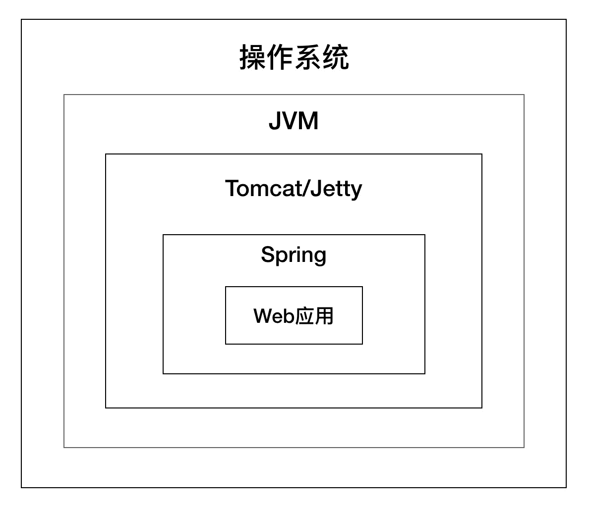

# 开篇词 | Java程序员如何快速成长？

 

你好，我是李号双，很高兴你走进我的“深入拆解 Tomcat & Jetty”专栏，与我和其他同学一起探讨熟悉又陌生的 Tomcat 和 Jetty。

如果你和我一样选择了 Java Web 开发这个方向，并且正在学习和提高的路上，你一定思考过这个问题：

**我怎样才能成长为一名高级程序员或者架构师？**

对于这个问题，每个人的答案都可能都不太一样，我先来讲讲我的经历。十年前我在实习的时候是做嵌入式系统开发，用的开发语言是 C 和 C++。出于我个人的兴趣爱好，当时我想转 Java，在学了一段时间的 Java 后，发现 Java 上手还是挺快的，API 比较齐全，而且也不需要自己来管理内存，感觉比 C 语言高级。毕业后我也顺利地找到了一个 Java 开发的工作，入职后我的工作主要是实现一些小模块，很多时候通过代码的复制粘贴，再稍微改改就能完成功能，这样的状态大概持续了一年。

在这个过程中，虽然我对 Java 语法更加熟悉了，也“背”过一些设计模式，用过一些 Web 框架，但是我很少有机会将一些 Java 的高级特性运用到实际项目中，因此我对它们的理解也是模糊的。那时候如果让我独立设计一个系统，我会感到非常茫然，不知道从哪里下手；对于 Web 框架，我也只是知道这样用是可以的，不知道它背后的原理是什么。并且在我脑子里也没有一张 Java Web 开发的全景图，比如我并不知道浏览器的请求是怎么跟 Spring 中的代码联系起来的。

后来我分析发现，我的知识体系在广度和深度上都有问题。为了突破这个瓶颈，我当时就想，为什么不站在巨人的肩膀上学习一些优秀的开源系统，看看大牛们是如何思考这些问题的呢。

于是我注意到了像 Tomcat 和 Jetty 这样的 Web 容器，觉得它们很神奇，只需要把 Web 应用打成 WAR 包放到它的目录下，启动起来就能通过浏览器来访问了，我非常好奇 Web 容器是如何工作的。此外 Tomcat 的设计非常经典，并且运用了方方面面的 Java 技术，而这些正好是我欠缺的，于是我决定选择 Tomcat 来深入研究。

学习了 Tomcat 的原理之后，我发现 Servlet 技术是 Web 开发的原点，几乎所有的 Java Web 框架（比如 Spring）都是基于 Servlet 的封装，Spring 应用本身就是一个 Servlet，而 Tomcat 和 Jetty 这样的 Web 容器，负责加载和运行 Servlet。你可以通过下面这张图来理解 Tomcat 和 Jetty 在 Web 开发中的位置。

随着学习的深入，我还发现 Tomcat 和 Jetty 中用到不少 Java 高级技术，比如 Java 多线程并发编程、Socket 网络编程以及反射等等。之前我仅仅只是了解这些技术，为了面试也背过一些题，但是总感觉“知道”和“会用”之间存在一道鸿沟。通过对 Tomcat 和 Jetty 源码的学习，我学会了在什么样的场景下去用这些技术，这一点至关重要。

还有就是系统设计能力，Tomcat 和 Jetty 作为工业级的中间件，它们的设计非常优秀，比如面向接口编程、组件化、骨架抽象类、一键式启停、对象池技术以及各种设计模式，比如模板方法、观察者模式、责任链模式等，之后我也开始模仿它们并把这些设计思想运用到实际的工作中。

在理解了 Web 容器以及 JVM 的工作原理后，我开始解决线上的疑难杂症，并且尝试对线上的 Tomcat 进行调优。性能的提升也是实实在在的成果，我也因此得到了同事们的认可。

总之在这个过程中，我逐渐建立起了自己的知识体系，也开始独立设计一个系统，独立解决技术难题，也就是说我渐渐具备了**独当一面**的能力，而这正是高级程序员或者架构师的特质。

概括一下，独当一面的能力，离不开**技术的广度和深度**。

技术的广度体现在你的知识是成体系的，从前端到后端、从应用层面到操作系统、从软件到硬件、从开发、测试、部署到运维…有些领域虽然你不需要挖得很深，但是你必须知道这其中的“门道”。

而技术的深度体现在对于某种技术，你不仅知道怎么用，还知道这项技术如何产生的、它背后的原理是什么，以及它为什么被设计成这样，甚至你还得知道如何去改进它。

但是人的精力是有限的，广度和深度该如何权衡呢？我建议找准一个点先突破深度，而 Tomcat 和 Jetty 就是非常好的选择。但同时它们也是比较复杂的，具体应该怎么学呢？我想通过这个专栏，来分享一些我的经验。

首先我们要学习一些基础知识，比如操作系统、计算机网络、Java 语言，面向对象设计、HTTP 协议以及 Servlet 规范等。

接下来我们会学习 Tomcat 的 Jetty 的总体架构，并从全貌逐步深入到各个组件。在这个过程中，我会重点关注组件的工作原理和设计思路，比如这个组件为什么设计成这样，设计者们当时是怎么考虑这个问题的。然后通过源码的剖析，加深你的理解。**更重要的是，帮你学会在真实的场景下如何运用 Java 技术**。

同时我还会通过 Jetty 与 Tomcat 的对比，比较它们各自的设计特点，让你对选型有更深的理解。并且通过思考和总结，帮你从中提炼一些通用的设计原则，以及实现高性能高并发的思路。

在深入了解 Tomcat 和 Jetty 的工作原理之后，我会从实战出发，带你看看如何监控 Tomcat 的性能，以及怎么从内存、线程池和 I/O 三个方面进行调优，同时我也还会分析和解决一些你在实际工作中可能会碰到的棘手问题。

在这个过程中，我还会介绍 Tomcat 和 Jetty 支持的 Servlet 新技术，比如 WebSocket 和异步 Servlet 等，我会重点分析这些新技术是从何而来，以及 Tomcat 和 Jetty 是如何支持的。这些都是 Web 技术的最新动向，你可以在自己的工作中根据需要选用这些新技术。

总之，弄懂了 Tomcat 和 Jetty，Java Web 开发对你来说就已经毫无“秘密”可言。并且你能体会到大神们是如何设计 Tomcat 和 Jetty 的，体会他们如何思考问题、如何写代码。比如怎样设计服务端程序的 I/O 和线程模型、怎样写高性能高并发程序、Spring 的 IoC 容器为什么设计成这个样子、设计一个中间件或者框架有哪些套路等…这些都能快速增加你的经验值。

成长的道路没有捷径，不仅需要上进心和耐心，还要保持对知识的好奇心。如果你也想在技术和视野上有所突破，拥有独当一面的能力，从 Tomcat 和 Jetty 入手是一个非常好的选择，我也邀请你与我一起探究 Tomcat 和 Jetty 的设计精髓，一起收获经验、享受成长。

最后，如果你正在 Java Web 开发这条路上向着架构师的方向狂奔，欢迎你给我留言，讲讲你所付出的努力、遇到了哪些问题，或者写写你对这个专栏的期待，期待与你交流。

