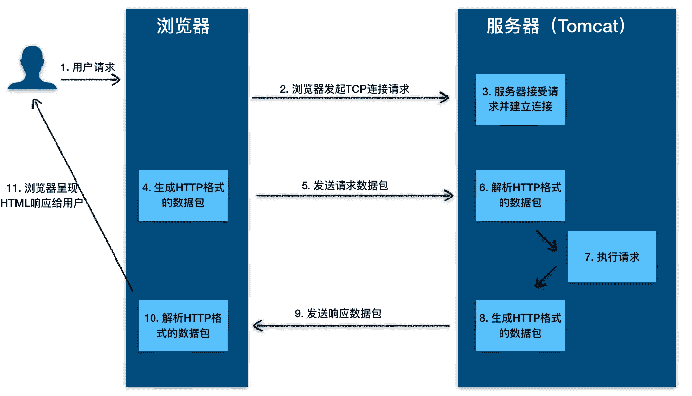
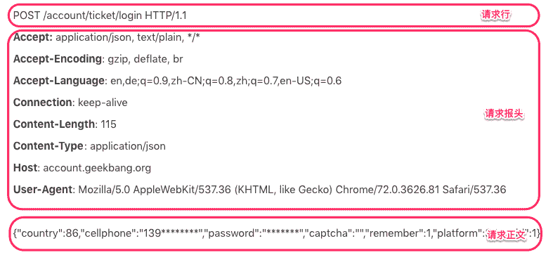
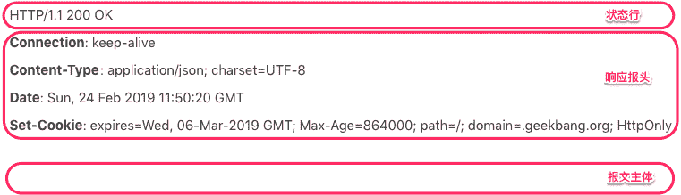

# 02 | HTTP协议必知必会

 

在开始学习 Web 容器之前，我想先问你一个问题：HTTP 和 HTML 有什么区别？

为什么我会问这个问题？你可以把它当作一个入门测试，检测一下自己的对 HTTP 协议的理解。因为 Tomcat 和 Jetty 本身就是一个“HTTP 服务器 + Servlet 容器”，如果你想深入理解 Tomcat 和 Jetty 的工作原理，我认为理解 HTTP 协议的工作原理是学习的基础。

如果你对这个问题还稍有迟疑，那么请跟我一起来回顾一下 HTTP 协议吧。

## HTTP 的本质

HTTP 协议是浏览器与服务器之间的数据传送协议。作为应用层协议，HTTP 是基于 TCP/IP 协议来传递数据的（HTML 文件、图片、查询结果等），HTTP 协议不涉及数据包（Packet）传输，主要规定了客户端和服务器之间的通信格式。

下面我通过一个例子来告诉你 HTTP 的本质是什么。

假如浏览器需要从远程 HTTP 服务器获取一个 HTML 文本，在这个过程中，浏览器实际上要做两件事情。

 
-  

与服务器建立 Socket 连接。
  
-  

生成**请求数据**并通过 Socket 发送出去。
  

第一步比较容易理解，浏览器从地址栏获取用户输入的网址和端口，去连接远端的服务器，这样就能通信了。

我们重点来看第二步，这个请求数据到底长什么样呢？都请求些什么内容呢？或者换句话说，浏览器需要告诉服务端什么信息呢？

首先最基本的是，你要让服务端知道你的意图，你是想获取内容还是提交内容；其次你需要告诉服务端你想要哪个内容。那么要把这些信息以一种什么样的格式放到请求里去呢？这就是 HTTP 协议要解决的问题。也就是说，**HTTP 协议的本质就是一种浏览器与服务器之间约定好的通信格式**。那浏览器与服务器之间具体是怎么工作的呢？

## HTTP 工作原理

请你来看下面这张图，我们过一遍一次 HTTP 的请求过程。

从图上你可以看到，这个过程是：

1. 用户通过浏览器进行了一个操作，比如输入网址并回车，或者是点击链接，接着浏览器获取了这个事件。

2. 浏览器向服务端发出 TCP 连接请求。

3. 服务程序接受浏览器的连接请求，并经过 TCP 三次握手建立连接。

4. 浏览器将请求数据打包成一个 HTTP 协议格式的数据包。

5. 浏览器将该数据包推入网络，数据包经过网络传输，最终达到端服务程序。

6. 服务端程序拿到这个数据包后，同样以 HTTP 协议格式解包，获取到客户端的意图。

7. 得知客户端意图后进行处理，比如提供静态文件或者调用服务端程序获得动态结果。

8. 服务器将响应结果（可能是 HTML 或者图片等）按照 HTTP 协议格式打包。

9. 服务器将响应数据包推入网络，数据包经过网络传输最终达到到浏览器。

10. 浏览器拿到数据包后，以 HTTP 协议的格式解包，然后解析数据，假设这里的数据是 HTML。

11. 浏览器将 HTML 文件展示在页面上。

那我们想要探究的 Tomcat 和 Jetty 作为一个 HTTP 服务器，在这个过程中都做了些什么事情呢？主要是接受连接、解析请求数据、处理请求和发送响应这几个步骤。这里请你注意，可能有成千上万的浏览器同时请求同一个 HTTP 服务器，因此 Tomcat 和 Jetty 为了提高服务的能力和并发度，往往会将自己要做的几个事情并行化，具体来说就是使用多线程的技术。这也是专栏所关注的一个重点，我在后面会进行专门讲解。

## HTTP 请求响应实例

你有没有注意到，在浏览器和 HTTP 服务器之间通信的过程中，首先要将数据打包成 HTTP 协议的格式，那 HTTP 协议的数据包具体长什么样呢？这里我以极客时间的登陆请求为例，用户在登陆页面输入用户名和密码，点击登陆后，浏览器发出了这样的 HTTP 请求：

你可以看到，HTTP 请求数据由三部分组成，分别是**请求行、请求报头、请求正文**。当这个 HTTP 请求数据到达 Tomcat 后，Tomcat 会把 HTTP 请求数据字节流解析成一个 Request 对象，这个 Request 对象封装了 HTTP 所有的请求信息。接着 Tomcat 把这个 Request 对象交给 Web 应用去处理，处理完后得到一个 Response 对象，Tomcat 会把这个 Response 对象转成 HTTP 格式的响应数据并发送给浏览器。

我们再来看看 HTTP 响应的格式，HTTP 的响应也是由三部分组成，分别是**状态行、响应报头、报文主体**。同样，我还以极客时间登陆请求的响应为例。

具体的 HTTP 协议格式，你可以去网上搜索，我就不再赘述了。为了更好地帮助你理解 HTTP 服务器（比如 Tomcat）的工作原理，接下来我想谈一谈 Cookie 跟 Session 的原理。

## Cookie 和 Session

我们知道，HTTP 协议有个特点是无状态，请求与请求之间是没有关系的。这样会出现一个很尴尬的问题：Web 应用不知道你是谁。比如你登陆淘宝后，在购物车中添加了三件商品，刷新一下网页，这时系统提示你仍然处于未登录的状态，购物车也空了，很显然这种情况是不可接受的。因此 HTTP 协议需要一种技术让请求与请求之间建立起联系，并且服务器需要知道这个请求来自哪个用户，于是 Cookie 技术出现了。

**1. Cookie 技术**

Cookie 是 HTTP 报文的一个请求头，Web 应用可以将用户的标识信息或者其他一些信息（用户名等）存储在 Cookie 中。用户经过验证之后，每次 HTTP 请求报文中都包含 Cookie，这样服务器读取这个 Cookie 请求头就知道用户是谁了。**Cookie 本质上就是一份存储在用户本地的文件，里面包含了每次请求中都需要传递的信息**。

**2. Session 技术**

由于 Cookie 以明文的方式存储在本地，而 Cookie 中往往带有用户信息，这样就造成了非常大的安全隐患。而 Session 的出现解决了这个问题，**Session 可以理解为****服务器****端开辟的存储空间，里面保存了用户的状态**，用户信息以 Session 的形式存储在服务端。当用户请求到来时，服务端可以把用户的请求和用户的 Session 对应起来。那么 Session 是怎么和请求对应起来的呢？答案是通过 Cookie，浏览器在 Cookie 中填充了一个 Session ID 之类的字段用来标识请求。

具体工作过程是这样的：服务器在创建 Session 的同时，会为该 Session 生成唯一的 Session ID，当浏览器再次发送请求的时候，会将这个 Session ID 带上，服务器接受到请求之后就会依据 Session ID 找到相应的 Session，找到 Session 后，就可以在 Session 中获取或者添加内容了。而这些内容只会保存在服务器中，发到客户端的只有 Session ID，这样相对安全，也节省了网络流量，因为不需要在 Cookie 中存储大量用户信息。

**3. Session 创建与存储**

那么 Session 在何时何地创建呢？当然还是在服务器端程序运行的过程中创建的，不同语言实现的应用程序有不同的创建 Session 的方法。在 Java 中，是 Web 应用程序在调用 HttpServletRequest 的 getSession 方法时，由 Web 容器（比如 Tomcat）创建的。那 HttpServletRequest 又是什么呢？别着急，我们下一期再聊。

Tomcat 的 Session 管理器提供了多种持久化方案来存储 Session，通常会采用高性能的存储方式，比如 Redis，并且通过集群部署的方式，防止单点故障，从而提升高可用。同时，Session 有过期时间，因此 Tomcat 会开启后台线程定期的轮询，如果 Session 过期了就将 Session 失效。

## 本期精华

HTTP 协议和其他应用层协议一样，本质上是一种通信格式。回到文章开头我问你的问题，其实答案很简单：HTTP 是通信的方式，HTML 才是通信的目的，就好比 HTTP 是信封，信封里面的信（HTML）才是内容；但是没有信封，信也没办法寄出去。HTTP 协议就是浏览器与服务器之间的沟通语言，具体交互过程是请求、处理和响应。

由于 HTTP 是无状态的协议，为了识别请求是哪个用户发过来的，出现了 Cookie 和 Session 技术。Cookie 本质上就是一份存储在用户本地的文件，里面包含了每次请求中都需要传递的信息；Session 可以理解为服务器端开辟的存储空间，里面保存的信息用于保持状态。作为 Web 容器，Tomcat 负责创建和管理 Session，并提供了多种持久化方案来存储 Session。

## 课后思考

在 HTTP/1.0 时期，每次 HTTP 请求都会创建一个新的 TCP 连接，请求完成后之后这个 TCP 连接就会被关闭。这种通信模式的效率不高，所以在 HTTP/1.1 中，引入了 HTTP 长连接的概念，使用长连接的 HTTP 协议，会在响应头加入 Connection:keep-alive。这样当浏览器完成一次请求后，浏览器和服务器之间的 TCP 连接不会关闭，再次访问这个服务器上的网页时，浏览器会继续使用这一条已经建立的连接，也就是说两个请求可能共用一个 TCP 连接。

今天留给你的思考题是，我在上面提到 HTTP 的特点是无状态的，多个请求之间是没有关系的，这是不是矛盾了？

不知道今天的内容你消化得如何？如果还有疑问，请大胆的在留言区提问，也欢迎你把你的课后思考和心得记录下来，与我和其他同学一起讨论。如果你觉得今天有所收获，欢迎你把它分享给你的朋友。

