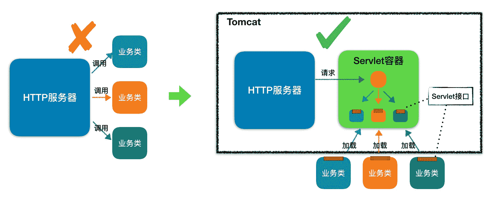
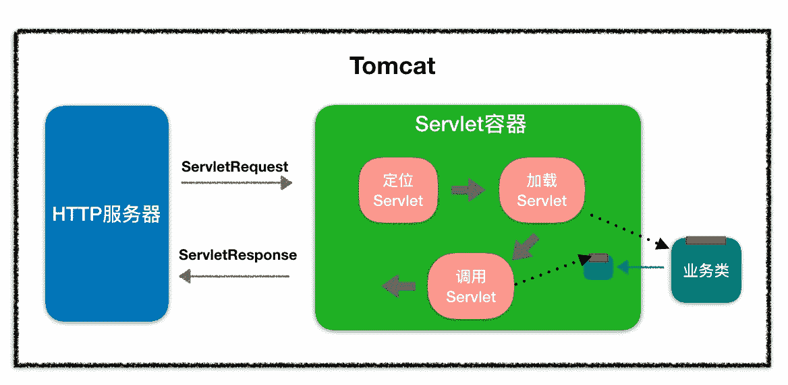

# 03 | 你应该知道的Servlet规范和Servlet容器

 

通过专栏上一期的学习我们知道，浏览器发给服务端的是一个 HTTP 格式的请求，HTTP 服务器收到这个请求后，需要调用服务端程序来处理，所谓的服务端程序就是你写的 Java 类，一般来说不同的请求需要由不同的 Java 类来处理。

那么问题来了，HTTP 服务器怎么知道要调用哪个 Java 类的哪个方法呢。最直接的做法是在 HTTP 服务器代码里写一大堆 if else 逻辑判断：如果是 A 请求就调 X 类的 M1 方法，如果是 B 请求就调 Y 类的 M2 方法。但这样做明显有问题，因为 HTTP 服务器的代码跟业务逻辑耦合在一起了，如果新加一个业务方法还要改 HTTP 服务器的代码。

那该怎么解决这个问题呢？我们知道，面向接口编程是解决耦合问题的法宝，于是有一伙人就定义了一个接口，各种业务类都必须实现这个接口，这个接口就叫 Servlet 接口，有时我们也把实现了 Servlet 接口的业务类叫作 Servlet。

但是这里还有一个问题，对于特定的请求，HTTP 服务器如何知道由哪个 Servlet 来处理呢？Servlet 又是由谁来实例化呢？显然 HTTP 服务器不适合做这个工作，否则又和业务类耦合了。

于是，还是那伙人又发明了 Servlet 容器，Servlet 容器用来加载和管理业务类。HTTP 服务器不直接跟业务类打交道，而是把请求交给 Servlet 容器去处理，Servlet 容器会将请求转发到具体的 Servlet，如果这个 Servlet 还没创建，就加载并实例化这个 Servlet，然后调用这个 Servlet 的接口方法。因此 Servlet 接口其实是**Servlet 容器跟具体业务类之间的接口**。下面我们通过一张图来加深理解。



图的左边表示 HTTP 服务器直接调用具体业务类，它们是紧耦合的。再看图的右边，HTTP 服务器不直接调用业务类，而是把请求交给容器来处理，容器通过 Servlet 接口调用业务类。因此 Servlet 接口和 Servlet 容器的出现，达到了 HTTP 服务器与业务类解耦的目的。

而 Servlet 接口和 Servlet 容器这一整套规范叫作 Servlet 规范。Tomcat 和 Jetty 都按照 Servlet 规范的要求实现了 Servlet 容器，同时它们也具有 HTTP 服务器的功能。作为 Java 程序员，如果我们要实现新的业务功能，只需要实现一个 Servlet，并把它注册到 Tomcat（Servlet 容器）中，剩下的事情就由 Tomcat 帮我们处理了。

接下来我们来看看 Servlet 接口具体是怎么定义的，以及 Servlet 规范又有哪些要重点关注的地方呢？

## Servlet 接口

Servlet 接口定义了下面五个方法：

```
public interface Servlet {    void init(ServletConfig config) throws ServletException;        ServletConfig getServletConfig();        void service(ServletRequest req, ServletResponse res）throws ServletException, IOException;        String getServletInfo();        void destroy();}
```

其中最重要是的 service 方法，具体业务类在这个方法里实现处理逻辑。这个方法有两个参数：ServletRequest 和 ServletResponse。ServletRequest 用来封装请求信息，ServletResponse 用来封装响应信息，因此**本质上这两个类是对通信协议的封装。**

比如 HTTP 协议中的请求和响应就是对应了 HttpServletRequest 和 HttpServletResponse 这两个类。你可以通过 HttpServletRequest 来获取所有请求相关的信息，包括请求路径、Cookie、HTTP 头、请求参数等。此外，我在专栏上一期提到过，我们还可以通过 HttpServletRequest 来创建和获取 Session。而 HttpServletResponse 是用来封装 HTTP 响应的。

你可以看到接口中还有两个跟生命周期有关的方法 init 和 destroy，这是一个比较贴心的设计，Servlet 容器在加载 Servlet 类的时候会调用 init 方法，在卸载的时候会调用 destroy 方法。我们可能会在 init 方法里初始化一些资源，并在 destroy 方法里释放这些资源，比如 Spring MVC 中的 DispatcherServlet，就是在 init 方法里创建了自己的 Spring 容器。

你还会注意到 ServletConfig 这个类，ServletConfig 的作用就是封装 Servlet 的初始化参数。你可以在 web.xml 给 Servlet 配置参数，并在程序里通过 getServletConfig 方法拿到这些参数。

我们知道，有接口一般就有抽象类，抽象类用来实现接口和封装通用的逻辑，因此 Servlet 规范提供了 GenericServlet 抽象类，我们可以通过扩展它来实现 Servlet。虽然 Servlet 规范并不在乎通信协议是什么，但是大多数的 Servlet 都是在 HTTP 环境中处理的，因此 Servet 规范还提供了 HttpServlet 来继承 GenericServlet，并且加入了 HTTP 特性。这样我们通过继承 HttpServlet 类来实现自己的 Servlet，只需要重写两个方法：doGet 和 doPost。

## Servlet 容器

我在前面提到，为了解耦，HTTP 服务器不直接调用 Servlet，而是把请求交给 Servlet 容器来处理，那 Servlet 容器又是怎么工作的呢？接下来我会介绍 Servlet 容器大体的工作流程，一起来聊聊我们非常关心的两个话题：**Web 应用的目录格式是什么样的，以及我该怎样扩展和定制化 Servlet 容器的功能**。

**工作流程**

当客户请求某个资源时，HTTP 服务器会用一个 ServletRequest 对象把客户的请求信息封装起来，然后调用 Servlet 容器的 service 方法，Servlet 容器拿到请求后，根据请求的 URL 和 Servlet 的映射关系，找到相应的 Servlet，如果 Servlet 还没有被加载，就用反射机制创建这个 Servlet，并调用 Servlet 的 init 方法来完成初始化，接着调用 Servlet 的 service 方法来处理请求，把 ServletResponse 对象返回给 HTTP 服务器，HTTP 服务器会把响应发送给客户端。同样我通过一张图来帮助你理解。



**Web 应用**

Servlet 容器会实例化和调用 Servlet，那 Servlet 是怎么注册到 Servlet 容器中的呢？一般来说，我们是以 Web 应用程序的方式来部署 Servlet 的，而根据 Servlet 规范，Web 应用程序有一定的目录结构，在这个目录下分别放置了 Servlet 的类文件、配置文件以及静态资源，Servlet 容器通过读取配置文件，就能找到并加载 Servlet。Web 应用的目录结构大概是下面这样的：

```
| -  MyWebApp      | -  WEB-INF/web.xml        -- 配置文件，用来配置 Servlet 等      | -  WEB-INF/lib/           -- 存放 Web 应用所需各种 JAR 包      | -  WEB-INF/classes/       -- 存放你的应用类，比如 Servlet 类      | -  META-INF/              -- 目录存放工程的一些信息
```

Servlet 规范里定义了**ServletContext**这个接口来对应一个 Web 应用。Web 应用部署好后，Servlet 容器在启动时会加载 Web 应用，并为每个 Web 应用创建唯一的 ServletContext 对象。你可以把 ServletContext 看成是一个全局对象，一个 Web 应用可能有多个 Servlet，这些 Servlet 可以通过全局的 ServletContext 来共享数据，这些数据包括 Web 应用的初始化参数、Web 应用目录下的文件资源等。由于 ServletContext 持有所有 Servlet 实例，你还可以通过它来实现 Servlet 请求的转发。

**扩展机制**

不知道你有没有发现，引入了 Servlet 规范后，你不需要关心 Socket 网络通信、不需要关心 HTTP 协议，也不需要关心你的业务类是如何被实例化和调用的，因为这些都被 Servlet 规范标准化了，你只要关心怎么实现的你的业务逻辑。这对于程序员来说是件好事，但也有不方便的一面。所谓规范就是说大家都要遵守，就会千篇一律，但是如果这个规范不能满足你的业务的个性化需求，就有问题了，因此设计一个规范或者一个中间件，要充分考虑到可扩展性。Servlet 规范提供了两种扩展机制：**Filter**和**Listener**。

**Filter**是过滤器，这个接口允许你对请求和响应做一些统一的定制化处理，比如你可以根据请求的频率来限制访问，或者根据国家地区的不同来修改响应内容。过滤器的工作原理是这样的：Web 应用部署完成后，Servlet 容器需要实例化 Filter 并把 Filter 链接成一个 FilterChain。当请求进来时，获取第一个 Filter 并调用 doFilter 方法，doFilter 方法负责调用这个 FilterChain 中的下一个 Filter。

**Listener**是监听器，这是另一种扩展机制。当 Web 应用在 Servlet 容器中运行时，Servlet 容器内部会不断的发生各种事件，如 Web 应用的启动和停止、用户请求到达等。 Servlet 容器提供了一些默认的监听器来监听这些事件，当事件发生时，Servlet 容器会负责调用监听器的方法。当然，你可以定义自己的监听器去监听你感兴趣的事件，将监听器配置在 web.xml 中。比如 Spring 就实现了自己的监听器，来监听 ServletContext 的启动事件，目的是当 Servlet 容器启动时，创建并初始化全局的 Spring 容器。

到这里相信你对 Servlet 容器的工作原理有了深入的了解，只有理解了这些原理，我们才能更好的理解 Tomcat 和 Jetty，因为它们都是 Servlet 容器的具体实现。后面我还会详细谈到 Tomcat 和 Jetty 是如何设计和实现 Servlet 容器的，虽然它们的实现方法各有特点，但是都遵守了 Servlet 规范，因此你的 Web 应用可以在这两个 Servlet 容器中方便的切换。

## 本期精华

今天我们学习了什么是 Servlet，回顾一下，Servlet 本质上是一个接口，实现了 Servlet 接口的业务类也叫 Servlet。Servlet 接口其实是 Servlet 容器跟具体 Servlet 业务类之间的接口。Servlet 接口跟 Servlet 容器这一整套规范叫作 Servlet 规范，而 Servlet 规范使得程序员可以专注业务逻辑的开发，同时 Servlet 规范也给开发者提供了扩展的机制 Filter 和 Listener。

最后我给你总结一下 Filter 和 Listener 的本质区别：

 
-  

**Filter 是干预过程的**，它是过程的一部分，是基于过程行为的。
  
-  

**Listener 是基于状态的**，任何行为改变同一个状态，触发的事件是一致的。
  

## 课后思考

Servlet 容器与 Spring 容器有什么关系？

不知道今天的内容你消化得如何？如果还有疑问，请大胆的在留言区提问，也欢迎你把你的课后思考和心得记录下来，与我和其他同学一起讨论。如果你觉得今天有所收获，欢迎你把它分享给你的朋友。


