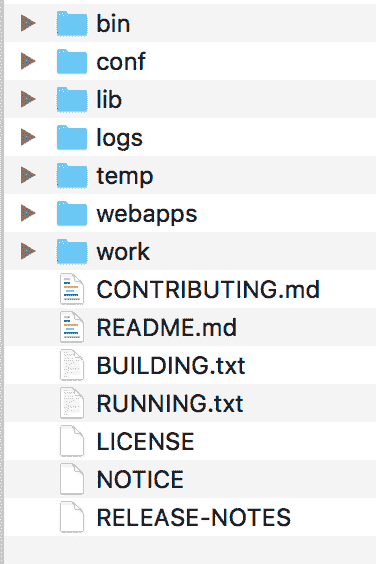

# 04 | 实战：纯手工打造和运行一个Servlet

 

作为 Java 程序员，我们可能已经习惯了使用 IDE 和 Web 框架进行开发，IDE 帮我们做了编译、打包的工作，而 Spring 框架在背后帮我们实现了 Servlet 接口，并把 Servlet 注册到了 Web 容器，这样我们可能很少有机会接触到一些底层本质的东西，比如怎么开发一个 Servlet？如何编译 Servlet？如何在 Web 容器中跑起来？

今天我们就抛弃 IDE、拒绝框架，自己纯手工编写一个 Servlet，并在 Tomcat 中运行起来。一方面进一步加深对 Servlet 的理解；另一方面，还可以熟悉一下 Tomcat 的基本功能使用。

主要的步骤有：

1. 下载并安装 Tomcat。  
 2. 编写一个继承 HttpServlet 的 Java 类。  
 3. 将 Java 类文件编译成 Class 文件。  
 4. 建立 Web 应用的目录结构，并配置 web.xml。  
 5. 部署 Web 应用。  
 6. 启动 Tomcat。  
 7. 浏览器访问验证结果。  
 8. 查看 Tomcat 日志。

下面你可以跟我一起一步步操作来完成整个过程。Servlet 3.0 规范支持用注解的方式来部署 Servlet，不需要在 web.xml 里配置，最后我会演示怎么用注解的方式来部署 Servlet。

**1. 下载并安装 Tomcat**

最新版本的 Tomcat 可以直接在[官网](https://tomcat.apache.org/download-90.cgi)上下载，根据你的操作系统下载相应的版本，这里我使用的是 Mac 系统，下载完成后直接解压，解压后的目录结构如下。



下面简单介绍一下这些目录：

/bin：存放 Windows 或 Linux 平台上启动和关闭 Tomcat 的脚本文件。  
 /conf：存放 Tomcat 的各种全局配置文件，其中最重要的是 server.xml。  
 /lib：存放 Tomcat 以及所有 Web 应用都可以访问的 JAR 文件。  
 /logs：存放 Tomcat 执行时产生的日志文件。  
 /work：存放 JSP 编译后产生的 Class 文件。  
 /webapps：Tomcat 的 Web 应用目录，默认情况下把 Web 应用放在这个目录下。

**2. 编写一个继承 HttpServlet 的 Java 类**

我在专栏上一期提到，javax.servlet 包提供了实现 Servlet 接口的 GenericServlet 抽象类。这是一个比较方便的类，可以通过扩展它来创建 Servlet。但是大多数的 Servlet 都在 HTTP 环境中处理请求，因此 Serve 规范还提供了 HttpServlet 来扩展 GenericServlet 并且加入了 HTTP 特性。我们通过继承 HttpServlet 类来实现自己的 Servlet 只需要重写两个方法：doGet 和 doPost。

因此今天我们创建一个 Java 类去继承 HttpServlet 类，并重写 doGet 和 doPost 方法。首先新建一个名为 MyServlet.java 的文件，敲入下面这些代码：

```
import java.io.IOException;import java.io.PrintWriter; import javax.servlet.ServletException;import javax.servlet.http.HttpServlet;import javax.servlet.http.HttpServletRequest;import javax.servlet.http.HttpServletResponse;  public class MyServlet extends HttpServlet {     @Override    protected void doGet(HttpServletRequest request, HttpServletResponse response)            throws ServletException, IOException {         System.out.println("MyServlet 在处理 get（）请求...");        PrintWriter out = response.getWriter();        response.setContentType("text/html;charset=utf-8");        out.println("<strong>My Servlet!</strong><br>");    }     @Override    protected void doPost(HttpServletRequest request, HttpServletResponse response)            throws ServletException, IOException {         System.out.println("MyServlet 在处理 post（）请求...");        PrintWriter out = response.getWriter();        response.setContentType("text/html;charset=utf-8");        out.println("<strong>My Servlet!</strong><br>");    } }
```

这个 Servlet 完成的功能很简单，分别在 doGet 和 doPost 方法体里返回一段简单的 HTML。

**3. 将 Java 文件编译成 Class 文件**

下一步我们需要把 MyServlet.java 文件编译成 Class 文件。你需要先安装 JDK，这里我使用的是 JDK 10。接着你需要把 Tomcat lib 目录下的 servlet-api.jar 拷贝到当前目录下，这是因为 servlet-api.jar 中定义了 Servlet 接口，而我们的 Servlet 类实现了 Servlet 接口，因此编译 Servlet 类需要这个 JAR 包。接着我们执行编译命令：

```
javac -cp ./servlet-api.jar MyServlet.java
```

编译成功后，你会在当前目录下找到一个叫 MyServlet.class 的文件。

**4. 建立 Web 应用的目录结构**

我们在上一期学到，Servlet 是放到 Web 应用部署到 Tomcat 的，而 Web 应用具有一定的目录结构，所有我们按照要求建立 Web 应用文件夹，名字叫 MyWebApp，然后在这个目录下建立子文件夹，像下面这样：

```
MyWebApp/WEB-INF/web.xml MyWebApp/WEB-INF/classes/MyServlet.class
```

然后在 web.xml 中配置 Servlet，内容如下：

```
<?xml version="1.0" encoding="UTF-8"?><web-app xmlns="http://xmlns.jcp.org/xml/ns/javaee"  xmlns:xsi="http://www.w3.org/2001/XMLSchema-instance"  xsi:schemaLocation="http://xmlns.jcp.org/xml/ns/javaee  http://xmlns.jcp.org/xml/ns/javaee/web-app_4_0.xsd"  version="4.0"  metadata-complete="true">     <description> Servlet Example. </description>    <display-name> MyServlet Example </display-name>    <request-character-encoding>UTF-8</request-character-encoding>     <servlet>      <servlet-name>myServlet</servlet-name>      <servlet-class>MyServlet</servlet-class>    </servlet>     <servlet-mapping>      <servlet-name>myServlet</servlet-name>      <url-pattern>/myservlet</url-pattern>    </servlet-mapping> </web-app>
```

你可以看到在 web.xml 配置了 Servlet 的名字和具体的类，以及这个 Servlet 对应的 URL 路径。请你注意，**servlet 和 servlet-mapping 这两个标签里的 servlet-name 要保持一致。**

**5. 部署 Web 应用**

Tomcat 应用的部署非常简单，将这个目录 MyWebApp 拷贝到 Tomcat 的安装目录下的 webapps 目录即可。

**6. 启动 Tomcat**

找到 Tomcat 安装目录下的 bin 目录，根据操作系统的不同，执行相应的启动脚本。如果是 Windows 系统，执行`startup.bat`.；如果是 Linux 系统，则执行`startup.sh`。

**7. 浏览访问验证结果**

在浏览器里访问这个 URL：`http://localhost:8080/MyWebApp/myservlet`，你会看到：

```
My Servlet!
```

这里需要注意，访问 URL 路径中的 MyWebApp 是 Web 应用的名字，myservlet 是在 web.xml 里配置的 Servlet 的路径。

**8. 查看 Tomcat 日志**

打开 Tomcat 的日志目录，也就是 Tomcat 安装目录下的 logs 目录。Tomcat 的日志信息分为两类 ：一是运行日志，它主要记录运行过程中的一些信息，尤其是一些异常错误日志信息 ；二是访问日志，它记录访问的时间、IP 地址、访问的路径等相关信息。

这里简要介绍各个文件的含义。

 
- `catalina.***.log` 

主要是记录 Tomcat 启动过程的信息，在这个文件可以看到启动的 JVM 参数以及操作系统等日志信息。

 
- `catalina.out` 

catalina.out 是 Tomcat 的标准输出（stdout）和标准错误（stderr），这是在 Tomcat 的启动脚本里指定的，如果没有修改的话 stdout 和 stderr 会重定向到这里。所以在这个文件里可以看到我们在 MyServlet.java 程序里打印出来的信息：

>  
> MyServlet 在处理 get() 请求…
 

 
- `localhost.**.log` 

主要记录 Web 应用在初始化过程中遇到的未处理的异常，会被 Tomcat 捕获而输出这个日志文件。

 
- `localhost_access_log.**.txt` 

存放访问 Tomcat 的请求日志，包括 IP 地址以及请求的路径、时间、请求协议以及状态码等信息。

 
- `manager.***.log/host-manager.***.log` 

存放 Tomcat 自带的 manager 项目的日志信息。

**用注解的方式部署 Servlet**

为了演示用注解的方式来部署 Servlet，我们首先修改 Java 代码，给 Servlet 类加上**@WebServlet**注解，修改后的代码如下。

```
import java.io.IOException;import java.io.PrintWriter; import javax.servlet.ServletException;import javax.servlet.annotation.WebServlet;import javax.servlet.http.HttpServlet;import javax.servlet.http.HttpServletRequest;import javax.servlet.http.HttpServletResponse; @WebServlet("/myAnnotationServlet")public class AnnotationServlet extends HttpServlet {     @Override    protected void doGet(HttpServletRequest request, HttpServletResponse response)            throws ServletException, IOException {           System.out.println("AnnotationServlet 在处理 get（）请求...");        PrintWriter out = response.getWriter();        response.setContentType("text/html; charset=utf-8");        out.println("<strong>Annotation Servlet!</strong><br>");     }     @Override    protected void doPost(HttpServletRequest request, HttpServletResponse response)            throws ServletException, IOException {         System.out.println("AnnotationServlet 在处理 post（）请求...");        PrintWriter out = response.getWriter();        response.setContentType("text/html; charset=utf-8");        out.println("<strong>Annotation Servlet!</strong><br>");     } }  
```

这段代码里最关键的就是这个注解，它表明两层意思：第一层意思是 AnnotationServlet 这个 Java 类是一个 Servlet，第二层意思是这个 Servlet 对应的 URL 路径是 myAnnotationServlet。

```
@WebServlet("/myAnnotationServlet")
```

创建好 Java 类以后，同样经过编译，并放到 MyWebApp 的 class 目录下。这里要注意的是，你**需要删除原来的 web.xml**，因为我们不需要 web.xml 来配置 Servlet 了。然后重启 Tomcat，接下来我们验证一下这个新的 AnnotationServlet 有没有部署成功。在浏览器里输入：`http://localhost:8080/MyWebApp/myAnnotationServlet`，得到结果：

```
Annotation Servlet!
```

这说明我们的 AnnotationServlet 部署成功了。可以通过注解完成 web.xml 所有的配置功能，包括 Servlet 初始化参数以及配置 Filter 和 Listener 等。

## 本期精华

通过今天的学习和实践，相信你掌握了如何通过扩展 HttpServlet 来实现自己的 Servlet，知道了如何编译 Servlet、如何通过 web.xml 来部署 Servlet，同时还练习了如何启动 Tomcat、如何查看 Tomcat 的各种日志，并且还掌握了如何通过注解的方式来部署 Servlet。我相信通过专栏前面文章的学习加上今天的练习实践，一定会加深你对 Servlet 工作原理的理解。之所以我设置今天的实战练习，是希望你知道 IDE 和 Web 框架在背后为我们做了哪些事情，这对于我们排查问题非常重要，因为只有我们明白了 IDE 和框架在背后做的事情，一旦出现问题的时候，我们才能判断它们做得对不对，否则可能开发环境里的一个小问题就会折腾我们半天。

## 课后思考

我在 Servlet 类里同时实现了 doGet 方法和 doPost 方法，从浏览器的网址访问默认访问的是 doGet 方法，今天的课后思考题是如何访问这个 doPost 方法。

不知道今天的内容你消化得如何？如果还有疑问，请大胆的在留言区提问，也欢迎你把你的课后思考和心得记录下来，与我和其他同学一起讨论。如果你觉得今天有所收获，欢迎你把它分享给你的朋友。


