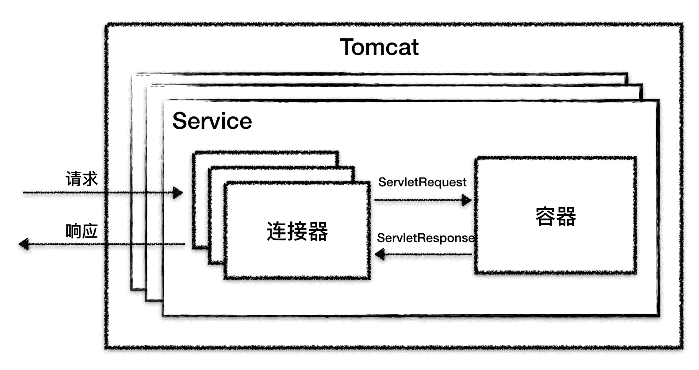
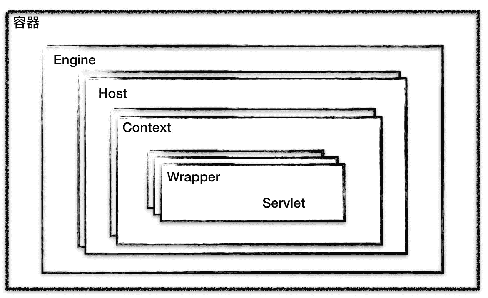
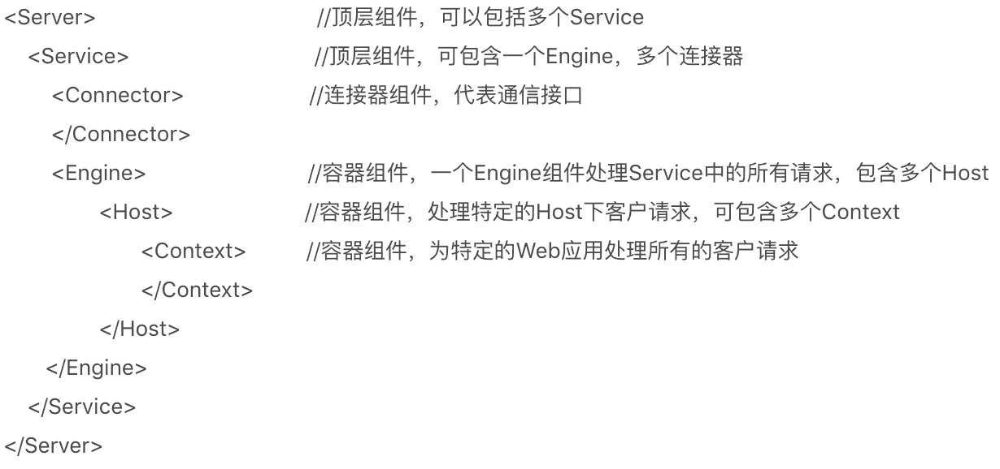
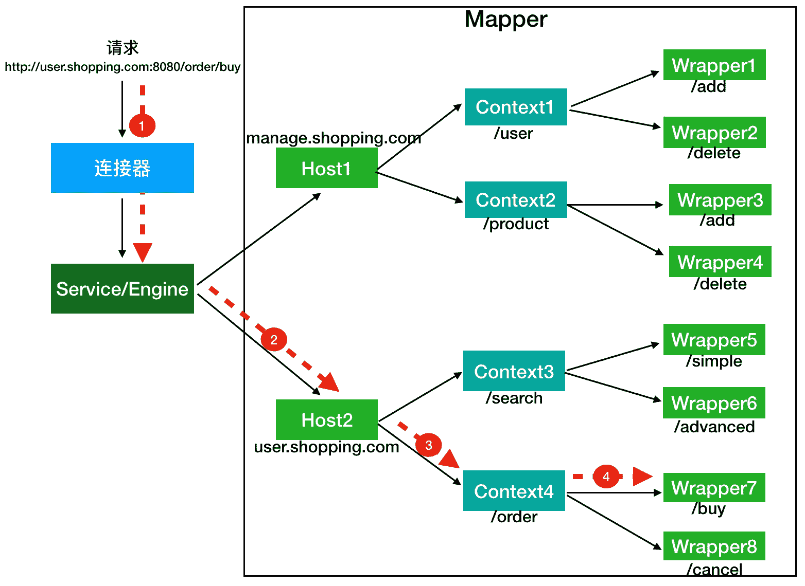
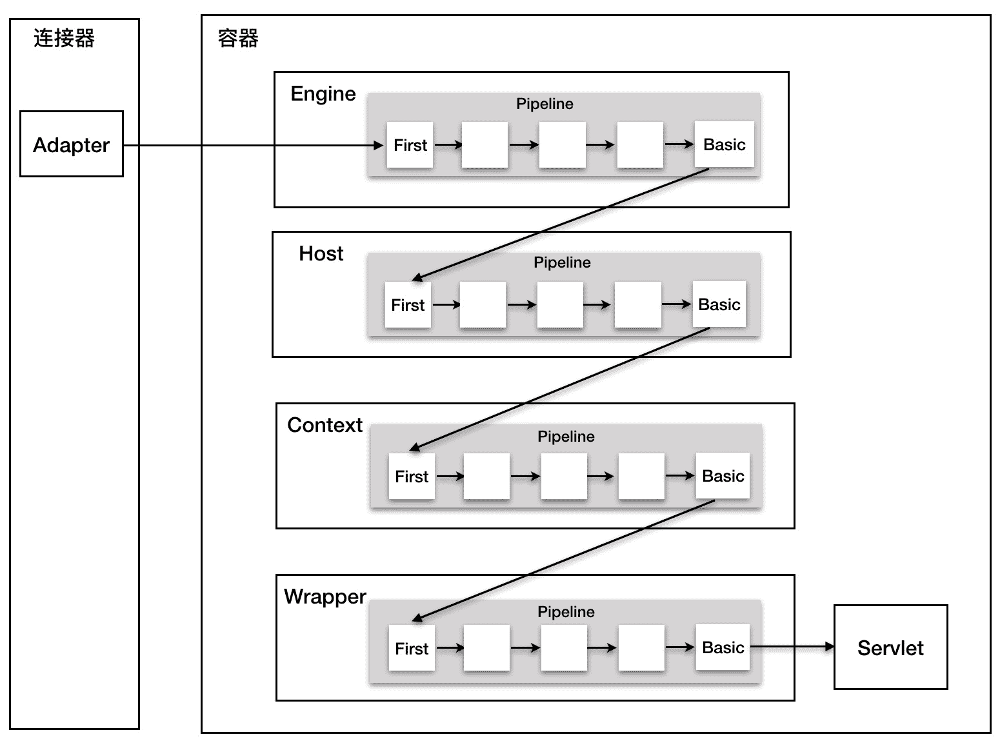

# 06 | Tomcat系统架构（下）：聊聊多层容器的设计

 

专栏上一期我们学完了连接器的设计，今天我们一起来看一下 Tomcat 的容器设计。先复习一下，上期我讲到了 Tomcat 有两个核心组件：连接器和容器，其中连接器负责外部交流，容器负责内部处理。具体来说就是，连接器处理 Socket 通信和应用层协议的解析，得到 Servlet 请求；而容器则负责处理 Servlet 请求。我们通过下面这张图来回忆一下。



容器，顾名思义就是用来装载东西的器具，在 Tomcat 里，容器就是用来装载 Servlet 的。那 Tomcat 的 Servlet 容器是如何设计的呢？

## 容器的层次结构

Tomcat 设计了 4 种容器，分别是 Engine、Host、Context 和 Wrapper。这 4 种容器不是平行关系，而是父子关系。下面我画了一张图帮你理解它们的关系。



你可能会问，为什么要设计成这么多层次的容器，这不是增加了复杂度吗？其实这背后的考虑是，**Tomcat 通过一种分层的架构，使得 Servlet 容器具有很好的灵活性。**

Context 表示一个 Web 应用程序；Wrapper 表示一个 Servlet，一个 Web 应用程序中可能会有多个 Servlet；Host 代表的是一个虚拟主机，或者说一个站点，可以给 Tomcat 配置多个虚拟主机地址，而一个虚拟主机下可以部署多个 Web 应用程序；Engine 表示引擎，用来管理多个虚拟站点，一个 Service 最多只能有一个 Engine。

你可以再通过 Tomcat 的 server.xml 配置文件来加深对 Tomcat 容器的理解。Tomcat 采用了组件化的设计，它的构成组件都是可配置的，其中最外层的是 Server，其他组件按照一定的格式要求配置在这个顶层容器中。



那么，Tomcat 是怎么管理这些容器的呢？你会发现这些容器具有父子关系，形成一个树形结构，你可能马上就想到了设计模式中的组合模式。没错，Tomcat 就是用组合模式来管理这些容器的。具体实现方法是，所有容器组件都实现了 Container 接口，因此组合模式可以使得用户对单容器对象和组合容器对象的使用具有一致性。这里单容器对象指的是最底层的 Wrapper，组合容器对象指的是上面的 Context、Host 或者 Engine。Container 接口定义如下：

```
public interface Container extends Lifecycle {    public void setName(String name);    public Container getParent();    public void setParent(Container container);    public void addChild(Container child);    public void removeChild(Container child);    public Container findChild(String name);}
```

正如我们期望的那样，我们在上面的接口看到了 getParent、SetParent、addChild 和 removeChild 等方法。你可能还注意到 Container 接口扩展了 LifeCycle 接口，LifeCycle 接口用来统一管理各组件的生命周期，后面我也用专门的篇幅去详细介绍。

## 请求定位 Servlet 的过程

你可能好奇，设计了这么多层次的容器，Tomcat 是怎么确定请求是由哪个 Wrapper 容器里的 Servlet 来处理的呢？答案是，Tomcat 是用 Mapper 组件来完成这个任务的。

Mapper 组件的功能就是将用户请求的 URL 定位到一个 Servlet，它的工作原理是：Mapper 组件里保存了 Web 应用的配置信息，其实就是**容器组件与访问路径的映射关系**，比如 Host 容器里配置的域名、Context 容器里的 Web 应用路径，以及 Wrapper 容器里 Servlet 映射的路径，你可以想象这些配置信息就是一个多层次的 Map。

当一个请求到来时，Mapper 组件通过解析请求 URL 里的域名和路径，再到自己保存的 Map 里去查找，就能定位到一个 Servlet。请你注意，一个请求 URL 最后只会定位到一个 Wrapper 容器，也就是一个 Servlet。

读到这里你可能感到有些抽象，接下来我通过一个例子来解释这个定位的过程。

假如有一个网购系统，有面向网站管理人员的后台管理系统，还有面向终端客户的在线购物系统。这两个系统跑在同一个 Tomcat 上，为了隔离它们的访问域名，配置了两个虚拟域名：`manage.shopping.com`和`user.shopping.com`，网站管理人员通过`manage.shopping.com`域名访问 Tomcat 去管理用户和商品，而用户管理和商品管理是两个单独的 Web 应用。终端客户通过`user.shopping.com`域名去搜索商品和下订单，搜索功能和订单管理也是两个独立的 Web 应用。

针对这样的部署，Tomcat 会创建一个 Service 组件和一个 Engine 容器组件，在 Engine 容器下创建两个 Host 子容器，在每个 Host 容器下创建两个 Context 子容器。由于一个 Web 应用通常有多个 Servlet，Tomcat 还会在每个 Context 容器里创建多个 Wrapper 子容器。每个容器都有对应的访问路径，你可以通过下面这张图来帮助你理解。



假如有用户访问一个 URL，比如图中的`http://user.shopping.com:8080/order/buy`，Tomcat 如何将这个 URL 定位到一个 Servlet 呢？

**首先，根据协议和端口号选定 Service 和 Engine。**

我们知道 Tomcat 的每个连接器都监听不同的端口，比如 Tomcat 默认的 HTTP 连接器监听 8080 端口、默认的 AJP 连接器监听 8009 端口。上面例子中的 URL 访问的是 8080 端口，因此这个请求会被 HTTP 连接器接收，而一个连接器是属于一个 Service 组件的，这样 Service 组件就确定了。我们还知道一个 Service 组件里除了有多个连接器，还有一个容器组件，具体来说就是一个 Engine 容器，因此 Service 确定了也就意味着 Engine 也确定了。

**然后，根据域名选定 Host。**

Service 和 Engine 确定后，Mapper 组件通过 URL 中的域名去查找相应的 Host 容器，比如例子中的 URL 访问的域名是`user.shopping.com`，因此 Mapper 会找到 Host2 这个容器。

**之后，根据 URL 路径找到 Context 组件。**

Host 确定以后，Mapper 根据 URL 的路径来匹配相应的 Web 应用的路径，比如例子中访问的是 /order，因此找到了 Context4 这个 Context 容器。

**最后，根据 URL 路径找到 Wrapper（Servlet）。**

Context 确定后，Mapper 再根据 web.xml 中配置的 Servlet 映射路径来找到具体的 Wrapper 和 Servlet。

看到这里，我想你应该已经了解了什么是容器，以及 Tomcat 如何通过一层一层的父子容器找到某个 Servlet 来处理请求。需要注意的是，并不是说只有 Servlet 才会去处理请求，实际上这个查找路径上的父子容器都会对请求做一些处理。我在上一期说过，连接器中的 Adapter 会调用容器的 Service 方法来执行 Servlet，最先拿到请求的是 Engine 容器，Engine 容器对请求做一些处理后，会把请求传给自己子容器 Host 继续处理，依次类推，最后这个请求会传给 Wrapper 容器，Wrapper 会调用最终的 Servlet 来处理。那么这个调用过程具体是怎么实现的呢？答案是使用 Pipeline-Valve 管道。

Pipeline-Valve 是责任链模式，责任链模式是指在一个请求处理的过程中有很多处理者依次对请求进行处理，每个处理者负责做自己相应的处理，处理完之后将再调用下一个处理者继续处理。

Valve 表示一个处理点，比如权限认证和记录日志。如果你还不太理解的话，可以来看看 Valve 和 Pipeline 接口中的关键方法。

```
public interface Valve {  public Valve getNext();  public void setNext(Valve valve);  public void invoke(Request request, Response response)}
```

由于 Valve 是一个处理点，因此 invoke 方法就是来处理请求的。注意到 Valve 中有 getNext 和 setNext 方法，因此我们大概可以猜到有一个链表将 Valve 链起来了。请你继续看 Pipeline 接口：

```
public interface Pipeline extends Contained {  public void addValve(Valve valve);  public Valve getBasic();  public void setBasic(Valve valve);  public Valve getFirst();}
```

没错，Pipeline 中有 addValve 方法。Pipeline 中维护了 Valve 链表，Valve 可以插入到 Pipeline 中，对请求做某些处理。我们还发现 Pipeline 中没有 invoke 方法，因为整个调用链的触发是 Valve 来完成的，Valve 完成自己的处理后，调用 getNext.invoke() 来触发下一个 Valve 调用。

每一个容器都有一个 Pipeline 对象，只要触发这个 Pipeline 的第一个 Valve，这个容器里 Pipeline 中的 Valve 就都会被调用到。但是，不同容器的 Pipeline 是怎么链式触发的呢，比如 Engine 中 Pipeline 需要调用下层容器 Host 中的 Pipeline。

这是因为 Pipeline 中还有个 getBasic 方法。这个 BasicValve 处于 Valve 链表的末端，它是 Pipeline 中必不可少的一个 Valve，负责调用下层容器的 Pipeline 里的第一个 Valve。我还是通过一张图来解释。



整个调用过程由连接器中的 Adapter 触发的，它会调用 Engine 的第一个 Valve：

```
// Calling the containerconnector.getService().getContainer().getPipeline().getFirst().invoke(request, response);
```

Wrapper 容器的最后一个 Valve 会创建一个 Filter 链，并调用 doFilter() 方法，最终会调到 Servlet 的 service 方法。

你可能会问，前面我们不是讲到了 Filter，似乎也有相似的功能，那 Valve 和 Filter 有什么区别吗？它们的区别是：

 
-  

Valve 是 Tomcat 的私有机制，与 Tomcat 的基础架构 /API 是紧耦合的。Servlet API 是公有的标准，所有的 Web 容器包括 Jetty 都支持 Filter 机制。
  
-  

另一个重要的区别是 Valve 工作在 Web 容器级别，拦截所有应用的请求；而 Servlet Filter 工作在应用级别，只能拦截某个 Web 应用的所有请求。如果想做整个 Web 容器的拦截器，必须通过 Valve 来实现。
  

## 本期精华

今天我们学习了 Tomcat 容器的层次结构、根据请求定位 Servlet 的过程，以及请求在容器中的调用过程。Tomcat 设计了多层容器是为了灵活性的考虑，灵活性具体体现在一个 Tomcat 实例（Server）可以有多个 Service，每个 Service 通过多个连接器监听不同的端口，而一个 Service 又可以支持多个虚拟主机。一个 URL 网址可以用不同的主机名、不同的端口和不同的路径来访问特定的 Servlet 实例。

请求的链式调用是基于 Pipeline-Valve 责任链来完成的，这样的设计使得系统具有良好的可扩展性，如果需要扩展容器本身的功能，只需要增加相应的 Valve 即可。

## 课后思考

Tomcat 内的 Context 组件跟 Servlet 规范中的 ServletContext 接口有什么区别？跟 Spring 中的 ApplicationContext 又有什么关系？

不知道今天的内容你消化得如何？如果还有疑问，请大胆的在留言区提问，也欢迎你把你的课后思考和心得记录下来，与我和其他同学一起讨论。如果你觉得今天有所收获，欢迎你把它分享给你的朋友。


