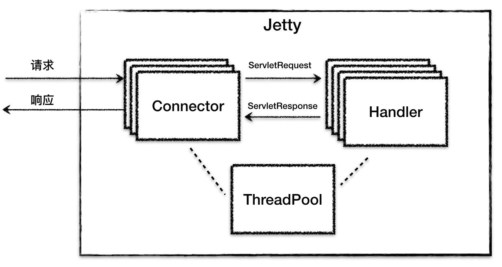
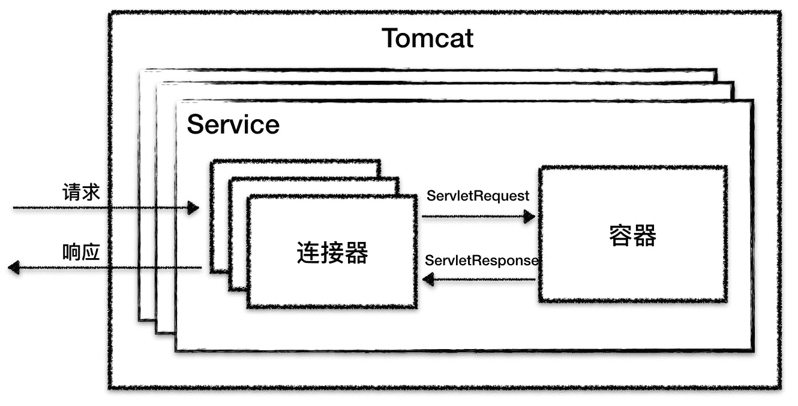
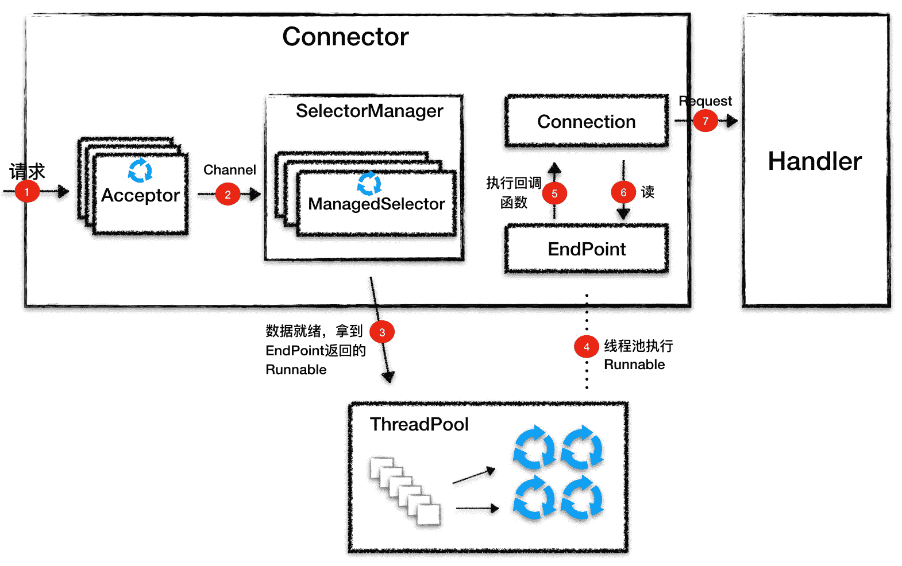

# 09 | 比较：Jetty架构特点之Connector组件

 

经过专栏前面几期的学习，相信你对 Tomcat 的整体架构和工作原理有了基本了解。但是 Servlet 容器并非只有 Tomcat 一家，还有别的架构设计思路吗？今天我们就来看看 Jetty 的设计特点。

Jetty 是 Eclipse 基金会的一个开源项目，和 Tomcat 一样，Jetty 也是一个“HTTP 服务器 + Servlet 容器”，并且 Jetty 和 Tomcat 在架构设计上有不少相似的地方。但同时 Jetty 也有自己的特点，主要是更加小巧，更易于定制化。Jetty 作为一名后起之秀，应用范围也越来越广，比如 Google App Engine 就采用了 Jetty 来作为 Web 容器。Jetty 和 Tomcat 各有特点，所以今天我会和你重点聊聊 Jetty 在哪些地方跟 Tomcat 不同。通过比较它们的差异，一方面希望可以继续加深你对 Web 容器架构设计的理解，另一方面也让你更清楚它们的设计区别，并根据它们的特点来选用这两款 Web 容器。

## 鸟瞰 Jetty 整体架构

简单来说，Jetty Server 就是由多个 Connector（连接器）、多个 Handler（处理器），以及一个线程池组成。整体结构请看下面这张图。



跟 Tomcat 一样，Jetty 也有 HTTP 服务器和 Servlet 容器的功能，因此 Jetty 中的 Connector 组件和 Handler 组件分别来实现这两个功能，而这两个组件工作时所需要的线程资源都直接从一个全局线程池 ThreadPool 中获取。

Jetty Server 可以有多个 Connector 在不同的端口上监听客户请求，而对于请求处理的 Handler 组件，也可以根据具体场景使用不同的 Handler。这样的设计提高了 Jetty 的灵活性，需要支持 Servlet，则可以使用 ServletHandler；需要支持 Session，则再增加一个 SessionHandler。也就是说我们可以不使用 Servlet 或者 Session，只要不配置这个 Handler 就行了。

为了启动和协调上面的核心组件工作，Jetty 提供了一个 Server 类来做这个事情，它负责创建并初始化 Connector、Handler、ThreadPool 组件，然后调用 start 方法启动它们。

我们对比一下 Tomcat 的整体架构图，你会发现 Tomcat 在整体上跟 Jetty 很相似，它们的第一个区别是 Jetty 中没有 Service 的概念，Tomcat 中的 Service 包装了多个连接器和一个容器组件，一个 Tomcat 实例可以配置多个 Service，不同的 Service 通过不同的连接器监听不同的端口；而 Jetty 中 Connector 是被所有 Handler 共享的。



它们的第二个区别是，在 Tomcat 中每个连接器都有自己的线程池，而在 Jetty 中所有的 Connector 共享一个全局的线程池。

讲完了 Jetty 的整体架构，接下来我来详细分析 Jetty 的 Connector 组件的设计，下一期我将分析 Handler 组件的设计。

## Connector 组件

跟 Tomcat 一样，Connector 的主要功能是对 I/O 模型和应用层协议的封装。I/O 模型方面，最新的 Jetty 9 版本只支持 NIO，因此 Jetty 的 Connector 设计有明显的 Java NIO 通信模型的痕迹。至于应用层协议方面，跟 Tomcat 的 Processor 一样，Jetty 抽象出了 Connection 组件来封装应用层协议的差异。

Java NIO 早已成为程序员的必备技能，并且也经常出现在面试题中。接下来我们一起来看看 Jetty 是如何实现 NIO 模型的，以及它是怎么**用**Java NIO 的。

**Java NIO 回顾**

关于 Java NIO 编程，如果你还不太熟悉，可以先学习这一[系列文章](http://ifeve.com/java-nio-all/)。Java NIO 的核心组件是 Channel、Buffer 和 Selector。Channel 表示一个连接，可以理解为一个 Socket，通过它可以读取和写入数据，但是并不能直接操作数据，需要通过 Buffer 来中转。

Selector 可以用来检测 Channel 上的 I/O 事件，比如读就绪、写就绪、连接就绪，一个 Selector 可以同时处理多个 Channel，因此单个线程可以监听多个 Channel，这样会大量减少线程上下文切换的开销。下面我们通过一个典型的服务端 NIO 程序来回顾一下如何使用这些组件。

首先，创建服务端 Channel，绑定监听端口并把 Channel 设置为非阻塞方式。

```
ServerSocketChannel server = ServerSocketChannel.open();server.socket().bind(new InetSocketAddress(port));server.configureBlocking(false);
```

然后，创建 Selector，并在 Selector 中注册 Channel 感兴趣的事件 OP_ACCEPT，告诉 Selector 如果客户端有新的连接请求到这个端口就通知我。

```
Selector selector = Selector.open();server.register(selector, SelectionKey.OP_ACCEPT);
```

接下来，Selector 会在一个死循环里不断地调用 select() 去查询 I/O 状态，select() 会返回一个 SelectionKey 列表，Selector 会遍历这个列表，看看是否有“客户”感兴趣的事件，如果有，就采取相应的动作。

比如下面这个例子，如果有新的连接请求，就会建立一个新的连接。连接建立后，再注册 Channel 的可读事件到 Selector 中，告诉 Selector 我对这个 Channel 上是否有新的数据到达感兴趣。

```
 while (true) {        selector.select();// 查询 I/O 事件        for (Iterator<SelectionKey> i = selector.selectedKeys().iterator(); i.hasNext();) {             SelectionKey key = i.next();             i.remove();              if (key.isAcceptable()) {                 // 建立一个新连接                 SocketChannel client = server.accept();                 client.configureBlocking(false);                                 // 连接建立后，告诉 Selector，我现在对 I/O 可读事件感兴趣                client.register(selector, SelectionKey.OP_READ);            }         }    } 
```

简单回顾完服务端 NIO 编程之后，你会发现服务端在 I/O 通信上主要完成了三件事情：**监听连接、I/O 事件查询以及数据读写**。因此 Jetty 设计了**Acceptor、SelectorManager 和 Connection 来分别做这三件事情**，下面我分别来说说这三个组件。

**Acceptor**

顾名思义，Acceptor 用于接受请求，跟 Tomcat 一样，Jetty 也有独立的 Acceptor 线程组用于处理连接请求。在 Connector 的实现类 ServerConnector 中，有一个`_acceptors`的数组，在 Connector 启动的时候, 会根据`_acceptors`数组的长度创建对应数量的 Acceptor，而 Acceptor 的个数可以配置。

```
for (int i = 0; i < _acceptors.length; i++){  Acceptor a = new Acceptor(i);  getExecutor().execute(a);}
```

Acceptor 是 ServerConnector 中的一个内部类，同时也是一个 Runnable，Acceptor 线程是通过 getExecutor() 得到的线程池来执行的，前面提到这是一个全局的线程池。

Acceptor 通过阻塞的方式来接受连接，这一点跟 Tomcat 也是一样的。

```
public void accept(int acceptorID) throws IOException{  ServerSocketChannel serverChannel = _acceptChannel;  if (serverChannel != null && serverChannel.isOpen())  {    // 这里是阻塞的    SocketChannel channel = serverChannel.accept();    // 执行到这里时说明有请求进来了    accepted(channel);  }}
```

接受连接成功后会调用 accepted() 函数，accepted() 函数中会将 SocketChannel 设置为非阻塞模式，然后交给 Selector 去处理，因此这也就到了 Selector 的地界了。

```
private void accepted(SocketChannel channel) throws IOException{    channel.configureBlocking(false);    Socket socket = channel.socket();    configure(socket);    // _manager 是 SelectorManager 实例，里面管理了所有的 Selector 实例    _manager.accept(channel);}
```

**SelectorManager**

Jetty 的 Selector 由 SelectorManager 类管理，而被管理的 Selector 叫作 ManagedSelector。SelectorManager 内部有一个 ManagedSelector 数组，真正干活的是 ManagedSelector。咱们接着上面分析，看看在 SelectorManager 在 accept 方法里做了什么。

```
public void accept(SelectableChannel channel, Object attachment){  // 选择一个 ManagedSelector 来处理 Channel  final ManagedSelector selector = chooseSelector();  // 提交一个任务 Accept 给 ManagedSelector  selector.submit(selector.new Accept(channel, attachment));}
```

SelectorManager 从本身的 Selector 数组中选择一个 Selector 来处理这个 Channel，并创建一个任务 Accept 交给 ManagedSelector，ManagedSelector 在处理这个任务主要做了两步：

第一步，调用 Selector 的 register 方法把 Channel 注册到 Selector 上，拿到一个 SelectionKey。

```
 _key = _channel.register(selector, SelectionKey.OP_ACCEPT, this);
```

第二步，创建一个 EndPoint 和 Connection，并跟这个 SelectionKey（Channel）绑在一起：

```
private void createEndPoint(SelectableChannel channel, SelectionKey selectionKey) throws IOException{    //1. 创建 Endpoint    EndPoint endPoint = _selectorManager.newEndPoint(channel, this, selectionKey);        //2. 创建 Connection    Connection connection = _selectorManager.newConnection(channel, endPoint, selectionKey.attachment());        //3. 把 Endpoint、Connection 和 SelectionKey 绑在一起    endPoint.setConnection(connection);    selectionKey.attach(endPoint);    }
```

上面这两个过程是什么意思呢？打个比方，你到餐厅吃饭，先点菜（注册 I/O 事件），服务员（ManagedSelector）给你一个单子（SelectionKey），等菜做好了（I/O 事件到了），服务员根据单子就知道是哪桌点了这个菜，于是喊一嗓子某某桌的菜做好了（调用了绑定在 SelectionKey 上的 EndPoint 的方法）。

这里需要你特别注意的是，ManagedSelector 并没有调用直接 EndPoint 的方法去处理数据，而是通过调用 EndPoint 的方法**返回一个 Runnable，然后把这个 Runnable 扔给线程池执行**，所以你能猜到，这个 Runnable 才会去真正读数据和处理请求。

**Connection**

这个 Runnable 是 EndPoint 的一个内部类，它会调用 Connection 的回调方法来处理请求。Jetty 的 Connection 组件类比就是 Tomcat 的 Processor，负责具体协议的解析，得到 Request 对象，并调用 Handler 容器进行处理。下面我简单介绍一下它的具体实现类 HttpConnection 对请求和响应的处理过程。

**请求处理**：HttpConnection 并不会主动向 EndPoint 读取数据，而是向在 EndPoint 中注册一堆回调方法：

```
getEndPoint().fillInterested(_readCallback);
```

这段代码就是告诉 EndPoint，数据到了你就调我这些回调方法 _readCallback 吧，有点异步 I/O 的感觉，也就是说 Jetty 在应用层面模拟了异步 I/O 模型。

而在回调方法 _readCallback 里，会调用 EndPoint 的接口去读数据，读完后让 HTTP 解析器去解析字节流，HTTP 解析器会将解析后的数据，包括请求行、请求头相关信息存到 Request 对象里。

**响应处理**：Connection 调用 Handler 进行业务处理，Handler 会通过 Response 对象来操作响应流，向流里面写入数据，HttpConnection 再通过 EndPoint 把数据写到 Channel，这样一次响应就完成了。

到此你应该了解了 Connector 的工作原理，下面我画张图再来回顾一下 Connector 的工作流程。



1.Acceptor 监听连接请求，当有连接请求到达时就接受连接，一个连接对应一个 Channel，Acceptor 将 Channel 交给 ManagedSelector 来处理。

2.ManagedSelector 把 Channel 注册到 Selector 上，并创建一个 EndPoint 和 Connection 跟这个 Channel 绑定，接着就不断地检测 I/O 事件。

3.I/O 事件到了就调用 EndPoint 的方法拿到一个 Runnable，并扔给线程池执行。

4. 线程池中调度某个线程执行 Runnable。

5.Runnable 执行时，调用回调函数，这个回调函数是 Connection 注册到 EndPoint 中的。

6. 回调函数内部实现，其实就是调用 EndPoint 的接口方法来读数据。

7.Connection 解析读到的数据，生成请求对象并交给 Handler 组件去处理。

## 本期精华

Jetty Server 就是由多个 Connector、多个 Handler，以及一个线程池组成，在设计上简洁明了。

Jetty 的 Connector 只支持 NIO 模型，跟 Tomcat 的 NioEndpoint 组件一样，它也是通过 Java 的 NIO API 实现的。我们知道，Java NIO 编程有三个关键组件：Channel、Buffer 和 Selector，而核心是 Selector。为了方便使用，Jetty 在原生 Selector 组件的基础上做了一些封装，实现了 ManagedSelector 组件。

在线程模型设计上 Tomcat 的 NioEndpoint 跟 Jetty 的 Connector 是相似的，都是用一个 Acceptor 数组监听连接，用一个 Selector 数组侦测 I/O 事件，用一个线程池执行请求。它们的不同点在于，Jetty 使用了一个全局的线程池，所有的线程资源都是从线程池来分配。

Jetty Connector 设计中的一大特点是，使用了回调函数来模拟异步 I/O，比如 Connection 向 EndPoint 注册了一堆回调函数。它的本质**将函数当作一个参数来传递**，告诉对方，你准备好了就调这个回调函数。

## 课后思考

Jetty 的 Connector 主要完成了三件事件：接收连接、I/O 事件查询以及数据读写。因此 Jetty 设计了 Acceptor、SelectorManager 和 Connection 来做这三件事情。今天的思考题是，为什么要把这些组件跑在不同的线程里呢？

不知道今天的内容你消化得如何？如果还有疑问，请大胆的在留言区提问，也欢迎你把你的课后思考和心得记录下来，与我和其他同学一起讨论。如果你觉得今天有所收获，欢迎你把它分享给你的朋友。


